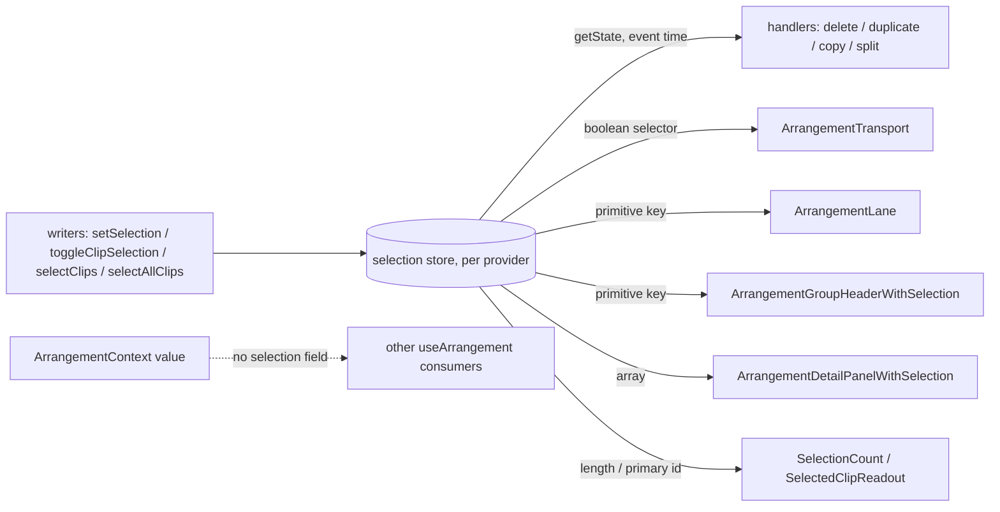

# კლიპების მონიშვნა საკუთარ selection store-ში: მონიშვნის ცვლილება მხოლოდ subscriber-ებს render-ავს (PERF-8b)

**თარიღი:** 2026-11-03
**სტატუსი:** Completed (C round 324 PASS)
**შეცვლილი პროექტი:** Store (`app/lib/arrangement/selection-store.ts`, `app/contexts/ArrangementContext.tsx`, `app/components/arrangement/StudioWorkspace.tsx`, `ArrangementLane.tsx`, `ArrangementTransport.tsx`, `perf/studio-lab-interactions.perf.spec.ts`, `perf/budgets.interactions.json`)

## კონტექსტი

PERF-8-ის მეორე ეტაპი (პირველი, PERF-8a, იყო range store, doc 230). `/studio-lab`-ში კლიპზე დაწკაპუნება, თუნდაც უკვე მონიშნულ კლიპზე, მთელ workspace-ს render-ავდა.

მექანიზმი (HEAD `53c5c79`, B-ის probe `b-round-321/click-hooks-probe.mjs`):

- `selectedClipIds` იყო `ArrangementProvider`-ის `useState`, მისი ასლი `latestRef`-ში და ველი context value-ს `useMemo`-ში და მის deps-ში.
- ყოველი `setSelection` ინახავდა ახალ array-ს equality შემოწმების გარეშე. `toggleInSelection` ყოველთვის ახალ array-ს აბრუნებს, ამიტომ უკვე მონიშნულ კლიპზე ხელახალი click-იც context value-ს ცვლიდა და ყველა `useArrangement()` consumer-ს render-ავდა.
- Dev probe-ით HEAD-ზე, ერთ lane-ზე ორი კლიპით: მეორე კლიპზე click → **105** rendered კომპონენტი; იმავე კლიპზე ხელახალი click → **92**, თუმცა ეკრანზე არაფერი იცვლება. Commit-ში ჩანდა ათი კომპონენტი, რომელთაც მონიშნულ კლიპზე არაფერი სჭირდებათ (`ArrangementRuler`, `ArrangementLibrary`, `ArrangementMaster` და სხვ.).

მომხმარებლისთვის ქცევა არ იცვლება. იცვლება მხოლოდ render-ის სამუშაო.

## მიდგომა

1. **ახალი მოდული `selection-store.ts`** (`zustand/vanilla`, იგივე ფორმა, რაც `range-store.ts`-ს აქვს, D-29z193/D-29z894). თითო `ArrangementProvider`-ს თავისი store აქვს (`useState(() => createArrangementSelectionStore())`), არასდროს module singleton.
2. **Order-sensitive equality guard.** `setSelectedClipIds(next)` ძველ reference-ს ინარჩუნებს და არავის ატყობინებს, როცა `next`-ს იგივე სიგრძე და იგივე id-ები **იმავე რიგით** აქვს. რიგი მნიშვნელოვანია: `add` რეჟიმში `toggleInSelection` id-ს ბოლოში გადაიტანს, ეს კი primary კლიპს (`.at(-1)`, detail panel-ის კლიპი) ცვლის და notify **უნდა** მოხდეს.
3. **Context value-ს ფორმა (D-29z894 grant).** `selectedClipId`/`selectedClipIds` გავიდა `ArrangementContextValue`-დან, value-ს `useMemo`-დან და deps-იდან, `latestRef`-იდან და provider-ის `useState`-იდან. `activeTrackId` რჩება value-ში (PERF-10, D-29z891).
4. **Writer-ები** (`setSelection`, `setSelectedClipId`, `toggleClipSelection`, `selectClips`, `selectAllClips`) იგივე signature-ით რჩება. `setSelection` ერთი store write-ია (L49: `latestRef` mirror მოიხსნა, state write store-ში გადავიდა).
5. **Event-time read-ები** (`getSelectedClipIds()`, `primarySelectedClipId()` და `StudioWorkspace`-ის handler-ები) `store.getState()`-ს კითხულობს, render snapshot-ს არა.
6. **Selector-ის წესი.** Selector აბრუნებს store-ის array reference-ს, primitive-ს ან boolean-ს, არასდროს ახალ array-ს, `Set`-ს ან object-ს. `ArrangementTransport` ერთ boolean-ს ირჩევს ("კლიპი მონიშნულია"). `ArrangementLane` და group header იყენებს primitive key-ს (`selectedClipIdsKeyAmong`), Set კი `useMemo`-ში აიგება.
7. **`StudioWorkspace` top level-ზე selection-ს აღარ უსმენს.** მისი render-time გამოყენებები გადავიდა პატარა subscriber კომპონენტებში იმავე ფაილში: `ArrangementSelectionCount`, `ArrangementSelectedClipReadout`, `ArrangementGroupHeaderWithSelection`, `ArrangementDetailPanelWithSelection`. ბოლო ორი `function XInner` + `const X = memo(XInner)` ფორმითაა (round 323, D-29z899), ამიტომ ისინი render-დება მხოლოდ მაშინ, როცა მათი prop-ები ან selection იცვლება.
8. **Async წესი და selector-ის key.** `await`-ის შემდეგ კოდი ახლად შექმნილ კლიპს არ მონიშნავს, სანამ history-ის განახლება ხილული არ გახდება, ან selection-ის ჩაწერას გადადებს. `selectedClipIdsKeyAmong`-ის key ეყრდნობა იმას, რომ კლიპის id არასდროს შეიცავს U+0000 სიმბოლოს.

### განხილული ალტერნატივები

- **ერთი store `selectedClipIds`-ისა და `activeTrackId`-ისთვის** (`tech-lead`): ჩაწერილია სიგნალად `SIG-R322-ACTIVE-TRACK-STORE` PERF-10-ისთვის. ერთი გაზომვადი ცვლილება თითო მოგებაზე (`performance-optimizer`).
- **Set-ად შედარება equality guard-ში:** უარყოფილია, რადგან primary კლიპის ცვლილებას ჩაყლაპავდა (mutant MU-UNORDERED-GUARD).

### გადაწყვეტილებები (rulings)

- **D-29z894:** `selectedClipId`/`selectedClipIds` leave `useArrangement()`; read them with `useArrangementSelection`.
- **D-29z897 (round 323 §1):** `render-budget.test.tsx` R9-L2: `selectClip` აღარ ცვლის context value-ს (`toBe`); positive control გადავიდა `setStatus('Positive control')`-ზე.
- **D-29z899:** ორივე selection wrapper memo ფორმითაა; prop-ები ორივე call site-ზე სტაბილურია.
- **D-29z904 (round 324 §1):** `render-budget.test.tsx` R11-P1e: positive control `ArrangementDetailPanel > 0` → `ArrangementTransport > 0`, და `ArrangementDetailPanel` `toBe(0)` (memo-ს ახალი contract).

## არქიტექტურა

## შეცვლილი ფაილები

- **ახალი:** `app/lib/arrangement/selection-store.ts`, `app/lib/arrangement/__tests__/selection-store.test.tsx`, `app/lib/arrangement/__tests__/selection-wrappers-render.test.tsx`, ეს doc.
- **შეცვლილი app:** `app/contexts/ArrangementContext.tsx`, `app/components/arrangement/StudioWorkspace.tsx`, `ArrangementLane.tsx`, `ArrangementTransport.tsx`.
- **შეცვლილი ტესტები:** `b-round-321/selection-test-files.txt`-ის 29 ფაილი (მხოლოდ selection-ის წაკითხვის გზა) და `render-budget.test.tsx` (R9-L2 და R11-P1e).
- **Perf:** `perf/studio-lab-interactions.perf.spec.ts` (ახალი ბოლო ნაბიჯი `measureSelectSameLane`), `perf/budgets.interactions.json` (5 ახალი row).
- **Docs:** `168-perf-interactions-baseline.md` (`## მეტრიკები`), `230-perf-range-store.md` (l.4 და ერთი ruling).

## პრობლემები და გადაწყვეტები

- **Problem:** B-ის type-only sketch-ზე 81 ფაილი `StudioWorkspace`-ის crash-ით ვარდებოდა, ამიტომ `render-budget.test.tsx`-ის R9-L2 positive control (selection-ის ცვლილება) არ ჩანდა (A STOP 322, C-R322-01).
  **Solution:** positive control გადავიდა value-ს შემცვლელ trigger-ზე (`setStatus`), და დაემატა negative row (`selectClip`-ის შემდეგ value იგივეა, Ruler/Library 0).
- **Problem:** detail wrapper-ის memo-მ R11-P1e-ის positive control (`ArrangementDetailPanel > 0`) გააყალბა (A STOP 323, C-R323-01).
  **Solution:** control გადავიდა `ArrangementTransport`-ზე (ის `isPlaying`-ს კითხულობს), და `ArrangementDetailPanel` `toBe(0)` row memo-ს აფიქსირებს (mutant MU-DETAIL-NO-MEMO მას წითლად აქცევს).
- **Problem:** group header-ის memo-ს არც ერთი ტესტი არ აფიქსირებდა (C-R323-02).
  **Solution:** ახალი ფაილი `selection-wrappers-render.test.tsx`, row-ები SS8a/SS8b, mutant MU-GROUP-HEADER-NO-MEMO.
- **Problem:** round 324-ის task-ის K19 claim-ი (`grep -c '"interact\.select'` ≥ 5) ვერ სრულდებოდა ზუსტად დასახელებული row-ებით: live row-ის id `interact.harness.select-same-lane-live`-ია, ამიტომ grep 4-ს აბრუნებს.
  **Solution:** B-ის ruling D-29z912 (a): 4 ამ ბრძანების სწორი შედეგია, ხუთივე row-ის id ადგილზეა და budgets-ის diff მხოლოდ ხაზებს ამატებს. ეს B-ის spec-ის ხარვეზი იყო, retroactive FAIL არ არის (C-R324-01 `closed_ruled`).

## ტესტირება

- **Unit (vitest):**
  - `selection-store.test.tsx`: SS1 (`NO_SELECTION`-ით დაწყება, ზუსტი reference), SS2 (იგივე რიგი → ძველი reference და notify არა; სხვა რიგი → notify ერთხელ), SS3 (ორი store და ორი provider დამოუკიდებელია), SS4 (ერთ lane-ზე მონიშვნის გადატანისას `useArrangement()` probe არ render-დება, selection probe ზუსტად ერთხელ), SS5 (ხელახალი `selectClip` → 0 render), SS6 (event-time `deleteSelection` ახალ მონიშვნას კითხულობს), SS7 (primary = ბოლოს დამატებული; `add` რეჟიმში ხელახლა დამატებული id ბოლოში გადადის და primary ხდება, როგორც HEAD-ის `toggleInSelection`-ში).
  - `selection-wrappers-render.test.tsx`: SS8a (დაკეცილი group header არ render-დება `setStatus` commit-ზე; positive control `ArrangementTransport > 0`), SS8b (Ctrl+A → header render-დება და ყველა overview block-ს `data-overview-selected="true"` აქვს; group დაკეცილი რჩება).
  - `render-budget.test.tsx`: R9-L2 და R11-P1e (იხ. rulings).
- **Mutants** (scratch copy-ზე, A round 324): MU-NO-EQUAL-GUARD → SS2, SS5; MU-UNORDERED-GUARD → SS2, SS7; MU-SELECTION-IN-VALUE → SS4; MU-STALE-SELECTION-READ → SS6; MU-DETAIL-NO-MEMO → R11-P1e; MU-GROUP-HEADER-NO-MEMO → SS8a (SS8b მწვანე რჩება). შედეგები: `a-round-324.md`.
- **Perf (production build, A-ის run, round 324):** `interact.select.same-lane.30.components` HEAD `53c5c79` 107 (per commit 105,2,0) → A 25 (23,2,0); `interact.select.reclick.30` HEAD 2 commit / 92 კომპონენტი → A 1 commit / 0; `interact.harness.select-same-lane-live` 1 ორივეზე; `failures` [] ორივეზე. `interact.click.components` 103 → 106 და fade/trim/move drag-ის `move-components-per-move` +2: ზედმეტი სახელები მხოლოდ selection subscriber-ებია (dev name probe). zoom და play/stop components 2-ით ნაკლებია. C-ის run ავტორიტეტულია
- **C-ის browser row-ები:** PERF-SELECT, PERF-LOAD, SELECT-NAMES, DUP-NAMES, S2-VIDEO, S-CLICK, S-EDIT, S-DETAIL, S-TRANSPORT, S-RANGE, S-GROUP, WAV export-ის byte შედარება და G324-AUTH; ორივე viewport, HEAD-თან შედარებით (`c-round-324.md`).

## TODO / შემდეგი ნაბიჯები

- **PERF-10:** `activeTrackId` (`SIG-R322-ACTIVE-TRACK-STORE`) და harness-ის `interact.click.components`; `A-R322-ARCH-SELECTION-WRAPPERS` (ოთხი in-file wrapper `StudioWorkspace.tsx`-ში, დაახლოებით 190 ხაზი); `SIG-R323-R9L2-CONTROL-SOURCE`.
- **Root:** `ARCH-CHECKPOINT-PERF8-STORE-PATTERN` ამ საზღვარზე პასუხგაცემადია (არ ბლოკავს).
