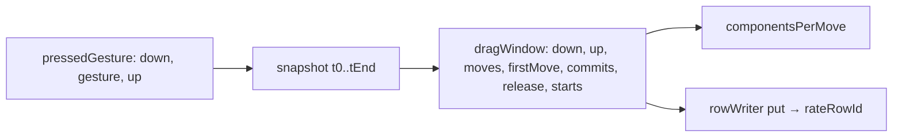

# perf harness-ის drag ფანჯრის ერთი helper და გათავისუფლებული ღილაკი (SYS-R336-PERF-DRAG-WINDOW)

**თარიღი:** 2026-11-04
**სტატუსი:** Completed (C round 337 PASS)
**შეცვლილი პროექტი:** Store (`perf/studio-lab-interactions.perf.spec.ts`, `perf/budgets.interactions.json` notes, docs 168 და 233)

## კონტექსტი

RETRO 336-მა (D-29z1019) interactions perf harness-ის ექვსი ჩანაწერი ერთ systemic task-ად გააერთიანა. ექვსივე spec-ში, მის budget notes-სა და doc 168-შია:

- **ARCH-R335-DRAG-WINDOW-HELPER:** `measureDrag` და `measureLaneDrag` თითოეული ცალკე ითვლიდა pointerdown/pointerup-ს, პირველ move-ს, whole window-ს, release-სა და `start()`-ებს და თავის `put` ფუნქციას აცხადებდა.
- **GATE335-S1-MOUSE-UP-FINALLY:** თუ `mouse.down()`-ის შემდეგ წაკითხვა exception-ს ისვრის, `mouse.up()` აღარ სრულდებოდა.
- **GATE335-S3-LANE-SEGMENT-CONSTANTS:** lane drag-ი `dragSteps / 6`-სა და `dragDistancePx / 3`-ს იყენებდა, რაც ზუსტია მხოლოდ 60-სა და 120-ზე.
- **GATE335-S4-REPEATED-NOTES:** ერთი და იგივე ≈180 სიმბოლოიანი gesture-ის წინადადება 26 lane note-ში მეორდებოდა.
- **A-R335-REVIEW-WHOLE-NOTE:** whole-window notes ისე იკითხებოდა, თითქოს პირველი move არ ითვლება; კოდი კი pointerdown-სა და pointerup-ს შორის ყველა move-ზე ყოფს.
- **INFO-A335-SEQUENCE-ORDER:** 30-კლიპიან `interactionSequence` ჩანაწერში Ctrl+wheel Space-მდე იყო დაწერილი, კოდი კი მას ბოლო Space-ის შემდეგ უშვებს.

იგივე root cause-ის გამო (L7) ძველი 32 drag note (`commits-per-move` ×16, `move-components-per-move` ×16) და doc 168-ის `## მეტრიკები`-ის ორი სტრიქონიც გასწორდა.

## მიდგომა

**სამი helper, მნიშვნელობის ცვლილების გარეშე:**
- `dragWindow(whole)` აბრუნებს `null`-ს ან `{ moves, firstMove, up, commits, release, moveStarts, releaseStarts }`-ს, HEAD-ის ზუსტი საზღვრებით: ბოლო pointerdown, მის შემდეგ პირველი pointerup; move-ები `downAt < t < up`; whole-window commit-ები და `start()`-ები `firstMove < t < up`; release `t >= up`.
- `rowWriter(result, baseId)` აბრუნებს `put`-ს, რომელიც `rateRowId`-ით წერს.
- `componentsPerMove(commits, count)` = `roundTo(count ? sumRendered(commits) / count : 0, 3)`.
- `pressedGesture(page, grab, gesture)`: გადაადგილება grab წერტილზე, `mouse.down()`, `gesture`. წარმატებისას ერთი `mouse.up()`; exception-ისას `mouse.up()` (მისი შეცდომა იყლაპება) და **პირველადი** შეცდომის ხელახლა სროლა.
- `laneSegmentSteps = 10` და `laneSegmentPx = 40` ცვლის `dragSteps / 6`-სა და `dragDistancePx / 3`-ს.

ორივე drag-ში წაკითხვებისა და in-page timestamp-ების რიგი HEAD-ის ტოლია (mid, end; t1, cross read, t2, back read, t3); `tUp` გათავისუფლებისთანავე იკითხება. `measureLaneDrag`-ის cross/lane ფანჯრები, `backMoves` და `measureDrag`-ის `commits-per-move` ფორმულა უცვლელია (RV-4 არ გამოყენებულა).

**GATE335-S1-ის წანამძღვრის შემოწმება (D-29z1025):** drag ფუნქციებში `try` არ არის, ერთადერთი `try` pass-ში `runInteractionPass`-ისაა: მისი `catch` წერს `abortedAt`-ს, `finally` კი context-ს ხურავს. ამიტომ exception `mouse.down()`-ის შემდეგ მთელ pass-ს წყვეტს და „შემდეგი ნაბიჯი gesture-ის შუაში იწყება“ დღეს არ ხდება. გათავისუფლება hygiene-ია: ჩანაწერი პატიოსანი რჩება და მომავალ catch-and-continue-ს დასჭირდება. დაკვირვებადი შედეგი: in-page instrumentation (`state.ups`) ბოლო pointerdown-ის შემდეგ pointerup-ს აფიქსირებს მხოლოდ გათავისუფლების შემთხვევაში.

**Budget notes (D-29z1026, L4):** SYS-R336-ის notes-only grant უპირატესია ARCH-R335-ის „უცვლელ `budgets.interactions.json`“-ზე. 193 სტრიქონის ყოველი არა-`note` ველი და რიგი უცვლელია; იცვლება ზუსტად 58 `note`. 26 lane note-ში gesture-ის წინადადება მოკლე მითითებად იქცა („Lane drag (gesture: the 'lane drag' entries of interactionSequence; doc 168).“). whole-window მნიშვნელი ყველგან ასე იწერება: „/ all pointermoves between the in-page pointerdown and pointerup, the first one included“.

უარყოფილი ვარიანტები: budget generator ან schema-ს ცვლილება (generator არ არსებობს, `perf/lib/**` ფარგლებს გარეთაა); `commitsPerMove` helper (RV-4, ფორმულის ცვლილების რისკი).

## არქიტექტურა

## შეცვლილი ფაილები

- `perf/studio-lab-interactions.perf.spec.ts`
- `perf/budgets.interactions.json` (მხოლოდ 58 `note`)
- `docs/implementation/2026/quarter-IV/168-perf-interactions-baseline.md` (მხოლოდ `## მეტრიკები`)
- `docs/implementation/2026/quarter-IV/233-sys-r336-perf-drag-window.md` (ახალი)

## პრობლემები და გადაწყვეტები

- **Problem:** gate reviewer-ის წანამძღვარი („ღილაკი დაჭერილი რჩება და შემდეგი ნაბიჯი gesture-ის შუაში იწყება“) კოდში არ დადასტურდა. → **Solution:** acceptance დაკვირვებად შედეგზე გადავიდა: pass-ის `catch`-ში წაკითხული `state.ups` (mutants P/M).
- **Problem:** „EQUAL“ შედარება pre-fix tree-ზე ტრივიალურად გადის (L58). → **Solution:** mutant D (`measureDrag`-ის per-move ÷ `moves.length - 1`) ამტკიცებს, რომ შედარება მნიშვნელობის ცვლილებაზე წითლდება.
- **Problem:** `pressedGesture`-ის catch-ში `mouse.up()`-ის შეცდომა პირველად შეცდომას დამალავდა. → **Solution:** release-ის შეცდომა იყლაპება და პირველადი ხელახლა ისროლება (RV-1).

## ტესტირება

A-ის production perf run (spec მარტო, L38, `a-round-337/perf.log`): rc 0, 193 სტრიქონი, `complete` true, `failures` [], 36/36 asserted სტრიქონი გადის, liveness სტრიქონები (`interact.harness.drag-*-live`, `.6x` ასლები, `hook-live`) ყველა pass-ში 1-ია (6.7 წთ).

- `perf-rowcmp.py` vs C round 335-ის `latest-interactions.json`: **139 `EQUAL`, 0 `DIFF`, 0 `NEW`**; `rowids-equal.py`: `ids-equal 193`.
- `notes-only-check.py`: `ids equal order equal nonnote-diffs 0 notes-changed 58 matches-expected True`.
- `perf/lib/report.test.ts` scratch config-ით (GATE304-M1): 34/34 pass.
- Mutants (1 pass, 1×, scratch ასლებზე):
  - **P** (injected throw, release დარჩა): pass წყდება `drag lane stopped`-ზე `MU-INJECT-THROW`-ით; `MU-PROBE up-after-last-down true`.
  - **M** (injected throw, catch-ში release არ არის): იგივე წყვეტა; `MU-PROBE up-after-last-down false`.
  - **D** (per-move ÷ `moves.length - 1`): `rowcmp-1x.py`: 9 `DIFF` (range, fade, trim და move-ის 1× `move-components-per-move`, stopped და playing, და `interact.drag.fade.30.playing.move-components-per-move`), 73 `EQUAL`.
- `npm run typecheck` rc 0; `npm run lint` rc 0 (205 warnings, 1 info, უცვლელი).

## TODO / შემდეგი ნაბიჯები

- PERF-DRAG-PREVIEW c3-ii: `clipLaneDrag` store და lane row-ების `assert`-ზე გადაყვანა.
- RV-4 (`commitsPerMove` helper) — მომავალი შესაძლებლობა, არა ამ რაუნდის.
- ROOT-REQ-VITEST-PERF-INCLUDE (GATE304-M1): `perf/lib` ტესტები gate-ში — root-ის საქმე.
