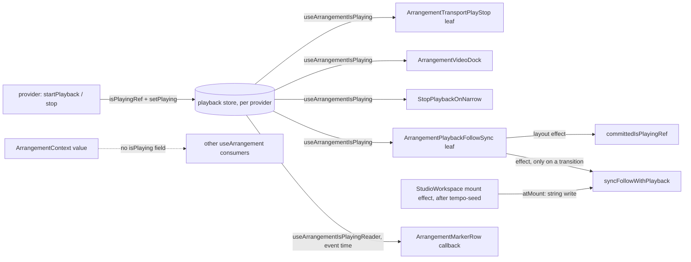

# `isPlaying` საკუთარ playback store-ში: Play და Stop აღარ render-ავს მთელ workspace-ს (PERF-10a)

**თარიღი:** 2026-11-05
**სტატუსი:** Completed (C round 364 PASS)
**შეცვლილი პროექტი:** Store (`app/lib/arrangement/playback-store.ts`, `app/lib/arrangement/selection-store.ts`, `app/contexts/ArrangementContext.tsx`, `app/components/arrangement/StudioWorkspace.tsx`, `ArrangementLane.tsx`, `ArrangementLibraryPreview.tsx`, `ArrangementTransport.tsx`, `ArrangementVideoDock.tsx`, `ArrangementMarkerRow.tsx`, `app/routes/studio-lab.tsx`)

## კონტექსტი

PERF-10-ის პირველი ეტაპი. `/studio-lab`-ში Space-ით Play და Stop თითოეული ერთ commit-ს აკეთებდა **70** კომპონენტით (B-ის dev names probe, `b-round-356/play-click-names-head.json`; C356-ის production run: `interact.play.start-components` და `interact.play.stop-components` 70, 1× და 6×).

მიზეზი: `isPlaying` იყო `ArrangementProvider`-ის `useState`, context value-ს ველი და value-ს `useMemo`-ს dep. ყოველი Play/Stop ცვლიდა value-ს და ყველა `useArrangement()` consumer-ს render-ავდა: `StudioWorkspace`, lane-ები, ruler, library, video dock, master.

`isPlaying`-ს მხოლოდ ხუთი ფაილი კითხულობს: `ArrangementTransport` (render: label, `data-playing`), `ArrangementVideoDock` (effect), `ArrangementMarkerRow` (მხოლოდ callback), `studio-lab.tsx`-ის `StopPlaybackOnNarrow` (effect, null render) და `StudioWorkspace` (Follow effect და event-time read-ები).

მომხმარებლისთვის ქცევა არ იცვლება: ტექსტები, `data-playing`, accessible name-ები, Follow და ვიდეოს სინქრონი იგივეა. იცვლება მხოლოდ render-ის სამუშაო.

## მიდგომა

1. **ახალი მოდული `playback-store.ts`** (`zustand/vanilla`, იგივე ფორმა, რაც `selection-store.ts`-ს და `status-preview-store.ts`-ს აქვს). State: `{ isPlaying, setPlaying }`. `setPlaying` იგივე მნიშვნელობაზე იმავე state object-ს აბრუნებს, ამიტომ subscriber-ები notify არ ხდება. თითო provider-ს თავისი store აქვს (`useState(() => …)`), არასდროს module singleton (SSR).
2. **Provider.** `useState(false)` შეიცვალა store-ით. ორივე ჩაწერის ადგილზე `isPlayingRef.current` და `playbackStore.getState().setPlaying(…)` ერთმანეთის გვერდითაა, იმავე რიგით, რაც HEAD-ზე. `isPlaying` ამოღებულია `ArrangementContextValue` type-იდან, value-დან და deps-იდან. დაემატა `ArrangementPlaybackContext` და ორი hook: `useArrangementPlaybackStore()` (provider-ის გარეთ throw) და `useArrangementIsPlaying()`.
3. **Consumer-ები.** `ArrangementTransport`, `ArrangementVideoDock` და `StopPlaybackOnNarrow` იძახებს `useArrangementIsPlaying()`-ს. Video dock-ის effect-ები უცვლელია, შეიცვალა მხოლოდ `isPlaying`-ის წყარო. `ArrangementMarkerRow` არ subscribe-დება: callback კითხულობს `playbackStore.getState().isPlaying`-ს.
4. **`StudioWorkspace` top level-ზე არ subscribe-დება.** ახალი memo leaf `ArrangementPlaybackFollowSync` (`function ArrangementPlaybackFollowSyncInner` + `memo`) status `<output>`-ის შემდეგ render-დება და DOM-ს არ ქმნის. მისი layout effect წერს `committedIsPlayingRef.current = isPlaying`-ს, ხოლო `useEffect` იძახებს `syncFollowWithPlayback(isPlaying)`-ს, რომელიც HEAD-ის Follow effect-ის სხეულია `useCallback`-ად. Leaf-ის effect მხოლოდ **გადასვლაზე** ისვრის: `syncedRef` ინახავს ბოლო მნიშვნელობას და იგივე მნიშვნელობაზე (mount-ის ჩათვლით) არაფერს აკეთებს. `workspaceRef.current.isPlaying`-ის შვიდი event-time read ახლა `committedIsPlayingRef.current`-ს კითხულობს.
5. **Stop branch-ის status.** ჯერ მოწმდება ნაჩვენები status ზუსტად ისე, როგორც HEAD-ზე (preview, თორემ committed). თუ HEAD არ დაწერდა, არაფერი იწერება (`stop-commits` რჩება 1). Preview-ს შემთხვევაში რჩება string write. სხვა შემთხვევაში იწერება functional form, რომელიც რიგში მდგომ ტექსტს ხელახლა ამოწმებს, ამიტომ stop-ის საკუთარი message (მაგ. ვიდეოს შეცდომა) Follow pause-ის შემდეგაც რჩება.
6. **Mount-ის სინქრონი HEAD-ის ადგილზე (C-R357-01, B-ის ruling (b)).** `StudioWorkspace`-ში `useEffect(() => syncFollowWithPlayback(committedIsPlayingRef.current, true), [syncFollowWithPlayback])` გამოცხადებულია `syncFollowWithPlayback`-ის შემდეგ, ანუ tempo-seed effect-ის **შემდეგ**, სადაც HEAD-ის Follow effect იდგა. `atMount = true`-ზე stopped branch წერს HEAD-ის **string**-ს (`setStatus(describeSpaceStart())`), ამიტომ remount-ზე ტექსტი და `statusSequence`-ის bump HEAD-ის ტოლია. გადასვლებზე რჩება functional form (პუნქტი 5). Ref-ის წაკითხვა უსაფრთხოა: leaf-ის layout effect ref-ს იმავე commit-ის ნებისმიერ passive effect-მდე წერს.

### განხილული ალტერნატივები

- **`get isPlaying()` getter value-ზე** (B-ის პირველი sketch): ტესტების sweep არ სჭირდებოდა, მაგრამ spread probe (`{ ...useArrangement() }`) getter-ს ერთხელ აკოპირებს და stale ხდება (`b-round-356/precheck-full-getter-variant-killed.log`). უარყოფილია; ამოღებისას `tsc` ყველა გამოტოვებულ reader-ს პოულობს.
- **`store.subscribe` ან `getState()` `StudioWorkspace`-ში** (`performance-optimizer`): synchronous subscriber provider-ის `setStatus`/`updatePosition`-მდე ისვრის, ამიტომ position subscriber "playing"-ს `autoScrollLeftRef`-ის დაყენებამდე დაინახავდა. Leaf ინარჩუნებს HEAD-ის post-commit timing-ს.
- **Functional status write ყოველთვის:** `interact.play.stop-commits` 1 → 2 (`b-round-356/perf-sketch-final-v1-results/`). უარყოფილია.
- **Remount-ის სხვაობის მიღება შეგნებულ გადახრად (C-R357-01, ვარიანტი (a)):** tempo-seed-ის ტექსტი remount-ის შემდეგაც დარჩებოდა და status ხელახლა აღარ გამოცხადდებოდა. უარყოფილია (D-29z1156): PERF-10a ქცევის ცვლილებას არ გვპირდება, ხოლო tempo-seed-ის remount-ზე ხელახალი გაშვება ცალკე, უკვე არსებული ხარვეზია (A-R357-TEMPO-SEED-REMOUNT-DUP).

### ეტაპი 2: PERF-10a-BUDGETS (round 360, D-29z1165)

ეტაპ 1-მა Play/Stop 28 კომპონენტამდე ჩამოიყვანა, მაგრამ `interact.play.*`-ის ხუთი 1× row `record` დარჩა. D-29z1151-მა PERF-CAND-FADE-RELEASE-COMMITS ფიქსის გარეშე დახურა და `tech-lead`-ის შეთავაზება გადმოიტანა: audio და video fade-ის `release-commits`-ის ზედა ზღვარი `<= 3`, stopped და playing. ეს ეტაპი კოდიდან მხოლოდ `perf/budgets.interactions.json`-ს ცვლის (B-ის `b-round-359/sketch/budgets.patch.txt`, უცვლელად), დამატებით docs 234 და 232-ს; app-ის კოდი არ იცვლება.

| Row | ძველი mode | budget | გაზომვა (C358 / C359 / B-ის sketch, 3 sample თითოეულში) |
|---|---|---|---|
| `interact.play.start-commits` | record | `== 1` | 1 / 1 / 1 |
| `interact.play.start-components` | record | `<= 28` | 28 / 28 / 28 |
| `interact.play.start-sources` | record | `== 1` | 1 / 1 / 1 |
| `interact.play.stop-commits` | record | `== 1` | 1 / 1 / 1 |
| `interact.play.stop-components` | record | `<= 28` | 28 / 28 / 28 |
| `interact.drag.fade.stopped.release-commits` | record | `<= 3` | 3 / 3 / 3 |
| `interact.drag.fade.playing.release-commits` | record | `<= 3` | 2 / 2 / 2 |
| `interact.drag.video-fade.stopped.release-commits` | record | `<= 3` | 2 / 2 / 2 |
| `interact.drag.video-fade.playing.release-commits` | record | `<= 3` | 2 / 2 / 2 |

ცხრა row-ის owner ახლა `PERF-10a-BUDGETS`-ია; თითო note ინარჩუნებს პირველ წინადადებას და იძენს ერთს, რომელიც რაუნდს, გადაწყვეტილებას და გაზომვას ასახელებს. assert row-ები 84 → 93 (252-დან).

**Budget-ის წესები:**
- commit-ების ან `start()`-ების რაოდენობა `== 1`-ია, როგორც trim-ისა და move-ის release row-ებზე round 348-იდან. `<= 1` მიიღებდა Play-ს, რომელიც საერთოდ არ აკეთებს commit-ს (TL-R360-1).
- კომპონენტების ჯამი `<=` გაზომილ მნიშვნელობაზეა, მარაგის გარეშე, რადგან deterministic-ია (round 348-ის წესი).
- fade-ის release-ის რაოდენობა `<= 3`-ია (D-29z1151). ეს ზედა ზღვარია და არა ზუსტი მნიშვნელობა.

**Rulings (D-29z1165):**
- **ორაკული C359-ია და არა C358.** C359-მა გაზომა HEAD `a977b97`-ის app კოდი, ანუ ამ ეტაპის baseline. ორივე run-ის მნიშვნელობები ტოლია.
- **`.6x` ასლები `record` რჩება.** ცხრა row-დან `.6x` ასლი შვიდს აქვს (video fade-ის ორი row მხოლოდ 1×-ზე იზომება). მათი sample-ები ორივე run-ში 1×-ის ტოლია; ეს L37-ის loaded replicate-ია. თითო rate-ს ტოლი sample-ების შემოწმება `record` mode-შიც აქვს (TL-R360-4), ამიტომ assert იმავე მიზეზზე მხოლოდ მეორე, კორელირებულ ჩავარდნას დაამატებდა. ტესტირების სექციის წინადადება მოსალოდნელ მნიშვნელობებზე 1×-სა და 6×-ზე ისევ მართებულია.
- **`interact.play.start-sources` არის `== 1`.** ის ითვლის `start()`-ის გამოძახებებს harness-ის play სცენარის Play-ის ფანჯარაში; მეორე `start()` graph-ის restart-ია (mutant M-P3).
- **ტოლი sample-ები უკვე მოწმდება.** `perf/lib/report.ts` ნებისმიერ `deterministic` row-ს `exact` კონტრაქტით (ამ ცხრა row-ის ერთეულები: count, components, `start()` calls), რომლის სამი sample განსხვავდება, `record` mode-შიც აგდებს (TL-R360-1, TL-R360-5). ამიტომ assert flake-ის ახალ კლასს არ ამატებს.
- **doc 232-ის fade-ის წინადადებები ისტორიაა.** doc 232-ის პუნქტები 90 და 228 round 347/348-ის მდგომარეობას აღწერს და დათარიღებულ ჩანაწერად რჩება. ოთხი fade release row-ის მოქმედი კონტრაქტი ეს სექციაა; doc 232-ს ემატება TODO bullet, რომელიც აქ მიუთითებს.

**B-ის sketch run-ები** (production, მარტო, თანმიმდევრობით; `b-round-359/perf-summary.txt`; პროგნოზები run-ებამდე `b-round-359/checkpoint.md`-შია):
- **Sketch:** rc 0, 252 row, 93/93 assert გადის, 0 NEW, C359-თან 0 განსხვავებული row (`b-round-359/perf-rowcmp-sketch-vs-c359.txt`), `durationMs` 435487. PERF-LIB 40/40.
- **MU-A = M-P1 + M-P3** (M-P1: `StudioWorkspace` top-level-ზე იძახებს `useArrangementIsPlaying()`-ს; M-P3: `startPlaybackAt` `startGraph`-ს ორჯერ იძახებს): rc 1, 90/93. წითელია ზუსტად სამი პროგნოზირებული row: `play.start-components` და `play.stop-components` 70 (> 28), `play.start-sources` 2 (≠ 1).
- **MU-B = M-P2 + M-F1** (M-P2: `setStatus` `setPlaying`-იდან 100 ms-ში start-სა და stop-ში; M-F1: ორი `setStatus` `fadeCommitted`-იდან 100 და 200 ms-ში `ArrangementClip.finishGesture`-ში, რომელსაც audio და video fade იზიარებს): rc 1, 85/93. წითელია ექვსი პროგნოზირებული row: `play.start-commits` და `play.stop-commits` 2; fade stopped 5, fade playing 4, video-fade stopped 4, video-fade playing 4. დამატებით წითელია `play.start-components` და `play.stop-components` 99, რადგან status-ის ჩაწერა provider-ის value-ს ცვლის და მის consumer-ებს render-ავს (checkpoint-ში შესაძლო შედეგად იყო ჩაწერილი).
- ორივე mutant-ში არსებული `.6x` ასლები 1× row-ებთან ერთად შეიცვალა (`record`, არა წითელი); ყველა მნიშვნელობა სამივე sample-ში მეორდებოდა. `== 1`-ის 0-commit-იან მხარეს mutant არ ამოწმებს (TL-R360-3, info).

### ეტაპი 3: PERF-10b-i (round 361, D-29z1170)

**Premise (გაზომილი, L37).** `activeTrackId` provider-ის `useState` იყო და `ArrangementContextValue`-ის ველი, ამიტომ მისი ყოველი ცვლილება მთელ context value-ს ცვლიდა. C360-ზე clip-ზე click, რომელიც active lane-საც ცვლის, ერთ commit-ში **83** კომპონენტს render-ავდა (`interact.click.components`, perCommit `83,0`, ×3 1×-სა და 6×-ზე). იმავე lane-ზე click, რომელიც მხოლოდ selection-ს ცვლის (PERF-8b-იდან უკვე store), **15**-ს render-ავდა (`interact.select.same-lane.30.components`). სხვაობა active track-ის ცვლილებაა.

**დიზაინი (`b-round-360/sketch-review.md`; B-ის sketch უცვლელად):**
- **ერთი store და არა მე-13 (TL-R361-1).** `activeTrackId` და `setActiveTrackId` `app/lib/arrangement/selection-store.ts`-ის `ArrangementSelectionState`-ში შევიდა. setter ტოლ id-ზე ძველ state-ს ტოვებს (guard). `createArrangementSelectionStore(initial, initialActiveTrackId)` მას seed-ავს; provider პირველი **audio** track-ით seed-ავს, როგორც ადრე `useState`-ის initialiser.
- **ველი context value-დან და `useMemo`-ს ორივე dependency სიიდან ამოვიდა.** provider-ის `setActiveTrackId` store-ში წერს. handler-ები (library add, paste) `selectionStore.getState().activeTrackId`-ს კითხულობს; `StudioWorkspace`-ის edge navigation (Alt+Arrow) იმავე store-ს `useArrangementSelectionStore()`-ით, key-ის დროს.
- **Subscriber-ები:**
  - `ArrangementLane`: `useArrangementSelection((state) => state.activeTrackId === track.id)`, boolean, ამიტომ მხოლოდ ის ორი lane render-დება, რომლის flag-იც იცვლება (TL-R361-3).
  - `ArrangementLibraryPreview`: ახალი hook `useArrangementActiveTrackId()` (`ArrangementContext.tsx`).
  - collapsed group-ის header: `containsActive` `ArrangementGroupHeaderWithSelectionInner`-ში გადავიდა (უკვე `XInner` + `memo`), boolean selector-ით `activeCandidateTrackIds`-ზე. `StudioWorkspace` ამ id-ებს collapsed group-ებზე `useMemo` map-იდან (`trackGroupActiveCandidates`) გადასცემს, დანარჩენს module constant-ს `NO_ACTIVE_CANDIDATE_TRACK_IDS`, არასდროს inline array-ს (TL-R361-2). `StudioWorkspace` render-ის დროს active track-ს აღარ კითხულობს.
- **Test probe-ები:** `useWorkspaceProbe` `activeTrackId: useArrangementActiveTrackId()`-ს ამატებს, როგორც `isPlaying`-ს; `ArrangementContextValue`-ზე typed ორი probe (`grid-snap-position.test.tsx`, `marker-time-snap-ui.test.tsx`) იმავე ველს ამატებს. არსებულ ტესტებში assert არ შეცვლილა.
- კომპონენტების memo ან rename არ ყოფილა; runtime სახელები `ArrangementLane`, `ArrangementLibraryPreview` და `ArrangementGroupHeaderWithSelectionInner` უცვლელია.

| Row | ძველი mode | budget | გაზომვა (C360 / B-ის sketch, 3 sample 1×-სა და 6×-ზე) |
|---|---|---|---|
| `interact.click.components` | record | `<= 42` | 83 / 42 (perCommit `42,0`) |
| `interact.click.commits` | record | `<= 2` | 2 / 2 |

ორივე row-ის owner `PERF-10b-i`-ია; assert row-ები 93 → 95 (252-დან).

**Budget-ის წესები (D-29z1170):**
- `<= 42` მარაგის გარეშეა: რაოდენობა deterministic-ია (round 348-ის წესი) და ექვს sample-ში ტოლია.
- `click.commits` `<= 2`-ია, ზედა ზღვარი. მეორე commit 0 კომპონენტს render-ავს და ახსნილი არ არის (PO-R361-2); click, რომელიც საერთოდ არ აკეთებს commit-ს, `interact.harness.click-live`-ზე ვარდება (fader უნდა გააქტიურდეს).
- `.6x` ასლები `record` რჩება (იგივე ruling, რაც round 360-ში: loaded replicate, საკუთარი ტოლი sample-ების შემოწმებით).
- **C-R360-NOTE-STALE** იმავე patch-ში გასწორდა: video fade-ის ორ note-ს მოაკლდა "Record until C measures it (…)", playing fade-ის note-ს კი "the third commit is intermittent". მხოლოდ note-ები; ამ row-ების mode და budget არ შეცვლილა.

**Mutant-ები** (B-ის, `b-round-360/mutants/`; პროგნოზები `b-round-360/checkpoint.md`-შია):

| Mutant | ცვლილება | წითელი |
|---|---|---|
| MU-1 | `StudioWorkspace` top-level-ზე იძახებს `useArrangementActiveTrackId()`-ს | perf `interact.click.components` 82 ×3 (> 42), 95-დან ერთადერთი ჩავარდნა |
| MU-2 | active track-ის provider `useState` mirror context value-ს deps-ში | მხოლოდ SS8 |
| MU-3 | store-ის setter-ს equality guard არ აქვს | მხოლოდ SS9 |
| MU-4 | seed ნებისმიერი ტიპის პირველი track-ია | მხოლოდ SS10 |
| MU-5 | paste active track-ის render-time snapshot-ს კითხულობს | მხოლოდ SS11 |
| MU-6 | group-ის leaf active track-ს არასდროს აცხადებს | მხოლოდ UC7 (perf harness-ში collapsed group არ არის: იქ მწვანეა, PO-R361-3) |
| MU-7 | provider-ის `setActiveTrackId` 100 ms-ში `setStatus`-საც იძახებს (`click.commits <= 2`-ის red-proof) | assert-იანი budget-ებით: `click.commits` 3 ×3 (> 2) და `click.components` 113 ×3 (`42,0,71`), როგორც იყო პროგნოზირებული; დამატებით 20 drag row წითელია (status-ის ჩაწერა მათ ფანჯრებში; ჩაწერილია, არ იყო პროგნოზირებული) |

**ამ ეტაპის გარეთ:**
- `SIG-R360-STATUS-WRITE-RENDERS-WORKSPACE`: status-ის ჩაწერა ისევ provider-ის value-ს ცვლის; PERF-11-ის input-ია.
- `TL-R361-ACTIVE-TRACK-DANGLING` (info): თუ active track-ის lane გაქრება, id არარსებულ track-ზე დარჩება. დღეს track-ის წაშლის გზა არ არსებობს, ამიტომ ეს ჩაწერილი ჰიპოთეზაა STEM-LANES-ისთვის; ქცევა უცვლელია.

### ეტაპი 4: PERF-10b-ii-a (round 362, D-29z1177)

**Premise (გაზომილი, L37).** PERF-10a-ის შემდეგ Play და Stop თითოეული **28** კომპონენტს render-ავდა (`interact.play.start-components` / `interact.play.stop-components`, C361 28 ×3 1×-სა და 6×-ზე). მიზეზი: `ArrangementTransport` თავის top-level-ზე იძახებდა `useArrangementIsPlaying()`-ს, ამიტომ ყოველ Play-სა და Stop-ზე მთელი Transport-ის body render-დებოდა (undo/redo, edit, loop, zoom, Follow და ყველა icon), თუმცა `isPlaying`-ს მხოლოდ Play ღილაკი, Stop ღილაკი და დამალული state span კითხულობს. ამასთან exported `useArrangementPlaybackStore()` მთელ playback store-ს, `setPlaying`-ის ჩათვლით, ნებისმიერ კომპონენტს აძლევდა (`B-R356-PLAYBACK-SETTER`); მისი ერთადერთი consumer `ArrangementMarkerRow` იყო, რომელიც key handler-ში მხოლოდ `getState().isPlaying`-ს კითხულობდა.

**დიზაინი (B-ის sketch უცვლელად, `b-round-361/sketch.patch.txt`):**
- **Play/Stop leaf.** Play ღილაკი, Stop ღილაკი და დამალული `arrangement-playback-state` span უცვლელად გადავიდა `ArrangementTransportPlayStopInner({ togglePlayback, returnToStart })`-ში, რომელიც `memo`-თ არის შეფუთული (`ArrangementTransportPlayStop`) და module-იდან export-ს არ აკეთებს. leaf-ს აქვს საკუთარი `useArrangementIsPlaying()` და state span-ისთვის საკუთარი `useId()`. `preventRepeatedEnterKeyDown` module-level ფუნქცია გახდა (hook-ს არ იყენებს) და მას Transport-ის body და leaf ერთად იყენებს. Transport-ის body `isPlaying`-ს აღარ კითხულობს. DOM, სახელები, `data-playing`, title-ები, `aria-keyshortcuts`, `aria-describedby` და თანმიმდევრობა უცვლელია.
- **მხოლოდ წამკითხველი hook (`B-R356-PLAYBACK-SETTER`).** exported `useArrangementPlaybackStore()` ჩაანაცვლა `useArrangementIsPlayingReader(): () => boolean`-მა (`useCallback` store-ის `getState().isPlaying`-ზე). store-ის lookup module-private `useArrangementPlaybackStoreContext()` გახდა, რომელსაც `useArrangementIsPlaying()`-იც იყენებს. `ArrangementMarkerRow` `playbackStore.getState().isPlaying`-ის ნაცვლად `readIsPlaying()`-ს იძახებს და deps-ის ჩანაწერიც შესაბამისად შეიცვალა. ამ ეტაპის შემდეგ provider-ის გარეთ `setPlaying`-მდე ვერაფერი აღწევს.
- სხვა memo ან rename არ ყოფილა; runtime სახელი `ArrangementTransport` უცვლელია.

| Row | ძველი budget | ახალი budget | გაზომვა (C361 / B-ის sketch, 3 sample 1×-სა და 6×-ზე) |
|---|---|---|---|
| `interact.play.start-components` | assert `<= 28` | assert `<= 11` | 28 / 11 |
| `interact.play.stop-components` | assert `<= 28` | assert `<= 11` | 28 / 11 |
| `interact.click.components` | assert `<= 42` | assert `<= 38` | 42 / 38 |

სამივე row-ის owner `PERF-10b-ii-a`-ია (D-29z1177); assert row-ები 95 რჩება (252-დან).

**Budget-ის წესები (D-29z1177):**
- მარაგი არ არის: რაოდენობა deterministic-ია (round 348-ის წესი) და ექვს sample-ში ტოლია.
- `interact.click.components` 42 → 38 შემცირდა, რადგან memo-იანი leaf Transport-თან ერთად აღარ render-დება.
- `.6x` ასლები `record` რჩება.

**Mutant-ები** (B-ის, `b-round-361/mutants/`; პროგნოზები `b-round-361/checkpoint.md`-შია):

| Mutant | ცვლილება | წითელი |
|---|---|---|
| MU-A | Transport-ის body ისევ იძახებს `useArrangementIsPlaying()`-ს | `render-budget.test.tsx`-ის სამი row: ორი "Play → Stop → Play" row და RB-PB2 (`ArrangementTransport` > 0); perf-ში HEAD-ის ტოლია (play 28 > 11) |
| MU-B | leaf memo-ს გარეშეა | jsdom მწვანეა (პროგნოზის მიხედვით); assert-იანი budget-ებით perf rc 1, 94/95, წითელია მხოლოდ `interact.click.components` 43 ×3 > 38 (პროგნოზი 42 იყო, დამატებითი function component ითვლება); play 11 რჩება |
| MU-C | context module ისევ export-ს აკეთებს `useArrangementPlaybackStore`-ს | მხოლოდ PS4 |

**`B-R356-PLAYBACK-SETTER` დაიხურა:** `useArrangementPlaybackStore` აღარ არსებობს და `setPlaying`-ს context-ისა და store-ის გარეთ არცერთი ფაილი არ იძახებს; PS4 ამას module-ის export-ების დონეზე ამოწმებს.

### ეტაპი 5: PERF-10b-ii-b (rounds 363–364, D-29z1182, D-29z1187)

**Premise: რომელ memo boundary-ს აკლდა guard (C-R320-01, D-29z1180, გაზომილი L37-ით).** Round 320-მა ოთხი `memo` boundary დაამატა, მაგრამ C-ის round-320 mutant-ებზე (`const X = XInner;`) არცერთი ტესტი არ წითლდებოდა. B-მ იგივე ოთხი mutant HEAD-ის scratch-ზე (`9da8daa`) გაუშვა 179 ტესტზე (render-budget, clip-gain-pointer-preview, range-store, detail-panel, track-layout, drag-preview-render; `b-round-362/mutants-head/summary.txt`):

| Boundary | memo-ს მოხსნა HEAD-ზე | გადაწყვეტა |
|---|---|---|
| `ArrangementPeakPath` | წითელია: DP43, DP44, DP46, DP47, DP48 (rounds 331–334) | უკვე დაცულია, ახალი row არ სჭირდება |
| `ArrangementDetailPlayhead` | მწვანე, 179/179 | RB-MEMO1 |
| `ArrangementDetailWaveform` | მწვანე, 179/179 | RB-MEMO2 |
| `ArrangementRangeReadout` | მწვანე, 179/179 | RB-MEMO3 |

**jsdom row-ები (`render-budget.test.tsx`, B-ის sketch `b-round-362/sketch.patch.txt` უცვლელად):**
- **RB-MEMO1:** `music-1` მონიშნულია, detail panel ღიაა, range 2–4 s `music`-ზე; ხუთი range ცვლილება (end 5…9 s). `ArrangementDetailWaveformInner` = 5 (positive control), `ArrangementDetailPlayheadInner` = 0.
- **RB-MEMO2:** იგივე setup, შემდეგ ორი `fireEvent.change` `arrangement-detail-start`-ზე ("2.5", "2.75"). `ArrangementDetailContentInner` = 2 (positive), `ArrangementDetailWaveformInner` = 0, `ArrangementDetailPlayheadInner` = 0.
- **RB-MEMO3:** range 2–4 s `music`-ზე; ერთი range ცვლილება `ArrangementRangeReadoutInner`-ს ზუსტად 1-ხელ render-ავს (positive), შემდეგ ორი `setStatus` write `StudioWorkspace`-ს render-ავს (> 0) და `ArrangementRangeReadoutInner` = 0.
- შეგნებული გადახრა C-R320-01-ის რეცეპტისგან: RB-MEMO1 პირდაპირ `setTimeRange`-ს წერს, ანუ იმავე store write-ს, რასაც drag ყოველ move-ზე აკეთებს; boundary props-ის თანასწორობით skip-ია და pointer-ის გზაზე არ არის დამოკიდებული.

| Mutant (`b-round-362/mutants/`) | ცვლილება | წითელი |
|---|---|---|
| MU-P | `const ArrangementDetailPlayhead = ArrangementDetailPlayheadInner;` | მხოლოდ RB-MEMO1, 12/13 |
| MU-W | `const ArrangementDetailWaveform = ArrangementDetailWaveformInner;` | მხოლოდ RB-MEMO2, 12/13 |
| MU-R | `const ArrangementRangeReadout = ArrangementRangeReadoutInner;` | მხოლოდ RB-MEMO3, 12/13 |

**GATE320-S3-ის ruling (D-29z1181).** `selectArrangementLaneRange` `allTracks: true`-ზე ყველა lane-ს ერთსა და იმავე `range`-ს აძლევს, მაგრამ HEAD-ზე `allTracks`-ს ვერცერთი drag ვერ აყენებს: range-ის ერთადერთი `allTracks: true` write არის `extendRangeToAllTracks` (Ctrl+Shift+L, თითო key-ზე ერთი write), lane-ის ფონის drag-ის `updateRange` კი `{ start, end, trackId }`-ს წერს. Saba-ს SABA-B-11c-ის პასუხი #2 multi-lane time selection-ს scope-ის გარეთ ტოვებს. ამიტომ "all-lanes drag" row არარსებულ gesture-ს გაზომავდა; რეალური ხარვეზი ის იყო, რომ harness lane-ის ფონის range drag-ს საერთოდ არ ზომავდა (perf-ის range drag clip-ის body-ს იყენებს).

**12 `record` row (`perf/budgets.interactions.json`, owner `PERF-10b-ii-b`, `budget: null`).** ნაბიჯი `drag background-range stopped` stopped drag-ების შემდეგ და `drag lane stopped`-მდეა, 1×-სა და 6×-ზე: press სხვა lane-ის ცარიელ ფონზე, 60 step +120 px, reset clip-ის name bar-ის click-ით. row-ები `interact.drag.background-range.stopped.{commits-per-move, move-components-max, release-commits, move-to-paint-p95, move-components-per-move}` და `interact.harness.drag-background-range-live`, თითო `.6x` ასლით. სულ 264 row, assert 95 რჩება. მნიშვნელობები (მედიანა, სამი pass):

| Row | kind | 1× (A round 364) | 6× (A round 364) |
|---|---|---|---|
| `….commits-per-move` | wallclock | 0.983 [0.983 ×3] | 0.983 [0.983 ×3] |
| `….move-components-max` | deterministic | 37 [37 ×3] | 37 [37 ×3] |
| `….release-commits` | deterministic | 1 [1 ×3] | 1 [1 ×3] |
| `….move-to-paint-p95` (ms) | wallclock | 2.8 [3.2, 2.7, 2.8] | 17.4 [15.3, 18.8, 17.4] |
| `….move-components-per-move` | deterministic | 7.383 [7.383 ×3] | 7.383 [7.383 ×3] |
| `interact.harness.drag-background-range-live` | deterministic | 1 [1 ×3] | 1 [1 ×3] |

deterministic მნიშვნელობები round 363-ის A-ისა და C-ის run-ებს უდრის; wallclock `move-to-paint-p95` round 363-ში 2.6 / 16.1 ms (A) იყო. A-ის run (`a-round-364/latest-interactions.json`) C363-თან შედარებით: 264 row, assert 95/95, 0 DIFF, `problems` [] ექვსივე pass-ში. ავტორიტეტული მნიშვნელობები C-ის round-364 PERF row-ია.

**DC-KINDS (C-R363-01, D-29z1185).** perf-lib-ის guard ამოწმებს, რომ ყოველი windowed drag-ის `commits-per-move` row `wallclock`-ია და interactions ფაილში სხვა `commits-per-move` row არ არსებობს. მისმა id regex-მა `background-range` არ იცოდა, ამიტომ round 363-ში perf-lib 39/40 იყო. Round 364-ში regex გახდა `/^interact\.drag\.(range|fade|trim|move|background-range)\.(stopped|playing)\.commits-per-move(\.6x)?$/` და `toHaveLength(16)` → `toHaveLength(18)`. B-ის sketch-ზე perf-lib 40/40 (`b-round-363/sketch-perf-lib.log`):

| Mutant (`b-round-363/mutants/`, მხოლოდ scratch-ის budgets) | ცვლილება | შედეგი |
|---|---|---|
| MU-K | `interact.drag.background-range.stopped.commits-per-move`-ის `kind` → `deterministic` | წითელია მხოლოდ DC-KINDS, 39/40 |
| MU-N | `interact.drag.background-range.stopped.commits-per-move.6x` წაშლილია | წითელია მხოლოდ DC-KINDS, 39/40 |

**Reviewer-ის ორი შემოწმება (round 364, D-29z1186).** `measureBackgroundRangeDrag` მხოლოდ problem-ებს წერს, liveness-ის წესი და row-ების მნიშვნელობები უცვლელია, წაკითხვები კი გაზომვის ფანჯრის გარეთაა:
- reset-ის problem ასევე იწერება, როცა clip-ის მონიშვნა reset-ის შემდეგ drag-მდელს არ უდრის.
- clip-ის start/width იკითხება `t0`-მდე და reset-ის შემდეგ; Insert Marker-ის `data-insert-marker` იკითხება name bar-ის click-ის წინ და შემდეგ. განსხვავება (ან marker-ის არარსებობა ორივე მხარეს) problem-ია.

**დაიხურა:** C-R320-01 (RB-MEMO1–3), A-R320-REVIEW-WAVEFORM-NAME-POSITIVE (`drag-preview-render.test.tsx`-ის არსებული positive და RB-MEMO1-ის `toBe(5)`), GATE320-S3 (ruling და record row-ები), C-R363-01 (DC-KINDS).

## არქიტექტურა

## შეცვლილი ფაილები

- **ახალი:** `app/lib/arrangement/playback-store.ts`, `app/lib/arrangement/__tests__/playback-store.test.ts`, `app/lib/arrangement/__tests__/helpers/workspace-probe.ts`, `app/lib/arrangement/__tests__/follow-remount-ui.test.tsx` (round 358), ეს doc.
- **შეცვლილი app:** `app/contexts/ArrangementContext.tsx`, `app/components/arrangement/StudioWorkspace.tsx`, `ArrangementTransport.tsx`, `ArrangementVideoDock.tsx`, `ArrangementMarkerRow.tsx`, `app/routes/studio-lab.tsx`.
- **შეცვლილი ტესტები:** `b-round-356/tsc-removal-files.txt`-ის 46 ფაილი, წესით R: `useArrangement()` → `useWorkspaceProbe()` და `ArrangementContextValue` → `WorkspaceProbeValue`. `render-budget.test.tsx` და `bars-ruler-ui.test.tsx` დამატებით ახალ row-ებს შეიცავს.
- `perf/budgets.interactions.json`: round 358-ში (ეტაპი 1) არ შეცვლილა და play row-ები `record` დარჩა; round 360-ში (ეტაპი 2, PERF-10a-BUDGETS) ცხრა 1× row გახდა assert (`interact.play.*`-ის ხუთი და ოთხი fade release row), `.6x` ასლები `record` რჩება.
- `docs/implementation/2026/quarter-IV/232-perf-drag-preview.md` (round 360): TODO-ში ერთი bullet, რომელიც fade release row-ების კონტრაქტისთვის ამ doc-ის ეტაპ 2-ზე მიუთითებს.
- `app/lib/arrangement/selection-store.ts` (2026-11-06, round 361, ეტაპი 3): `activeTrackId`, `setActiveTrackId` equality guard-ით და `createArrangementSelectionStore`-ის მეორე პარამეტრი `initialActiveTrackId`.
- `app/contexts/ArrangementContext.tsx` (2026-11-06, round 361, ეტაპი 3): `useState` და `latestRef`-ის ველი წაიშალა, store-ის seed პირველი audio track-ით, setter store-ში წერს, library add და paste store-ს კითხულობს, ველი value-დან და deps-იდან ამოვიდა, ახალი hook `useArrangementActiveTrackId()`.
- `app/components/arrangement/ArrangementLane.tsx` (2026-11-06, round 361, ეტაპი 3): `isActive` boolean selector-ით selection store-იდან.
- `app/components/arrangement/ArrangementLibraryPreview.tsx` (2026-11-06, round 361, ეტაპი 3): active track `useArrangementActiveTrackId()`-ით.
- `app/components/arrangement/StudioWorkspace.tsx` (2026-11-06, round 361, ეტაპი 3): `containsActive` group header-ის `Inner`-ში, `trackGroupActiveCandidates`, `NO_ACTIVE_CANDIDATE_TRACK_IDS`, edge navigation store-იდან.
- `app/lib/arrangement/__tests__/helpers/workspace-probe.ts` (2026-11-06, round 361, ეტაპი 3): probe-ს ემატება `activeTrackId: useArrangementActiveTrackId()`.
- `app/lib/arrangement/__tests__/grid-snap-position.test.tsx` (2026-11-06, round 361, ეტაპი 3): local probe-ს ემატება იგივე ველი; assert-ები უცვლელია.
- `app/lib/arrangement/__tests__/marker-time-snap-ui.test.tsx` (2026-11-06, round 361, ეტაპი 3): local probe-ს ემატება იგივე ველი; assert-ები უცვლელია.
- `app/lib/arrangement/__tests__/selection-store.test.tsx` (2026-11-06, round 361, ეტაპი 3): ახალი row-ები SS8–SS11.
- `perf/budgets.interactions.json` (2026-11-06, round 361, ეტაპი 3): `interact.click.components` `<= 42` და `interact.click.commits` `<= 2` assert-ია (owner `PERF-10b-i`), სამი მოძველებული note გასწორდა (C-R360-NOTE-STALE).
- `app/components/arrangement/ArrangementTransport.tsx` (2026-11-06, round 362, ეტაპი 4): Play, Stop და state span memo-იან leaf-ში `ArrangementTransportPlayStopInner` (საკუთარი `useArrangementIsPlaying()` და `useId()`), `preventRepeatedEnterKeyDown` module-level ფუნქცია, body `isPlaying`-ს აღარ კითხულობს.
- `app/contexts/ArrangementContext.tsx` (2026-11-06, round 362, ეტაპი 4): `useArrangementPlaybackStore()` → `useArrangementIsPlayingReader()`, private `useArrangementPlaybackStoreContext()`.
- `app/components/arrangement/ArrangementMarkerRow.tsx` (2026-11-06, round 362, ეტაპი 4): `readIsPlaying()` `playbackStore.getState().isPlaying`-ის ნაცვლად.
- `app/lib/arrangement/__tests__/playback-store.test.ts` (2026-11-06, round 362, ეტაპი 4): ახალი row PS4.
- `app/lib/arrangement/__tests__/render-budget.test.tsx` (2026-11-06, round 362, ეტაპი 4): სამ Play → Stop → Play row-ში positive control `ArrangementTransportPlayStopInner > 0` და `ArrangementTransport` `toBe(0)`; RB-PB2-ის zero map-ს ემატება `ArrangementTransport: 0`.
- `perf/budgets.interactions.json` (2026-11-06, round 362, ეტაპი 4): `interact.play.start-components` და `interact.play.stop-components` `<= 11`, `interact.click.components` `<= 38` (owner `PERF-10b-ii-a`).
- `app/lib/arrangement/__tests__/render-budget.test.tsx` (2026-11-06, round 363, ეტაპი 5): ახალი row-ები RB-MEMO1, RB-MEMO2 და RB-MEMO3 (B-ის sketch `b-round-362/sketch.patch.txt` უცვლელად).
- `perf/studio-lab-interactions.perf.spec.ts` (2026-11-06, rounds 363–364, ეტაპი 5): ნაბიჯი `drag background-range stopped`, helper-ები `backgroundRangeGrabPoint`, `readBackgroundRange`, `measureBackgroundRangeDrag`, `interactionSequence`-ის ახალი ჩანაწერი; round 364-ში reviewer-ის ორი შემოწმება (reset-ზე მონიშვნა უცვლელია, clip-ის start/width და Insert Marker უცვლელია; ახალი helper `readInsertMarker`).
- `perf/budgets.interactions.json` (2026-11-06, round 363, ეტაპი 5): 12 ახალი `record` row (owner `PERF-10b-ii-b`); სულ 264 row, assert 95 რჩება.
- `perf/lib/report.test.ts` (2026-11-06, round 364, ეტაპი 5): DC-KINDS-ის regex-ს დაემატა `background-range`, `toHaveLength(16)` → `toHaveLength(18)` (B-ის patch `b-round-363/sketch-perflib.patch.txt` უცვლელად).

## პრობლემები და გადაწყვეტები

- **Problem:** `isPlaying`-ის ამოღება value-დან 46 ტესტ-ფაილს `tsc`-ზე ამტვრევდა: ისინი probe value-დან `.isPlaying`-ს კითხულობდა.
  **Solution:** საერთო helper `useWorkspaceProbe()` (`{ ...useArrangement(), isPlaying: useArrangementIsPlaying() }`) და `WorkspaceProbeValue` type; ფაილებში მხოლოდ import და probe-ის გამოძახება შეიცვალა.
- **Problem:** `render-budget.test.tsx`-ის "does not re-render clips…" ტესტის parent-ები (`ArrangementRuler`, `ArrangementLibrary`, `ArrangementLane`) Play-ზე აღარ render-დება, ამიტომ `> 0` assert წითელი იყო და memo barrier-ის დამტკიცებაც იკარგებოდა.
  **Solution:** Transport-ს რჩება `> 0`, დანარჩენი სამი `toBe(0)` ხდება; დაემატა positive control `setStatus('Positive control')`, რის შემდეგაც სამივე parent `> 0`-ია და watched list-ები 0 რჩება.
- **Problem:** R9-L2-ის `toBe` assert-ები probe object-ს ამოწმებდა და არა context value-ს.
  **Solution:** `mountWorkspace` დამატებით raw probe-ს (`useArrangement()`) mount-ავს; R9-L2-ს დაემატა `raw.current`-ის ორი `toBe` და positive control-ის შემდეგ ერთი `not.toBe`.
- **Problem:** stop React event-ის გარეთ (ვიდეოს play-ის შეცდომა) შეიძლება store write-ისა და status reducer-ის ცალკე commit-ებად გაყოფილიყო, და Follow leaf failure message-ს `describeSpaceStart()`-ით გადაწერდა.
  **Solution:** stop branch-ის functional write (იხ. მიდგომა, 5). jsdom ორ commit-ს აერთიანებს, ამიტომ ეს branch jsdom-ში არ მიიღწევა; ბრაუზერის მხარე C-ის VIDEO-FAIL-STOP row-ია.
- **Problem (C-R357-01, Medium):** `/studio-lab`-ზე WIDE → NARROW → WIDE resize `StudioWorkspace`-ს ცოცხალი provider-ის ქვეშ ხელახლა mount-ავს. React შვილის effect-ს მშობლისაზე ადრე უშვებს, ამიტომ leaf-ის mount run-ი tempo-seed-ის append-მდე წერდა functional form-ს: stopped insert-marker status-ს რჩებოდა მიწერილი "Tempo … BPM from …" წინადადება, HEAD-ზე კი მხოლოდ insert-marker-ის ტექსტი რჩებოდა. გარდა ამისა, უცვლელი ტექსტი აღარ ცვლიდა `statusSequence`-ს, ამიტომ HEAD-ის ხელახალი გამოცხადება იკარგებოდა.
  **Solution:** ruling (b): leaf მხოლოდ გადასვლაზე ისვრის, ხოლო mount-ის სინქრონი `StudioWorkspace`-ის effect-ია tempo-seed-ის შემდეგ, string write-ით (მიდგომა, 4 და 6). RM1 და RM2 წითელია round-357 tree-ზე და მწვანე ფიქსის შემდეგ.
- **Problem (C-R363-01, Medium):** round 363-ში ორი ახალი `interact.drag.background-range.stopped.commits-per-move` row (1× და `.6x`) `perf/lib/report.test.ts`-ის DC-KINDS-მა არ იცნო: მისი id regex მხოლოდ `range|fade|trim|move`-ს იცნობდა, ამიტომ perf-lib 39/40 იყო (A-მ STOP გააკეთა). row-ები თავად `wallclock`-ია, ანუ guard-ის აზრი არ დარღვეულა.
  **Solution:** ვარიანტი (a) (D-29z1185): regex-ს დაემატა `background-range` და `toHaveLength(16)` → `18`; metric-ის გადარქმევა (b) და row-ების წაშლა (c) უარყოფილია. perf-lib 40/40.

## ტესტირება

- **Unit (vitest):**
  - `playback-store.test.ts`: PS1 (ახალი store stopped-ია), PS2 (`setPlaying(true)` subscriber-ს ერთხელ ატყობინებს), PS3 (იგივე მნიშვნელობა არავის ატყობინებს და state object იგივეა).
  - `render-budget.test.tsx`: RB-PB1 (Play → Stop → Play-ზე context value იგივე object-ია), RB-PB2 (`StudioWorkspace`, `ArrangementRuler`, `ArrangementLibrary`, `ArrangementLane`, `ArrangementDetailPanel` 0 render; Transport და follow leaf > 0; `data-playing` true → false → true), და "does not re-render clips…" და R9-L2-ის rulings.
  - `bars-ruler-ui.test.tsx`: FW-PB1 (`setTimeout`-იდან `pausePlaybackWithStatus`-ით stop Follow pause-ის დროს: message რჩება, Follow ბრუნდება `on`-ზე, `isPlaying` false).
  - `follow-remount-ui.test.tsx` (round 358, C-R357-01): `RemountHarness` ცოცხალი `ArrangementProvider`-ის ქვეშ `StudioWorkspace`-ს პირობითად render-ავს; insert marker 20 s-ზეა, clip-ის ბოლოს (6 s) იქით, status კი `describeSpaceStart()`. RM1 (bpm-90 stem: remount-ის შემდეგ status ზუსტად stopped ტექსტია, tempo-seed-ის წინადადების გარეშე), RM2 (music წყარო BPM-ის გარეშე: ტექსტი უცვლელია და `statusSequence` = `before + 1`, HEAD-ის ხელახალი გამოცხადება).
- **Mutants** (scratch copy-ზე): M-B1 (provider ხელახლა subscribe-დება), M-B2 (`StudioWorkspace` top-level subscriber), M-B3 (leaf აღარ წერს ref-ს), M-B4 (HEAD pre-check-ის გარეშე); round 358-ში დაემატა M-B5 (mount effect წაშლილია) და M-B6 (mount გამოძახება functional გზით, `|| atMount`-ის გარეშე), ორივე RM1-სა და RM2-ზე წითელია. შედეგები: `a-round-358.md`.
- **Perf (production build):** მოსალოდნელია `interact.play.start-components` და `interact.play.stop-components` 70 → 28 (1× და 6×), commit-ები 1 რჩება; შედეგები `a-round-358.md`-ში და C-ის run ავტორიტეტულია.
- **C-ის browser row-ები:** PERF, PLAY-BEHAVIOUR, FOLLOW, VIDEO-SYNC, VIDEO-FAIL-STOP, NARROW, REMOUNT, PRE-REMOUNT და G358-AUTH (`c-round-358.md`).
- **ეტაპი 2 (round 360):** budget-ები `perf/budgets.interactions.json`-შია; B-ის sketch-ისა და mutant-ების run-ები `b-round-359/perf-summary.txt`-შია; ავტორიტეტული შედეგი C-ის round-360 PERF row-ია (`c-round-360.md`).
- **ეტაპი 3 (round 361):** `selection-store.test.tsx`-ის SS8 (active track-ის ცვლილება მის subscriber-ს ერთხელ render-ავს და context-ის consumer-ს არა), SS9 (იგივე active track store-ის listener-ებს არ ატყობინებს), SS10 (საწყისი active track პირველი audio track-ია და არა პირველი track), SS11 (paste, რომელიც იმავე event-ში active track-ის ცვლილებას მოსდევს, ახალ track-ზე ჯდება); `track-group-collapse-ui.test.tsx`-ის UC7 (არსებული, უკვე HEAD-ზე: დამალული active lane თავის collapsed group-ს მონიშნავს და library add-ს მაინც იღებს). Perf-ის sketch-ისა და mutant-ების run-ები `b-round-360/perf-summary.txt`-შია; ავტორიტეტული შედეგი C-ის round-361 PERF row-ია (`c-round-361.md`).
- **ეტაპი 4 (round 362):** `playback-store.test.ts`-ის PS4 (context module export-ს აკეთებს `useArrangementIsPlayingReader`-სა და `useArrangementIsPlaying`-ს და არა `useArrangementPlaybackStore`-ს); `render-budget.test.tsx`-ის სამი row — "does not re-render clips, overview bars, library rows or ruler ticks over Play → Stop → Play", "does not re-render the detail panel content over 60 position frames or Play → Stop → Play (R11-P1e)" და RB-PB2 (Play/Stop leaf > 0, `ArrangementTransport` 0). Perf-ის sketch-ის run `b-round-361/perf-final.log`-შია; ავტორიტეტული შედეგი C-ის round-362 PERF row-ია (`c-round-362.md`).
- **ეტაპი 5 (rounds 363–364):** `render-budget.test.tsx`-ის RB-MEMO1, RB-MEMO2 და RB-MEMO3; mutant-ები MU-P, MU-W, MU-R (`b-round-362/mutants/summary.txt`, თითო მხოლოდ თავის row-ზე წითელია). perf-lib-ის DC-KINDS: B-ის sketch-ის run `b-round-363/sketch-perf-lib.log` (40/40) და mutant-ები MU-K, MU-N (`b-round-363/mutants/summary.txt`), ავტორიტეტული შედეგი C-ის round-364 PERF-LIB row-ია. ახალი perf row-ები `interact.drag.background-range.stopped.*` და `interact.harness.drag-background-range-live` (1× და `.6x`); ავტორიტეტული შედეგი C-ის round-364 PERF row-ია (`c-round-364.md`).

## TODO / შემდეგი ნაბიჯები

- ~~**PERF-10a-BUDGETS:** play row-ები `record` → assert C358-ის მნიშვნელობებით და fade release-ის `<= 3` ზღვრები.~~ დასრულდა round 360-ში (ეტაპი 2; C round 360 PASS); ორაკული C359-ია (D-29z1165).
- ~~**PERF-10b-i:** `activeTrackId` selection store-ში (`SIG-R322-ACTIVE-TRACK-STORE`).~~ დასრულდა round 361-ში (ეტაპი 3; C round 361 PASS).
- ~~**PERF-10b-ii-a:** Transport-ის Play/Stop საკუთარ leaf-ად და `B-R356-PLAYBACK-SETTER`.~~ დასრულდა round 362-ში (ეტაპი 4; C round 362 PASS).
- ~~**PERF-10b-ii-b:** C-R320-01-ის render-budget row (+ A-R320-REVIEW-WAVEFORM-NAME-POSITIVE) და GATE320-S3-ის record row.~~ დასრულდა round-ებში 363–364 (ეტაპი 5; C round 364 PASS).
- **TL-R361-ACTIVE-TRACK-DANGLING (info, STEM-LANES-ის input):** lane-ის წაშლის გზის დამატებისას active track-ის id არარსებულ track-ზე არ უნდა დარჩეს.
- ~~**A-R357-TEMPO-SEED-REMOUNT-DUP (Low კანდიდატი):** tempo-seed effect ყოველ remount-ზე ხელახლა ისვრის; remount-ზე tempo-ს ტექსტის ბედი ამ ხარვეზის საკუთარ ფიქსში წყდება, არა PERF-10a-ში.~~ დაიხურა doc 235-ით (`235-workspace-session-remount.md`; C round 359 PASS).
