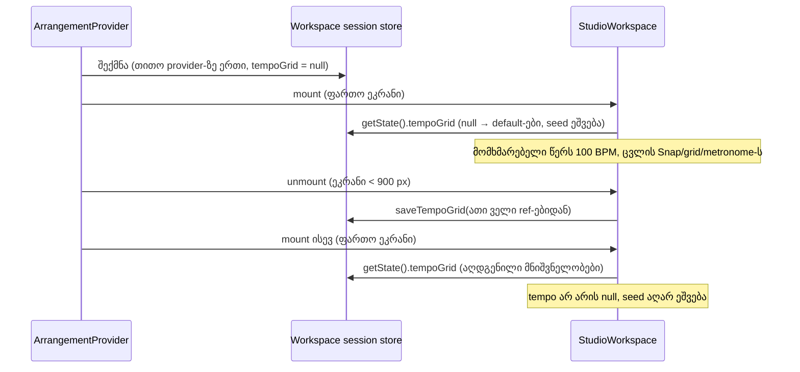

# Tempo, grid, Snap და metronome Studio-ს remount-ს უძლებს (C-R358-01)

**თარიღი:** 2026-11-06
**სტატუსი:** Completed (C round 359 PASS)
**შეცვლილი პროექტი:** Store (`app/lib/arrangement/workspace-session-store.ts`, `app/contexts/ArrangementContext.tsx`, `app/components/arrangement/StudioWorkspace.tsx`)

## კონტექსტი

C-მ 358-ე რაუნდში რეალურ ბრაუზერში იპოვა Medium ბაგი C-R358-01. `/studio-lab`-ში "Night Pulse · Full mix"-ის დამატების შემდეგ tempo 120-ზე დგება. მომხმარებელი BPM ველში წერს 100-ს. ფანჯარა 900 px-ზე ვიწრო ხდება და შემდეგ ისევ ფართოვდება. ამის შემდეგ ველში ისევ 120 წერია, status-ს კი "Tempo 120 BPM from …" წინადადება ხელახლა ემატება. პირველი resize-ის შემდეგ ეს წინადადება status-ში უკვე ორჯერ იყო.

მიზეზი: ვიწრო ეკრანზე `/studio-lab` `StudioWorkspace`-ს unmount-ს უკეთებს, `ArrangementProvider` კი mounted რჩება. Tempo და grid პარამეტრები `StudioWorkspace`-ის `useState`/`useRef` default-ები იყო. ყოველი remount `tempoBpm = null`-ით და ღია seed flag-ით იწყებოდა. Tempo-seed effect ხელახლა ეშვებოდა: მომხმარებლის tempo-ს გადაწერდა, grid-ს 1/4-ზე და Snap-ს ისევ ჩართავდა, status-ს კი წინადადებას დაუმატებდა. A-R357-TEMPO-SEED-REMOUNT-DUP ამ ბაგთან გაერთიანდა (D-29z1160).

## მიდგომა

გადაწყვეტილება (D-29z1160): tempo/grid პარამეტრები ცოცხლობს მანამ, სანამ Studio-ს გვერდი (`ArrangementProvider`) ღიაა და არა `StudioWorkspace` კომპონენტის სიცოცხლის განმავლობაში. ინახება ათი ველი, რადგან ისინი ერთად იცვლება (`changeTempo` და seed წერენ musical grid-ს, Snap-სა და metronome-ს):

- `tempoBpm` და tempo-seed-open flag;
- grid hand-chosen და Snap hand-chosen flag-ები;
- `snapEnabled`;
- seconds division და musical division;
- `gridMode` და `gridDensity`;
- `metronomeOn`.

იმპლემენტაცია:

- ახალი zustand **vanilla** store (`playback-store.ts`-ის ნიმუშით) ინახავს snapshot-ს. `null` ნიშნავს, რომ ჯერ არაფერი შენახულა.
- Provider-ი ქმნის **ერთ store-ს თითო provider-ზე** (`useState`-ის initializer-ით) და არა module singleton-ს. ახალი გვერდი ან ახალი provider default-ებით იწყება.
- `StudioWorkspace` mount-ზე ერთხელ კითხულობს snapshot-ს. ყოველი initializer იღებს აღდგენილ მნიშვნელობას ან დღევანდელ default-ს. Unmount-ის cleanup ათივე მნიშვნელობას ref-ებიდან ინახავს.
- Tempo-seed effect უცვლელია: აღდგენილი non-null tempo-ს ან დახურული seed flag-ის შემთხვევაში ის უბრალოდ აღარ ეშვება. ახალი `setStatus` ჩანაწერი არ დამატებულა.

განხილული ალტერნატივები:

- **Write-through ყოველ ცვლილებაზე.** შესაძლებელია, მაგრამ ყოველ ცვლილებაზე დამატებით ჩაწერას საჭიროებს. Unmount save-ს ერთი effect სჭირდება და interaction-ზე render-ს არ ამატებს.
- **Module singleton.** უარყოფილია: ორ provider-ს ან page reload-ის გარეშე ახალ provider-ს ძველი მნიშვნელობები გადაეცემოდა (მუტანტი M-S3).

**ფარგლებს გარეთ** (ჩაწერილია, არ გაკეთებულა):

- **Page reload-ის შემდეგ შენახვა.** Reload ახალი provider-ია და default-ებით იწყება, როგორც დღეს. ეს ახალი ფუნქცია იქნებოდა და Saba-ს გადაწყვეტილებას საჭიროებს.
- **ვიწრო ეკრანზე `StudioWorkspace`-ის mounted დატოვება.** ეს ვიწრო ეკრანის layout-ისა და ქცევის ცვლილება იქნებოდა.
- **Follow mode.** D-29z1156 mount-ზე ხელახლა სინქრონდება, ამიტომ არ ინახება.
- **Envelope mode და waveform zoom.** ესენიც remount-ზე ბრუნდება default-ზე, მაგრამ view-state-ის ცალკე კლასია: B-R359-VIEW-STATE-REMOUNT (Low, deferred).

## არქიტექტურა

## შეცვლილი ფაილები

- `app/lib/arrangement/workspace-session-store.ts`: ახალი. `WorkspaceTempoGridSnapshot` ტიპი, `saveTempoGrid` action და `createArrangementWorkspaceSessionStore` factory.
- `app/contexts/ArrangementContext.tsx`: provider-ი თითო provider-ზე ერთ store-ს ქმნის. `ArrangementWorkspaceSessionContext` შემოფარგლავს `ArrangementContext.Provider`-ს. ახალი hook `useArrangementWorkspaceSessionStore()` provider-ის გარეთ შეცდომას აგდებს.
- `app/components/arrangement/StudioWorkspace.tsx`: ათი initializer აღდგენილ მნიშვნელობას კითხულობს. ემატება `metronomeOnRef` და unmount-ის save effect.
- `app/lib/arrangement/__tests__/workspace-session-remount-ui.test.tsx`: ახალი, რიგები WS1–WS5.

## პრობლემები და გადაწყვეტები

- **პრობლემა:** seed guard (`tempoBpmRef.current !== null`) remount-ზე ხელახლა იხსნებოდა, რადგან ref ახალი კომპონენტის instance-ს ეკუთვნოდა. **გადაწყვეტა:** seed-ის ლოგიკა არ შეცვლილა. Seed flag და tempo store-იდან აღდგება, ამიტომ guard სწორ მდგომარეობაში რჩება.
- **პრობლემა:** მხოლოდ tempo-ს აღდგენა grid-ს tempo-სთან შეუსაბამოს დატოვებდა. **გადაწყვეტა:** ათივე დაკავშირებული ველი ერთ snapshot-ად ინახება.
- **პრობლემა:** metronome-ს state-ს ref არ ჰქონდა და unmount-ის cleanup მის მიმდინარე მნიშვნელობას ვერ წაიკითხავდა. **გადაწყვეტა:** დაემატა `metronomeOnRef`. Metronome tempo-ს effect mount-ზე აღდგენილი მნიშვნელობებით ხელახლა ეშვება.

## ტესტირება

- `workspace-session-remount-ui.test.tsx`-ში live `ArrangementProvider` პირობითად რენდერავს `StudioWorkspace`-ს (`follow-remount-ui.test.tsx`-ის `RemountHarness` ნიმუში). bpm-90 stem clip mount-ზე tempo-ს 90-ზე აყენებს.
  - **WS1:** აკრეფილი 100 ორ remount-ს უძლებს და seed-ის წინადადება აღარ ემატება.
  - **WS2:** აკრეფილი tempo-ს გარეშე seed-ის წინადადება ორი remount-ის შემდეგ ზუსტად ერთხელ ჩანს და ველში 90 რჩება.
  - **WS3:** გასუფთავებული BPM ველი remount-ის შემდეგ ცარიელი რჩება.
  - **WS4:** ხელით გამორთული Snap, division 1/8 და ჩართული metronome remount-ს უძლებს.
  - **WS5:** ახალი provider-ი default-ებით იწყება და seed ხელახლა ეშვება.
- Red-first: ფიქსამდე WS1–WS4 წითელი იყო და WS5 მწვანე. ფიქსის შემდეგ 5/5 მწვანეა.
- სახელიანი მუტანტები: M-S1 (seed flag არ აღდგება) → WS3. M-S2 (tempo არ აღდგება) → WS1, WS2, WS4. M-S3 (module singleton) → WS2, WS4, WS5. M-S4 (metronome არ აღდგება) → WS4. M-S5 (unmount save არაფერს აკეთებს) → WS1–WS4. ყველა მუტანტის დროს `follow-remount-ui`-ის RM1/RM2 მწვანე რჩება.
- Covering set (`cover-paths-359.txt`), typecheck და lint. Browser-ის შემოწმებებს (resize, metronome audio, reload, perf) C ატარებს.

## TODO / შემდეგი ნაბიჯები

- B-R359-VIEW-STATE-REMOUNT (Low, deferred): envelope mode და waveform zoom remount-ზე default-ს უბრუნდება.
- სატესტო დაფარვის ხარვეზი: `snapEnabled`, `gridDensity`, seconds division და hand-chosen flag-ები აღდგება, მაგრამ არც ერთ რიგს არ აქვს assert, რომელიც მათი გამოტოვებისას წითლდება (A-ს დამატებითი მუტანტები გადარჩა: `a-round-359/mutants-extra/`). გადაეცა B-ს.
- Page reload-ის შემდეგ პარამეტრების შენახვა საჭიროების შემთხვევაში ცალკე ფუნქციაა და Saba-ს გადაწყვეტილებას საჭიროებს.
