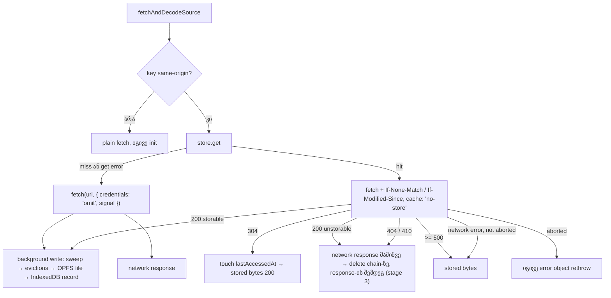
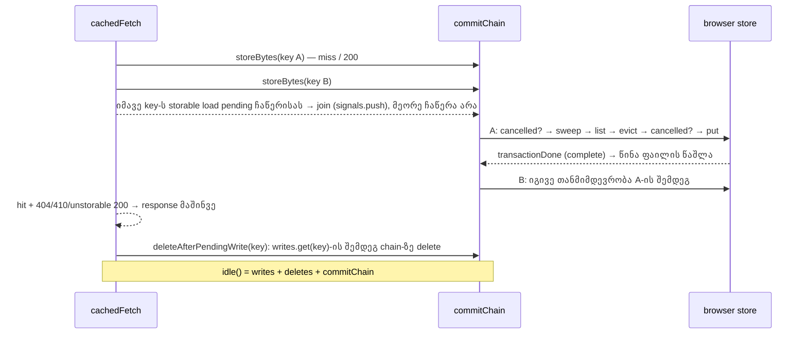

# PERF-9a: stem-ების მუდმივი cache (v2) `/studio-lab`-ის public preview-ებისთვის

**თარიღი:** 2026-11-06
**სტატუსი:** Completed (C round 368 PASS)
**შეცვლილი პროექტი:** Store (stage 1: `app/lib/arrangement/source-fetch.ts`, `app/lib/arrangement/stem-cache.ts`, `app/lib/arrangement/stem-cache.client.ts`, `app/lib/arrangement/collection.ts`, `app/data/studio-lab-demo.ts`; stage 2: `perf/studio-lab-stem-cache.perf.spec.ts`, `perf/budgets.stem-cache.json`; stage 3, rounds 367–368: `app/lib/arrangement/stem-cache.client.ts`, `app/lib/arrangement/__tests__/stem-cache.test.ts`)

## კონტექსტი

`/studio-lab` ყოველ გახსნაზე ორ same-origin public preview-ს ტვირთავს: `/middle-east.mp3` და `/videos/hero/hero-music.mp3`. B-ის probe-მა (dev server, Chromium, 1440×900, `b-round-364/probe/reopen-1440.json`) აჩვენა:

- cold გახსნაზე ორივე ფაილი 200-ით ჩამოიტვირთა (908,352 B gzip და 3,610,677 B);
- იმავე context-ში ხელახლა გახსნისას `/middle-east.mp3` **მთლიანად ხელახლა ჩამოიტვირთა** (200, 4,054,380 B), ხოლო hero-music-მა მხოლოდ revalidation გაიარა (300 B).

ბრაუზერის HTTP cache-ზე დაყრდნობა საკმარისი არ არის: მისი ქცევა სერვერისა და gzip-ის მიხედვით იცვლება. ამიტომ PERF-9 (perf-plan) ითხოვს საკუთარ, მუდმივ stem cache-ს. ეს doc აღწერს პირველ ეტაპს (9a): cache-ის policy, OPFS + IndexedDB store და მისი ჩართვა მხოლოდ demo public preview-ებზე.

**Stage 2 (9b-i).** 9a-ის browser row-ები dev server-ზე მოწმდებოდა. perf-plan-ის PERF-9 row ითხოვს გაზომვას production build-ზე: „second open: 0 stem network bytes; ready ≤ 50 % of cold“. ამიტომ 9b-i ამატებს ცალკე perf spec-სა და budgets ფაილს, რომლებსაც `npm run test:perf` production build-ზე (remix-serve, port 5188) უშვებს. `app/` კოდი ამ ეტაპზე არ იცვლება.

**Stage 3 (9b-ii, SYS-R365-STEM-CACHE-HARDENING).** round 365-ის code review-მ `stem-cache.client.ts`-ში ხუთი Low დატოვა, რომლებსაც ერთი root cause აქვს — storage-ში ჩაწერისა და commit-ის დისციპლინა:

- **A-R365-REVIEW-L4:** readwrite transaction-ის ჩაწერა request-ის `success`-ზე ითვლებოდა დასრულებულად და არა transaction-ის `complete`-ზე; `put` წინა OPFS ფაილს commit-მდე შლიდა.
- **A-R365-REVIEW-L3:** abort/disabled შემოწმება მხოლოდ sweep-მდე ხდებოდა; sweep/list/quota-ს შემდეგ გაუქმებული ჩაწერა მაინც შლიდა victim-ებს და წერდა.
- **A-R365-REVIEW-L5:** hit-ზე 404/410 ან unstorable 200-ის delete პირდაპირ await-დებოდა response-ის გზაზე და იმავე key-ს pending ჩაწერას შეიძლება წაეგო.
- **A-R365-REVIEW-L6:** `response.clone()` და stored content type-ის `headers.set` დაცული არ იყო.
- **C-R365-OBS-INTEGRITY:** browser store-ის integrity-ს (ზომის შეუსაბამობა, წაშლილი ფაილი) არც unit row ჰქონდა და არც browser row.

ხუთივე ერთ სისტემურ დავალებაში დაიხურა, ერთ ფაილში.

## მიდგომა

- **საერთო fetch/decode ბლოკი.** `fetchAndDecodeSource` (`source-fetch.ts`) აერთიანებს demo loader-ისა და purchased adapter-ის ერთნაირ fetch → `arrayBuffer()` → `decodeAudioData` ბლოკს. შეცდომების ტექსტები და abort-ის rethrow ბაიტ-ბაიტ იგივეა (`studioSourceLoadStrings`).
- **Cache არის `SourceFetch`.** `createCachedSourceFetch` აბრუნებს `{ fetchSource, idle }`-ს, რომელიც ჩვეულებრივ `fetch`-ს ცვლის. loader-მა cache-ის შესახებ არაფერი იცის.
- **Key = same-origin pathname** (query-ისა და hash-ის გარეშე), ხოლო ახლობის შემოწმება ხდება stored `ETag` / `Last-Modified` validator-ებით (`If-None-Match` / `If-Modified-Since`, `cache: 'no-store'`).
- **Storage:** bytes ინახება OPFS-ის `czaba-stem-cache-v2/` დირექტორიაში, index კი IndexedDB-ის `czaba-stem-cache-v2` ბაზაში. IndexedDB record არის commit point.
- **Budget:** `min(256 MiB, 10 % quota)`. budget/4-ზე დიდი ფაილი არ ინახება. LRU eviction `lastAccessedAt`-ით.
- **Purchased stem-ები 9a-ში cache-ს არ იყენებს** (D-29z1192). `collection.ts` არ აიმპორტებს `stem-cache`-ს, default fetcher უცვლელია.

უარყოფილი ვარიანტები:

| ვარიანტი | რატომ არა |
|---|---|
| mock-api collection-ზე გაზომვა | მომხმარებლის რეალური ქსელის გზა ორი same-origin preview-ა (D-29z1191) |
| პირდაპირ SRW-21-ის purchased stem-ები | protected route-ები და Saba-ს პასუხი (SABA-Q-PERF4-STUDIO-CACHE) — ეს 9c-ა |
| content-hash key | hash-ს სრული ჩამოტვირთვა სჭირდება და 304-ს ვერასოდეს მისცემს |
| `navigator.storage.persist()` | Firefox-ში permission prompt-ს აჩენს; ხელახლა ჩამოტვირთვადი cache-ისთვის best-effort storage საკმარისია |

### Stage 2 (9b-i): production perf harness

- **რატომ production.** `npm run test:perf` აშენებს app-ს და remix-serve-ით ემსახურება. dev server (Vite) static ფაილებს სხვა header-ებით აბრუნებს, ამიტომ dev-ზე მიღებული შედეგი production-ის ქცევას არ ადასტურებს.
- **ქსელის პირობები.** ყოველ გახსნაზე ერთი და იგივე CDP throttle: latency 40 ms, download 1,250,000 B/s, upload 375,000 B/s; CPU rate 1, viewport 1440×900, 3 pass, ყოველ pass-ს საკუთარი ცარიელი browser context (HTTP cache, IndexedDB, OPFS).
- **თანმიმდევრობა ერთ pass-ში:** cold → warm (`Network.clearBrowserCache`, HTTP cache ამოგდებულია) → warm-http (HTTP cache შენარჩუნებულია) → warm-nocache (`Network.setCacheDisabled(true)`) → blocked (`Network.setBlockedURLs(['*.mp3'])`). ყოველი გახსნა ელოდება library ready-ს და collection status-ს, ხოლო blocked-ის გარდა ყველა — ორივე stem path-ის fetch entry-ს Resource Timing-ში.
- **მთავარი სცენარი არის warm (evicted HTTP cache).** ეს არის მომხმარებლის რეალური ხელახლა გახსნა, როცა ბრაუზერმა HTTP cache უკვე გაასუფთავა: stem bytes მხოლოდ ჩვენს cache-შია და მას მხოლოდ revalidation (304) სჭირდება. warm-http და warm-nocache მხოლოდ `record` row-ებია.
- **DevTools no-cache მომხმარებლის გზა არ არის.** `Network.setCacheDisabled(true)` request-ს `Cache-Control: no-cache`-სა და `Pragma: no-cache`-ს ამატებს, remix-serve `If-None-Match`-ს აღარ აქცევს ყურადღებას და სრულ 200-ს აბრუნებს. ამიტომ `stem.warm-nocache.*` მხოლოდ ჩანაწერია.
- **Plan-ისგან ორი განსხვავება (D-29z1192):**
  1. „0 stem network bytes“ ნიშნავს 0 network **body** bytes-ს; თითო stem-ზე ერთი 304 revalidation დასაშვებია (`stem.warm.status-304` == 2).
  2. „ready ≤ 50 % of cold“ იზომება იმავე CDP throttle-ის ქვეშ, როგორც ready-ms-ის შეფარდება warm / cold (`stem.warm-ready-ratio`).
- **ქსელის body bytes:** Σ `encodedBodySize` მხოლოდ იმ fetch-initiator stem entry-ებზე, რომელთა `transferSize > 0` (304 და HTTP-cache hit ითვლება 0-ად).
- **IndexedDB-ის წაკითხვა ბაზას არ ქმნის.** spec `indexedDB.open`-ს aborting `onupgradeneeded`-ით იყენებს; ბაზის არარსებობისას entries = −1. DB-ის სახელი `app/`-დან იმპორტდება.

### Stage 3 (9b-ii): commit-ის დისციპლინა

1. **ჩაწერა commit-ზე სრულდება.** ახალი export `transactionDone(transaction)` resolve-დება `complete`-ზე, ხოლო `abort`-ზე reject-დება `transaction.error`-ით, ან `AbortError` DOMException-ით, თუ ის `null`-ია. მხოლოდ `error` event მას არ ასრულებს (TL-1). browser store-ის readwrite transaction-ები (record-ის ჩაწერა, record-ის წაშლა, `touch` და sweep-ის არავალიდური record-ის წაშლა) commit-ს ელოდება. `put` წინა OPFS ფაილს მხოლოდ record transaction-ის დასრულების შემდეგ შლის; aborted ჩაწერა ახალ ფაილს შლის და წინა record-სა და ფაილს ინარჩუნებს (`transactionDone`-ის complete/abort: SC22; error event-ის წესი და browser store-ის put: SC23).
2. **abort და disable ხელახლა მოწმდება.** signal-ით ან store-ის გამორთვით გაუქმებული ჩაწერა ბრუნდება: commit chain-ზე დაწყებისას, sweep/list/quota-ს await-ების შემდეგ (victim არ იშლება) და ყოველი `put`-ის წინ (SC24), quota retry-ის ჩათვლით (SC33: retry-ის eviction-ის დროს abort → retry put არ კეთდება).
3. **hit-ის delete response-ს არ აყოვნებს.** 404/410 ან unstorable 200 მაშინვე ბრუნდება. delete (`deleteAfterPendingWrite`) იმავე key-ს pending ჩაწერის შემდეგ და commit chain-ზე დგება, ამიტომ delete ვერ წააგებს იმ ჩაწერას, რომელიც delete-ის დადგომისას უკვე pending იყო. `idle()` ელოდება queued delete-ებსა და chain-ს (SC25, SC29; SC9 და SC21 მწვანე რჩება). hit-ის 404, რომელიც მოდის, სანამ იმავე key-ს 200 ჯერ კიდევ body-ს კითხულობს, იმ ჩაწერის put-ის შემდეგ შლის და key საბოლოოდ აღარ არის (SC32; coverage row — v2-მაც გაიარა).
4. **Guards.** `response.clone()`-ის throw → არაფერი ინახება, response უცვლელად ბრუნდება და store ჩართული რჩება. stored content type, რომელსაც `Headers.set` უარყოფს, `content-type`-ის გარეშე მიეწოდება (SC26).
5. **სესიის serialisation.** ყოველი ჩაწერის sweep → list → evict → put წინას შემდეგ სრულდება (`commitChain`), ამიტომ ერთდროულად დაწყებული ორი key budget-ში რჩება (SC27). tech-lead-მა ეს „smallest correct fix“-ად შეაფასა; cross-tab overshoot ფარგლებს გარეთაა (TODO).
6. **browser store-ის integrity (unit ნაწილი).** fake IndexedDB + OPFS-ში ზომის შეუსაბამობა და წაშლილი ფაილი ორივე miss-ია, რომელიც record-სა და ფაილს შლის (SC28). browser ნაწილი C-ის INTEGRITY row-ია.
7. **Join (round 368, C-R367-DEDUP-CANCELLED-WRITE).** `writes` ინახავს `{ done, signals }`-ს (`PendingStemWrite`). storable load, რომელიც იმავე key-ს pending ჩაწერისას მოდის, მეორე ჩაწერას არ იწყებს — თავის signal-ს pending ჩაწერას უერთებს. ჩაწერა უქმდება მხოლოდ მაშინ, როცა **ყველა** შეერთებული signal გაუქმებულია (`isStemWriteAbandoned`), ან store გამორთულია (SC30, SC31; SC17 მწვანე რჩება). signal-ის გარეშე load `every`-ის კონტრაქტით ჩაწერას ცოცხალს ტოვებს; ამ შემთხვევას unit row არ აქვს და production-ში მიუღწევადია, რადგან `fetchAndDecodeSource` signal-ს ყოველთვის გადასცემს. same-key თანმიმდევრობები HEAD `d53d113`-თან შედარებით (სრული ცხრილი: B-ის `b-round-367/sketch-review.md`):

   | თანმიმდევრობა | HEAD | v2 (round 367) | v3 (round 368) |
   |---|---|---|---|
   | (a) load 1 გაუქმდა body-ის წაკითხვის შემდეგ → load 2 მოდის (sweep ან სხვა key-ს put დაკავებულია) | ინახება | **არ ინახება** | ინახება, put ერთხელ (SC30) |
   | (b) load 2 უერთდება → load 1 მერე უქმდება | ინახება | არ ინახება | ინახება (SC31, ნაწილი 1) |
   | (b') load 1 ცოცხალია → შეერთებული load 2 უქმდება | ინახება | ინახება | ინახება (SC31, ნაწილი 3) |
   | (b'') ყველა შეერთებული load უქმდება | ინახება (HEAD abort-ს არ ამოწმებდა) | არ ინახება | არ ინახება (SC31, ნაწილი 2) |
   | (c) load 1 გაუქმდა, სანამ body-ს კითხულობს | არ ინახება | არ ინახება | არ ინახება — მიღებულია, HEAD-ის ტოლია |

8. **უცვლელი:** key-ები, validator-ები, budget და eviction policy, 304/5xx/network-error ქცევა, decode path და purchased adapter (cache-ის გარეშე).

## არქიტექტურა

Stage 3 — commit chain (ერთი სესია):

## შეცვლილი ფაილები

- `app/lib/arrangement/source-fetch.ts` — ახალი: `SourceFetch`, `plainSourceFetch`, `fetchAndDecodeSource`.
- `app/lib/arrangement/stem-cache.ts` — ახალი, pure: DB name, schema version, `StemCacheRecord`, `stemCacheKey`, `readStemCacheValidators`, `stemCacheConditionalHeaders`, `stemCacheBudgetBytes`, `selectStemCacheEvictions`.
- `app/lib/arrangement/stem-cache.client.ts` — ახალი: `StemCacheStore`, `isStemCacheRecord`, `createBrowserStemCacheStore`, `createCachedSourceFetch`, `publicPreviewSourceFetch`.
- `app/lib/arrangement/collection.ts` — purchased `loadSource` იძახებს `fetchAndDecodeSource`-ს; `PurchasedStemFetch = SourceFetch`.
- `app/data/studio-lab-demo.ts` — URL branch იძახებს `fetchAndDecodeSource(url, ctx, signal, publicPreviewSourceFetch())`-ს.
- `app/lib/arrangement/__tests__/stem-cache.test.ts` — ახალი (SC1–SC21).
- `app/lib/arrangement/__tests__/source-fetch.test.ts` — ახალი (SF1–SF6).

Stage 2 (9b-i):

- `perf/studio-lab-stem-cache.perf.spec.ts` — ახალი: PERF-9b stem cache harness (production build, CDP throttle, 5 გახსნა თითო pass-ში).
- `perf/budgets.stem-cache.json` — ახალი: `stem.*` row-ები, მათ შორის 7 assert.

Stage 3 (9b-ii):

- `app/lib/arrangement/stem-cache.client.ts` — `transactionDone` export, commit chain (`enqueueCommit`), `deleteAfterPendingWrite`, abort/disable-ის ხელახალი შემოწმება, clone და content-type guard-ები; round 368: join (`PendingStemWrite`, `isStemWriteAbandoned`), `deleteAfterPendingWrite` ელოდება `writes.get(key)?.done`-ს.
- `app/lib/arrangement/__tests__/stem-cache.test.ts` — მესამე `describe` SC22–SC29, fake browser storage helper (`installFakeBrowserStorage`) და `transactionDone`-ისა და `type CompletableTransaction`-ის import. round 368: SC30–SC33 მესამე `describe`-ის ბოლოს და SC22-ის დავიწროებული სათაური. SC1–SC21 უცვლელია.
- `docs/implementation/2026/quarter-IV/236-perf-stem-cache-v2.md` — ეს doc.

## პრობლემები და გადაწყვეტები

- **Problem:** dev server `/middle-east.mp3`-ს gzip-ით აგზავნის, ამიტომ transfer size და ფაილის ზომა განსხვავდება. **Solution:** ინახება decoded body (`arrayBuffer()` clone-იდან), და record-ის `size` მისი `byteLength`-ია. C ადარებს `decodedBodySize`-ს.
- **Problem:** weak ETag (`W/"…"`) შეიძლება ჩამოვიდეს. **Solution:** validator ინახება ისე, როგორც მოვიდა, და `If-None-Match`-ში უცვლელად იგზავნება. weak ETag-ის შემთხვევაში სერვერის 304 მხოლოდ semantic equivalence-ს ადასტურებს და არა იდენტურ ბაიტებს; public preview-ებისთვის ეს მისაღებია, ჩვენ კი hash-ს არ ვითვლით.
- **Problem:** abort-ი load-ის შუაში. **Solution:** abort-ის დროს loader-ი იგივე error object-ს იღებს (SC8, SF3, SF4). თუ signal commit-მდე გაუქმდა, არაფერი ინახება (SC12). abort და body read error cache-ს არ თიშავს (SC19).
- **Problem:** quota ამოიწურა. **Solution:** `QuotaExceededError`-ზე ყველაზე ძველი სხვა entry ერთხელ იშლება და ჩაწერა ერთხელ მეორდება. მეორე შეცდომაზე cache გვერდის სესიის ბოლომდე ითიშება და ყველა შემდეგი load plain fetch-ს იყენებს (SC11).
- **Problem:** ერთი key-ს ორი პარალელური ჩაწერა ობოლ OPFS ფაილს ტოვებდა. **Solution:** in-flight `writes` map-ი მეორე ჩაწერას ტოვებს (SC17). ერთჯერადი `sweep()` შლის არავალიდურ record-ებს და 60 წამზე ძველ ობოლ ფაილებს, და მას ყველა ჩაწერა ელოდება (SC20).
- **Problem:** revalidation-ზე მოსული 200, რომლის შენახვაც არ შეიძლება, ძველ entry-ს ტოვებდა. **Solution:** entry იშლება, ასე რომ შემდეგი network error ძველ bytes-ს აღარ აბრუნებს (SC21).

Stage 2 (9b-i):

- **Problem:** DevTools-ის cache-disabled რეჟიმში (`Network.setCacheDisabled(true)`) Chromium `Cache-Control: no-cache`-ს ამატებს და remix-serve `If-None-Match`-ის მიუხედავად სრულ 200-ს აბრუნებს. round 365-ის „cache off → 304“ dev server-ზე იყო, რომელიც სხვაგვარად იქცევა. **Solution:** ეს შემთხვევა მომხმარებლის გზა არ არის; ის `stem.warm-nocache.*` `record` row-ებად რჩება, ხოლო assert-ები evicted HTTP cache-ის warm გახსნაზეა.
- **Problem:** `encodedBodySize` cache hit-საც ითვლის, ამიტომ მისი ჯამი warm გახსნაზე 0-ს ვერ აჩვენებს. **Solution:** network body bytes = Σ `encodedBodySize` მხოლოდ `transferSize > 0` entry-ებზე. ამ მთვლელის სიცოცხლისუნარიანობას `stem.harness.cold-body-live` იცავს (cold body > 1,000,000 B), რომ `stem.warm.body-bytes` == 0 ცარიელი მთვლელით არ გავიდეს.
- **Problem:** დაბლოკილი fetch-ის Resource Timing entry-ზე დაყრდნობა არ შეიძლება (ის შეიძლება საერთოდ არ გაჩნდეს), ამიტომ blocked გახსნა ქსელის row-ებს არ იყენებს. **Solution:** `stem.blocked.ready` (collection ready ქსელის გარეშე) და `stem.blocked.entries` (IndexedDB-ში ორივე record რჩება).
- **Problem:** plain fetch-ს შეუძლია concurrent `<audio preload="metadata">` 206 request-ის ნაწილობრივი HTTP-cache entry გამოიყენოს, ამიტომ plain fetch-ის byte-ჯამი pass-ებს შორის იცვლება (B-ის cache-off mutant-ში: 7,664,757 / 7,515,518 / 7,517,018). **Solution:** `stem.cold.body-bytes`, `stem.cold.transfer-bytes`, `stem.warm-nocache.body-bytes` და `stem.warm-nocache.transfer-bytes` `wallclock` kind-ისაა და არა `deterministic` (exact-match წესი record row-ზე spec-ს ჩააგდებდა). warm-nocache-ზე A-ის გაშვებაში ვარიაცია არ გამოჩენილა; ის B-ის v4 გადაწყვეტით cold-ის byte row-ებს მიჰყვება. სხვა მიზეზით (A-ის code-reviewer, round 366) `wallclock`-ია ოთხი `stem.*.audio-requests` row-იც: დამალული `<audio>`-ს Resource Timing entry მხოლოდ load-ის დასრულებისას ან გაუქმებისას ჩნდება. CDP byte row-ები (`cdp-mp3-bytes`, `cdp-media-bytes`) ითვლება ერთი გახსნის navigation-იდან მომდევნო navigation-მდე, რომ გვიან მოსული bytes შემდეგ გახსნას არ მიეწეროს.
- **Problem:** harness-ის host (remix-serve) production არ არის: production Vercel-ზეა (`vercel.json`). **Solution:** row-ები harness host-ის header-ებს ზომავს (`Cache-Control: public, max-age=31536000, immutable`, weak ETag, 304). Vercel-ის header-ები ღია კითხვაა (ROOT-Q-R365-VERCEL-STATIC-HEADERS); ამ ეტაპის არცერთი assert მასზე არ არის დამოკიდებული.

Stage 3 (9b-ii):

- **Problem (TL-1):** `transactionDone`-ის პირველი ვერსია `onerror`-ზე reject-დებოდა, როცა `transaction.error` ჯერ კიდევ `null` იყო. quota abort ამიტომ non-quota შეცდომად იქცეოდა და cache-ს თიშავდა. **Solution:** reject მხოლოდ `abort`-ზე, `transaction.error ?? AbortError`-ით; მხოლოდ error event pending რჩება. aborted put იმავე `QuotaExceededError` ობიექტით reject-დება (abort-ის reject: SC22; error event-ის თანმიმდევრობა და aborted put: SC23).
- **Problem (TL-2):** hit-ის delete-ის ლოდინმა session commit queue response-ის გზაზე დააყენა: 404/410/unstorable 200 სხვა key-ების ჩაწერას ელოდებოდა, ხოლო გაჭედილი store call load-ს გაჭედავდა. **Solution:** response მაშინვე ბრუნდება; delete იმავე key-ს pending ჩაწერის შემდეგ chain-ზე დგება (SC25, SC29).
- **მიღებული რისკი (TL-3):** store call, რომელიც არასოდეს სრულდება, სესიის ბოლომდე cache-ს აჩერებს, მაგრამ load-ს არასოდეს ბლოკავს: `cachedFetch` მხოლოდ `get`-ს, `touch`-სა და ქსელს ელოდება. ეს იგივე degraded რეჟიმია, რაც „storage error → plain network“. timeout race არ დაემატა — მას გაზომვით დაუსაბუთებელი ლიმიტი დასჭირდებოდა. გაუქმებული queued ჩაწერა `storeBytesNow`-ში მაშინვე ბრუნდება.
- **Problem (C-R367-DEDUP-CANCELLED-WRITE, Medium):** v2-ში იმავე key-ს მეორე load `writes.has(key)` dedup-ით გამოტოვდებოდა. თუ pending ჩაწერას პირველი load-ის abort აუქმებდა (effect re-run / StrictMode, sweep ან სხვა key-ს put დაკავებული), key საერთოდ აღარ ინახებოდა. HEAD-ში (`d53d113`) abort-ი ჩაწერას არ აუქმებდა და key ინახებოდა (P2-ში A ორჯერაც იწერებოდა); v2 ამ შემთხვევას კარგავდა. **Solution (v3):** join — მეორე load თავის signal-ს pending ჩაწერას უერთებს, ჩაწერა უქმდება მხოლოდ მაშინ, როცა ყველა signal გაუქმებულია. ახლა key ინახება და `put` ერთხელ კეთდება (SC30, SC31). join სრულიად airtight არ არის: load, რომელიც შეუერთდება ჩაწერის ბოლო `cancelled()`-სა და `writes.delete`-ს შორის microtask gap-ში, ჩუმად იკარგება (B-R367-TL3-1-JOIN-MICROTASK-GAP). ბრაუზერში მიუღწევადია, რადგან შემდეგი load ცალკე task-ში მოდის; HEAD-იც ასეთ load-ს ტოვებდა. მიღებული შემთხვევები: (c) ზემოთ, და hit 200 ახალი ETag-ით, რომელიც ძველ pending ჩაწერას უერთდება — ინახება ძველი bytes (HEAD-ის ტოლი), შემდეგი conditional request ასწორებს.
- **მიღებული რისკი (stale-before-idle):** hit-ის delete response-მდე აღარ სრულდება. იმავე key-ს მეორე fetch-მა `idle()`-მდე შეიძლება ძველი entry ნახოს, ხოლო network error-ზე ძველი bytes მიიღოს. demo თითო source-ს ერთ გახსნაზე ერთხელ ტვირთავს; SC9/SC21 `idle()`-ის შემდეგ ამოწმებს.

## ტესტირება

- `app/lib/arrangement/__tests__/stem-cache.test.ts`: SC1–SC21 (SC4-ს აქვს მეორე row cached fetch-ის eviction-ისთვის, SC14-ს კი მეორე row server branch-ისთვის). ისინი იყენებს in-memory `StemCacheStore` fake-ს და `vi.fn` fetcher-ს რეალური `Response` ობიექტებით. background write-ებს `await cached.idle()` ელოდება.
- `app/lib/arrangement/__tests__/source-fetch.test.ts`: SF1–SF6. SF6 (purchased-ს cache არ აქვს) შედგება `collection.ts`-ის source scan-ისგან და tripwire-ისგან: `vi.mock` + `vi.hoisted` holder-ით `publicPreviewSourceFetch()` გადამისამართდება demo cache-ზე, რომელშიც `/a.mp3` უკვე ინახება. თუ purchased გზა მას გამოიყენებდა, global `fetch` ზუსტი `{ credentials: 'omit', signal }`-ით აღარ გამოიძახებოდა.
- Mutants M1–M12: M4 ორ ნაწილად (M4a pure loop, M4b client delete loop), M7 კი ორ ვარიანტად (M7 პირდაპირი import, M7b re-export `source-fetch.ts`-ის გავლით, რომელიც scan-ს გვერდს უვლის). დამატებით M7c ამოწმებს module load-ის დროს დაჭერილ fetcher-ს. სულ 15 გაშვებაა. თითოეული წითლდება თავის row-ზე. Logs: `a-round-365/mutants/`.
- Covering ფაილები (DL6, PC3 და Georgian-line guard-ის ჩათვლით) ცვლილების გარეშე გადის.
- Browser: B-ის probe (`b-round-364/probe/sketch-cache-*.json`). C-ის row-ები: CS-COLD, CS-WARM, CS-AUDIO, CS-BLOCKED, CS-CLEAR, CS-LEGACY და ONE-FETCH.
- `publicPreviewSourceFetch()`-ის server branch (`window`-ის გარეშე → `plainSourceFetch`) SC14-ში მოწმდება; Remix Vite-ის server build-ში `.client` export-ები stub-ით იცვლება, ამიტომ რეალურ SSR-ს A-SSR row ამოწმებს.
- SC20-ში `put`-ის negative check-ისთვის gate დაჭერილია და რამდენიმე `setTimeout(0)` flush გამოიყენება (M11-ის წითლად გამოსაჩენად); background write-ებს ტესტები მაინც `idle()`-ით ელოდება.
- შეზღუდვა (stage 1; stage 3-ში ჩანაცვლებულია SC28-ით): browser store-ის `get` (ფაილის არარსებობა და ზომის შეუსაბამობა) jsdom-ში `null`-ია. ის მხოლოდ C-ის browser row-ებით მოწმდებოდა, unit-ით კი fake-ის კონტრაქტითა და `isStemCacheRecord`-ით (SC15).

Stage 2 (9b-i). A-ის გაშვება: `npx playwright test --config playwright.perf.config.ts perf/studio-lab-stem-cache.perf.spec.ts`, მარტო, exit 0, 0 failure, ყოველი row 3-ჯერ გაზომილი (საბოლოო გაშვება code-review-ის შესწორებების შემდეგ: `a-round-366/perf-v2.log`, `a-round-366/latest-stem-cache-v2.json`). 7 assert, A-ის median-ებით, და mutant, რომელიც თითოეულს აწითლებს:

| Row | Budget | A-ის median | წითლდება |
|---|---|---|---|
| `stem.harness.cold-body-live` | == 1 | 1 | counter-zero (0) |
| `stem.cold.entries-stored` | == 2 | 2 | cache-off (−1) |
| `stem.warm.body-bytes` | == 0 | 0 | cache-off (7,532,018) |
| `stem.warm.status-304` | == 2 | 2 | cache-off (0) |
| `stem.warm-ready-ratio` | ≤ 0.5 | 0.187 (cold 7527 ms, warm 1409 ms) | cache-off (0.993) |
| `stem.blocked.ready` | == 1 | 1 | cache-off (0) |
| `stem.blocked.entries` | == 2 | 2 | cache-off (−1) |

- **Mutant cache-off:** `publicPreviewSourceFetch()` ყოველთვის `plainSourceFetch`-ს აბრუნებს. 6 assert წითელია, `stem.harness.cold-body-live` მწვანე რჩება. Log: `a-round-366/mutants/mutant-cache-off-v2.log`.
- **Mutant counter-zero:** body-byte მთვლელი არასოდეს ითვლის. წითელია მხოლოდ `stem.harness.cold-body-live`, ხოლო `stem.warm.body-bytes` == 0 მწვანე რჩება — ანუ 0-ის სანდოობას liveness row იცავს. Log: `a-round-366/mutants/mutant-counter-zero-v2.log`.
- ორივე mutant-ის შემდეგ წყარო აღდგენილია და `cmp`-ით შემოწმებულია.
- C-ის row-ები: PERF, MUTANT-OWN, PROBE (1440×900 და 1280×720), AUDIO, G366-AUTH და DOCS.

Stage 3 (9b-ii):

- `app/lib/arrangement/__tests__/stem-cache.test.ts`: SC22–SC29 მესამე `describe`-ში. SC23 და SC28 იყენებს fake IndexedDB + OPFS-ს (`installFakeBrowserStorage`, `vi.stubGlobal`): request success commit-მდე ხდება, commit შეიძლება დაკავდეს, put request-ს შეუძლია ჩავარდნა IndexedDB spec-ის თანმიმდევრობით (error event → `error` → abort). ეს ხურავს წინა შეზღუდვას: browser store-ის `get` integrity ახლა unit-ითაც მოწმდება. round 368: SC30–SC33 იმავე `describe`-ში (SC30 — join დაკავებული sweep-ისა და სხვა key-ს დაკავებული put-ის უკან; SC31 — join-ის სამი ნაწილი; SC32 — hit 404 body-ს მკითხველი 200-ის შემდეგ; SC33 — quota retry-ის abort). SC30 და SC31 წითელია v2 client-ზე (round 367-ის ხე) v3 ტესტებით (`b-round-367/mutants/round367-client-vs-v3-tests.log`). A-ის გაშვება: stem-cache 35/35, source-fetch 6/6 (`a-round-368/tests.log`).
- Mutants (19, v3-ზე; თითოეული წითელია ზუსტად B-ის `b-round-367/mutants/mutant-summary.txt`-ის row-ებზე; A-ის logs: `a-round-368/mutants/`): `M-SC22-ABORT-RESOLVES` (SC22 SC23), `M-SC22-ONERROR-NULL` (SC23), `M-SC23-WRITE-REQUEST` (SC23), `M-SC28-NO-SIZE` (SC28), `M-L3-EVICT` (SC24), `M-L3-PUT` (SC24), `M-L5-GONE` (SC25 SC29 SC32), `M-L5-BLOCKING` (SC25 SC29 SC32), `M-L5-UNSTORABLE` (SC25), `M-L6-CLONE` (SC26), `M-L6-HEADERS` (SC26), `M-SERIAL` (SC27 SC30), `M-IDLE-NO-DELETES` (SC29), `M-V2-NO-JOIN` (SC30 SC31), `M-V2-SOME` (SC30 SC31), `M-C367-DELETE-SKIPS-PENDING` (SC32), `M-L3-RETRY` (SC33), `M-V2-LAST-SIGNAL` (SC31), `M-SC32-NO-WRITE` (SC7 SC15 SC25 SC32).
- Browser (production build): B-ის probe `b-round-366/probe/stem-integrity-probe.mjs` (cold, truncate, delete-file, stale-etag; 1440×900 და 1280×720) HEAD-სა და sketch-ზე ერთნაირ შედეგს იძლევა; mutant build-ები `nosize` (truncate წითელია; delete-file-ის სიწითლე truncate-იდან გადმოყოლილია — middle-east-ის შეკვეცილი ფაილი 304-ით რჩება) და `nohitrestore` (stale-etag წითელია) აჩვენებს, რომ row-ებს ჩავარდნა შეუძლიათ (`b-round-366/probe/probe-summary.txt`). C round 367-ის row-ები: INTEGRITY და VALIDATOR (ორივე viewport), PLAYBACK-EXPORT (record), G367-AUTH და DOCS.
- Browser, round 368: B-მა v3-ის production build-ზე იგივე probe გაუშვა (`b-round-367/probe/sketch-*.json`): ყველა phase ready-ა და უკრავს (pos ≈ 00:02.77, peak 0.31, 1 start); truncate და delete-file 200-ის შემდეგ ხელახლა ინახება; stale-etag-ზე `If-None-Match "b366-stale"` → 200 და stored ETag განახლდება. C-ის DEDUP probe v3-ზე: P1 და P2 `storedA=true putCalls=2` (A ერთხელ, B ერთხელ) (`b-round-367/dedup-probe-v3.log`). dedup race-ს დეტერმინისტული browser trigger არ აქვს; მას unit row-ები SC30/SC31 ამტკიცებს. C round 368-ის row-ები: DEDUP, MUTANT-OWN, INTEGRITY და VALIDATOR (ორივე viewport), PLAYBACK-EXPORT (record), G368-AUTH და DOCS.

## TODO / შემდეგი ნაბიჯები

- **Cross-tab budget:** serialisation ერთ სესიაშია; ორ tab-ს შეუძლია budget ერთდროულად გადააჭარბოს.
- **ARCH-CHECKPOINT-PERF9-STEM-CACHE:** root-ის მოთხოვნა (`frontend-architect`, `architecture-checkpoint.md`), არა-დამბლოკავი.
- **ROOT-Q-R365-VERCEL-STATIC-HEADERS:** Vercel-ის static header-ები და 304 production-ზე — root-ის კითხვა.
- **PERF-CAND-STEM-BACKGROUND-REVALIDATE (Low, კანდიდატი):** hit-ზე revalidation-ის ფონზე გადატანა.
- **PERF-9c:** purchased stem-ები cache-ში — `awaiting_user` (SABA-Q-PERF4-STUDIO-CACHE, SRW-21-PLAN-თან ერთად).
- **PERF-9d:** root — legacy `audio-cache.ts`-ისა და `czaba-audio-cache` DB-ის გაუქმება და `indexeddb-cache` skill-ის გადაწერა (protected ფაილები, ROOT-REQ-PERF9D-LEGACY-CACHE).
- **B-R364-DEMO-DOUBLE-FETCH (info):** `audio` initiator-ის დამატებითი entry `/middle-east.mp3`-ზე; ჰიპოთეზით, ის `StudioNarrowScreen.tsx`-ის `<audio preload="metadata">`-დან მოდის.
- **A-R368-REVIEW-L1 (ღია):** hit 200 იწყებს ჩაწერას W-ს → hit 404 delete-ს W-ის შემდეგ აყენებს → მესამე storable 200 W-ს უერთდება; W-ის შემდეგ delete ხვდება და key აღარ არის. HEAD-ში key შენახული რჩებოდა. იკარგება მხოლოდ cache entry, შემდეგი load აღადგენს.
- **`deferred_low_polish` (D-29z1207):** A-R367-REVIEW-L-c, A-R367-REVIEW-L-d, A-R367-REVIEW-L-e, A-R367-REVIEW-L-g და B-R367-TL3-1-JOIN-MICROTASK-GAP.
- IndexedDB `onblocked` / `onversionchange` (sketch-review I4) — ღიაა; 9b-i-ში არ შესულა (ამ ეტაპზე `app/` კოდი არ იცვლება).
