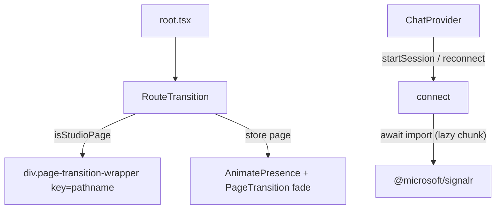

# PERF-11a: root bundle-ის დიეტა — lazy signalr და framer page transition-ის გარეშე `/studio*`

**თარიღი:** 2026-11-06
**სტატუსი:** Completed (C round 370 PASS)
**შეცვლილი პროექტი:** Store (`app/contexts/ChatContext.tsx`, `app/components/animations/RouteTransition.tsx`, `app/components/animations/index.ts`, `app/root.tsx`, `perf/budgets.resources.json`, ორი ახალი ტესტ-ფაილი)

## კონტექსტი

PERF-11-ის მიზანია ყოველ route-ზე ჩატვირთული JavaScript-ის შემცირება. HEAD `29f4b4d`-ზე ორი პრობლემა იყო:

- `app/contexts/ChatContext.tsx` `@microsoft/signalr`-ს value import-ით ტვირთავდა. ის `app/`-ში ერთადერთი signalr-ის მომხმარებელია, მაგრამ ბიბლიოთეკა shared root chunk-ში ხვდებოდა და ყოველ გვერდზე (Studio-ს ჩათვლით) ჩამოიტვირთებოდა, თუმცა connect მხოლოდ მომხმარებლის მოქმედებაზე (`startSession`, ან reconnect timer) ხდება.
- `app/root.tsx` ყველა route-ს, `/studio*`-ის ჩათვლით, `<AnimatePresence mode="wait"><PageTransition>`-ში ხვევდა. ამიტომ `/studio-lab`-ის server HTML-ში `.page-transition-wrapper`-ს inline `opacity:0` ჰქონდა და პირველი paint hydration-სა და fade-ს ელოდებოდა.

B-ის გაზომვა (`b-round-369/perf-res-head.log`): Script-ების encoded bytes HEAD-ზე — studio-lab 378,121, home 264,641, studio-guard 286,109.

## მიდგომა

- **Lazy signalr.** ChatContext ახლა მხოლოდ `import type { HubConnection }`-ს იყენებს. `connect()`-ის არსებული `try`-ის შიგნით, `setConnectionStatus('connecting')`-ის შემდეგ, `await import('@microsoft/signalr')` ტვირთავს მოდულს და module-level ცვლადში ინახავს. ოთხი `HubConnectionState.Connected`-თან შედარება ერთ `isHubConnected` ფუნქციაში გაერთიანდა. ჩატვირთვის შეცდომა არსებულ `catch`-ში ხვდება: სტატუსი `disconnected`, ტექსტი უცვლელი. handlers, reconnect, `startSession`, `disconnect` და context value არ შეცვლილა.
- **RouteTransition.** ახალი კომპონენტი `RouteTransition({ pathname, isStudioPage, children })`. Studio-ზე აბრუნებს უბრალო `
`-ს (კლასი რჩება, რადგან `app/styles/app.css` მას ორჯერ იყენებს). Store-ის გვერდებზე ქცევა იგივეა: `AnimatePresence` + `PageTransition`.
- **Budget.** `perf/budgets.resources.json`-ის სამი `res.js.*.encoded-bytes` ჩანაწერი `record`-დან `assert`-ზე გადავიდა: 372,000 / 258,000 / 278,000 bytes, owner `PERF-11a`.

განხილული ალტერნატივები:
- Firebase-ის lazy ჩატვირთვა (დაახლოებით −36 KB ყველა გვერდზე) დაცულ `app/lib/auth.ts`-ს მოითხოვს. ის PERF-11b-დ გამოიყო და root/Saba-ს მოთხოვნად გადაეცა (`b-round-369/root-request-perf11b-firebase-lazy.md`).
- perf-plan-ის 230 KB სამიზნე loop-ის შიგნით მიუღწევადია: lazy Firebase-ის შემდეგაც დაახლოებით 326 KB რჩება. მხოლოდ Studio route chunk-ი 123.9 KB-ია, ხოლო framer-motion (39.1 KB) root-იდან Toast, Header, LeadMagnet და სხვა მოდულებით მიიღწევა; მისი გატანა store-wide საკითხია (PERF-11-ის შემდეგი ეტაპი ან STORE-REDESIGN). სამიზნე გაზომვით გადაეწყო (D-29z1220).
- ArrangementContext-ის leaf-consumer-ების ცვლილება PERF-11c-ია.

## არქიტექტურა

## შეცვლილი ფაილები

- `app/contexts/ChatContext.tsx` — type-only import, lazy `import()`, `isHubConnected`.
- `app/components/animations/RouteTransition.tsx` — ახალი.
- `app/components/animations/index.ts` — `RouteTransition`-ის export.
- `app/root.tsx` — `RouteTransition`-ის გამოყენება (`b-round-369/sketch-root.tsx.txt`-ის byte-equal).
- `perf/budgets.resources.json` — სამი encoded-bytes assert.
- `app/components/animations/__tests__/route-transition.test.tsx` — ახალი, RT1–RT4.
- `app/contexts/__tests__/chat-lazy-signalr.test.tsx` — ახალი, CL1–CL4.

## პრობლემები და გადაწყვეტები

- **Problem:** Studio-ს პირველი paint უხილავ (`opacity:0`) გვერდს ელოდებოდა. → **Solution:** `/studio*` route-ები `AnimatePresence`-ის გარეთ გადავიდა; server HTML-ში inline opacity აღარ არის (RT1).
- **Problem:** Store → Studio გადასვლისას store-ის exit fade იკარგება, რადგან studio branch `AnimatePresence`-ის გარეთაა. → **Solution:** მიღებულია, როგორც „framer transition-ის გარეშე `/studio*`“-ის უმცირესი პატიოსანი ქცევა; Studio → Store გადასვლა store-ის enter fade-ს ინარჩუნებს.
- **Problem:** `import()` `try`-ის გარეთ რომ ყოფილიყო, chunk-ის ჩავარდნა `startSession`-ის catch-ის ტექსტს აჩვენებდა. → **Solution:** import არსებული connect `try`-შია; CL4 ამოწმებს ზუსტ ტექსტს `Failed to connect to chat. Please try again.`
- **Problem:** ზოგი ბრაუზერი ჩავარდნილ dynamic import-ს reload-მდე ინახავს, ამიტომ retry შეიძლება ისევ ჩავარდეს. → **Solution:** 11a-ში კოდი არ ემატება; ჩაწერილია როგორც ცნობილი რისკი (sketch-review TL-9).
- **Problem:** provider-ის unmount connect-ის დროს: ახალი connection არ ჩერდება (HEAD-ზეც არსებული). → **Solution:** გადადებულია, B-R369-CHAT-UNMOUNT-RACE (Low).

## ტესტირება

- Unit: `route-transition.test.tsx` (RT1–RT4) და `chat-lazy-signalr.test.tsx` (CL1–CL4), ასევე `self-hosted-fonts.test.ts` და `store-focus-ring.test.ts` (ორივე `root.tsx`-ს კითხულობს) — 4 ფაილი, 23/23 PASS; chat ფაილი shuffle seed 42-ითაც PASS.
- `npm run typecheck` და `npm run lint` — rc 0.
- Perf: `npx playwright test --config playwright.perf.config.ts studio-lab-resources` (production build) — studio-lab 362,477, home 250,526, studio-guard 270,648; სამივე assert PASS. HEAD-ზე ისინი წითელია (mutant MU-CHAT-STATIC: 378,149 / 264,669 / 286,137).
- Paint (B-ის probe, record): FCP − DCL-ის მედიანა HEAD-ზე 358 ms, sketch-ზე 6 ms; SSR `opacity:0` HEAD-ზე 5/5, sketch-ზე 0/5.
- ბრაუზერის შემოწმებებს (NO-SIGNALR, SSR-OPACITY, FADE, NAV, Studio smoke) C ასრულებს რაუნდ 370-ში. რეალური chat connect cloud-ში backend-ის გარეშე დაბლოკილია.

## TODO / შემდეგი ნაბიჯები

- PERF-11c: ArrangementContext-ის leaf-consumer-ები; PERF2-FIRST-FRAME-LONGTASK (hydration long task FCP-სთან ახლოს).
- PERF-11b: lazy Firebase — root/Saba-ს პასუხს ელოდება.
- B-R369-CHAT-UNMOUNT-RACE (Low): connect-ის დროს unmount-ის შემთხვევა.
- ახალი Studio ფუნქციის bytes-ის ზრდისას 372,000-ის budget ხელახლა გაზომვით გადაწყდება.
