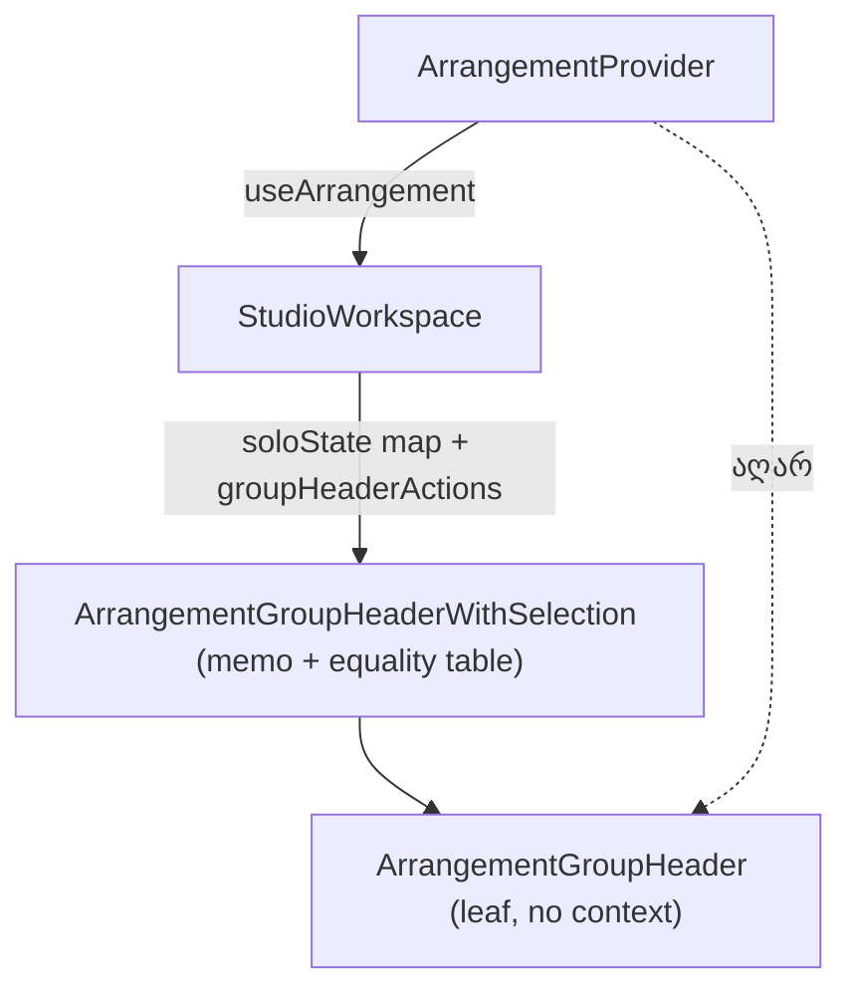

# PERF-11c-i: track-group header-ის leaf აღარ კითხულობს მთელ workspace context-ს

**თარიღი:** 2026-11-06
**სტატუსი:** In Progress (stage 1 of 3; C round 371 PASS)
**შეცვლილი პროექტი:** Store (`app/components/arrangement/ArrangementGroupHeader.tsx`, `app/components/arrangement/StudioWorkspace.tsx`, `app/contexts/ArrangementContext.tsx`, ორი არსებული ტესტ-ფაილი)

## კონტექსტი

PERF-11c-ის მიზანია, რომ Studio-ს leaf კომპონენტებმა `useArrangement()`-ით მთელი context value აღარ წაიკითხონ (SIG-R361). HEAD `f530e2d`-ზე:

- `ArrangementGroupHeader` თავად იძახებდა `useArrangement()`-ს და `trackGroupSoloState(arrangement, group.id)`-ს ითვლიდა. ამიტომ context value-ის ყოველი ცვლილება — ყოველი status write და ყოველი arrangement edit, ჯგუფის გარეთაც — ყველა group header-ს ხელახლა არენდერებდა (GATE361-S1).
- wrapper `ArrangementGroupHeaderWithSelection` ჩვეულებრივი `memo` იყო, StudioWorkspace კი folded ჯგუფის overview და active-candidate მასივებს ყოველ edit-ზე თავიდან აგებდა, ამიტომ wrapper-იც ყოველ edit-ზე რენდერდებოდა.
- `useArrangementPlaybackStoreContext` `useArrangementIsPlayingReader`-ისთვისაც `useArrangementIsPlaying`-ის სახელით აგდებდა შეცდომას (A-R362-REVIEW-PLAYBACK-CTX-ERROR-TEXT).

B-ის browser baseline-ში (HEAD, ორივე viewport) folded ჯგუფის გარეთ SFX-ის mute-ზე header leaf და wrapper თითო რენდერს აკეთებდა.

## მიდგომა

PERF-11c სამ ეტაპად დაიყო (D-29z1225):

- **11c-i (ეს რაუნდი):** group header-ის leaf. ყველაზე მცირე grant და მისი jsdom row-ები HEAD-ზე წითელია.
- **11c-ii:** committed `status` გადის context value-დან (SIG-R360), test migration-ის grant-ით.
- **11c-iii:** დარჩენილი `useArrangement()` leaf-ები და PERF2-FIRST-FRAME-LONGTASK.

ამ ეტაპში:

- leaf იღებს ორ ახალ prop-ს: `soloState: TrackGroupSoloState` და `actions: ArrangementGroupHeaderActions` (context-ის 9 callback-ის `Pick`). `useArrangement` leaf-ში აღარ არის.
- StudioWorkspace ითვლის ჯგუფების solo-state map-ს (`useMemo`, `arrangement` და `trackRows`) და ერთ memoised `groupHeaderActions` ობიექტს.
- wrapper-ის `memo` იღებს `sameGroupHeaderWithSelectionProps`-ს. მას მართავს `GROUP_HEADER_WITH_SELECTION_PROP_EQUALITY` — mapped type `-?`-ით, ამიტომ tsc უარყოფს გამოტოვებულ ან ზედმეტ key-ს. `overviewClips` და `activeCandidateTrackIds` შედარდება შიგთავსით (`TRACK_GROUP_OVERVIEW_CLIP_EQUALITY`).
- leaf **არ** იხვევა `memo`-ში და სახელი არ იცვლება: `fader-pointer-preview.test.tsx`-ის `PARENT_NAMES` runtime სახელს `'ArrangementGroupHeader'` ეყრდნობა. memo-ს საზღვარი wrapper-ია.
- `useArrangementPlaybackStoreContext(hookName)` — ორივე გამომძახებელი საკუთარ სახელს გადასცემს.

უარყოფილი ალტერნატივა: leaf-ის `memo`-ში გახვევა (L58-ის memo clause) — runtime სახელი შეიცვლებოდა და `PARENT_NAMES` row-ები გაწყდებოდა. `ArrangementContextValue`-ის ფორმა ამ რაუნდში არ იცვლება.

## არქიტექტურა

## შეცვლილი ფაილები

- `app/components/arrangement/ArrangementGroupHeader.tsx` — `useArrangement` მოიხსნა; ახალი export type `ArrangementGroupHeaderActions`; props `soloState`, `actions`; ერთი TODO ხაზი.
- `app/components/arrangement/StudioWorkspace.tsx` — solo-state map, `groupHeaderActions`, wrapper-ის comparator და equality ცხრილები.
- `app/contexts/ArrangementContext.tsx` — playback store hook-ის შეცდომის ტექსტი გამომძახებლის სახელით.
- `app/lib/arrangement/__tests__/selection-wrappers-render.test.tsx` — row-ები GH1–GH5.
- `app/lib/arrangement/__tests__/context-hygiene.test.tsx` — row-ები L8c, L8d.

## პრობლემები და გადაწყვეტები

- **Problem:** leaf-ის `memo` შეცვლიდა runtime სახელს, რომელსაც `PARENT_NAMES` ეყრდნობა. → **Solution:** leaf რჩება un-memoised; wrapper-ი უკვე memo-ა და მხოლოდ საკუთარი props-ის ცვლილებაზე რენდერდება.
- **Problem:** custom comparator ჩუმად გამოტოვებდა მომავალში დამატებულ prop-ს (tech-lead-ის v1 Medium). → **Solution:** compile-checked equality ცხრილი (`PropEquality<…>`, `-?`); ახალი prop ან `TrackGroupOverviewClip`-ის ახალი ველი ცხრილში ჩაწერამდე tsc-ს ვერ გაივლის.
- **Problem:** folded ჯგუფის overview და candidate მასივები ყოველ edit-ზე ახალი იყო. → **Solution:** comparator ადარებს შიგთავსით, არა reference-ით.

## ტესტირება

- B-ის pre-check (`b-round-370/`): GH1, GH2, GH5 და L8d HEAD-ზე წითელია, GH3, GH4 და L8c მწვანე (positive controls); 8 mutant-იდან თითოეული წითელია პროგნოზირებულ row-ებზე; full suite sketch-ზე 252 ფაილი / 3,703 ტესტი; ორივე perf spec (interactions, fader) `failures []`, deterministic row-ები უცვლელი.
- A (რაუნდი 371): `npm run typecheck` rc 0, `npm run lint` rc 0 (repo-ს 205 არსებული warning), 19 covering ფაილი 366 ტესტით მწვანე, `selection-wrappers-render.test.tsx` `--sequence.shuffle --sequence.seed=42`-ით მწვანე.
- row-ები:
  - `selection-wrappers-render.test.tsx`: GH1 (status write — wrapper და leaf 0 რენდერი), GH2 (edit ჯგუფის გარეთ — 0 რენდერი, overview უცვლელი), GH3 (member clip-ის nudge — leaf რენდერდება, overview block მოძრაობს), GH4 (member solo → `mixed`, შემდეგ `off`; group Solo/Mute), GH5 (ორი ჯგუფი — მხოლოდ მეორე header რენდერდება).
  - `context-hygiene.test.tsx`: L8c (`useArrangementIsPlaying`), L8d (`useArrangementIsPlayingReader`) — provider-ის გარეთ საკუთარი სახელით აგდებს შეცდომას.
- C ბრაუზერში ამოწმებს group Solo/Mute/Volume/rename/fold ქცევას ორივე viewport-ზე და outside-mute რენდერების რაოდენობას (record).

## TODO / შემდეგი ნაბიჯები

- PERF-11c-ii: committed `status` context value-დან გატანა (28 ტესტ-ფაილის migration).
- PERF-11c-iii: დარჩენილი `useArrangement()` leaf-ები და PERF2-FIRST-FRAME-LONGTASK.
- B-R370-GH-ACTIVE-CANDIDATES-ROW და B-R370-HOOK-ERROR-NAMES — Low, დარეგულირებულია, არ იცვლება.
