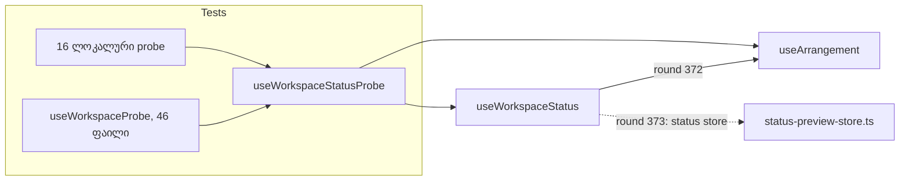

# PERF-11c-ii-a: ტესტები committed status-ს ერთი helper-ით კითხულობენ

**თარიღი:** 2026-11-06
**სტატუსი:** Completed (stage 1 of 2; stage 2 in doc 240; C round 373 PASS)
**შეცვლილი პროექტი:** Store (`app/lib/arrangement/__tests__/helpers/workspace-probe.ts` და 16 ტესტ-ფაილი `app/lib/arrangement/__tests__/`-ში; app კოდი არ შეცვლილა)

## კონტექსტი

PERF-11c-ii-ის მიზანია, რომ committed status (`status`, `statusSequence`, `statusKey`) `ArrangementContextValue`-დან status store-ში გადავიდეს. მაშინ ყოველი status write მთელ context value-ს აღარ შეცვლის და `useArrangement()`-ის ყველა consumer-ს ხელახლა აღარ დაარენდერებს (SIG-R361).

HEAD `66ee771`-ზე სამივე ველი context value-შია. app კოდში მათ მხოლოდ `StudioWorkspace.tsx` და `ArrangementMarkerRow.tsx` კითხულობენ. ტესტები კი status-ს პირდაპირ context value-დან კითხულობდნენ:

- 18 ფაილი საერთო `useWorkspaceProbe()`-ით, რომელიც `useArrangement()`-ს spread-ავს (`useWorkspaceProbe()`-ს სულ 46 ფაილი იყენებს, მაგრამ status-ს მათგან მხოლოდ 18 კითხულობს);
- 16 ფაილი საკუთარი ლოკალური probe-ით (`api.current = useArrangement();`, `renderHook(() => useArrangement())` ან spread probe).

ველების ამოღება HEAD-ზე 36 ფაილს ტეხავს (34 ტესტ-ფაილი და 2 app ფაილი, 241 TypeScript შეცდომა).

## მიდგომა

PERF-11c-ii ორ ეტაპად გაიყო (D-29z1229):

1. **11c-ii-a (ეს ეტაპი, მხოლოდ ტესტები):** ყველა ტესტი status-ს ერთი helper-ით კითხულობს. ქცევა არ იცვლება და helper ჯერ ისევ `useArrangement()`-დან კითხულობს.
2. **11c-ii-b (round 373):** status context value-დან store-ში გადადის. ტესტებიდან იცვლება მხოლოდ helper-ის body; app-ში — ორი reader და provider-ის status path.

ალტერნატივა იყო ერთ რაუნდში ყველაფრის გაკეთება. ამ შემთხვევაში ქცევის ცვლილება 34 ტესტ-ფაილს შეეხებოდა და გაუგებარი იქნებოდა, რომელი წითელი ტესტი მიგრაციის ბრალია და რომელი ქცევის. ახლა მიგრაციის სისრულეს compiler ამოწმებს: ველების ამოღებისას შეცდომა მხოლოდ helper-სა და ორ app ფაილში რჩება.

`helpers/workspace-probe.ts`-ში დაემატა:

- `WorkspaceStatusValue`: სამი ველის interface;
- `WorkspaceStatusProbeValue`: `ArrangementContextValue` და `WorkspaceStatusValue` ერთად;
- `useWorkspaceStatus()`: ჯერ სამ ველს `useArrangement()`-დან კითხულობს;
- `useWorkspaceStatusProbe()`: context value-ს და `useWorkspaceStatus()`-ის შედეგს აერთიანებს.

`useWorkspaceProbe()` ახლა `useWorkspaceStatusProbe()`-ს spread-ავს. 16 ფაილის ლოკალური probe `useArrangement()`-ის ნაცვლად `useWorkspaceStatusProbe()`-ს იძახებს, ხოლო ტიპი `ArrangementContextValue`-დან `WorkspaceStatusProbeValue`-ზე გადავიდა. assertion, ტესტის სახელი, setup და timing არ შეცვლილა.

## არქიტექტურა

`useWorkspaceStatusProbe()` ერთ კომპონენტში `useArrangement()`-ს ორჯერ იძახებს. ეს იგივე context-ია, ამიტომ დამატებითი subscription და render არ ჩნდება; `range-store.test.tsx`-ის RS4 უცვლელად გადის.

## შეცვლილი ფაილები

- `app/lib/arrangement/__tests__/helpers/workspace-probe.ts`: ახალი status helper-ები და ტიპები.
- `app/lib/arrangement/__tests__/`-ის 16 ფაილი, მათი ლოკალური probe helper-ზე გადავიდა: `all-lane-clipboard.test.tsx`, `context-hygiene.test.tsx`, `fader-click.test.tsx`, `fader-focus-order.test.tsx`, `failed-source-refusal.test.tsx`, `follow-remount-ui.test.tsx`, `gesture-guard.test.tsx`, `grid-adaptive-ui.test.tsx`, `library-preview.test.tsx`, `pan-release-recovery.test.tsx`, `pending-status.test.tsx`, `range-store.test.tsx`, `self-disabling-focus.test.tsx`, `tempo-seed-ui.test.tsx`, `video-import-status-ui.test.tsx`, `workspace-session-remount-ui.test.tsx`.
- ეს დოკუმენტი.

## პრობლემები და გადაწყვეტები

- **პრობლემა:** თანაბარი `expect(`/`it(` რაოდენობა არ ამტკიცებს, რომ მიგრირებული ფაილები გადის. **გადაწყვეტა:** B-მ sketch-ზე სრული suite გაუშვა (252 ფაილი, 3,703 ტესტი), A-მ კი 62 covering ფაილი.
- **პრობლემა:** helper-ს შეუძლია ჩუმად დააბრუნოს არასწორი status, ტესტები კი მაინც მწვანე დარჩეს. **გადაწყვეტა:** mutant MU-HELPER-EMPTY-STATUS (helper status-ის ნაცვლად `''`-ს აბრუნებს) 21 ტესტს აწითლებს: `failed-source-refusal.test.tsx`-ში FS1–FS8, `pending-status.test.tsx`-ში S1–S6, S8, S1-same-act, S3-same-act, S5b და PO4, ხოლო `fader-click.test.tsx`-ში F7 და D5.
- **პრობლემა:** ერთი გამოტოვებული ფაილი შეუმჩნეველი დარჩებოდა. **გადაწყვეტა:** mutant MU-REVERT-ONE-PROBE (`fader-click.test.tsx` HEAD-ის ვერსიაზე) სისრულის შემოწმებაში `fader-click.test.tsx`-ს 7 შეცდომით ამატებს.

## ტესტირება

- სისრულე: რეპოს ასლზე დროებითი loop script-ი `ArrangementContext.tsx`-ში სამ ველს შლის `ArrangementContextValue` interface-დან (3 ხაზი) provider-ის value object-იდან (3 shorthand ხაზი) და მისი `useMemo` deps მასივიდან (3 ხაზი), შემდეგ ეშვება `npx tsc --noEmit -p .`. HEAD-ზე შეცდომას 36 ფაილი იძლევა, ამ ცვლილების შემდეგ კი 3: `helpers/workspace-probe.ts` (3), `StudioWorkspace.tsx` (4) და `ArrangementMarkerRow.tsx` (1). თავად `ArrangementContext.tsx` შეცდომას არ იძლევა.
- `expect(` და `it(` რაოდენობა 16 ტესტ-ფაილიდან თითოეულში HEAD-ის ტოლია.
- 62 covering ფაილი (16 მიგრირებული და ყველა, ვინც `helpers/workspace-probe`-ს import-ს აკეთებს): 1,153 ტესტი გადის. `pending-status.test.tsx` `--sequence.shuffle --sequence.seed=42`-ით გადის.
- `npm run typecheck`, `npm run lint` და Biome 17 ფაილზე: rc 0.
- Browser: app არ შეცვლილა. C ამოწმებს `/studio-lab`-ს, auth guard-ს და Studio-ს smoke სცენარს.

## TODO / შემდეგი ნაბიჯები

Round 373 (PERF-11c-ii-b), შემავალი პირობებით:

- `useWorkspaceStatus` მხოლოდ committed entry-ს უნდა გამოიწეროს, text-ის, sequence-ისა და key-ის equality-ით, რათა RS4 (`range-store.test.tsx`) და PV1–PV4 (`context-hygiene.test.tsx`) უცვლელი დარჩეს.
- parent render-ების ჯამი `fader-pointer-preview.test.tsx`-სა და `clip-gain-pointer-preview.test.tsx`-ში მხოლოდ შეიძლება შემცირდეს.
- provider-ის layout effect-ის ლოგიკა (preview-ის adoption) `status-preview-store.ts`-ის commit action-ში გადადის, status path-ზე `useState`/`useReducer` write აღარ რჩება.
- perf-ის `release-commits == 1` assert-ად რჩება: status write history dispatch-თან ერთ batch-ში უნდა მოხდეს.
- `StudioWorkspace.tsx` და `ArrangementMarkerRow.tsx` status-ს store-დან კითხულობენ; `ArrangementContext.tsx`-ის reader-ები `getStatus()`-ს იყენებენ.
