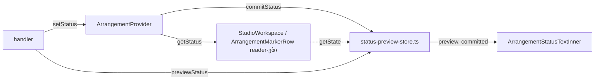

# PERF-11c-ii-b: committed status workspace context-იდან status store-ში გადავიდა

**თარიღი:** 2026-11-06
**სტატუსი:** Completed (C round 373 PASS)
**შეცვლილი პროექტი:** Store (`app/contexts/ArrangementContext.tsx`, `app/lib/arrangement/status-preview-store.ts`, ორი Studio კომპონენტი, ორი ტესტ-ფაილი და ტესტის helper `workspace-probe.ts`)

## კონტექსტი

HEAD `4900b83`-ზე committed status (`status`, `statusSequence`, `statusKey`) `ArrangementContextValue`-ის ნაწილი იყო. provider-ი მას status `useReducer`-ით ინახავდა. ამიტომ ყოველი `setStatus` მთელ context value-ს ცვლიდა და `useArrangement()`-ის ყველა consumer-ი, მათ შორის `StudioWorkspace` და `ArrangementTransport`, ხელახლა რენდერდებოდა (SIG-R360, A-R327-ARCH-STATUS-ONE-SOURCE).

პირველმა ეტაპმა (doc 239, round 372) ყველა ტესტი status-ს ერთ helper-ზე (`useWorkspaceStatus()`) გადაიყვანა. ეს მეორე ეტაპია: status value-დან გადის.

მომხმარებლისთვის არაფერი იცვლება: ტექსტები, მათი თანმიმდევრობა და screen reader-ის announcement-ები იგივეა.

## მიდგომა

ARCH-CHECKPOINT-PERF11C-STATUS-STORE-ზე root-ის პასუხი არ მოსულა, ამიტომ B-მ option A აირჩია (D-29z1233): committed entry არსებულ `status-preview-store.ts`-ს უერთდება და ცალკე store არ იქმნება. ასე preview და committed ერთ zustand store-შია და მათი ურთიერთობა (preview-ის adoption) ერთ `set`-ში წყდება.

- store-ში დაემატა `ArrangementCommittedStatus` (`text`, `sequence`, `key`), state-ები `committed` და `adoptedPreviewSequence`, და action `commitStatus(update, gestureActive)`. ერთ `set`-ში ის:
  1. pending preview-ს იღებს committed-ად (key `preview-<n>`, sequence +1);
  2. update-ს `reduceArrangementStatus`-ით ამცირებს;
  3. მიღებულ preview-ს ასუფთავებს.

  თუ არაფერი შეიცვალა, იგივე state ბრუნდება და subscriber-ს შეტყობინება არ მიდის.
- provider-იდან წაიშალა status `useReducer`, `dispatchStatus`, `flushStatusPreview`, ორი layout effect და მათი ref-ები (`committedStatusTextRef`, `adoptedPreviewSequenceRef`). `setStatus` ახლა `commitStatus`-ს იძახებს, შემდეგ კი `lastNonRefusalStatusRef`-ს წერს (ჯერ მიღებული preview-ს, მერე committed ტექსტს, თითოეულს მხოლოდ მაშინ, თუ refusal არ არის).
- context value-ს დაემატა სტაბილური getter `getStatus()`. `StudioWorkspace.tsx`-ისა და `ArrangementMarkerRow.tsx`-ის reader-ები მას იყენებენ.
- `ArrangementStatusTextInner` props-ს აღარ იღებს და `preview`-სა და `committed`-ს თავად იწერს `useArrangementStatusPreview`-ით. ახლა status write მხოლოდ ამ leaf-ს არენდერებს.

ალტერნატივა იყო ცალკე committed-status store. ამ შემთხვევაში adoption ორ store-ს შორის გაიყოფოდა და ordering-ის ახალი შემთხვევები გაჩნდებოდა.

## არქიტექტურა

context value status-ს აღარ შეიცავს, ამიტომ status write `useArrangement()`-ის consumer-ებს აღარ არენდერებს.

## შეცვლილი ფაილები

- `app/lib/arrangement/status-preview-store.ts`: committed entry, `adoptedPreviewSequence` და `commitStatus`.
- `app/contexts/ArrangementContext.tsx`: status reducer-ისა და layout effect-ების ნაცვლად store; ახალი `getStatus()`; `playFrom`-ის რიგის ცვლილება.
- `app/components/arrangement/StudioWorkspace.tsx`: `ArrangementStatusTextInner` store-ს იწერს; ორი `current.status` → `current.getStatus()`.
- `app/components/arrangement/ArrangementMarkerRow.tsx`: `status` → `getStatus()`.
- `app/lib/arrangement/__tests__/helpers/workspace-probe.ts`: `useWorkspaceStatus()` მხოლოდ `state.committed`-ს იწერს.
- `app/lib/arrangement/__tests__/render-budget.test.tsx` და `app/lib/arrangement/__tests__/selection-wrappers-render.test.tsx`: ახალი trigger-ები და assert-ები.
- `docs/implementation/2026/quarter-IV/239-perf-status-probe-migration.md`: სტატუსის ხაზი.
- ეს დოკუმენტი.

## პრობლემები და გადაწყვეტები

- **პრობლემა (R-CALLTIME):** HEAD-ზე function updater-ები და gesture flag reducer-ში, შემდეგ render-ზე იკითხებოდა; ახლა `setStatus`-ის გამოძახებისთანავე. app-ის 8 function updater-ის SWEEP-მა ერთი შემთხვევა იპოვა: `playFrom` marker-ის write-ის შემდეგ წერდა `isPlayingRef`-ს, რომელსაც updater კითხულობს. **გადაწყვეტა:** `playFrom`-ის start branch-ში `placeInsertMarker(target)` ახლა `startPlaybackAt`-ის შემდეგ იძახება. ამას `status-lifetime.test.tsx`-ის LT12 იცავს. code-reviewer-მა მეორე call-time დამოკიდებულებაც იპოვა: `placeInsertMarker` ჯერ marker-ს წერს და მერე range-ს ასუფთავებს, ამიტომ stopped ტექსტის updater ჯერ კიდევ არსებულ range-ს კითხულობს. gesture-ის გარეშე `setRange(null)` ტექსტს იმავე call-ში ასწორებს (LT13). აქტიური gesture-ის დროს ეს გასწორება არ ხდება, მაგრამ production-ში ასეთი გზა არ არსებობს: ruler click, marquee და playhead drag gesture-ს write-მდე ასრულებენ. ეს B-ს შემდეგ რაუნდში გადაეცა.
- **პრობლემა (R-PREVIEW-GUARD):** `previewStatus`-ის same-text guard ადრე layout effect-ის ref-ს ადარებდა. **გადაწყვეტა:** ის store-ის committed ტექსტს ადარებს. ეს უფრო ახალი მნიშვნელობაა, მაგრამ ნაჩვენები ტექსტი იგივე რჩება (`drag-preview-render.test.tsx` DP15–DP18).
- **პრობლემა (R-KEY):** adoption-ის შემდეგ ``-ის key რომ შეცვლილიყო, screen reader ტექსტს ხელახლა წაიკითხავდა. **გადაწყვეტა:** adoption-ზე committed key `preview-<n>` რჩება.
- **პრობლემა (TL-R372-M1):** როცა ერთ batch-ში ხდება non-refusal ტექსტი, refusal და release, აღდგება batch-ის შიგნით დაწერილი non-refusal ტექსტი (HEAD-ზე batch-მდე არსებული). **გადაწყვეტა:** მიღებულია (D-29z1234). ეს S5b-ის კონტრაქტს ემთხვევა და production handler სამივეს ერთ batch-ში არ აკეთებს.
- **პრობლემა:** ხუთი positive control status write-ს იყენებდა context value-ს შესაცვლელად. ახლა status write value-ს აღარ ცვლის და control-ები ცარიელი გახდებოდა. **გადაწყვეტა:** trigger-ად `resetExportState()` გამოიყენება, რომელიც ყოველთვის ახალ `exportState` ობიექტს წერს. RB-MEMO3-მა და GH1-მა ახალი assert-ები მიიღეს: status write `ArrangementStatusTextInner`-ს არენდერებს (RB-MEMO3: 2 write-ზე ზუსტად 2-ჯერ), `StudioWorkspace`-ს 0-ჯერ (RB-MEMO3), `ArrangementTransport`-ს 0-ჯერ (GH1). `expect(` რაოდენობა მხოლოდ გაიზარდა: `render-budget.test.tsx` 125 → 129, `selection-wrappers-render.test.tsx` 34 → 37.

## ტესტირება

- B-ის sketch-ზე: სრული suite 252 ფაილი და 3,703 ტესტი გადის; typecheck და Biome rc 0.
- Perf (`perf/studio-lab-interactions.perf.spec.ts`, production build, B-ის sketch run): 95 assert გადის. `interact.play.start-components` და `stop-components` 11/11. Fade-ის release-commits 2; trim, move, lane, group და video release-commits 1.
- 6 mutant, ყველა წითელი B-ის sketch-ზე:
  - MU-STATUS-ON-VALUE (status ისევ value-ზე): RB-MEMO3, GH1 (2);
  - MU-ADOPT-KEY-SEQUENCE (adoption-ის key sequence-იდან): DP11, DP17, DP18 (3);
  - MU-PLAYFROM-ORDER (`placeInsertMarker` ისევ წინ): LT12 (1);
  - MU-NO-PREVIEW-CLEAR (მიღებული preview არ სუფთავდება): 16 ტესტი;
  - MU-GESTURE-FLAG-OFF (gesture flag ყოველთვის false): SU5 (1);
  - MU-NO-NONREFUSAL-WRITE (`lastNonRefusalStatusRef` არ იწერება commit-ის შემდეგ): 11 ტესტი (`pending-status.test.tsx`-ის S1, S1-same-act, S2, S4, S5, S5b, S7, S8; SU4, SU5; TU13).
- A-ის ხეზე: `npm run typecheck`, `npm run lint` და Biome 7 code ფაილზე rc 0. 136 covering ტესტ-ფაილი (ყველა ფაილი, რომელიც context-ს, `StudioWorkspace`-ს, `ArrangementMarkerRow`-ს, store-ს ან probe-ს import-ს აკეთებს): 2,153 ტესტი გადის. `pending-status.test.tsx` და `status-lifetime.test.tsx` `--sequence.shuffle --sequence.seed=42`-ით: 43 ტესტი გადის.
- Browser: C ამოწმებს status ტექსტებს HEAD-თან შედარებით, auth guard-ს და Studio-ს smoke სცენარს.

## TODO / შემდეგი ნაბიჯები

- PERF-11c-iii: დარჩენილი `useArrangement()` leaf consumer-ები, PERF2-FIRST-FRAME-LONGTASK და B-R370-HOOK-ERROR-NAMES.
- S5b-same-act და CG→GR-same-act რიგები PERF-11c-iii-ის input-ია.
