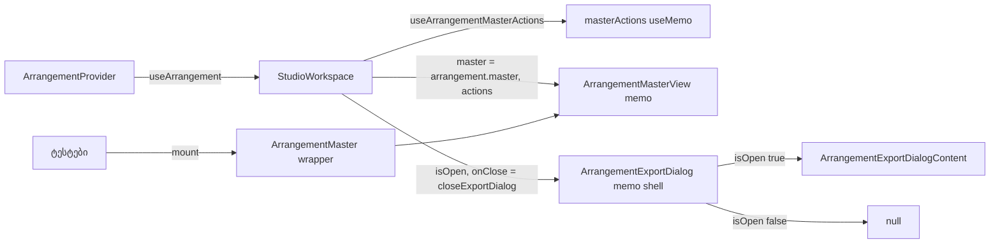

# PERF-11c-iii-a: Master strip და დახურული Export dialog workspace commit-ზე აღარ რენდერდება

**თარიღი:** 2026-11-06
**სტატუსი:** Completed (C round 374 PASS)
**შეცვლილი პროექტი:** Store (`ArrangementMaster.tsx`, `ArrangementExportDialog.tsx`, `StudioWorkspace.tsx`, `ArrangementContext.tsx` და სამი ტესტ-ფაილი)

## კონტექსტი

HEAD `e69eba4`-ზე `ArrangementMaster` props-ს არ იღებდა და `useArrangement()`-ს იძახებდა, ხოლო `ArrangementExportDialog` დახურულ მდგომარეობაშიც `useArrangement()`-ს იძახებდა. `StudioWorkspace` Export dialog-ს ყოველ render-ზე ახალ inline `onClose`-ს აძლევდა. შედეგად ყოველი commit (lane mute, Undo, drag-ის release) და ყოველი zoom ნაბიჯი ორივე leaf-ს ხელახლა არენდერებდა, თუმცა მათ ეკრანზე არაფერი ეცვლებოდათ (B-ის dev probe: zoom key, lane mute და Ctrl+Z — Master და ExportDialog თითოჯერ რენდერდება).

იმავე რაუნდში გასწორდა B-R370-HOOK-ERROR-NAMES: store hook-ების wrapper-ები provider-ის გარეშე გამოძახებისას საკუთარი სახელის ნაცვლად store hook-ის სახელს აჩვენებდნენ. დაემატა S5b-same-act row, რომელიც Medium TL-R372-M1-ს ხურავს.

მომხმარებლისთვის არაფერი იცვლება: ის, რასაც ხედავს და ისმენს, იგივეა.

## მიდგომა

**R-PATTERN (D-29z1237, `tech-lead`):** გამოყენებულია pattern A, round 371-ის ფორმა: memo view `Pick` props-ით, ხოლო export-ი რჩება თხელ wrapper-ად, რომელიც context-ს კითხულობს. Pattern B (სტაბილური actions context და data store-ები) ელოდება ARCH-CHECKPOINT-PERF11C-LEAF-PLUMBING-ს (D-29z1238).

- **Master:**
  - ახალი ტიპი `ArrangementMasterActions` არის `ArrangementContextValue`-ის 9 callback-ის `Pick`;
  - ახალი hook `useArrangementMasterActions(workspace)` ამ callback-ებს `useMemo`-ში აერთიანებს, ამიტომ object-ი მხოლოდ callback-ის შეცვლისას იცვლება;
  - ძველი body გახდა `ArrangementMasterViewInner({ master, actions })`, ხოლო export არის `ArrangementMasterView = memo(ArrangementMasterViewInner)` (`XInner` + `memo` ფორმა, რომ render log-მა სახელით დაინახოს);
  - `ArrangementMaster()` რჩება თხელ wrapper-ად: ტესტები მას პირდაპირ mount-ავენ და მისი signature არ შეცვლილა;
  - `StudioWorkspace` ახლა რენდერავს `ArrangementMasterView`-ს `arrangement.master`-ითა და `masterActions`-ით. `master` object-ი მხოლოდ master-ის ცვლილებისას ახლდება (Undo-ს ჩათვლით), ამიტომ lane commit-სა და zoom-ზე memo render-ს აჩერებს.
- **Export dialog (shell/content split):**
  - `ArrangementExportDialog = memo(ArrangementExportDialogShell)`;
  - shell აბრუნებს `ArrangementExportDialogContent`-ს მხოლოდ მაშინ, როცა `isOpen` true-ა, სხვა შემთხვევაში `null`-ს;
  - ძველი body უცვლელად გახდა `ArrangementExportDialogContent`;
  - `StudioWorkspace`-ში `onClose` ახლა სტაბილური `closeExportDialog` (`useCallback`) არის, ამიტომ shell-ის memo მუშაობს.
- **Hook-ის სახელები (R-HOOK-API, D-29z1239):** 7 store hook-ს (Position, Range, ClipLaneDrag, Selection, Preview, MasterMeter, TrackMeter) აქვს private helper `use<Name>StoreContext(hookName)`, იგივე pattern, რაც არსებულ `useArrangementPlaybackStoreContext`-ს. Public store hook-ები ისევ zero-argument-ია. 10 wrapper (Range, ClipLaneDrag, Selection, Preview, ActiveTrackId, PreviewLaneClips, Position, PositionWriter, MasterMeterWriter, TrackMeterWriter) helper-ს საკუთარ სახელს გადასცემს. Public hook-ზე default პარამეტრის ვარიანტი უარყო `tech-lead`-ის Medium-მა: ის public API-ს ცვლიდა.

**რატომ არის shell/content split ექვივალენტური (R-SHELL-EQUIV, D-29z1239):** `Modal` დახურულ მდგომარეობაში `null`-ს აბრუნებს, ამიტომ HEAD-ზეც დახურული dialog DOM-ში არაფერს ხატავდა. ახლა დახურვა content-ს unmount-ავს. მიღებული განსხვავებები, არცერთი არ ჩანს:
- opener-ზე focus ბრუნდება content-ის layout-effect cleanup-ში, portal-ის DOM-ის წაშლამდე (HEAD-ზე ჯერ DOM იშლებოდა). `blur`/`focusout`-ს არავინ უსმენს;
- `useId`-ის მნიშვნელობები ყოველ გახსნაზე ახალია;
- `scopeChoice` და `exportFormat` passive effect-ის ნაცვლად unmount-ზე ბრუნდება საწყისზე; საბოლოო მდგომარეობა იგივეა;
- დახურვისას `useScrollLock` მხოლოდ unmount cleanup-ს უშვებს (HEAD-ზე cleanup-ს და `else` branch-ს). body-ს სტილი და scroll-ის პოზიცია ისევ აღდგება, საბოლოო მდგომარეობა იგივეა.

Export-ის render-ის დროს დახურვას ისევ `handleClose` უარყოფს. Content-ის `isOpen` branch-ები ახლა ყოველთვის true-ა; diff-ის შესამცირებლად ისინი უცვლელი დარჩა (Low B-R373-EXPORT-CONTENT-DEAD-ISOPEN, გადადებული).

## არქიტექტურა

## შეცვლილი ფაილები

- `app/components/arrangement/ArrangementMaster.tsx` — `ArrangementMasterActions`, `useArrangementMasterActions`, `ArrangementMasterViewInner` / `ArrangementMasterView`, თხელი wrapper `ArrangementMaster`.
- `app/components/arrangement/ArrangementExportDialog.tsx` — memo shell და `ArrangementExportDialogContent`.
- `app/components/arrangement/StudioWorkspace.tsx` — `closeExportDialog`, `masterActions` და `ArrangementMasterView`-ის render.
- `app/contexts/ArrangementContext.tsx` — private `use<Name>StoreContext(hookName)` helper-ები 7 store hook-ისთვის.
- `app/lib/arrangement/__tests__/render-budget.test.tsx` — RB-LEAF1, RB-LEAF2.
- `app/lib/arrangement/__tests__/context-hygiene.test.tsx` — L8e, L8f.
- `app/lib/arrangement/__tests__/pending-status.test.tsx` — S5b-same-act.

## პრობლემები და გადაწყვეტები

- **პრობლემა:** Master-ის view-ს 9 callback სჭირდება, მაგრამ მთელი workspace value-ის prop-ად გადაცემა memo-ს გააუქმებდა. **გადაწყვეტა:** `useArrangementMasterActions` callback-ებს `useMemo`-ში აერთიანებს. ყველა callback provider-ში `useCallback`-ით სტაბილურია, ამიტომ object-ი commit-ზე არ იცვლება. RB-LEAF1 ამას ემპირიულად ამოწმებს.
- **პრობლემა:** inline `onClose` ყოველ render-ზე ახალი იყო და ნებისმიერ memo-ს გვერდს აუვლიდა. **გადაწყვეტა:** `closeExportDialog` `useCallback`-ით.
- **პრობლემა:** sketch-ის v1-ში public store hook-ებს diagnostic default პარამეტრი ჰქონდა (`tech-lead` Medium). **გადაწყვეტა:** v2-ში private helper-ები, public hook-ები zero-argument; `useArrangementPreviewLaneClips` ახლა საკუთარ სახელს აჩვენებს.
- **ცნობილი შეზღუდვა (Low, მიღებული):** თუ საიტი ისევ `<ArrangementMaster />`-ს დაუბრუნდება, RB-LEAF1 მწვანე რჩება (wrapper-ის შვილი memo-ში ჩერდება). ამას მხოლოდ perf spec-ის zoom/release რიცხვები იჭერს (C-ის PERF-INTERACT row).

## ტესტირება

- **ახალი row-ები:**
  - RB-LEAF1 (`render-budget.test.tsx`): lane mute და zoom ნაბიჯი `ArrangementMasterViewInner`-ს 0-ჯერ არენდერებს; Master mute — ერთხელ, და `aria-pressed` იცვლება.
  - RB-LEAF2 (`render-budget.test.tsx`): lane mute არც shell-ს, არც content-ს არ არენდერებს და DOM-ში dialog არ არის; Export-ზე click ორივეს არენდერებს და dialog იხსნება.
  - L8e (`context-hygiene.test.tsx`): `it.each` 10 wrapper-ზე, თითოეული საკუთარ სახელს აჩვენებს.
  - L8f (`context-hygiene.test.tsx`): პირდაპირ გამოძახებული store hook საკუთარ სახელს ინარჩუნებს.
  - S5b-same-act (`pending-status.test.tsx`): ახალი status, refusal და release ერთ batch-ში ახალ status-ს ინარჩუნებს (TL-R372-M1).
- **Assertion-ების რაოდენობა** მხოლოდ გაიზარდა (B-ის pre-check): context-hygiene `expect(` 50 → 52 / `it(` 12 → 14; pending-status 84 → 86 / 22 → 23; render-budget 129 → 140 / 13 → 15.
- **Mutant-ები** (B-ის `b-round-373/mutants/`), თითოეული წითელია sketch-ზე:
  - MU-MASTER-NO-MEMO — RB-LEAF1;
  - MU-MASTER-ACTIONS-FRESH — RB-LEAF1;
  - MU-EXPORT-NO-SHELL — RB-LEAF2;
  - MU-EXPORT-INLINE-ONCLOSE — RB-LEAF2;
  - MU-HOOK-NAME-RANGE — L8e `useArrangementRange`;
  - MU-NONREFUSAL-OUTSIDE-GESTURE-ONLY — S5b, S5b-same-act, SU5.
- **Perf (production build, B-ის sketch-ზე გაზომილი):**
  - `interact.zoom.1.components-per-key` 73 → 67 (1x და 6x);
  - `zoom.30` 160 → 154;
  - drag-ის `releaseComponentsMax` ყველა სახეობაზე 6-ით ნაკლებია (მაგ. fade/trim 72 → 66, move 73 → 67);
  - start/stop: 11/11, click: 38 (უცვლელი).
- **A-ს შემოწმებები:** `npm run typecheck`, `npm run lint`, Biome 7 კოდ-ფაილზე და `b-round-373/covering-374.txt`-ის 140 ფაილი (შედეგები `a-round-374.md`-ში).
- **ბრაუზერი:** Master strip-ის, Export dialog-ის, status ტექსტების, auth guard-ისა და Studio smoke-ის შედარება HEAD-თან 1440×900 და 1280×720-ზე C-ის round 374-ის row-ებია.

## TODO / შემდეგი ნაბიჯები

- PERF-11c-iii-b: `ArrangementLibrary` და `LibraryPreview` (active-track selector).
- PERF-11c-iii-c: Transport, LoopBrace და MarkerRow.
- PERF-11c-iii-d და PERF-11c-iii-e ელოდება ARCH-CHECKPOINT-PERF11C-LEAF-PLUMBING-ს (ან RETRO 384-ს).
- Low B-R373-EXPORT-CONTENT-DEAD-ISOPEN: Content-ის მკვდარი `isOpen` branch-ები.
- PERF-11c ჯერ არ დასრულებულა, ამიტომ doc 238-ის სტატუსი უცვლელია.
