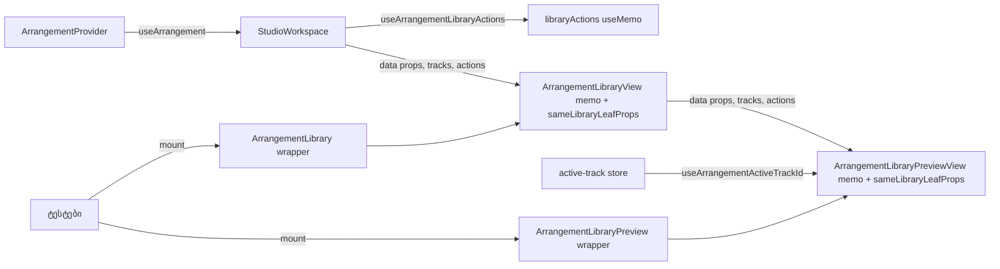

# PERF-11c-iii-b: Library და მისი preview workspace commit-ზე აღარ რენდერდება

**თარიღი:** 2026-11-06
**სტატუსი:** Completed (C round 375 PASS)
**შეცვლილი პროექტი:** Store (`ArrangementLibrary.tsx`, `ArrangementLibraryPreview.tsx`, `StudioWorkspace.tsx` და სამი ტესტ-ფაილი)

## კონტექსტი

HEAD `ad13a96`-ზე `ArrangementLibrary` და `ArrangementLibraryPreview` `useArrangement()`-ს იძახებდნენ. ამიტომ ყოველი workspace commit (lane mute, Undo, drag-ის release) და ყოველი zoom ნაბიჯი ორივე leaf-ს ხელახლა არენდერებდა, თუმცა ეკრანზე მათთვის არაფერი იცვლებოდა. B-ის dev probe-ით, zoom key-ზე, lane mute-სა და Ctrl+Z-ზე Library და LibraryPreview თითოჯერ რენდერდებოდა ორივე viewport-ზე.

იმავე რაუნდში დაიხურა GATE374-L2: RB-LEAF1-ს Master-ის საიტის `<ArrangementMaster />`-ზე დაბრუნება ვერ შეეძლო დაეჭირა.

მომხმარებლისთვის არაფერი იცვლება: ის, რასაც ხედავს და ისმენს, იგივეა.

## მიდგომა

**R-PATTERN (D-29z1237):** გამოყენებულია pattern A, round 374-ის ფორმა: memo view, `Pick` actions და თხელი wrapper. ახალი ნაწილი მხოლოდ custom comparator-ია. `tech-lead`-ის შეფასებით ის უსაფრთხოა, ხოლო მისი სამუდამო ადგილის საკითხი (SIG-R375-LEAF-COMPARATOR-HOME) ARCH-CHECKPOINT-PERF11C-LEAF-PLUMBING-ს შეუძლია დაელოდოს.

- **Preview (`ArrangementLibraryPreview.tsx`):**
  - ახალი ტიპი `LibraryTrackLabel` (`id`, `kind`, `name`), ყველა ველი `readonly`-ა;
  - `ArrangementLibraryPreviewActions` არის `ArrangementContextValue`-ის 4 callback-ის `Pick`;
  - `sameLibraryTrackLabels` ორ track სიას თანმიმდევრობით ადარებს `id`-ით, `kind`-ითა და `name`-ით;
  - `sameLibraryLeafProps` ყოველ prop-ს `tracks`-ის გარდა `Object.is`-ით ადარებს, ხოლო მხოლოდ `next`-ში არსებული key ცვლილებად ითვლება (მხოლოდ `previous`-ში არსებული key, რომლის მნიშვნელობა `undefined`-ია, ტოლად ითვლება, რაც React-ისთვისაც იგივეა). ბოლოს `tracks`-ს `sameLibraryTrackLabels`-ით ადარებს;
  - ძველი body გახდა `ArrangementLibraryPreviewViewInner`, ხოლო export არის `ArrangementLibraryPreviewView = memo(ArrangementLibraryPreviewViewInner, sameLibraryLeafProps)`. view ინარჩუნებს საკუთარ `useArrangementActiveTrackId()`-სა და insert-marker store-ის subscription-ებს, ამიტომ active lane-ის ცვლილება preview-ს მაინც არენდერებს;
  - `ArrangementLibraryPreview({ sourceId })` რჩება თხელ wrapper-ად, რომელიც context-ს კითხულობს: ტესტი მას პირდაპირ mount-ავს.
- **Library (`ArrangementLibrary.tsx`):**
  - ახალი ტიპი `ArrangementLibraryActions` (7 callback-ის `Pick`) და hook `useArrangementLibraryActions(workspace)`, რომელიც callback-ებს `useMemo`-ში აერთიანებს;
  - ძველი body გახდა `ArrangementLibraryViewInner`, ხოლო export არის `ArrangementLibraryView = memo(ArrangementLibraryViewInner, sameLibraryLeafProps)`. ის `ArrangementLibraryPreviewView`-ს data props-ითა და იგივე `actions` object-ით არენდერებს;
  - `ArrangementLibrary(props)` რჩება თხელ wrapper-ად, props-ის იგივე ტიპით.
- **`StudioWorkspace.tsx`:** `libraryActions = useArrangementLibraryActions(workspace)`. რენდერავს `<ArrangementLibraryView`-ს ხუთი layout prop-ით და `collection`, `sourceStates`, `sourcePeaks`, `selectedSourceId`, `libraryPreviewSourceId`, `tracks={arrangement.tracks}` და `actions={libraryActions}`-ით.

**რატომ ედრება track-ები `id`/`kind`/`name`-ით (R-TRACK-LABELS, D-29z1244):** lane mute ან Undo `arrangement.tracks`-ს ახალ მასივად აქცევს, ამიტომ იდენტობით შედარება memo-ს ყოველ commit-ზე გაატარებდა. Library და preview track-ის მხოლოდ ამ სამ ველს კითხულობს. Context-ს track-ის rename, add ან delete action არ აქვს, ამიტომ label დღეს UI-დან ვერ შეიცვლება. Prop-ის ტიპია `readonly LibraryTrackLabel[]`: სხვა ველის მომავალი წაკითხვა ტიპის გაფართოების გარეშე არ დაკომპილირდება.

## არქიტექტურა

## შეცვლილი ფაილები

- `app/components/arrangement/ArrangementLibraryPreview.tsx` — `LibraryTrackLabel`, `ArrangementLibraryPreviewActions`, `sameLibraryTrackLabels`, `sameLibraryLeafProps`, `ArrangementLibraryPreviewViewInner` / `ArrangementLibraryPreviewView`, თხელი wrapper `ArrangementLibraryPreview`.
- `app/components/arrangement/ArrangementLibrary.tsx` — `ArrangementLibraryActions`, `useArrangementLibraryActions`, `ArrangementLibraryViewInner` / `ArrangementLibraryView`, თხელი wrapper `ArrangementLibrary`.
- `app/components/arrangement/StudioWorkspace.tsx` — `libraryActions` და `ArrangementLibraryView`-ის render.
- `app/lib/arrangement/__tests__/render-budget.test.tsx` — RB-LEAF3, RB-LEAF1-ის Master assert და სახელების გადარქმევა.
- `app/lib/arrangement/__tests__/library-preview.test.tsx` — LP-EQ1, LP-EQ2 და cursor row-ის სახელი.
- `app/lib/arrangement/__tests__/drag-preview-render.test.tsx` — 4 `rendersOf` სახელის გადარქმევა.

## პრობლემები და გადაწყვეტები

- **პრობლემა:** `arrangement.tracks` ყოველ commit-ზე ახალი მასივია, ამიტომ ჩვეულებრივი `memo` Library-ს ვერ გააჩერებდა. **გადაწყვეტა:** `sameLibraryLeafProps` comparator, რომელიც track-ებს მხოლოდ წაკითხული ველებით ადარებს.
- **პრობლემა:** view-ებს 7 და 4 callback სჭირდებათ, მაგრამ მთელი workspace value-ის გადაცემა memo-ს გააუქმებდა. **გადაწყვეტა:** `useArrangementLibraryActions` callback-ებს `useMemo`-ში აერთიანებს. ყველა callback provider-ში `useCallback`-ია, ამიტომ object-ი commit-ზე არ იცვლება. Preview იგივე `actions` object-ს იღებს.
- **პრობლემა (R-RENAMES, D-29z1244, `tech-lead`):** StudioWorkspace-ის ქვეშ wrapper-ები აღარ mount-დება, ამიტომ ძველი სახელით (`'ArrangementLibrary'`, `'ArrangementLibraryPreview'`) დათვლა ყოველთვის 0 იქნებოდა და row-ები ცარიელ შემოწმებად იქცეოდა. **გადაწყვეტა:** row-ები ახლა `ArrangementLibraryViewInner`-სა და `ArrangementLibraryPreviewViewInner`-ს ითვლის. `render-budget.test.tsx`-სა და `library-preview.test.tsx`-ში ახალ სახელებს იმავე ფაილში დადებითი კონტროლი აქვს: RB-LEAF3-ის `=== 1` სამჯერ და library-preview-ის cursor row-ის `>= 10`. `drag-preview-render.test.tsx`-ის 4 გადარქმეულ row-ს საკუთარ ფაილში დადებითი კონტროლი არ აქვს; სახელის სისწორეს RB-LEAF3 ადასტურებს. `resetExportState()`-ის შემდეგ row ახლა Library view-ის **0** render-ს ამოწმებს, რაც უფრო მკაცრია: export-ის state Library-ის prop არ არის.
- **პრობლემა (GATE374-L2):** Master-ის საიტის `<ArrangementMaster />`-ზე დაბრუნებას RB-LEAF1 ვერ ხედავდა. **გადაწყვეტა:** RB-LEAF1 ახლა lane commit-ზე `ArrangementMaster`-ის 0 render-საც ამოწმებს. MU-MASTER-SITE-REVERT ამ row-ს წითლად აქცევს.
- **ღია საკითხი (R-MASTER-COUNTS, B-R374-MASTER-VACUOUS-NAME-COUNTS, გადადებული Low):** `master-ui.test.tsx` და `fader-pointer-preview.test.tsx` StudioWorkspace-ის ქვეშ ჯერ კიდევ `'ArrangementMaster'`-ს ითვლის. ეს ფაილები ამ რაუნდს არ ეკუთვნის.

## ტესტირება

- **ახალი row-ები:**
  - RB-LEAF3 (`render-budget.test.tsx`): lane mute, zoom ნაბიჯი და Undo არ არენდერებს არც `ArrangementLibraryViewInner`-ს, არც `ArrangementLibraryPreviewViewInner`-ს. wrapper-ების (`ArrangementLibrary`, `ArrangementLibraryPreview`) 0 render-ის assert-ები StudioWorkspace-ის ქვეშ site-revert-ის დამცავია: wrapper-ები იქ მხოლოდ მაშინ mount-დება, თუ render-ის ადგილი wrapper-ს დაუბრუნდება. Video lane-ის გააქტიურება preview-ს ერთხელ არენდერებს, Library-ს 0-ჯერ, და Add იღებს `aria-disabled="true"`-ს სათაურით "Add — make an audio track active first". Music-ზე დაბრუნება `aria-disabled`-ს ხსნის. სხვა ხმის არჩევა Library-ს ერთხელ არენდერებს. ძებნაში ბეჭდვა Library-ს ერთხელ არენდერებს და preview-ს 0-ჯერ.
  - RB-LEAF1 (`render-budget.test.tsx`): დამატებით `ArrangementMaster` lane commit-ზე 0-ჯერ რენდერდება.
  - LP-EQ1 (`library-preview.test.tsx`): label-ები `id`-ით, `kind`-ითა და `name`-ით ედრება, არა იდენტობით ან სხვა ველით. მხოლოდ id-ის, kind-ის, name-ის, თანმიმდევრობის ან სიგრძის ცვლილება უტოლობაა.
  - LP-EQ2 (`library-preview.test.tsx`): დაკოპირებული track სია ტოლია; სხვა `sourceId`, ახალი `actions` object-ი ან დამატებითი key უტოლობაა.
- **Assertion-ების რაოდენობა** მხოლოდ გაიზარდა (ლუპის artifact `tmp/studio-real-loop/b-round-374/expect-counts-375.txt`): render-budget `expect(` 140 → 160 / `it(` 15 → 16; library-preview 61 → 71 / 12 → 14; drag-preview-render 526 / 74 უცვლელი.
- **Mutant-ები** (B-ის ლუპის artifact `tmp/studio-real-loop/b-round-374/mutants/`), თითოეული წითელია sketch-ზე:
  - MU-LIB-NO-MEMO — RB-LEAF3, Play → Stop → Play და start-hold row-ები;
  - MU-PREVIEW-NO-MEMO — RB-LEAF3;
  - MU-LEAF-PROPS-DEFAULT-EQUALITY — RB-LEAF3;
  - MU-LIB-ACTIONS-FRESH — RB-LEAF3, Play → Stop → Play და start-hold row-ები;
  - MU-TRACK-LABEL-NO-NAME — LP-EQ1;
  - MU-TRACK-LABEL-NO-ID — LP-EQ1;
  - MU-LEAF-PROPS-NO-EXTRA-KEY — LP-EQ2;
  - MU-LIB-SITE-REVERT — RB-LEAF3;
  - MU-PREVIEW-SITE-REVERT — RB-LEAF3;
  - MU-MASTER-SITE-REVERT — RB-LEAF1.
- **Perf (production build, B-ის sketch-ზე გაზომილი, ლუპის artifact `tmp/studio-real-loop/b-round-374/perf-sketch-vs-head.txt`):**
  - `interact.zoom.1.components-per-key` 67 → 53 (1x და 6x);
  - `zoom.30` 154 → 140;
  - drag-ის `releaseComponentsMax` commit-იან ყველა სახეობაზე 14-ით ნაკლებია (fade/trim 66 → 52, move/lane/video 67 → 53, group 68 → 54);
  - move/lane-ის `move-components-max` 72 → 58, group-ის 73 → 59;
  - start/stop: 11/11, click: 38 (უცვლელი).
- **A-ს შემოწმებები:** `npm run typecheck`, `npm run lint`, Biome 6 ფაილზე და ლუპის `tmp/studio-real-loop/b-round-374/covering-375.txt`-ის 140 ფაილი (შედეგები ლუპის `tmp/studio-real-loop/a-round-375.md`-ში; ეს artifact-ები repository-ში არ არის).
- **ბრაუზერი:** Library-ის კლავიშები, მენიუ, preview, layout, auth guard და Studio smoke HEAD-თან შედარებით 1440×900 და 1280×720-ზე C-ის round 375-ის row-ებია.

## TODO / შემდეგი ნაბიჯები

- PERF-11c-iii-c: Transport, LoopBrace და MarkerRow.
- PERF-11c-iii-d (VideoDock) და PERF-11c-iii-e (Lane) ელოდება ARCH-CHECKPOINT-PERF11C-LEAF-PLUMBING-ს (ან RETRO 384-ს).
- SIG-R375-LEAF-COMPARATOR-HOME: comparator-ის სამუდამო ადგილი ARCH-CHECKPOINT-ის input-ია.
- Low B-R374-MASTER-VACUOUS-NAME-COUNTS: `master-ui.test.tsx`-ისა და `fader-pointer-preview.test.tsx`-ის `'ArrangementMaster'` სახელით დათვლა.
- PERF-11c ჯერ არ დასრულებულა, ამიტომ doc 238-ის სტატუსი უცვლელია.
