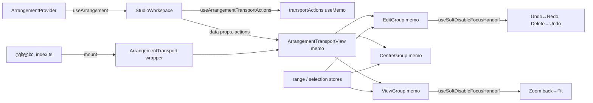

# PERF-11c-iii-c1: Transport მხოლოდ იმ ჯგუფს არენდერებს, რომლის input შეიცვალა

**თარიღი:** 2026-11-07
**სტატუსი:** Completed (C round 377 PASS)
**შეცვლილი პროექტი:** Store (`ArrangementTransport.tsx`, `StudioWorkspace.tsx` და ოთხი ტესტ-ფაილი)

## კონტექსტი

HEAD `6b11be7`-ზე `ArrangementTransport` `useArrangement()`-ს იძახებდა, ამიტომ ყოველი workspace commit მთელ Transport-ს ერთხელ არენდერებდა: clip-ის დამატება, zoom key, lane mute, Ctrl+Z, Undo და Redo ღილაკები, library preview-ის დაწყება და გაჩერება. B-ის displayName-aware dev probe-ით (ორივე viewport): add 3, zoom 1, mute 1, Ctrl+Z 1, Undo 1, Redo 1, preview start 1, preview stop 2 Transport render. Play/Stop მხოლოდ `ArrangementTransportPlayStopInner`-ს არენდერებდა.

მომხმარებლისთვის არაფერი იცვლება: ღილაკების label, title, `aria-*`, soft-disabled მდგომარეობა, focus hand-off, Loop-ის pressed მდგომარეობა, zoom slider და Export dialog იგივეა.

## მიდგომა

გამოყენებულია pattern A, round 374-ისა და 375-ის ფორმა: memo view, `Pick` actions და თხელი wrapper (D-29z1248).

- **`ArrangementTransport.tsx`:**
  - `ArrangementTransportActions` არის `ArrangementContextValue`-ის შვიდი action-ის `Pick` (`togglePlayback`, `returnToStart`, `undo`, `redo`, `splitSelection`, `deleteSelection`, `toggleLoopSelection`); `useArrangementTransportActions(workspace)` მათ `useMemo`-ში აერთიანებს. ყველა action provider-ში `useCallback`-ია, ამიტომ object-ი commit-ზე არ იცვლება.
  - სამი memo ჯგუფი, თითოეულს საკუთარი range/selection selector-ები აქვს:
    - **Edit** (`ArrangementTransportEditGroup`: Undo, Redo, Split, Delete) — რენდერდება, როცა Undo/Redo label, range ან clip-ის მონიშვნა იცვლება;
    - **Centre** (`ArrangementTransportCentreGroup`: Follow, position, project end, Play/Stop, back to start, Loop) — როცა follow mode, committed project end, loop ან range იცვლება;
    - **View** (`ArrangementTransportViewGroup`: zoom slider და readout, zoom to selection, Zoom back, Fit, Export) — როცა zoom, `canZoomBack` ან range იცვლება.
  - `ArrangementTransportView = memo(ArrangementTransportViewInner)` data props-ს (`undoLabel`, `redoLabel`, `pxPerSecond`, `loop`, `committedProjectEnd`, `onOpenExport`, `navigation`, `actions`) ჯგუფებს უნაწილებს.
  - `ArrangementTransport({ onOpenExport, navigation })` რჩება თხელ wrapper-ად იგივე signature-ით: მას `index.ts` და ორი ტესტ-ფაილი იყენებს (TL-R376-L2, GATE375-L1-UNUSED-WRAPPERS).
- **`useSoftDisableFocusHandoff()`:** HEAD-ის layout effect-ის body უცვლელია. arm callback `useCallback`-ია; ახალი arm წინა expiry frame-ს აუქმებს და `requestAnimationFrame`-ს ნიშნავს, რომელიც arm-ს ასუფთავებს; unmount-ზე frame უქმდება. Edit და View ჯგუფს საკუთარი hand-off აქვს (TL-R376-L1: ლოგიკა აღარ დუბლირდება). ოთხივე hand-off (Undo→Redo, Redo→Undo, Delete→Undo, Zoom back→Fit) ერთ ჯგუფშია, ამიტომ soft-disabled გამხდარი წყარო იმავე commit-ში თავის ჯგუფს ყოველთვის არენდერებს.
- **`StudioWorkspace.tsx`:** `openExportDialog` (`useCallback` ცარიელი deps მასივით, `[]`) ცვლის inline `() => setIsExportOpen(true)`-ს; `transportActions = useArrangementTransportActions(workspace)`; რენდერავს `<ArrangementTransportView`-ს.

**რატომ ქრება arm ერთ frame-ში (TL-R376-M1, Medium):** ცალკე ჯგუფებით, click-ით armed hand-off, რომლის commit ჯგუფის props-ს არ ცვლის (ორი Undo click ერთი და იმავე label-ებით), ჯგუფის შემდეგ render-მდე armed რჩებოდა და მოგვიანებით, სხვა წყაროდან მოსულ commit-ზე focus-ს გადაიტანდა. HEAD-ზე მთელი Transport ყოველ commit-ზე რენდერდებოდა, ამიტომ arm მაშინვე იხარჯებოდა. ერთ-frame-იანი expiry HEAD-ის ეფექტურ სიცოცხლეს აბრუნებს. FL11 ამას სამ ხეზე ამტკიცებს: HEAD-ზე მწვანე, expiry-ის გარეშე (sketch v1) წითელი, sketch v2-ზე მწვანე.

**დაშვება:** ერთ-frame-იანი expiry მუშაობს, რადგან Undo, Redo, Delete და Zoom back-ის commit click-ის handler-ში სინქრონულად სრულდება (`startTransition` ან `useDeferredValue` ამ გზაზე არ გამოიყენება). თუ რომელიმე ამ action-ს მომავალში transition-ში გადაიტანენ, arm შეიძლება commit-მდე გაქრეს და hand-off აღარ მოხდეს; ასეთ ცვლილებას ამ დაშვების ხელახალი შემოწმება სჭირდება. რეპროდუქციის სადარაჯო row არ არსებობს (A-R376-REVIEW-M2, Low, D-29z1251); tripwire არის B-ის claim K5 (ლუპის artifact `tmp/studio-real-loop/b-round-376/claims-377.sh`, repository-ს გარეთ): 0 `startTransition`/`useTransition`/`useDeferredValue` `ArrangementTransport.tsx`-ში, `StudioWorkspace.tsx`-სა და `ArrangementContext.tsx`-ში. ამ ფაილებზე მომუშავე ყოველი შემდეგი PERF დავალება ამ claim-ს იმეორებს.

## არქიტექტურა

## შეცვლილი ფაილები

- `app/components/arrangement/ArrangementTransport.tsx` — `useSoftDisableFocusHandoff`, `ArrangementTransportActions`, `useArrangementTransportActions`, `ArrangementTransportViewProps`, სამი memo ჯგუფი, `ArrangementTransportViewInner` / `ArrangementTransportView`, თხელი wrapper `ArrangementTransport`.
- `app/components/arrangement/StudioWorkspace.tsx` — `openExportDialog`, `transportActions` და `ArrangementTransportView`-ის render.
- `app/lib/arrangement/__tests__/render-budget.test.tsx` — `TRANSPORT_LEAVES`, `TRANSPORT_STEP_COUNTS`, RB-LEAF4, `CONTEXT_CONSUMERS`-ში `StudioWorkspace`, Play/Stop row-ები `ArrangementTransportViewInner`-ს ითვლის, RB-LEAF3 ყოველ commit-ზე ამოწმებს; RB-LEAF4b (round 377).
- `app/lib/arrangement/__tests__/selection-wrappers-render.test.tsx` — `resetExportState()`-ის შემდეგ ორი „commit მოხდა" კონტროლი (PERF-8b-ის describe-ში და GH1-ში) `StudioWorkspace`-ს ითვლის; GH1 ამოწმებს `ArrangementTransportViewInner`-ს (mount-ზე > 0, status write-ზე 0).
- `app/lib/arrangement/__tests__/drag-preview-render.test.tsx` — ხუთი `toBe(0)` row `ArrangementTransportViewInner`-ს ითვლის; DP23-ს აქვს mount კონტროლები და მონიშვნის ცვლილება Edit ჯგუფს არენდერებს, view-ს არა.
- `app/lib/arrangement/__tests__/self-disabling-focus.test.tsx` — FL11.
- `docs/implementation/2026/quarter-IV/243-perf-transport-leaves.md` — ეს დოკუმენტი.

## პრობლემები და გადაწყვეტები

- **პრობლემა:** `useArrangement()` Transport-ს ყოველ commit-ზე არენდერებდა. **გადაწყვეტა:** view memo-ა და მხოლოდ data props-ს იღებს; range და selection თითოეული ჯგუფის საკუთარი subscription-ია.
- **პრობლემა:** inline `onOpenExport` ან ახალი actions object memo-ს ყოველ commit-ზე გაატარებდა. **გადაწყვეტა:** `openExportDialog` `useCallback`-ია, actions `useMemo`-ში. MU-T-EXPORT-INLINE და MU-T-ACTIONS-FRESH RB-LEAF4-ს და start hold-ის row-ს წითლად აქცევს.
- **პრობლემა (TL-R376-M1):** armed hand-off ჯგუფის render-მდე რჩებოდა. **გადაწყვეტა:** ერთ-frame-იანი expiry (იხ. მიდგომა). MU-T-HANDOFF-NO-EXPIRY FL11-ს წითლად აქცევს.
- **პრობლემა (სახელების გადარქმევა სავალდებულოა):** StudioWorkspace ახლა view-ს არენდერებს, ამიტომ wrapper-ის სახელით (`'ArrangementTransport'`) დათვლა StudioWorkspace-ის ქვეშ ყოველთვის 0-ია და ყოველი `toBe(0)` ცარიელ შემოწმებად იქცეოდა. **გადაწყვეტა:** row-ები `ArrangementTransportViewInner`-ს ან `StudioWorkspace`-ს ითვლის; ყოველ გადარქმეულ სახელს იმავე ფაილში `> 0` row აქვს (RB-LEAF4 mount, GH1 mount, DP23 mount). RB-LEAF4 wrapper-ის 0 render-ს reset-სა და zoom-ზე site-revert-ის დამცავად ამოწმებს.
- **მიღებული ზრდა (D-29z1248):** range და background-range-ის `move-components-max` +2 (25 → 27, 37 → 39; ერთ move-ზე +0.033). სამივე ჯგუფი range selector-ს ფლობს, ამიტომ range-ის დაწყება სამ ჯგუფს არენდერებს იქ, სადაც HEAD ერთ Transport-ს. subscription-ის view-ში გადატანა ოთხს დაარენდერებდა. row ბიუჯეტში რჩება.

## ტესტირება

- **ახალი row-ები:**
  - RB-LEAF4 (`render-budget.test.tsx`): ოთხი შიდა სახელის mount-ზე სიცოცხლე, შემდეგ View/Edit/Centre/ViewGroup render-ები: reset 0/0/0/0, mute 1/1/0/0, zoom 1/0/0/1, range 0/1/1/1, loop 1/1/1/0, mute loop-ით 1/1/0/0, undo 1/1/0/0; wrapper `ArrangementTransport` reset-სა და zoom-ზე 0.
  - FL11 (`self-disabling-focus.test.tsx`): Undo click, რომლის commit label-ებს არ ცვლის, მოგვიანებითი undo-სთვის armed hand-off-ს არ ტოვებს.
  - RB-LEAF4b (`render-budget.test.tsx`, round 377): Master Mute-ის ორჯერ გადართვა. ორივე commit ერთსა და იმავე Undo label-ს ტოვებს (`Undo: Master Mute`), ამიტომ მეორე გადართვაზე `StudioWorkspace` რენდერდება (> 0), ოთხივე transport leaf 0-ია, Edit ჯგუფის ტექსტი უცვლელია და `master.mute` ისევ `false`-ია. **რატომ არსებობს (A-R376-REVIEW-M1, Medium, D-29z1251):** RB-LEAF4-ის ყოველი edit ნაბიჯი Undo/Redo label-ს ცვლის, ამიტომ არცერთი row არ ამტკიცებდა, რომ label-ის შემნარჩუნებელი edit leaf-ებს უძრავად ტოვებს.
- **Assertion-ების რაოდენობა** მხოლოდ გაიზარდა (ლუპის artifact-ები `tmp/studio-real-loop/b-round-375/expect-counts-376.txt` და `tmp/studio-real-loop/b-round-376/expect-counts-377.txt`, repository-ს გარეთ): render-budget `expect(` 160 → 181 → 187 / `it(` 16 → 17 → 18; self-disabling-focus 130 → 137 / 20 → 21; selection-wrappers-render 37 → 38 / 7; drag-preview-render 526 → 530 / 74.
- **Mutant-ები** (B-ის ლუპის artifact `tmp/studio-real-loop/b-round-375/mutants/mutant-<id>.log`, repository-ს გარეთ), თითოეული წითელია sketch-ზე; ჩამოთვლილია log-ში რეალურად წითელი row-ები:
  - MU-T-DELETE-NO-ARM — FL5;
  - MU-T-UNDO-ARM-SELF — FL3, SD5, TC9;
  - MU-T-HANDOFF-NO-EXPIRY — FL11;
  - MU-T-ACTIONS-FRESH — RB-LEAF4 და start hold-ის row (R9-L2);
  - MU-T-EXPORT-INLINE — RB-LEAF4 და start hold-ის row (R9-L2);
  - MU-T-LOOP-CLONE — RB-LEAF4;
  - MU-T-VIEW-NO-MEMO — RB-LEAF4 და start hold-ის row (R9-L2);
  - MU-T-EDIT-NO-MEMO — RB-LEAF4;
  - MU-T-SITE-REVERT — RB-LEAF4;
  - MU-T-CANZOOMBACK-TRUE — FL6, FL10, SD1, SD2, SD2b, SD3, NS1, NS3.
  - MU-T-UNDO-FRESH-PER-EDIT (round 377; provider-ის `undo`-ს `useCallback` deps-ს ემატება `history`, ამიტომ `undo` ყოველ edit-ზე ახალი ფუნქციაა) — RB-LEAF4b (`ArrangementTransportViewInner` 1, `ArrangementTransportEditGroupInner` 1, მოსალოდნელი 0); RB-LEAF4 მწვანე რჩება, რაც ადასტურებს, რომ ხარვეზი რეალური იყო (ლუპის artifact `tmp/studio-real-loop/b-round-376/mutants/sketch-run/mutant-MU-T-UNDO-FRESH-PER-EDIT.full.log`, repository-ს გარეთ: 1 failed, 1 passed, 16 skipped).
- **TC10-ის timeout (INFO-A376-TC10-DESCRIBE-TIMEOUT, D-29z1250):** TC10 `transport-centre-ui.test.tsx`-ის describe-შია, რომელსაც `timeout: 15_000` აქვს და არა 5 წამიანი default. ყველა გაზომვა 15 წამის 11–21 %-ია (2,096 ms gate 375-ში, 2,984 ms B-ის v3 run-ში, 3,088 ms A-ს round 376-ის run-ში, 1,685 ms C-ის ცალკე run-ში), ამიტომ STOP-ის პირობა არ არსებობს და timeout არ შეცვლილა.
- **Perf (production build, B-ის sketch-ზე გაზომილი, ლუპის artifact `tmp/studio-real-loop/b-round-375/perf-sketch-vs-head.txt`, repository-ს გარეთ):**
  - `interact.zoom.1.components-per-key` 53 → 41 (1x და 6x); `zoom.30` 140 → 128; `click.components` 38 → 29;
  - `releaseComponentsMax`: fade/trim 52 → 44; move/lane 53 → 51; group 54 → 52; video, video-trim, video-fade 53 → 45;
  - `move-components-max`: move/lane 58 → 40, group 59 → 41; range და background-range +2 (მიღებული, იხ. ზემოთ);
  - დანარჩენი deterministic row-ები HEAD-ის ტოლია.
- **A-ს შემოწმებები:** `npm run typecheck`, `npm run lint`, Biome 6 ფაილზე და ლუპის `tmp/studio-real-loop/b-round-375/covering-376.txt`-ის 140 ფაილი (შედეგები ლუპის `tmp/studio-real-loop/a-round-376.md`-ში; repository-ს გარეთ). Round 377-ში: `npm run typecheck`, `npm run lint`, Biome `render-budget.test.tsx`-ზე და `render-budget.test.tsx`-ის 18 row (ლუპის `tmp/studio-real-loop/a-round-377.md`, repository-ს გარეთ).
- **ბრაუზერი:** Transport-ის ღილაკები, focus hand-off-ები, Export dialog და Play/Stop 1440×900 და 1280×720-ზე C-ის round 377-ის row-ებია (LEAF-PROBE, TRANSPORT-BROWSER (f) და (a, c), STUDIO-SMOKE-377, მათ შორის RB-LEAF4b ბრაუზერში). C round 376 BLOCKED იყო და ეს row-ები არ გაუშვია.

## TODO / შემდეგი ნაბიჯები

- PERF-11c-iii-c2: LoopBrace და MarkerRow.
- PERF-11c-iii-d (VideoDock) და PERF-11c-iii-e (Lane) ელოდება ARCH-CHECKPOINT-PERF11C-LEAF-PLUMBING-ს (ან RETRO 384-ს).
- GATE375-L1-UNUSED-WRAPPERS: thin wrapper-ების პოლიტიკა (ეხება `ArrangementTransport`-საც).
- PERF-11c ჯერ არ დასრულებულა, ამიტომ doc 238-ის სტატუსი უცვლელია.
