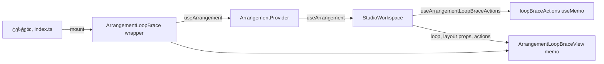

# PERF-11c-iii-c2a: Loop brace აღარ რენდერდება workspace-ის დაუკავშირებელ commit-ებზე

**თარიღი:** 2026-11-07
**სტატუსი:** Completed (C round 378 PASS)
**შეცვლილი პროექტი:** Store (`ArrangementLoopBrace.tsx`, `StudioWorkspace.tsx`, `render-budget.test.tsx`)

## კონტექსტი

HEAD `79ed8a9`-ზე `ArrangementLoopBrace` `useArrangement()`-ს იძახებდა და `arrangement.loop`-ს კითხულობდა, ამიტომ ყოველი `StudioWorkspace` commit loop brace-ს არენდერებდა, მაშინაც კი, როცა loop არ შეცვლილა. B-ის dev leaf probe-ით (ორივე viewport, 1440×900 და 1280×720; ლუპის artifact `tmp/studio-real-loop/b-round-377/probe/leaf-head-378.json`, repository-ს გარეთ) `ArrangementLoopBrace`-ის render-ები ნაბიჯზე: add 3, zoom 1, lane mute 1, Ctrl+Z 1, Undo/Redo ღილაკი 1, library preview start 1, preview stop 2.

მომხმარებლისთვის არაფერი იცვლება: brace-ის `aria-label`, `title`, `data-loop-enabled`, `style.left`/`style.width`, ტექსტი `Loop` / `Loop off`, `arrangement-loop-times` readout, pointer gesture-ები (capture, 3 px threshold, snap/Alt, marker snap targets, `claimPointerGesture` abort) და keyboard step-ები (`keyRepeat`) იგივეა.

## მიდგომა

გამოყენებულია pattern A — იგივე ფორმა, რაც Master-ს, Library-სა და Transport-ს აქვს (doc 241, 242, 243):

- **`ArrangementLoopBraceView = memo(ArrangementLoopBraceViewInner)`** — იღებს `loop`-ს და ოთხ layout prop-ს (`seconds`, `pxPerSecond`, `snapSeconds`, `gridSeconds`) და `actions`-ს. Render log fiber-ის სახელით ითვლის, ამიტომ გამოყენებულია `function XInner` + `memo(XInner)` ფორმა (ლუპის lesson L23, `tmp/studio-real-loop/lessons.md`, repository-ს გარეთ).
- **`useArrangementLoopBraceActions(workspace)`** — `ArrangementContextValue`-ის ხუთი callback-ის `Pick` (`getArrangement`, `previewLoopArrangement`, `commitLoopRange`, `stepLoopRange`, `claimPointerGesture`) `useMemo`-ში. ხუთივე provider-ში `useCallback`-ია და deps `[]` callback-ებზე ან `useState` store-ებზე მთავრდება, ამიტომ object-ი mount-ზე ერთხელ იქმნება.
- **`ArrangementLoopBrace`** — თხელი wrapper ძველი signature-ით; მას `index.ts` და standalone ტესტები იყენებს (`gesture-reentry`, `gesture-guard`, `ArrangementContext.test.ts`).
- **`StudioWorkspace`** — `loopBraceActions = useArrangementLoopBraceActions(workspace)` და `<ArrangementLoopBraceView loop={arrangement.loop} actions={loopBraceActions} … />`.

`loop` მხოლოდ ხატვისთვისაა: event-ის დროს მნიშვნელობა `getArrangement()`-დან ან gesture-ის captured მდგომარეობიდან იკითხება. snap-ის prop-ები memo-ს შედარებაშია, ამიტომ მათი ცვლილება brace-ს ისევე არენდერებს და handler-ებს ისევე აახლებს, როგორც HEAD-ზე.

**ალტერნატივა:** brace-ის საკუთარი store subscription. უარყოფილია: ოთხ წინა leaf-თან შეუსაბამო იქნებოდა და provider-ის ცვლილებას მოითხოვდა.

## არქიტექტურა

## შეცვლილი ფაილები

- `app/components/arrangement/ArrangementLoopBrace.tsx` — `ArrangementLoopBraceActions`, `useArrangementLoopBraceActions`, `ArrangementLoopBraceViewInner` / `ArrangementLoopBraceView`, თხელი wrapper `ArrangementLoopBrace`.
- `app/components/arrangement/StudioWorkspace.tsx` — import, `loopBraceActions` და `ArrangementLoopBraceView`-ის mount.
- `app/lib/arrangement/__tests__/render-budget.test.tsx` — RB-LEAF5.
- `docs/implementation/2026/quarter-IV/244-perf-loop-brace-leaf.md` — ეს დოკუმენტი.

ცვლილება B-ის განხილული sketch-ის ზუსტი გამოყენებაა (ლუპის artifact `tmp/studio-real-loop/b-round-377/sketch.patch.txt`, sha256 `28d86d7b…`, repository-ს გარეთ); სამი ფაილის sha256 sketch-ს ემთხვევა.

## პრობლემები და გადაწყვეტები

- **პრობლემა:** `useArrangement()` brace-ს ყოველ commit-ზე არენდერებდა. **გადაწყვეტა:** memo view, რომელიც მხოლოდ `loop`-ს, layout prop-ებსა და სტაბილურ actions-ს იღებს.
- **პრობლემა:** ახალი actions object memo-ს ყოველ commit-ზე გაატარებდა. **გადაწყვეტა:** `useMemo` ხუთ სტაბილურ callback-ზე. MU-LB-ACTIONS-FRESH ამას RB-LEAF5-ით წითლად აქცევს.
- **რისკი — stale brace drag-ის დროს:** თუ `arrangement.loop` ოდესმე in-place შეიცვლებოდა, memo ცვლილებას დამალავდა. Reviewer-ის grep-მა ასეთი ჩაწერა ვერ იპოვა: რეალური ცვლილებები `withLoop`-ით ან delete-time remap-ით ახალ object-ს ქმნის. Drag preview და arrow keys workspace-ის დონეზე ფარავს `grid-snap-loop-drop.test.tsx` (SL10) და `marker-time-snap-ui.test.tsx`.
- **Reviewer-ის სამი Low და B-ის გადაწყვეტილებები** (ლუპის artifact `tmp/studio-real-loop/b-round-377/sketch-review.md`, repository-ს გარეთ; reviewer `tech-lead`, verdict APPROVE, Medium ან უფრო მაღალი არ არის):
  - TL-R378-L1 — render-count row ერთი drag-preview move-ისა და ერთი ArrowRight-ისთვის: Info, არ დაემატა; ქცევას არსებული workspace ტესტები და C-ის browser recipe ფარავს.
  - TL-R378-L2 — ზუსტი `toBe(1)` zoom-სა და toggle-ზე: დარჩა (RB-LEAF1..4b-ის სტილი; ორმაგი render რეალური რეგრესია იქნებოდა).
  - TL-R378-L3 — commit-ს implementation doc სჭირდება: ეს დოკუმენტი.

## ტესტირება

- **ახალი row RB-LEAF5** (`render-budget.test.tsx`): loop იქმნება (range + toggle); შემდეგ lane mute, Master mute და Undo — თითოეულზე `StudioWorkspace` რენდერდება (> 0), `ArrangementLoopBraceViewInner` და wrapper `ArrangementLoopBrace` 0-ია და `arrangement.loop` იგივე object-ია (`toBe`). დადებითი კონტროლები: zoom ნაბიჯი და loop-ის გამორთვა `ArrangementLoopBraceViewInner`-ს ზუსტად ერთხელ არენდერებს, `data-loop-enabled` `false` ხდება.
- **Mutant-ები** (B-ის sketch-ზე, ლუპის artifact `tmp/studio-real-loop/b-round-377/mutants/sketch-run/mutant-<id>.full.log`, repository-ს გარეთ); თითოეულში წითელია მხოლოდ RB-LEAF5 (1 failed, 5 passed, 13 skipped):
  - MU-LB-NO-MEMO — view memo-ს გარეშე;
  - MU-LB-ACTIONS-FRESH — actions ყოველ render-ზე ახალი object;
  - MU-LB-SITE-REVERT — `StudioWorkspace` ისევ wrapper-ს არენდერებს.
- **Assertion-ების რაოდენობა:** render-budget `expect(` 187 → 197, `it(` 18 → 19 (ლუპის artifact `tmp/studio-real-loop/b-round-377/expect-counts-378.txt`, repository-ს გარეთ).
- **Perf (production build, B-ის sketch-ზე, ლუპის artifact `tmp/studio-real-loop/b-round-377/perf-sketch-vs-head.txt`, repository-ს გარეთ):** 264 row, count row-ების სხვაობა 0. Harness-ის სცენარებში mute და undo არ შედის, ამიტომ მოგება ჩანს მხოლოდ jsdom-ში (RB-LEAF5) და dev leaf probe-ში.
- **Leaf probe (B-ის sketch-ზე, ორივე viewport; ლუპის artifact `tmp/studio-real-loop/b-round-377/probe/leaf-sketch-vs-head-378.txt`, repository-ს გარეთ):** wrapper `ArrangementLoopBrace` ყველა ნაბიჯზე 0; `ArrangementLoopBraceViewInner` add 2, zoom in/out 1, Undo/Redo ღილაკი 1, lane mute, Ctrl+Z და library preview start/stop 0. სხვა leaf-ების მნიშვნელობები HEAD-ის ტოლია.
- **A-ს შემოწმებები (round 378):** `npm run typecheck` rc 0, `npm run lint` rc 0, Biome სამ ფაილზე rc 0, `npx vitest run` `render-budget.test.tsx`, `gesture-reentry.test.tsx` და `grid-snap-loop-drop.test.tsx` — 3 ფაილი, 69 ტესტი, ყველა გავიდა; code-reviewer-ის შენიშვნით დამატებით `gesture-guard`, `ArrangementContext`, `marker-time-snap-ui`, `mode-toggle-colour-ui`, `studio-theme-obsidian`, `affordance-colour-ui`, `strings` და `studio-focus-ring` — 8 ფაილი, 155 ტესტი, ყველა გავიდა (შედეგები ლუპის `tmp/studio-real-loop/a-round-378.md`-ში, repository-ს გარეთ).
- **ბრაუზერი:** brace-ის ხატვა, drag, arrow keys და Ctrl+L 1440×900 და 1280×720-ზე C-ის round 378-ის row-ებია (LEAF-PROBE, LOOP-BROWSER, STUDIO-SMOKE-378).

## TODO / შემდეგი ნაბიჯები

- PERF-11c-iii-c2b: MarkerRow (REGRESSION რაუნდის შემდეგ).
- PERF-11c-iii-d (VideoDock) და PERF-11c-iii-e (Lane) ელოდება ARCH-CHECKPOINT-PERF11C-LEAF-PLUMBING-ს (ან RETRO 384-ს).
- GATE375-L1-UNUSED-WRAPPERS: thin wrapper-ების პოლიტიკა (ეხება `ArrangementLoopBrace`-საც).
- PERF-11c ჯერ არ დასრულებულა, ამიტომ doc 238-ის სტატუსი უცვლელია.
