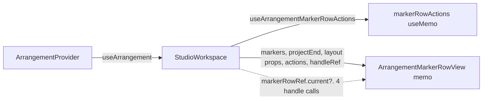

# PERF-11c-iii-c2b: Marker row აღარ რენდერდება workspace-ის დაუკავშირებელ commit-ებზე

**თარიღი:** 2026-11-07
**სტატუსი:** Completed (C round 379 PASS)
**შეცვლილი პროექტი:** Store (`ArrangementMarkerRow.tsx`, `StudioWorkspace.tsx`, `render-budget.test.tsx`)

## კონტექსტი

HEAD `3ae2885`-ზე `ArrangementMarkerRow` `useArrangement()`-ს ერთხელ იძახებდა და `markers = arrangementMarkers(arrangement)`-ს თავად ითვლიდა, ამიტომ ყოველი `StudioWorkspace` commit marker row-ს არენდერებდა, მაშინაც კი, როცა marker-ები არ შეცვლილა. B-ის dev leaf probe-ით (ორივე viewport, 1440×900 და 1280×720; ლუპის artifact `tmp/studio-real-loop/b-round-378/probe/leaf-head-379.json`, repository-ს გარეთ) `ArrangementMarkerRow`-ის render-ები ნაბიჯზე: add 3, zoom 1, lane mute 1, Ctrl+Z 1, Undo/Redo ღილაკი 1, library preview start 1, preview stop 2.

`arrangementMarkers` აბრუნებს `arrangement.markers ?? NO_MARKERS`-ს, ამიტომ list-ის identity იგივე რჩება ყველა commit-ზე, რომელიც marker-ებს არ ეხება. ეს memo-ს შედარებას საიმედოს ხდის.

მომხმარებლისთვის არაფერი იცვლება: flag-ები (`aria-label`, `aria-current`, `style.left`, ტექსტი), name editor, context menu, focus და status ტექსტი იგივეა; pointer gesture-ები (capture, snap, `claimPointerGesture`, uncaptured-pointer watch, unmount release, gesture-blocked Enter/blur) და `keyRepeat` nudge/step-ზე უცვლელია.

## მიდგომა

გამოყენებულია pattern A — იგივე ფორმა, რაც Master-ს, Library-ს, Transport-სა და LoopBrace-ს აქვს (doc 241–244):

- **`ArrangementMarkerRowView = memo(ArrangementMarkerRowViewInner)`** — იღებს `markers`-ს, `projectEnd`-ს, ოთხ layout prop-ს, `actions`-სა და `handleRef`-ს. Render log fiber-ის სახელით ითვლის, ამიტომ გამოყენებულია `function XInner` + `memo(XInner)` ფორმა (ლუპის lesson L23, `tmp/studio-real-loop/lessons.md`, repository-ს გარეთ).
- **`useArrangementMarkerRowActions(workspace)`** — `ArrangementContextValue`-ის 11 callback-ის `Pick` `useMemo`-ში. 11-ივე provider-ში `useCallback`-ია და deps `[]` callback-ებზე ან `useState` store-ებზე მთავრდება, ამიტომ object-ი mount-ზე ერთხელ იქმნება.
- **`handleRef` prop `forwardRef`-ის ნაცვლად.** მიზეზები:
  - render log მხოლოდ ჩვეულებრივ function fiber-ებს ხედავს; `forwardRef` view ყოველთვის 0-ს აჩვენებდა, რაც არ უნდა გაეკეთებინა;
  - `StudioWorkspace` ერთადერთი მომხმარებელია;
  - Master, Library, Transport და LoopBrace view-ებიც `forwardRef` არ არის.

  ეს `FORWARDREF_COMPONENT.md`-დან შეგნებული გადახვევაა (UI primitive-ის შაბლონი, არა Studio-ს შიდა leaf). Handle-ს `useImperativeHandle(handleRef, …)` ქმნის; `displayName` აღარ საჭიროა.
- **Wrapper არ არის** — `StudioWorkspace`-ის გარდა MarkerRow-ს არავინ mount-ავს; ტესტებში სახელი მხოლოდ path-ად გვხვდება (`studio-focus-ring.test.ts`, `strings.test.ts` — source scan).
- **`StudioWorkspace`** — `markerRowActions = useArrangementMarkerRowActions(workspace)` და `<ArrangementMarkerRowView markers=… projectEnd=… actions={markerRowActions} handleRef={markerRowRef} … />`. ოთხი handle გამოძახება (`focusEditorSuccessor`, `closeMenu`, `stepMarker`, `beginAddMarker`) ისევ `markerRowRef.current?.`-ით, გამოძახების მომენტში მიდის.
- **ერთი focus ხაზი (TL-R379-L1):** `focusEditorSuccessor` `focusMarkerTarget`-ის შემდეგ `pendingFocusRef`-ს ასუფთავებს. HEAD-ზე grid menu-ის დახურვით გამოწვეული workspace render ამ pending target-ს ასუფთავებდა; memo ამ render-ს ახლა გამოტოვებს, ამიტომ პირდაპირი გასუფთავება HEAD-ის შედეგს ინარჩუნებს: flag connected-ია — focus, თუ არა — არაფერი, მოგვიანებით გადახტომის გარეშე.

**ალტერნატივა:** marker row-ის საკუთარი store subscription ან ერთი სტაბილური actions context provider-ში (reviewer-ის TL-R379-ARCH). უარყოფილია ამ რაუნდში: ოთხ წინა leaf-თან შეუსაბამო იქნებოდა და provider-ის ცვლილებას მოითხოვდა; actions context არქიტექტურულ checkpoint-ს ელოდება.

## არქიტექტურა

## შეცვლილი ფაილები

- `app/components/arrangement/ArrangementMarkerRow.tsx` — `ArrangementMarkerRowActions`, `useArrangementMarkerRowActions`, `ArrangementMarkerRowViewInner` / `ArrangementMarkerRowView`, `handleRef` + `useImperativeHandle`, `pendingFocusRef`-ის გასუფთავება `focusEditorSuccessor`-ში.
- `app/components/arrangement/StudioWorkspace.tsx` — import, `markerRowActions` და `ArrangementMarkerRowView`-ის mount.
- `app/lib/arrangement/__tests__/render-budget.test.tsx` — `addMarker` import და RB-LEAF6.
- `docs/implementation/2026/quarter-IV/245-perf-marker-row-leaf.md` — ეს დოკუმენტი.

ცვლილება B-ის განხილული sketch-ის ზუსტი გამოყენებაა (ლუპის artifact `tmp/studio-real-loop/b-round-378/sketch.patch.txt`, sha256 `eaa1b3fd…`, v2, repository-ს გარეთ); სამი ფაილის sha256 sketch-ს ემთხვევა.

## პრობლემები და გადაწყვეტები

- **პრობლემა:** `useArrangement()` marker row-ს ყოველ commit-ზე არენდერებდა. **გადაწყვეტა:** memo view, რომელიც მხოლოდ `markers`-ს, `projectEnd`-ს, layout prop-ებს, სტაბილურ actions-სა და `handleRef`-ს იღებს.
- **პრობლემა:** ახალი actions object memo-ს ყოველ commit-ზე გაატარებდა. **გადაწყვეტა:** `useMemo` 11 სტაბილურ callback-ზე. MU-MR-ACTIONS-FRESH ამას RB-LEAF6-ით წითლად აქცევს.
- **პრობლემა:** dependency-ის გარეშე effect-ები (pending focus, detached focus) ახლა მხოლოდ view-ის render-ზე ეშვება. **გადაწყვეტა:** reviewer-მა დაადასტურა, რომ ref-ებში ყოველი ჩაწერა ხდება commit-ში, რომელიც `markers`-ს ან local state-ს ცვლის; ერთადერთი გამონაკლისი (TL-R379-L1) `focusEditorSuccessor`-ში პირდაპირი გასუფთავებით დაიხურა.
- **რისკი — stale handle:** `closeMenu` local `menu` state-ზეა დამოკიდებული (menu-ს გახსნა view-ს არენდერებს და handle-ს ხელახლა აბამს), `stepMarker` — `projectEnd` prop-ზე; `beginAddMarker` და `focusEditorSuccessor` მხოლოდ სტაბილურ callback-ებსა და ref-ებს იყენებს.
- **რისკი — in-place mutation:** თუ `arrangement.markers` ოდესმე in-place შეიცვლებოდა, memo ცვლილებას დამალავდა. RB-LEAF6 identity-ს არა-marker commit-ებზე ამოწმებს; GATE378-L2 (in-place mutation guard) deferred Low რჩება.
- **Reviewer-ის შედეგები და B-ის გადაწყვეტილებები** (ლუპის artifact `tmp/studio-real-loop/b-round-378/sketch-review.md`, repository-ს გარეთ; reviewer `tech-lead`, v1 და v2 delta — ორივე APPROVE, Medium ან უფრო მაღალი არ არის):
  - TL-R379-L1 (Low) — pending focus არ-connected flag-ზე: გასწორდა v2-ში (იხ. ზემოთ). `return false` ფორმა უარყოფილია, რადგან grid menu-ის დახურვას group-name fallback-ზე გადაიტანდა, რასაც HEAD არ აკეთებს.
  - TL-R379-L2 (Low) — RB-LEAF6-ს დაემატა Play/Stop და `setTimeRange` ნული-render ნაბიჯები, მხოლოდ projectEnd-ის ცვლილების დადებითი ნაბიჯი და handle-ის შემოწმება გამოტოვებული render-ების შემდეგ (M → name input ღიაა და focus-ითაა).
  - TL-R379-D1 (Low, optional) — Play/Stop/range ბლოკში `StudioWorkspace > 0` assertion არ დაემატა: იმავე row-ის mute/undo ციკლი უკვე აჩვენებს, რომ workspace რენდერდება, ხოლო ViewInner 0-ია. Info.
  - TL-R379-ARCH (note) — მეხუთე `useXActions(workspace)` + memo leaf; შეთავაზება: ერთი სტაბილური actions context. არქიტექტურული სიგნალი SIG-R379-ACTIONS-CONTEXT, ARCH-CHECKPOINT-PERF11C-LEAF-PLUMBING-ის ნაწილი; დაგეგმილი არ არის.
- **L50 ruling (focus origins):** patch focus-ის კოდს არ ცვლის, მხოლოდ იმას, თუ რამდენად ხშირად რენდერდება view. 12 grep hit (ლუპის artifact `tmp/studio-real-loop/b-round-378/l50-focus-origins.txt`, repository-ს გარეთ; sketch v2-ზე პირველი სამი hit HEAD + 70-ზეა, დანარჩენი ცხრა — HEAD + 71-ზე, რადგან `focusEditorSuccessor`-ის ახალი ხაზი მათ ზემოთაა) C-ის MARKER-BROWSER ნაბიჯებითა და UNIT row-ებით იფარება: markers-ui MU8c–MU8e, grid-snap-menu GM44 და GM45, markers-move-ui MV15–MV17. `pendingFocusRef` მხოლოდ marker commit-ის წინ იწერება, ეს commit `markers`-ს ცვლის, ამიტომ view რენდერდება და effect ეშვება.

## ტესტირება

- **ახალი row RB-LEAF6** (`render-budget.test.tsx`): lane mute, Master mute და მათი Undo — თითოეულზე `StudioWorkspace` რენდერდება (> 0), `ArrangementMarkerRowViewInner` 0-ია და `arrangement.markers` იგივე object-ია (`toBe`); Play/Stop და `setTimeRange` — ViewInner 0. დადებითი კონტროლები: marker-ის დამატება, მისი Undo, zoom ნაბიჯი და მხოლოდ projectEnd-ის ცვლილება ViewInner-ს არენდერებს; ბოლოს M body-ზე name input-ს ხსნის და focus-ს აძლევს.
- **Mutant-ები** (B-ის sketch v2-ზე, ლუპის artifact `tmp/studio-real-loop/b-round-378/mutants/sketch-run/mutant-<id>.full.log`, repository-ს გარეთ); თითოეულში წითელია მხოლოდ RB-LEAF6 (1 failed, 6 passed, 13 skipped):
  - MU-MR-NO-MEMO — view memo-ს გარეშე; წითელი ხაზი l.981 (zero-render assert mute/undo ციკლში, `expected 1 to be +0`);
  - MU-MR-ACTIONS-FRESH — actions ყოველ render-ზე ახალი object; l.981;
  - MU-MR-MARKERS-FRESH — `markers` ყოველ render-ზე ახალი array; l.981;
  - MU-MR-HEAD-REVERT — HEAD-ის კოდი; წითელი ხაზი l.966 (add-marker დადებითი კონტროლი, `expected +0 to be 1`). ეს წითელია მხოლოდ იმიტომ, რომ სახელი `ArrangementMarkerRowViewInner` HEAD-ზე არ არსებობს — სახელის guard-ია და არა ქცევის მტკიცებულება.
- **Assertion-ების რაოდენობა:** render-budget `expect(` 197 → 214, `it(` 19 → 20 (ლუპის artifact `tmp/studio-real-loop/b-round-378/expect-counts-379.txt`, repository-ს გარეთ).
- **Perf (production build, B-ის sketch v1-ზე, ლუპის artifact `tmp/studio-real-loop/b-round-378/perf-sketch-vs-head.txt`, repository-ს გარეთ):** 264 row, 0 FAIL; count row-ების სხვაობა 0, გარდა ცნობილი record-only `interact.drag.video.playing.move-components-per-move` median-ისა (9.95 vs 9.883). Harness-ის სცენარებში mute, undo და preview არ შედის, ამიტომ მოგება ჩანს მხოლოდ jsdom-ში (RB-LEAF6) და dev leaf probe-ში. v2 perf-ზე ხელახლა არ გაშვებულა: v1→v2 კოდის სხვაობა ერთი statement-ია, რომელსაც არცერთი perf სცენარი არ აღწევს.
- **Leaf probe (B-ის sketch-ზე, ორივე viewport; ლუპის artifact `tmp/studio-real-loop/b-round-378/probe/leaf-sketch-vs-head-379.txt`, repository-ს გარეთ):** `ArrangementMarkerRow` ყველა ნაბიჯზე 0 (სახელი აღარ არსებობს); `ArrangementMarkerRowViewInner` add 2, zoom in/out 1, Undo/Redo ღილაკი 1, lane mute, Ctrl+Z და library preview start/stop 0. სხვა leaf-ები HEAD-ის ტოლია, გარდა `ArrangementLibraryPreviewViewInner`-ისა preview stop-ზე (315 vs 314/316 — preview progress frame-ები wallclock-ით, record).
- **Marker recipe (B-ის sketch-ზე, ორივე viewport; ლუპის artifact `tmp/studio-real-loop/b-round-378/probe/marker-sketch-379.json`, repository-ს გარეთ):** s0–s17 HEAD-ის ტოლია (flag-ები, editor, menu, focus, status).
- **A-ს შემოწმებები (round 379):** იხ. ლუპის `tmp/studio-real-loop/a-round-379.md` (repository-ს გარეთ): `npm run typecheck`, `npm run lint`, Biome სამ ფაილზე და `npx vitest run` შვიდ covering ფაილზე (`render-budget`, `markers-ui`, `markers-move-ui`, `marker-time-snap-ui`, `grid-snap-menu`, `studio-focus-ring`, `strings`).
- **ბრაუზერი:** C-ის round 379-ის row-ები 1440×900 და 1280×720-ზე (LEAF-PROBE, MARKER-BROWSER, STUDIO-SMOKE-379, G379-AUTH).

## TODO / შემდეგი ნაბიჯები

- REGRESSION-2026-11-08 — შემდეგი დაგეგმვისას 2026-11-08-ზე ან მის შემდეგ.
- PERF-11c-iii-d (VideoDock) და PERF-11c-iii-e (Lane) ელოდება ARCH-CHECKPOINT-PERF11C-LEAF-PLUMBING-ს (ან RETRO 384-ს).
- SIG-R379-ACTIONS-CONTEXT: ერთი სტაბილური actions context leaf-ებისთვის (არქიტექტურული checkpoint-ის შეკითხვა).
- GATE378-L2: in-place mutation guard (deferred Low).
- PERF-11c ჯერ არ დასრულებულა, ამიტომ doc 238-ის სტატუსი უცვლელია.
