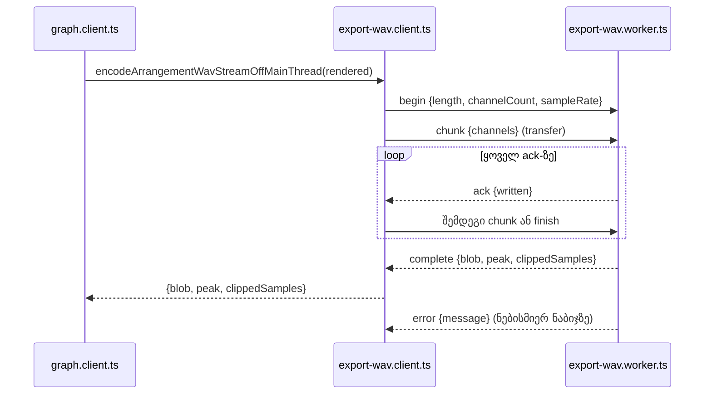

# PERF-12a: WAV export chunk-ებად გადაიწერება და worker Blob-ს აბრუნებს

**თარიღი:** 2026-11-07
**სტატუსი:** In Progress (stage 1 of 2; C round 380 PASS)
**შეცვლილი პროექტი:** Store (`export-wav.ts`, `export-wav.client.ts`, `export-wav.worker.ts`, `graph.client.ts`, `perf/budgets.resources.json`, export-ის ტესტები)

## კონტექსტი

HEAD `ed634d5`-ზე WAV export-ი ერთ `OfflineAudioContext` render-ს აკეთებდა, შემდეგ `graph.client.ts` ორივე არხს `getChannelData(index).slice()`-ით აკოპირებდა და `encodeArrangementWavOffMainThread`-ს გადასცემდა. worker-ი მთელ WAV-ს ArrayBuffer-ად აბრუნებდა და გვერდი მისგან Blob-ს ქმნიდა. ანუ გვერდზე ერთდროულად იყო ორი სრული ასლი და WAV-ის ბაიტები.

B-ის გაზომვა Chromium-ში (4,864,896 stereo frame, გვერდის `backingStorageSize` GC-ის შემდეგ; ლუპის artifact `tmp/studio-real-loop/b-round-379/sketch-review.md` §1, repository-ს გარეთ):

| ნაბიჯი | გვერდის backing |
|---|---|
| render-ის AudioBuffer, `getChannelData`-მდე | 0 MiB |
| `getChannelData` ×2 | +37.1 MiB |
| `slice` ×2 | +37.1 MiB |
| WAV ArrayBuffer | +27.8 MiB |
| `copyFromChannel`, 1 წმ chunk ×2 | +0.3 MiB |
| worker-ში შექმნილი Blob | 0 MiB |

HEAD-ის perf მწკრივები (`tmp/studio-real-loop/c-round-377/perf-resources.log`, repository-ს გარეთ): `res.export.1.peak-backing-delta-mib` 65, `res.export.2.peak-backing-delta-mib` 129.9; `longtask-max.6x` 171 / 304 ms.

`budgets.resources.json`-ის ძველი შენიშვნა („the worker and the rendered AudioBuffer are outside it") არასწორი იყო: AudioBuffer გვერდის მეტრიკაში ითვლება `getChannelData`-ის გამოძახების შემდეგ.

მომხმარებლისთვის ხილული არაფერი იცვლება: იგივე ფაილი ბაიტ-ბაიტ, იგივე სახელი, იგივე overload ტექსტი და dialog-ის მდგომარეობები (render → wav → done, Cancel, 30 წმ stall). ერთი შიდა ქცევა შეიცვალა გადაწყვეტილებით (TL-R380-B1): 'wav' ფაზაში throw-ის მქონე progress callback export-ს აღარ აფუჭებს; 'render' ფაზაში იგივე callback ისევ reject-ს იწვევს (EW6).

## მიდგომა

- **Render უცვლელია.** ერთი `OfflineAudioContext` render რჩება; windowed render-ები 12b-ის საქმეა.
- **გვერდი chunk-ებს აკოპირებს.** `encodeArrangementWavStreamOffMainThread(source, onProgress, signal)` render-ის buffer-იდან `copyFromChannel`-ით 65,536-frame-იან (`ARRANGEMENT_WAV_CHUNK_FRAMES`) chunk-ებს იღებს და worker-ს transfer-ით უგზავნის. `getChannelData` და `.slice()` აღარ გამოიძახება.
- **ერთი chunk გზაში (PO-R380-W1).** performance-optimizer-მა ორი chunk-ის window შესთავაზა; B-მ ერთი დატოვა, რადგან wall-ms HEAD-ზე უარესი არ არის (1×: 469 vs 524 და 886 vs 947; 6×: 1062 vs 1081 და 1806 vs 1819), ხოლო stall/abort-ის კონტრაქტი ასე უმარტივესია. მომავალში wall-time-ის რეგრესია ამ გადაწყვეტილებას ხელახლა ხსნის.
- **Worker წერს თანდათან.** `createArrangementWavStreamWriter(length, channelCount, sampleRate)` წინასწარ ზომის buffer-ს ქმნის (header + data + pad byte) და ყოველ chunk-ს იმავე clamp-ით, rounding-ით და byte split-ით წერს, რაც `encodeSfxWav`-ს აქვს. Peak მაქსიმუმია chunk-ებზე, clipped — ჯამი; ორივე clamp-მდე იზომება.
- **Blob worker-იდან.** `finish`-ზე worker `complete`-ს Blob-ით აგზავნის; გვერდი WAV-ის ბაიტებს აღარ ფლობს. შედეგის ფორმა `{ blob, peak, clippedSamples }` უცვლელია, ამიტომ ArrangementContext-ის ოთხივე `renderArrangementWav(` გამოძახება (WAV, MP3, `includeWav`) არ შეცვლილა.
- **ძველი API წაიშალა.** `encodeArrangementWavOffMainThread` და `encodeArrangementWavInPlace` წაიშალა. `encodeArrangementWav` რჩება დამოუკიდებელ oracle-ად (`encodeSfxWav`-ით); header-ის კოდი ამ ეტაპზე არ გაზიარებულა (tech-lead).
- **ალტერნატივა:** windowed render (12b) AudioBuffer-საც მოაშორებდა renderer-ის მეხსიერებიდან, მაგრამ ბაიტ-ბაიტ თანხვედრა იქ ვერ გარანტირდება (TL-R380-12B). ამიტომ ეტაპები გაიყო.

## არქიტექტურა

- **Protocol:** `begin` → `chunk` → `ack` (კუმულაციური `written`) → … → `finish` → `complete` Blob-ით; `error` შეტყობინებით.
- **Stall timer** ყოველ `ack`-ზე ხელახლა იწყება (30 წმ). 5-წუთიანი export-ი დაახლოებით 220 chunk-ია; ერთი 30 წმ-ზე გრძელი პაუზა ისევ stall-ია.
- **Abort:** worker `terminate`, reject `ArrangementExportCancelledError`, მეტი `copyFromChannel` აღარ.
- **'wav' progress:** იწყება 0-ით, მთავრდება 1-ით, მთელ პროცენტზე ერთხელ. შემდეგი chunk ან `finish` progress-მდე იგზავნება და callback-ის throw იყლაპება (TL-R380-B1).
- **No-Worker fallback** იმავე writer-ს იყენებს, იგივე chunk-ებით.

## შეცვლილი ფაილები

- `app/lib/arrangement/export-wav.ts` — `ARRANGEMENT_WAV_CHUNK_FRAMES`, stream ტიპები, `createArrangementWavStreamWriter`; `encodeArrangementWavInPlace` წაიშალა
- `app/lib/arrangement/export-wav.client.ts` — `encodeArrangementWavStreamOffMainThread` (`encodeArrangementWavOffMainThread`-ის ნაცვლად)
- `app/lib/arrangement/export-wav.worker.ts` — stream protocol
- `app/lib/arrangement/graph.client.ts` — `renderArrangementWav` stream-ს აბრუნებს
- `perf/budgets.resources.json` — ოთხი მწკრივი `assert`-ზე, შენიშვნები
- `app/lib/arrangement/__tests__/helpers/fake-rendered-buffer.ts` — ახალი (`fakeRenderedBuffer`)
- `app/lib/arrangement/__tests__/export-wav-stream.test.ts` — ახალი
- `app/lib/arrangement/__tests__/export-wav.test.ts`, `export-cancel.test.ts`, `export-wav-in-place.test.ts` — მიგრაცია
- `app/lib/arrangement/__tests__/export-range.test.ts`, `master.test.ts`, `clip-fades.test.ts`, `envelope.test.ts`, `track-group-mix.test.ts`, `meter.test.ts`, `track-meter.test.ts` — `startRendering` fake → `fakeRenderedBuffer`
- `app/lib/arrangement/__tests__/track-pan.test.tsx` — source pin `return encodeArrangementWavStreamOffMainThread(`

## პრობლემები და გადაწყვეტები

- **Problem:** throw-ის მქონე `onProgress` stream-ს აჩერებდა (sketch v1). **Solution (TL-R380-B1):** ჯერ შემდეგი chunk ან `finish` იგზავნება, შემდეგ progress; reporter callback-ის throw-ს ყლაპავს. ეს ქცევის ცვლილებაა: HEAD-ზე no-Worker fallback ასეთ callback-ზე reject-ს აკეთებდა, ახლა ორივე გზა სრულდება (SW2e).
- **Problem:** ნულ-frame-იანი chunk უსასრულო ციკლს გამოიწვევდა. **Solution (TL-R380-L1):** writer აგდებს `WAV stream: empty chunk` (SW1, SW3).
- **Problem:** HEAD-ზე პირველი 'wav' fraction 0 იყო; stream-ში ის ack-მდე არ ჩანდა. **Solution (TL-R380-L2):** `reportProgress(0)` `begin`-ისა და პირველი chunk-ის გაგზავნის შემდეგ, fallback-ში კი writer-ის შექმნის შემდეგ (SW4, SW2a).
- **Problem:** length 0 stall timer-ით 30 წმ-ში ჩავარდებოდა. **Solution (TL-R380-L3):** writer მაშინვე აგდებს `WAV stream: invalid length or channel count` (SW1).
- **Problem:** writer-ის invariant შეტყობინებები ინგლისურია. **Solution:** ისინი UI-მდე მხოლოდ არსებული „worker failed" prefix-ით აღწევს, როგორც ძველი `'WAV encoding failed'` (SW2b).
- **Problem:** jsdom-ში `Blob.prototype.arrayBuffer` არ არსებობს, ხოლო `new Response(blob).arrayBuffer()` 13 ბაიტს აბრუნებს (`[object Blob]` სტრიქონს). **Solution:** ტესტები Blob-ს `FileReader.readAsArrayBuffer`-ით კითხულობენ (`blobBytes`).

## ტესტირება

**ძველი → ახალი მწკრივები** (`export-wav-in-place.test.ts` ახლა SW1 writer-ის მწკრივებს შეიცავს):

| ძველი | ახალი |
|---|---|
| EW4 (no-Worker bytes) | SW1 fallback Blob = oracle (`export-wav-stream`) |
| EW5 worker path | SW2a |
| EW5 error / onerror / onmessageerror | SW2b |
| EW5 constructor throws | SW2c |
| EW7 worker module | SW3 (ორი მწკრივი) |
| EW8a–EW8e | EW8a–EW8e SW5 (`ack`; EW8b ორ მწკრივად: 29 და 58 წმ-ის ack-ები და ბოლო ack; `copyFromChannel`-ის რაოდენობა abort-ის შემდეგ). EW8f უცვლელია |
| EC4 ×4 | EC4 SW6 ×4 |
| EC4 3-argument | SW6 3-argument + SW2a |
| IP1 | SW1 lengths, chunk sizes |
| IP2 | SW1 „writer leaves its input chunks untouched" (IP2 retired, ruling) |
| IP3 | SW4 (worker და fallback) |
| IP4 | SW3 |
| IP5 | SW1 „encodeArrangementWav still leaves its input untouched" |

ახალი: SW1 late-chunk peak, SW2d (postMessage throw, `finish`-ის ჩათვლით), SW2e (throwing onProgress), SW7 (`getChannelData` throws → Blob = oracle).

Worker-ის გზის ბაიტებს unit ტესტი ბოლომდე არ ამოწმებს: SW2a-ს fake worker Blob-ს თავად აბრუნებს. ბაიტებს ამოწმებს SW3 (worker module), SW1 (writer და no-Worker fallback), SW7 (`renderArrangementWav` fallback-ით) და C-ის browser მწკრივები E1–E4. SW2a-ს fake worker transfer-ის შემდეგ ორიგინალ buffer-ებს detach-ს უკეთებს (`structuredClone` transfer-ით), როგორც ბრაუზერი, ამიტომ copy → offset → transfer თანმიმდევრობაც მოწმდება.

**Mutants** (unit; ლუპის `tmp/studio-real-loop/a-round-380/mutants/summary.txt`, repository-ს გარეთ): MU-12A-NO-CLAMP, MU-12A-OFFSET, MU-12A-PEAK-LAST, MU-12A-CLIPPED-LAST → SW1; MU-12A-ALL-IN-FLIGHT → SW2a; MU-12A-NO-ABORT → SW6; MU-12A-NO-REARM → EW8b SW5; MU-12A-NO-FINISH-CHECK → SW1 და SW3. ყველა წითელია.

**Asserted perf მწკრივები** (`perf/budgets.resources.json`):

| მწკრივი | ზღვარი | sketch v2 | mutant |
|---|---|---|---|
| `res.export.1.peak-backing-delta-mib` | ≤ 5 | 0.1 | MU-12A-PERF-GCD 37.2 |
| `res.export.2.peak-backing-delta-mib` | ≤ 5 | 0.2 | MU-12A-PERF-GCD 74.4 |
| `res.export.1.longtask-max.6x` | ≤ 100 | 0 | MU-12A-PERF-FALLBACK 1419 |
| `res.export.2.longtask-max.6x` | ≤ 100 | 0 | MU-12A-PERF-FALLBACK 2513 |

Perf mutant-ები: ლუპის `tmp/studio-real-loop/b-round-379/mutants/sketch-perf-v2/perf-summary.txt` (repository-ს გარეთ). Doc 169 და 209 ისტორიულ baseline-ად რჩება.

**Browser** (C round 380-ის მწკრივები WAV-BYTES, CANCEL-BROWSER, MP3-BROWSER, ორივე viewport): WAV-ის sha256, ზომა და სახელი HEAD-თან შედარებით (E1–E4), Cancel WAV ფაზაში, MP3 და WAV + MP3. B-ის sketch-ის გაშვებაზე E1–E4 HEAD-ს ემთხვეოდა (ლუპის `tmp/studio-real-loop/b-round-379/probe/wav-sketch-380.json`, repository-ს გარეთ). E4 არც ერთ ხეზე არ clip-დება, ამიტომ overload ტექსტს browser არ ამოწმებს; ამას SW1, MU-12A-PEAK-LAST და MU-12A-CLIPPED-LAST ფარავს.

## TODO / შემდეგი ნაბიჯები

- [ ] **PERF-12b** — windowed render-ები, რომ render-ის AudioBuffer renderer-ის მეხსიერებიდანაც გაქრეს. მიღება tolerance-ითაა (TL-R380-12B): ramp-ები window-ის საზღვარზე თავიდან იწყება, წყაროები წილად დროს იწყება. Saba-ს კითხვა **SABA-Q-PERF12B-TOLERANCE**: დასაშვებია თუ არა ≤ 1 LSB (24-bit) სხვაობა 30 წმ-იანი საზღვრების მახლობლად, შეზღუდული რაოდენობის sample-ზე, თანაბარი peak-ით და clipped-ით.
- [ ] **SIG-R380-WORKER-DOUBLE-BUFFER** — worker მოკლე დროით WAV ArrayBuffer-ს და Blob-ს ერთად ფლობს (~2 × WAV-ის ზომა, მხოლოდ worker-ში). Blob-ის ნაწილებად აწყობა ამას განახევრებს; 12a-ში არ შედის.
