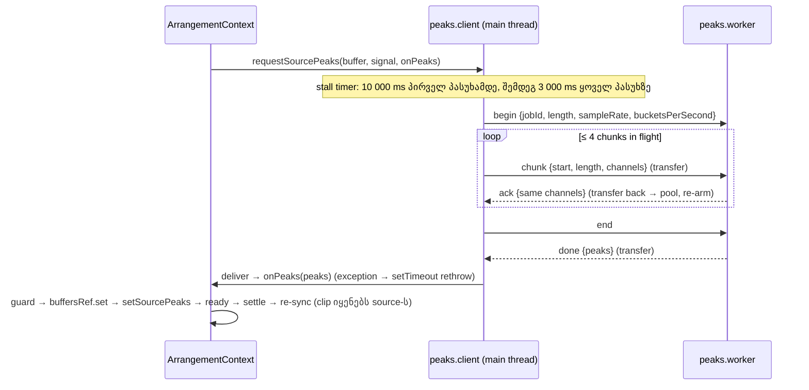

# Waveform peaks-ის გამოთვლა worker-ში: bounded, recycled chunks, byte-identical შედეგი (PERF-5a)

**თარიღი:** 2026-11-03
**სტატუსი:** Completed (C round 315 PASS)
**შეცვლილი პროექტი:** Store (`app/lib/arrangement/peaks*.ts`, `app/contexts/ArrangementContext.tsx`)

## კონტექსტი

`/studio-lab`-ის ჩატვირთვისას ყოველი source-ის waveform peaks (`computePeaks`) main thread-ზე ითვლებოდა, collection load-ის `.then`-ში და video import-ის decode-ის შემდეგ. B-მ round 312-ის დაგეგმვისას premise HEAD `dfa4502`-ზე თავიდან გაზომა (dev server, Chromium 143, CDP CPU profile 100 µs, fresh `/studio-lab`, 9 demo source):

- **Main-thread inclusive time `computePeaks`-ში:** 55–86 ms ერთ ჩატვირთვაზე, 5 ჩატვირთვაზე. ცალკეული გამოძახება 0.9–25.9 ms.
- **Peaks worker არ არსებობდა:** ერთადერთი worker იყო `demo-synth.worker.ts`.
- **ამ რაუნდის გარეთ:** ჩატვირთვის ყველაზე დიდი long task (65–78 ms) synth worker-ის `onmessage` handler-ია, ხოლო 2 SFX-ის `synthesizeDemoSamples` ჯერ კიდევ main thread-ზე მუშაობს (~20 ms). ორივე აღრიცხულია signal-ად PERF2-REMAINDER-SFX-SYNTH.

**მექანიზმის გაზომვა (D-29z835).** Chromium, 5-წუთიანი 48 kHz stereo `AudioBuffer`:

| Main-thread სამუშაო | ჯამი | ყველაზე დიდი ცალკეული slice |
|---|---|---|
| `computePeaks`, დღეს | 29.6–32.6 ms | იგივე (ერთი გამოძახება) |
| `copyFromChannel` **ახალ** `Float32Array`-ებში (ნებისმიერი chunk ზომა) | **58–82 ms** | 1.4–63 ms |
| `copyFromChannel` **ერთ ხელახლა გამოყენებულ** buffer set-ში | **5.6–9.3 ms** | 0.1–3.5 ms |
| Main-thread time-sliced compute | 43–47 ms | 3.8–6 ms |

დასკვნა: worker, რომელსაც ყოველ chunk-ზე ახალი copy მიეწოდება, main thread-ს **უფრო მეტი** უჯდება, ვიდრე დღეს. ამიტომ chunk buffer-ების recycling სავალდებულოა.

## მიდგომა

- **Worker + streaming:** ერთი shared, lazily შექმნილი module worker (`peaks.worker.ts`), `demo-synth.client.ts`-ის pattern-ით. Client buffer-ს 2-წამიან chunk-ებად (`PEAKS_CHUNK_SECONDS = 2`) აგზავნის, worker კი running bucket state-ს ინახავს. Max order-free ოპერაციაა, ამიტომ შედეგი `computePeaks`-ის byte-identical-ია.
- **Recycling და backpressure:** worker ყოველ chunk-ზე `ack`-ს აგზავნის და **იმავე** array-ებს transfer-ით აბრუნებს; client მათ pool-ში ინახავს და ხელახლა იყენებს. ერთდროულად მაქსიმუმ `PEAKS_CHUNKS_IN_FLIGHT = 4` chunk-ია გზაში, ამიტომ დროებითი მეხსიერება ~8 × 2 s ერთ არხზეა (≈ 3 MB 48 kHz-ზე). Pool job-ებს შორის იცლება.
- **"Ready" peaks-ის შემდეგ რჩება (tech-lead vs performance-optimizer, B-ის ruling D-29z835):** source `ready` და „Demo collection ready“ მხოლოდ მაშინ მოდის, როცა ამ source-ის peaks უკვე არსებობს. ეს perf harness-ის `waitForLibraryReady`-სა და ტესტების კონტრაქტებს ინარჩუნებს.
- **Buffer-იც „ready“-სთან ერთად (stage 2, A-R312-REVIEW-L3):** `buffersRef.current.set` ორივე call site-ზე peaks callback-ში გადავიდა, guard-ის შემდეგ და `setSourcePeaks`-მდე. ამიტომ playback, export და library preview source-ის buffer-ს `ready`-მდე ვეღარ ხედავს. Collection-ის callback-ს დაემატა იგივე re-sync, რაც video-ს უკვე ჰქონდა: თუ playback-ის დროს `ready` ხდება და clip ამ source-ს იყენებს, `syncPlayback(present, undefined, true)` მას მიმდინარე mix-ში რთავს. Load effect-ის dependency-ებს დაემატა `syncPlayback`; ის stable-ია (`startGraph`-ის helper-ებს ცარიელი dependency list აქვთ), ამიტომ collection ხელახლა არ იტვირთება.
- **ორი stall budget (stage 2, A-R312-REVIEW-L1):** worker-ის პირველ პასუხამდე `PEAKS_WORKER_COLD_START_TIMEOUT_MS = 10_000` (cold start: module fetch, როცა main thread დაკავებულია; demo-synth-იც 10 s-ს იყენებს), პირველი პასუხის შემდეგ კი ყოველ პასუხზე `PEAKS_WORKER_STALL_TIMEOUT_MS = 3_000`. `workerReplied` ყოველ parsed reply-ზე ირთვება, job-id filter-მდე. Context-ის სიცოცხლის განმავლობაში worker ერთ computer-ზე მაქსიმუმ ერთხელ იქმნება (`workerFailed` failure-ის შემდეგ true რჩება), ამიტომ flag-ს reset არ სჭირდება. `dispose()` flag-ს არ აბრუნებს; `dispose()`-ის შემდეგ `request()` context-იდან მიუწვდომელია (unmount-ზე ref null-დება), იხ. TODO.
- **`deliver` (stage 2, A-R312-REVIEW-L2):** `onPeaks`-ის ყველა გამოძახება (`handleReply`, `deliverOnMainThread`, ანუ `failWorker`-ის loop-იც) ერთ helper-ზე გადის. Callback-ის exception `window.setTimeout(..., 0)`-დან ხელახლა იყრება: ის scheduler-ის state-ს არ ეხება (შემდეგი job მაინც იწყება, `failWorker` ყველა job-ს აწვდის), `request()`-ის გამომძახებლამდე სინქრონულად არ აღწევს და collection-ის `.catch` უკვე `ready` source-ს `error`-ად ვეღარ აქცევს. Peaks-ის გამოთვლა (`computePeaksOnMainThread`) `try`-ს გარეთაა: გამოთვლის შეცდომა callback-ის შეცდომა არ არის.
- **Worker-ის გარეშე (jsdom), construct-ის შეცდომა ან ცარიელი buffer:** `onPeaks(computePeaks(...))` **სინქრონულად**, `request`-ის შიგნით სრულდება. ცარიელი buffer worker-ს არ ქმნის (PW20).
- **Worker error / stall:** `onerror`, `onmessageerror`, `postMessage`-ის exception ან budget-ის ამოწურვა → worker terminate, timer იშლება, ყველა მოლოდინში მყოფი (არა-aborted) job main thread-ზე ითვლება, შემდეგი request-ები კი სინქრონულ path-ს იყენებს. Worker-ის შეცდომა და `onPeaks` callback-ის შეცდომა source-ს `error`-ად არ აქცევს. `computePeaksOnMainThread`-ის საკუთარი exception (`try`-ს გარეთ, შეგნებულად) კი სინქრონულ path-ზე `request()`-იდან გამოდის; ვალიდურ `AudioBuffer`-ზე ეს მოსალოდნელი არ არის (იხ. TODO).
- **Abort:** aborted job `cancel`-ს აგზავნის და იშლება; `onPeaks` არ გამოიძახება, მაშინაც კი, თუ `done` მოგვიანებით მოვა. Provider-ის unmount-ზე `dispose()` timer-ს, queue-სა და pool-ს ასუფთავებს და worker-ს terminate-ს უკეთებს.
- **Replies validator-ით იკითხება** (`readPeaksWorkerReply`), type assertion-ის გარეშე.
- **PERF-5b batching დაიხურა მტკიცებულებით (D-29z846).** B-ის probe (production build, 3 ჩატვირთვა 1×-ზე და 3 6×-ზე): ყოველ ჩატვირთვაზე 9 peaks delivery და 9 commit, თითოში 94 component; React 18 `setSourcePeaks`-სა და `patchSourceState`-ს უკვე ერთ commit-ად აერთიანებს. 16 ms-ზე ნაკლები delivery gap: 1×-ზე 3, 3, 2 / 8, 6×-ზე 0 / 8; peaks commit-იდან 50 ms-ზე გრძელი long task: 0. rAF coalescer მაქსიმუმ 2–3 commit-ს დაზოგავდა 1×-ზე და არცერთს 6×-ზე, commit-ების რაოდენობას კი wallclock-ზე დამოკიდებულს გახდიდა. `startTransition` `status: 'ready'`-ს შეაყოვნებდა, რომელზეც library preview დგას. HEAD-ზე red deterministic row არ არის, ამიტომ batching არ განხორციელდა.
- **უარყოფილი/გადადებული ალტერნატივები:** main-thread time-sliced compute (43–47 ms ჯამი, ცხრილი ზემოთ); fresh copy-ები (58–82 ms); rAF/`startTransition` batching (ზემოთ); power-of-two pyramid → PERF-14.

## არქიტექტურა

- **Stall budget-ები:** `armStall` timer-ს თავიდან აყენებს job-ის დაწყებისას (`startNext`) და აქტიური job-ის ყოველ პასუხზე (`handleReply`, job-id filter-ის შემდეგ). `workerReplied` კი ნებისმიერ parsed reply-ზე ირთვება, filter-მდე. სანამ worker-ს ჯერ არ უპასუხია, budget 10 000 ms-ია; პირველი პასუხის შემდეგ 3 000 ms. Budget-ის ამოწურვა `failWorker`-ს იძახებს.
- **`deliver` path:** `handleReply` (`done`) → `active = null` → `deliver` → `if (!active) startNext()`. `failWorker` → timer clear, terminate → ყოველ pending job-ზე `deliverOnMainThread` → `deliver`. ორივე გზაზე callback-ის exception მხოლოდ timer-ზე ჩნდება, ამიტომ queue-ს არ აჩერებს და სხვა source-ს არ აკეთებს `error`-ად.
- **ორი call site:** collection load-ის callback ამოწმებს `controller.signal.aborted`-ს, video-ს callback — `signal.aborted`-სა და `videoSourcesRef.current.has(sourceId)`-ს. ორივეში guard-ის შემდეგ `buffersRef.current.set`, შემდეგ `setSourcePeaks`, ready და, თუ clip source-ს იყენებს, `syncPlayback(present, undefined, true)`. `buffersRef`-ის სამი reader (graph build, library preview, export) buffer-ს მხოლოდ ამის შემდეგ ხედავს.

## შეცვლილი ფაილები

- `app/lib/arrangement/peaks.ts` — დაემატა `peakBucketCount` და `accumulatePeakChunk` (streaming kernel, `computePeaks`-ის bucket edge-ებით); არსებული export-ები უცვლელია (stage 1).
- `app/lib/arrangement/peaks.worker-protocol.ts` — ახალი: request/response ტიპები და pure handler `handlePeaksWorkerRequest` (stage 1).
- `app/lib/arrangement/peaks.worker.ts` — ახალი: handler-ის `self`-ზე მიერთება (stage 1).
- `app/lib/arrangement/peaks.client.ts` — ახალი: `createSourcePeaksComputer()` (queue, chunking, pool, stall, fallback, abort, dispose) და `readPeaksWorkerReply` (stage 1); stage 2-ში `PEAKS_WORKER_COLD_START_TIMEOUT_MS`, `workerReplied` და `deliver`.
- `app/contexts/ArrangementContext.tsx` — import-ის ჩანაცვლება, ref-ში შენახული computer + stable `requestSourcePeaks`, unmount-ზე dispose, ორი call site (stage 1); stage 2-ში `buffersRef.current.set` ორივე callback-ში, collection-ის re-sync და load effect-ის `syncPlayback` dependency.
- `app/lib/arrangement/__tests__/peaks-worker.test.ts` — ახალი: PW1–PW13 (stage 1); stage 2-ში PW9 გადაიწერა და დაემატა PW13b, PW14–PW18, PW20.
- `app/lib/arrangement/__tests__/peaks-worker-video.test.tsx` — ახალი (stage 2): PW19.

## პრობლემები და გადაწყვეტები

- **Problem:** fresh copy-ები main thread-ს უფრო ძვირი უჯდებოდა, ვიდრე თავად `computePeaks`. **Solution:** ack-ით იმავე array-ების დაბრუნება და pool; in-flight bound ზღუდავს მეხსიერებას.
- **Problem:** recycled array-ებში copied length-ის მიღმა ძველი sample-ებია. **Solution:** kernel chunk-ის index-ს ≥ `chunkLength` არასოდეს კითხულობს; PW1 chunk array-ებს copied length-ის მიღმა 1.0-ით ავსებს.
- **Problem:** სამი არსებული ტესტის ფაილი მხოლოდ 2 microtask-ს ელოდება. **Solution:** `Worker`-ის გარეშე callback სინქრონულად სრულდება, ამიტომ ეს ფაილები HEAD-ის timing-ს ინარჩუნებს.
- **Problem (code-review, Medium, round 312):** `onPeaks`-ის შიგნით გაკეთებული `request` ახალ job-ს იწყებდა, შემდეგ კი `handleReply` `startNext`-ს ისევ იძახებდა და რიგში მდგარი job იკარგებოდა. **Solution:** `done`-ის შემდეგ `startNext` მხოლოდ მაშინ, როცა აქტიური job არ არის (PW12).
- **Problem (code-review, Medium, round 312):** `postMessage`-ის exception დაუჭერელი იყო. **Solution:** `post` exception-ს იჭერს და `failWorker`-ს იძახებს, როგორც `demo-synth.client.ts` (PW13; `end`/`cancel`-ისთვის PW13b, timer-ის გარეშე).
- **Problem:** B-ის sketch-ში `peakBucketCount` NaN sample rate-ზე `NaN`-ს აბრუნებდა. **Solution:** არა-finite count → 0 (PW2).
- **Problem (C-R312-01, C-R313-01):** perf harness-ის guard-ები; გადაწყდა rounds 313–314-ში harness-ის მხარეს, აპის კოდის ცვლილების გარეშე (`163-studio-perf-harness.md`).
- **Problem (A-R312-REVIEW-L1):** ერთი 3 000 ms stall timer worker-ის cold start-საც მოიცავდა: ნელ მანქანაზე worker მთელი სესიისთვის ითიშებოდა (B-ის browser probe: HEAD-ზე worker შექმნიდან ზუსტად 3 000 ms-ში terminate-დება, როცა პირველი პასუხი 4 s-ით იგვიანებს). **Solution:** 10 000 ms პირველ პასუხამდე, შემდეგ 3 000 ms (PW14, PW9, PW15).
- **Problem (A-R312-REVIEW-L2):** `onPeaks`-ის exception `handleReply`-ში `startNext`-ს ტოვებდა, `failWorker`-ის loop-ს აჩერებდა და შეიძლება collection-ის `.catch`-მდე მისულიყო. **Solution:** `deliver` timer rethrow-ით (PW16, PW17).
- **Problem (A-R312-REVIEW-L3):** `buffersRef.current.set` peaks request-მდე სრულდებოდა, ამიტომ playback/export `loading` source-ის buffer-ს ხედავდა. **Solution:** set callback-ში, collection-ზე re-sync-ით (PW18 collection-ზე, PW19 video-ზე).
- **Problem (A-R312-REVIEW-L4/L5):** video call site, ცარიელი buffer, re-arm და `end`/`cancel`-ის throw ტესტით არ იყო დაფარული. **Solution:** PW19, PW20, PW15, PW13b.

## ტესტირება

- **`peaks-worker.test.ts` (25 test):**
  - PW1 / PW1b / PW2 — streaming kernel = `computePeaks` byte-for-byte (rate-ები, სიგრძეები, არხები, chunk ზომები, NaN/−0/−Infinity), `peakBucketCount`;
  - PW3 (2) — protocol: იგივე array-ები ack-ში, stale chunk, `done`-ის transfer, cancel;
  - PW4–PW8, PW7b, PW10 — ერთი worker, in flight ≤ 4, reply ობიექტი `onPeaks`-მდე, `Worker`-ის გარეშე სინქრონული შედეგი, abort (PW7b: ბოლო chunk-ის შემდეგ, დაგვიანებული `done` იშლება), error fallback, job-ები თანმიმდევრობით;
  - PW9 — პირველი პასუხის შემდეგ fallback ზუსტად 3 000 ms-ზე, timer count 0;
  - PW14 — პასუხამდე 3 000 და 9 999 ms-ზე fallback არ არის, 10 000 ms-ზე არის;
  - PW15 — `begin`-ის შემდეგ 3 `ack` 2 999 ms-ის ინტერვალით და შემდეგ 2 999 ms ლოდინი fallback-ს არ იწვევს, მომდევნო 1 ms-ზე fallback ხდება (`begin`-ზე worker არ პასუხობს);
  - PW11 — `ArrangementProvider`: `ready` მხოლოდ `done`-ის შემდეგ, worker-ის peaks-ით;
  - PW12 — `onPeaks`-ის შიგნით გაკეთებული request რიგს არ კარგავს;
  - PW13 (2, `begin`/`chunk`) და PW13b (2, `end`/`cancel`) — `postMessage`-ის exception: worker off, timer არ რჩება, `end`-ზე main-thread peaks byte-equal;
  - PW16 — throwing `onPeaks` `handleReply`-ში: შემდეგი job იწყება და მიეწოდება, შეცდომა timer-ზე;
  - PW17 — worker `onerror` ორ pending job-ზე, პირველი callback ისვრის: ორივე მიეწოდება, სინქრონული throw არ არის;
  - PW18 — context: `loading` source-ის clip playback-ში არ იწყება, `ready`-ს შემდეგ re-sync მას რთავს;
  - PW20 — ცარიელი buffer: მაშინვე main thread-ზე, byte-equal, worker არ იქმნება.
- **`peaks-worker-video.test.tsx` (1 test):** PW19 — video import, decode → `audio` `decoding`, `sourcePeaks`-ში არ არის, Play-ის შემდეგ ხმის buffer არ იწყება; worker-ის შესრულების შემდეგ `ready`, `sourcePeaks` აქვს და მიმდინარე playback-ში buffer იწყება.
- **Mutants (round 315, scratch ასლზე):** B-ის `unit-mutants.py`-ის 11 mutant-იდან 10 red (MU-COLD-START-SAME → PW14; MU-NEVER-REPLIED, MU-STALL-ONLY-AT-BEGIN → PW9, PW15; MU-DELIVER-NO-CATCH/SWALLOW/SYNC-THROW → PW16, PW17; MU-FAIL-KEEPS-TIMER → PW13b; MU-EMPTY-TO-WORKER → PW20; MU-BUFFER-BEFORE-PEAKS, MU-NO-COLLECTION-RESYNC → PW18); MU-REPLIED-AFTER-FILTER by design ექვივალენტურია. A-ს MU-VIDEO-BUFFER-BEFORE-PEAKS → PW19 red step 3-ზე; დამატებით video re-sync-ის წაშლა → PW19 red step 5-ზე. აღდგენილი კოდი green. Stage 1-ის mutant-ები (round 312) ასევე red იყო.
- **Covering run (round 315):** peaks-worker, clip-gain-waveform, content-colour-ui, clip-gain-pointer-preview, waveform-zoom, failed-source-refusal, video-import-status-ui, export-mp3 — 8 ფაილი, 97/97.
- **Browser (C round 312, stage 1):** main thread-ზე peaks-ის 0 ms, `peaks.worker.ts`-ის შექმნა, 9 preview waveform-ის byte identity, ready-ის თანმიმდევრობა, video და perf harness — PASS.
- **Perf harness (rounds 313–314):** `harness.loaf-scripts-live` ≥ 50; 164 deterministic სტრიქონი ემთხვევა HEAD-harness control-ს; C round 314 PASS. Stage 2-ის browser row-ები (PK-LOAD, PK-COLD-START, PK-VIDEO-SOUND, PK-PERF-LOAD) C round 315-ისაა.

## TODO / შემდეგი ნაბიჯები

- **PERF-5:** ორივე stage (5a worker, 5b robustness + batching-ის დახურვა) ამ რაუნდით სრულდება.
- **Signal-ები და მათი ადგილი:**
  - R314-PEAKS-COMMIT-COMPONENTS (94 component ყოველ delivery-ზე) და R313-FOLLOW-PAGE-TURN-COVERAGE → PERF-10-ის დაგეგმვა;
  - R314-DEMO-BUFFER-LONGTASK-6X და PERF2-STEREO-COPY → PERF-13 (იქვე long-stem სცენარი და SOURCE-PEAKS-NEVER-PRUNED);
  - PERF2-FIRST-FRAME-LONGTASK → PERF-11;
  - B-R314-EXPORT-LOADING-GATE (export-ს `loading` collection source-ზე gate არ აქვს; `/studio-lab`-ში დღეს მიუწვდომელია) → SRW-21-PLAN;
  - power-of-two pyramid → PERF-14;
  - PERF2-REMAINDER-SFX-SYNTH — signal-ად რჩება backlog-ში.
- **A-R312-REVIEW-L6 (info):** უცვლელი, გამომძახებლები `signal.aborted`-ს თავად ამოწმებენ.
- **Round 315-ის review-ის Low შენიშვნები (B-სთვის, ამ რაუნდში `peaks.client.ts` sketch-ზეა გაყინული):** `dispose()` `workerReplied`-ს არ აბრუნებს; `computePeaksOnMainThread`-ის exception `failWorker`-ის loop-ს შეაჩერებდა; „`Worker` არ არის + throwing `onPeaks`“ სინქრონულ path-ს ცალკე row არ აქვს; `PW12-PW13` describe-ის (PW12, PW13, PW13b, PW16, PW17) `afterEach` `vi.useRealTimers()`-ს არ იძახებს; ორი call site-ის საერთო „source ready“ ბლოკი — architecture note (`commitDecodedSource`). — დაიხურა PERF-14c-i-ში (round 403, doc 257); `commitDecodedSource` architecture note რჩება signal-ად.
