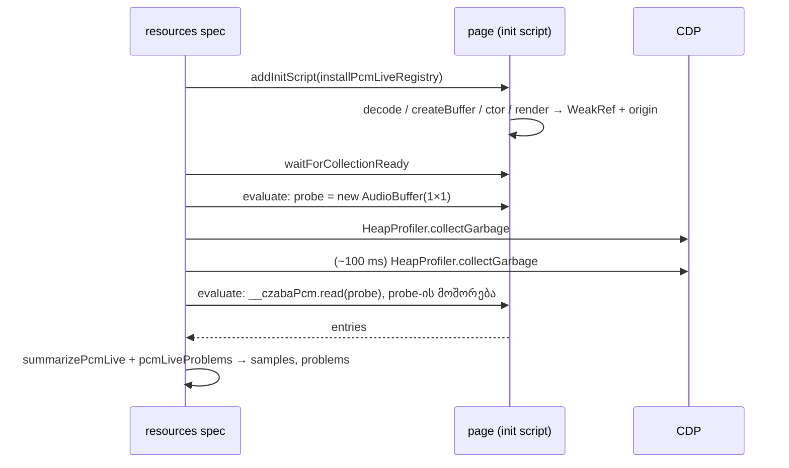

# PERF-13a: perf harness ზომავს გვერდზე ცოცხლად დატოვებულ decoded audio-ს (PCM)

**თარიღი:** 2026-11-07
**სტატუსი:** Completed (C round 397 PASS)
**შეცვლილი პროექტი:** Store (`perf/lib/pcm-live.ts`, `perf/lib/pcm-live.test.ts`, `perf/studio-lab-resources.perf.spec.ts`, `perf/budgets.resources.json`). `app/**` არ შეცვლილა.

## კონტექსტი

perf plan-ის PERF-13-ის მიზანი იყო „backing store at ready ≤ 60 MB". ამას ზომავს მწკრივი `res.mem.backing-ready-mib`, რომელიც round 380-ში 19.3 MiB-ს აჩვენებდა (`tmp/studio-real-loop/c-round-380/perf-res.log`, repository-ს გარეთ), ანუ მიზანი თითქოს უკვე შესრულებულია.

ეს არასწორი მეტრიკაა. Chromium-ში decoded `AudioBuffer` გვერდის backing-ში არ ითვლება, სანამ `getChannelData` არ გამოიძახება (round 379-ის გაზომვა, `tmp/studio-real-loop/b-round-379/sketch-review.md` §1, repository-ს გარეთ). B-მ HEAD-ზე თავად decoded audio გაზომა (`tmp/studio-real-loop/b-round-380/probe/pcm-head-381.json`, repository-ს გარეთ):

- `/studio-lab` ready-ზე ცოცხლად ინახავს **124.04 MiB decoded PCM-ს, 9 buffer-ში** (6/6 run, 1440×900 და 1280×720, თითოზე 3).
- აქედან 92.18 MiB ორი decoded MP3 ფაილია (101.35 წმ და 150.37 წმ), 31.86 MiB — 7 სინთეზირებული წყარო (2 წმ, 5 წმ, 5 × 16 წმ).
- decoded buffer არასდროს იშლება: `ArrangementContext`-ის `buffersRef`-ს 2 `set` აქვს და 0 `delete`/`clear`.

PERF-13b-ს (decoded-buffer cache ბიუჯეტით) სჭირდება მწკრივი, რომელზეც assert შეიძლება. ეს ეტაპი ამ გაზომვას `record` მწკრივებად ამატებს. მომხმარებლისთვის არაფერი იცვლება.

## მიდგომა

- **Registry init script-ით.** `installPcmLiveRegistry` თვითკმარი ფუნქციაა (`context.addInitScript` მას `toString()`-ით გადასცემს, ამიტომ module scope-ს არ იყენებს). ის AudioBuffer-ის შექმნის ოთხ წერტილს ახვევს და თითო შედეგს ინახავს როგორც `{ ref: new WeakRef(buffer), origin }`:
  - `BaseAudioContext.prototype.decodeAudioData` → `'decode'`. ყველა არგუმენტი გადაეცემა native მეთოდს და დაბრუნებული promise-ის `.then` ბრუნდება, ამიტომ callback-ის და promise-ის ფორმა ორივე მუშაობს და ახალი unhandled rejection არ ჩნდება.
  - `BaseAudioContext.prototype.createBuffer` → `'createBuffer'`.
  - `AudioBuffer`-ის constructor → `'ctor'`, subclass-ით, რომელიც `window.AudioBuffer`-ს ენიჭება.
  - `OfflineAudioContext.prototype.startRendering` → `'render'`.
- **`window.__czabaPcm.read(probe)`** აბრუნებს თითო ჩანაწერს `{ length, numberOfChannels, origin, probe }` ყოველ buffer-ზე, რომლის `deref()` ჯერ კიდევ რაღაცას აბრუნებს.
- **Probe-ის გამორიცხვა სუფთა კოდშია.** `summarizePcmLive` `probe: true` ჩანაწერს არ ითვლის; bytes = Σ `length × numberOfChannels × 4`. ასე probe-ის გამორიცხვა unit ტესტით მოწმდება (PL4).
- **`pcmLiveProblems(reading, expectedCount)`** აბრუნებს პრობლემებს ამ რიგით: „pcm registry missing" (მარტო, თუ registry არ არის), „pcm registry did not count its probe buffer", „pcm live count N ≠ M library sources".
- **`expectedCount`** spec-ში ითვლება `Sounds` listbox-ის `option`-ებიდან (label `studioLibraryPanelStrings.listLabel`-იდან), ლიტერალი 9 არ გამოიყენება.
- **ალტერნატივა:** `Runtime.getHeapUsage`-ის ან `performance.measureUserAgentSpecificMemory`-ის გამოყენება. პირველი PCM-ს ვერ ხედავს (ზემოთ), მეორე cross-origin isolation-ს მოითხოვს და buffer-ების origin-ს ვერ ყოფს.

### GC-ის რიგის წესი

`deref()` თავის target-ს მიმდინარე job-ის დასრულებამდე ცოცხლად ტოვებს. ამიტომ `readPcmLiveAfterGc` ყოველთვის ასე მუშაობს: GC ×2 → წაკითხვა, და GC-მდე იმავე job-ში `deref()` არასდროს იძახება:

1. `page.evaluate` ქმნის ერთ probe buffer-ს (`new AudioBuffer({ length: 1, numberOfChannels: 1, sampleRate: 48000 })`) და `window.__czabaPcmProbe`-ზე ინახავს.
2. `HeapProfiler.collectGarbage`, დაახლოებით 100 ms, ისევ `collectGarbage`.
3. ერთი `page.evaluate` კითხულობს registry-ს, აღნიშნავს probe-ს, აშორებს მას `window`-დან და აბრუნებს ჩანაწერებს.

### `instanceof` caveat

Registry `window.AudioBuffer`-ს subclass-ით ცვლის. decode-ით ან `createBuffer`-ით შექმნილი buffer-ები ამის შემდეგ `instanceof AudioBuffer` შემოწმებაზე `false`-ს მისცემდა. ეს უსაფრთხოა მხოლოდ იმიტომ, რომ `app/**`-ში, `perf/**`-ში და `e2e/**`-ში `instanceof AudioBuffer` არ გვხვდება (0 hit). ასეთი შემოწმების დამატება registry-ს გაზომვას აპის ქცევის შეცვლად აქცევს. third-party კოდიდან wavesurfer `AudioBuffer.prototype.copyFromChannel`-ს კითხულობს, რაც subclass-ის prototype chain-ით იგივე მეთოდზე მიდის.

### WeakRef-ის საზღვარი

WeakRef JS wrapper ობიექტს აკვირდება. buffer, რომელიც მხოლოდ C++-იდან არის მისაწვდომი (მაგალითად source node-ის `.buffer`, როცა აპს JS reference აღარ აქვს), შეიძლება დაუთვლელი დარჩეს, თუმცა PCM ჯერ კიდევ allocated იყოს. ready-ზე ეს არ ხდება, რადგან `buffersRef` (JS `Map`) ყველა buffer-ს ინახავს; 13b-მ ეს უნდა გაითვალისწინოს.

## არქიტექტურა

### მწკრივების კონტრაქტი

ოთხივე მწკრივი `perf/budgets.resources.json`-შია, `res.mem.backing-after-export-delta-mib`-ის შემდეგ: `kind` deterministic, `mode` record, `budget` null, `owner` PERF-13a. MiB მწკრივები determinism-ის 0.1-იან წესს ექვემდებარება, `count` — ზუსტ ტოლობას. ყველა მხოლოდ 1×-ის record pass-ში იწერება.

| მწკრივი | რას ზომავს | B-ის HEAD dev probe |
|---|---|---|
| `res.mem.pcm-live-mib-ready` | ცოცხალი decoded PCM ready-ზე, GC ×2-ის შემდეგ. PERF-13-ის მიზნად `backing-ready`-ს ცვლის; ბიუჯეტის owner: PERF-13b | 124.04 |
| `res.mem.pcm-live-count-ready` | ცოცხალი buffer-ების რაოდენობა; უდრის library-ის წყაროების რაოდენობას (harness guard) | 9 |
| `res.mem.pcm-live-decode-mib-ready` | `'decode'` ნაწილი (decoded ფაილები); 13b-ის eviction-ის input | 92.18 |
| `res.mem.pcm-live-after-export-delta-mib` | 1-clip export-ის შემდეგ ცოცხალი PCM მინუს ready-ის მნიშვნელობა. დაახლოებით 0 მოსალოდნელი; დადებითი მნიშვნელობა 13b-ის input-ია, არა ჩავარდნა | export probe არ გაშვებულა |

Ready-ის წაკითხვა არსებული heap-ის წაკითხვის შემდეგ ხდება, ამიტომ `res.mem.backing-ready-mib` იმავე წერტილში რჩება. ის PERF-13-ის მიზანი აღარ არის; მიზეზი ზემოთაა, მის შენიშვნას ცვლილება არ შეხებია.

## შეცვლილი ფაილები

- `perf/lib/pcm-live.ts` (ახალი) — `installPcmLiveRegistry`, `summarizePcmLive`, `pcmLiveProblems`, `readPcmLiveAfterGc`.
- `perf/lib/pcm-live.test.ts` (ახალი) — PL1–PL4.
- `perf/studio-lab-resources.perf.spec.ts` — registry-ის დაყენება, `pcm ready` ნაბიჯი, after-export delta.
- `perf/budgets.resources.json` — ოთხი ახალი `res.mem.pcm-live-*` მწკრივი.
- `docs/implementation/2026/quarter-IV/247-perf-pcm-live-baseline.md` (ეს ფაილი).

## პრობლემები და გადაწყვეტები

- **Problem:** `backing-ready` 19.3 MiB-ს აჩვენებს, როცა გვერდი 124 MiB PCM-ს ინახავს. **Solution:** WeakRef registry, რომელიც PCM-ს პირდაპირ ითვლის.
- **Problem:** `deref()` GC-მდე target-ს ცოცხლად ტოვებს და ნაგავს ცოცხლად დაითვლიდა. **Solution:** GC-ის რიგის წესი (GC ×2 → წაკითხვა). probe buffer `window`-ზე ცოცხლად ინახება, ამიტომ ის მხოლოდ იმას ამტკიცებს, რომ registry ხედავს constructor-ით შექმნილ ცოცხალ buffer-ს (დაუთვლელობა პრობლემად იწერება). იმას, რომ მიუწვდომელი buffer-ები მართლა ქრება, ეს probe არ ამოწმებს (იხ. TODO).
- **Problem:** registry, რომელიც ჩუმად აღარ მუშაობს (წაშლილი wrap), 0-ს ან ნაკლებს დაითვლიდა და ეს „გაუმჯობესებად" გამოჩნდებოდა. **Solution:** guard — probe-ის შემოწმება და ცოცხალი buffer-ების რაოდენობის შედარება library-ის წყაროების რაოდენობასთან. Guard-ის mutant-ები:
  - MU-13A-NO-DECODE-WRAP (`decodeAudioData`-ის wrap წაშლილია) → `pcm live count 7 ≠ 9 library sources`.
  - MU-13A-NO-CTOR-WRAP (subclass არ ენიჭება) → `pcm registry did not count its probe buffer` და `pcm live count 2 ≠ 9 library sources`.
  - MU-13A-SUM-NO-CHANNELS (bytes `numberOfChannels`-ს არ ითვალისწინებს) → PL1 წითელია.
  - Runner: `tmp/studio-real-loop/a-round-381/mutants/run-mutants-381.sh` (repository-ს გარეთ).
- **Problem:** ready-ის წერტილი (`waitForLibraryReady`) არ ნიშნავს, რომ ყველა წყარო decoded არის. **Solution:** PCM-ის წაკითხვამდე `waitForCollectionReady` (status „ready", შემდეგ studio quiet).

## ტესტირება

- `perf/lib/pcm-live.test.ts`, scratch config-ით (`tmp/studio-real-loop/b-round-334/vitest.perf-lib.config.mjs`, repository-ს გარეთ):
  - PL1: `length × channels × 4`-ის ჯამი და origin-ით დაყოფა (mono და stereo, ორი origin).
  - PL2: ცარიელი სია → count 0, bytes 0.
  - PL3: თითო პრობლემა მარტო ჩნდება თავის შემთხვევაში; სწორ წაკითხვაზე პრობლემა არ არის.
  - PL4: probe totals-ში არ ითვლება.
- `npm run typecheck` (`perf/**`-საც ფარავს) და `npm run lint`.
- Browser-ის მწკრივებს (PERF-RES, registry-ის browser control, browser mutant-ები) C ამოწმებს round 381-ში.

## TODO / შემდეგი ნაბიჯები

PERF-13-ის ოთხი ეტაპი (სრული მოცულობა რჩება):

1. **13a (ეს ეტაპი):** PCM მწკრივები (record).
2. **13b:** decoded-buffer cache მოდული (`app/lib/arrangement/decoded-buffer-cache.ts`; tech-lead-ის surface: `get`/`set`/`delete`/`clear`/`setPinned`/`totalBytes`/`asReadonlyMap`, `estimateBufferBytes`), `ArrangementContext`-ში ჩართული სასრული ბიუჯეტით იმ წყაროებისთვის, რომლებსაც არცერთი clip არ იყენებს. collection reset-ზე იწმინდება, place/preview/export-ზე თავიდან decode-ავს, „known" (duration და peaks) „decoded"-ისგან გამოყოფილია და `sourceNotLoaded` preview ტექსტი სწორდება. `pcm-live-mib-ready`-ის ბიუჯეტი assert-ზე გადადის mutant-ით. შეიძლება ორ რაუნდად გაიყოს.
   - **tech-lead-ის წესი 13b-სთვის:** pin მხოლოდ `present.clips`-ის წყაროები და ის ერთი, რომელიც ამ წამს preview-ში ან export-შია; history არასდროს.
   - 13b-ის eviction-ის შემდეგ ცოცხალი buffer-ების რაოდენობა library-ის წყაროების რაოდენობაზე ნაკლები იქნება, ამიტომ count guard-ს (და მასთან `decode` wrap-ის შემოწმებას) ახალი ფორმა დასჭირდება.
3. **13c:** library preview media element-ით (streaming), რომ placed არ ყოფილი წყარო მხოლოდ preview-სთვის არ decode-დეს.
4. **13d:** R314-DEMO-BUFFER-LONGTASK-6X და PERF2-STEREO-COPY (demo buffer-ების შექმნა 6×-ის long task-იდან გატანა). **შესრულდა (round 397)**, დეტალები: doc 253 (`253-perf-demo-synth-buffers.md`).

შემოთავაზება B-სთვის (ჯერ არ არის დაგეგმილი): მეორე probe, რომელიც იქმნება და მაშინვე ეშვება და GC ×2-ის შემდეგ ცოცხალი არ უნდა იყოს; ის დაამტკიცებდა, რომ registry მიუწვდომელ buffer-ებს ცოცხლად არ ითვლის.
