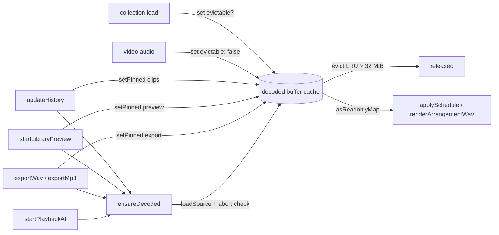

# PERF-13b-i: გამოუყენებელი decoded audio თავისუფლდება და საჭიროებისას თავიდან იშიფრება

**თარიღი:** 2026-11-07
**სტატუსი:** Completed (C round 392 PASS)
**შეცვლილი პროექტი:** Store (`app/lib/arrangement/decoded-buffer-cache.ts`, `app/contexts/ArrangementContext.tsx`, `app/types/arrangement.ts`, `app/data/studio-lab-demo.ts`, `perf/lib/pcm-live.ts`, `perf/studio-lab-resources.perf.spec.ts`, `perf/budgets.resources.json` და ტესტები).

## კონტექსტი

`/studio-lab` ready მდგომარეობაში 124 MiB decoded audio-ს ინახავდა, თუმცა საწყის arrangement-ში არც ერთი clip არ არის (C round 381, `res.mem.pcm-live-mib-ready`). Provider-ის `buffersRef` Map-ს ჰქონდა ორი `set` და არც ერთი `delete`/`clear`. ყველაზე დიდი ორი buffer დემოს MP3 ფაილებია: `demo-hero-music` (150.37 s, 55.07 MiB) და `demo-middle-east` (101.35 s, 37.12 MiB). ორივე public-preview stem cache-დან იაფად ხელახლა იტვირთება. perf plan-ის მიზანი ready-ზე ≤ 60 MB-ია.

## მიდგომა

- **ახალი pure მოდული** `decoded-buffer-cache.ts`: `createDecodedBufferCache<B>({ budgetBytes, estimate })` — LRU, per-owner pin-ები (`clips`, `preview`, `export`), `evict()`, და `asReadonlyMap()` (ერთი და იგივე Map instance მთელი სიცოცხლის განმავლობაში). `estimateBufferBytes` = `length × numberOfChannels × 4`.
- **Budget:** `UNPINNED_DECODED_BUDGET_BYTES = 32 MiB` — მხოლოდ evictable და unpinned ჩანაწერებზე. თითოეული დემო MP3 თავისთავად 32 MiB-ზე დიდია (55.07 და 37.12), ამიტომ ready-ზე ორივე თავისუფლდება, ჩატვირთვის რიგის მიუხედავად. 7 synth buffer evictable არ არის (≈ 31.9 MiB რჩება).
- **ვინ შეიძლება გათავისუფლდეს:** მხოლოდ ის source, რომელზეც collection-ის `canReloadSource` აბრუნებს `true`. დემო collection-ში ეს მხოლოდ `demoUrls`-ის ორი წყაროა. ველი არააუცილებელია: purchased adapter-სა და video audio-ზე არაფერი იცვლება (signed URL-ები შეიძლება ვადაგასული იყოს — ეს 13b-ii / SRW-21-ის საკითხია).
- **Pin-ები:**
  - `clips` — `history.present.clips`-ის `sourceId`-ები; ითვლება `updateHistory`-ში და გამოიტოვება, როცა `clips` მასივი იგივე reference-ია (მაგ. volume edit). Undo/Redo-ის past/future არასოდეს pin-დება.
  - `preview` — preview-ის წყარო, თავისუფლდება preview-ის დასრულებისას ან **library preview-ის** Stop-ზე (transport-ის Stop preview-ს არ აჩერებს, როგორც HEAD-ზე).
  - `export` — export-ის ყველა clip წყარო, `renderArrangementWav`-ის დასრულებამდე; `finally`-ში თავისუფლდება cancel-სა და error-ზეც. ჩანაცვლებული (აბორტირებული) export ახალი export-ის pin-ებს არ ხსნის: გახსნა ხდება მხოლოდ მაშინ, როცა pin-ის მფლობელი controller ჯერ კიდევ იგივეა.
- **`ensureDecoded(ids)`:** ხელახლა შიფრავს მხოლოდ collection-ის `ready` წყაროს, რომელსაც buffer აღარ აქვს; იგივე id-ზე ერთდროული გამოძახებები ერთ decode-ს იზიარებს. იყენებს collection effect-ის `AbortController`-ს, რომელიც გამოძახების მომენტში იკითხება, და `set`-მდე ამოწმებს `aborted`-ს. Peaks ხელახლა არ ითვლება — waveform, duration და `ready` სტატუსი რჩება.
- **Play refusal:** თუ `present.clips`-ში არის `ready` წყარო buffer-ის გარეშე, Play არ იწყება; status ხდება არსებული `“<title>” has not loaded yet.` და ეს ტექსტი ნებისმიერ წინა status-ს გადაეწერება. ავტომატური დაწყება არ არის; decode-ის შემდეგ შემდეგი Play ჩვეულებრივ იწყება. მიმდინარე playback-ს ახალი clip resync-ით უერთდება და playback არ ჩერდება. ერთადერთი ადგილი, სადაც playback იწყება, `startPlaybackAt`-ია; დანარჩენი `startGraph` გამოძახებები მხოლოდ მიმდინარე playback-ს გადაგეგმავს.
- **Failure path:** ხელახალი decode-ის შეცდომა წყაროს `error`-ზე გადაიყვანს არსებული ტექსტით (`error.message` ან `Loading failed`); clip ჩუმად არ გამოტოვდება, სანამ წყარო `ready`-ა. თუ ეს decode export-ის მიერ დაწყებული ლოდინისას ვერ შესრულდა, export ფაილს არ ქმნის და არსებულ `Export failed — no file was created.` ტექსტს აჩვენებს.
- **Peaks state:** `sourcePeaks`-ს ორივე `onPeaks` callback (collection load და video audio) component scope-ის `storeSourcePeaks(id, peaks)` helper-ით აახლებს; მისი functional updater მხოლოდ `id`-სა და `peaks`-ს იჭერს. წესი (SWEEP): callback-ში, რომლის scope-შიც `AudioBuffer` არის, `set…(`-ს inline ფუნქცია არ გადაეცემა.
- **განხილული ალტერნატივები:** ყველაფრის მყისიერი გათავისუფლება (budget 0) — უარყოფილია, synth buffer-ები ხელახლა ვერ იტვირთება; Play-ის ჩუმი დაწყება clip-ის გარეშე ან ავტომატური დაწყება decode-ის შემდეგ — უარყოფილია (D-29z1275, tech-lead option ii).

## არქიტექტურა

collection-ის შეცვლისას (effect cleanup) in-flight decode-ები აბორტირდება, მათი რუკა იწმინდება და cache-იდან `deleteMany(<ძველი collection-ის source id-ები>)`-ით იშლება ზუსტად ძველი collection-ის ჩანაწერები (D-29z1278). video audio-ს ჩანაწერები რჩება; `clear()` API-ში რჩება, მაგრამ provider მას არსად იძახებს. pin-ებს reset არ ეხება: `clips` history-დან ხელახლა ითვლება, `preview` და `export` საკუთარი lifecycle-ით თავისუფლდება. `/studio-lab`-ში collection მოდულის კონსტანტაა (`studioLabDemoCollection`), ხოლო `createPurchasedWorkspaceCollection`-ს route-ში გამომძახებელი არ ჰყავს, ამიტომ production-ში ეს მხოლოდ unmount-ზე ხდება.

## შეცვლილი ფაილები

- `app/lib/arrangement/decoded-buffer-cache.ts` (ახალი; round 383-ში `deleteMany`)
- `app/lib/arrangement/__tests__/decoded-buffer-cache.test.ts` (ახალი)
- `app/lib/arrangement/__tests__/decoded-buffer-eviction-ui.test.tsx` (ახალი)
- `app/contexts/ArrangementContext.tsx`
- `app/types/arrangement.ts` (`WorkspaceCollection.canReloadSource?`)
- `app/data/studio-lab-demo.ts`
- `perf/lib/pcm-live.ts`, `perf/lib/pcm-live.test.ts`
- `perf/studio-lab-resources.perf.spec.ts`, `perf/budgets.resources.json`

## პრობლემები და გადაწყვეტები

- **Problem:** eviction-ის შემდეგ harness-ის წესი „ცოცხალი buffer-ების რაოდენობა = library წყაროების რაოდენობა" განზრახ ირღვევა.
  **Solution:** წესი გახდა bound: `P ≤ N ≤ M` (P = გვერდზე განთავსებული audio clip-ების რაოდენობა წაკითხვის მომენტში, task §2.6-ის მიხედვით; M = library წყაროები), პრობლემის ტექსტით `pcm live count N outside [P, M]`.
- **Problem:** თუ `decodeAudioData`-ის wrap გაქრება, ready-ზე 0 decode buffer-ი eviction-ის შედეგს ჰგავს და harness ამას ვერ შეამჩნევდა.
  **Solution:** decode-liveness guard — ყოველი წაკითხვა ჯერ გვერდში აწყობილ 480 frame-იან mono WAV-ს (48,000 Hz) შიფრავს 48,000 Hz-იან `OfflineAudioContext`-ით და ინახავს; ზუსტად ერთი ასეთი `'decode'` ჩანაწერი უნდა იყოს, თორემ `pcm registry did not count its decode probe`.
- **Problem (code-reviewer M3, round 381):** registry რომ buffer-ებს strong reference-ით ინახავდეს, GC-ის შემოწმება ვერაფერს დაადასტურებდა.
  **Solution:** dropped probe — 2 frame-იანი mono buffer, რომლის reference GC ×2-მდე იკარგება; თუ ცოცხალია, `pcm registry kept a dropped probe`. სამი probe ფორმით გამოირჩევა (1, 2 და 480 frame mono) და ჯამებში არ ითვლება.
- **Problem (GATE381-L1):** registry 6× pass-შიც ინსტალირდებოდა.
  **Solution:** `installPcmLiveRegistry` მხოლოდ record (1×) pass-ში ემატება.
- **Problem:** export-ის ჩანაცვლებისას ძველი export-ის `finally` ახალი export-ის pin-ებს გახსნიდა.
  **Solution:** pin-ის მფლობელი controller ref-ში ინახება; გახსნა მხოლოდ იმავე controller-ზე ხდება.
- **Problem (C-R382-01):** ready-ზე ერთი decoded MP3 (hero, 150.37 s, 55.07 MiB) ცოცხალი რჩებოდა, თუმცა cache-მა თავისი reference გაათავისუფლა. B-ის heap snapshot-მა აჩვენა: provider-ის alternate `FiberNode`-ის `useState` hook-ის `baseQueue` ინახავდა ბოლო `setSourcePeaks((previous) => …)` updater-ს. ეს closure იმავე V8 context-ს იზიარებდა, რომელშიც `.then((buffer) => …)`-ის `buffer` იყო (context-allocated, რადგან `onPeaks` მას იყენებს).
  **Solution:** component scope-ის `storeSourcePeaks(id, peaks)` helper — updater მხოლოდ `id`-სა და `peaks`-ს იჭერს; ორივე `onPeaks` მას იძახებს. SWEEP წესი: `AudioBuffer`-ის მქონე scope-ში `set…(`-ს inline ფუნქცია არ გადაეცემა. ready-ზე ცოცხალია მხოლოდ 7 synth buffer, 0 გზა `baseQueue`-ით (A-ს heap self-check; C-ს HEAP-RETAINERS მწკრივი ამოწმებს).
- **Problem (code-reviewer M2, round 382):** collection-ის შეცვლისას `clear()` video audio-ს buffer-საც შლიდა.
  **Solution:** `deleteMany(<ძველი collection-ის id-ები>)` (D-29z1278); video audio-ს ჩანაწერები რჩება, pin-ებს reset არ ეხება.

## ტესტირება

- `decoded-buffer-cache.test.ts`: **DC1** LRU და `get`-ის განახლება, **DC2** pinned ჩანაწერი არ თავისუფლდება ბოლო owner-ის unpin-მდე, **DC3** non-evictable არასოდეს თავისუფლდება, **DC4** budget-ზე დიდი ჩანაწერი unpin-ის შემდეგ თავისუფლდება, **DC5** `asReadonlyMap()` იგივე instance-ია, **DC6** mono ×4 / stereo ×8, **DC7** ცარიელი `setPinned` მხოლოდ თავის owner-ს ხსნის, **DC8** `deleteMany` შლის მხოლოდ დასახელებულ id-ებს, pin-ებს ინარჩუნებს და შემდეგი `evict()` დარჩენილი ჩანაწერების LRU რიგს იცავს — MU-383-DELETE-MANY-ALL.
- `decoded-buffer-eviction-ui.test.tsx` (jsdom, provider fake collection-ით; cache დაკვირვება `vi.mock`-ით, რეალური factory spy-ებით), თითო მწკრივი თავისი mutant-ით, რომელიც A-მ გაუშვა და წითელია:
  - **EV1** — MU-EV-NO-EVICT
  - **EV2** — MU-EV-NO-DEDUPE
  - **EV3** (ორი it: Play-ის უარი decode-ის დროს — Add-ის status-ს გადაეწერება — და მერე დაწყება; უკვე მიმდინარე playback-ში ახალი clip resync-ით უერთდება და playback არ ჩერდება) — MU-EV-PLAY-NO-REFUSE, MU-EV-NO-PLAYING-RESYNC
  - **EV4** — MU-EV-NO-CLIPS-PIN-RECOMPUTE
  - **EV5** (სამი it: export ელოდება decode-ს და render-ის მომენტში buffer უკვე map-შია; გაუქმებული export pin-ებს ხსნის; ჩანაცვლებული export ახლის pin-ებს არ ხსნის) — MU-EV-EXPORT-NO-AWAIT, MU-EV-EXPORT-PIN-LEAK, MU-EV-REPLACED-EXPORT-RELEASES
  - **EV6** (ორი it: წყარო `error`-ზე გადადის; export, რომლის decode ვერ შესრულდა, ფაილს არ ქმნის) — MU-EV-FAIL-SILENT, MU-EV-EXPORT-FAIL-SILENT
  - **EV7** (collection-ის შეცვლა `deleteMany`-ს ზუსტად ძველი collection-ის id-ებით იძახებს და `clear`-ს არასოდეს; ძველი in-flight decode `set`-ს არ აკეთებს) — MU-EV-NO-ABORT-CHECK, MU-383-RESET-CLEAR
  - **EV8** — MU-EV-PIN-EVERY-UPDATE
  - **EV9** (ორი it: preview ხელახლა გაშიფრულ წყაროს უკრავს და **library preview-ის** Stop-ზე ათავისუფლებს; ჩანაცვლებული preview მოთხოვნა decode-ის შემდეგ არ იწყება და status-ს არ ცვლის) — MU-EV-PREVIEW-NO-STOP-RELEASE, MU-EV-PREVIEW-NO-SUPERSEDE
  - **EV10** (ორი წყაროს peaks ერთსა და იმავე tick-ში მოდის; `sourcePeaks` ორივეს ინახავს, თითოს საკუთარი მასივით) — MU-383-NONFUNCTIONAL-PEAKS. ეს helper-ის functional update-ს იცავს და retention-ის მტკიცებულება არ არის: jsdom V8 context retention-ს ვერ ხედავს.
- Heap mutant (C უშვებს `MODE=heap`-ით copy-ს dev server-ზე): MU-383-INLINE-PEAKS-UPDATER — load path-ის `onPeaks`-ში inline updater-ის დაბრუნება; მოსალოდნელი წითელი: 150.37 s buffer ready-ზე ცოცხალია და მისი გზა `baseQueue`-ს შეიცავს.
- `perf/lib/pcm-live.test.ts`: **PL1–PL4** (PL3 bound-ისთვის გადაწერილი), **PL5** ახალი პრობლემის ტექსტები ცალ-ცალკე, **PL6** N = P და N = M ორივე ვალიდურია, **PL7** dropped და decode probe ჯამებიდან გამორიცხულია. Unit mutant-ები: MU-13B-BOUND-OFF → PL3, MU-13B-DECODE-PROBE-OFF → PL5.
- Browser harness mutant-ები (C უშვებს PERF-RES-ით): MU-13B-NO-DECODE-WRAP → `pcm registry did not count its decode probe`, MU-13B-STRONG-REFS → `pcm registry kept a dropped probe`.
- Runner: `tmp/studio-real-loop/a-round-383/mutants/run-mutants-383.sh` (repository-ს გარეთ; round 382-ის ყველა mutant + MU-383-*).
- ახალი record მწკრივები: `res.mem.pcm-live-mib-after-add`, `res.mem.pcm-live-count-after-add`. ამ round-ში არც ერთი მწკრივი `assert` არ ხდება.

## TODO / შემდეგი ნაბიჯები

- PERF-13b-ii: წყაროს „ცნობილი vs decoded" მდგომარეობა და preview-ის ტექსტი; PCM მწკრივის `assert`-ზე გადაყვანა mutant-ით, ამ round-ის production მნიშვნელობის საფუძველზე (L58).
- purchased adapter-ის `canReloadSource` (signed URL-ის ვადა) — 13b-ii ან SRW-21.
- `previewArrangement` (envelope/marker drag) ყოველ კადრზე ახალ `clips` მასივს ქმნის, ამიტომ pin-ები ყოველ კადრზე ხელახლა ითვლება — ცნობილი ღირებულება, გაზომვის კანდიდატი.
