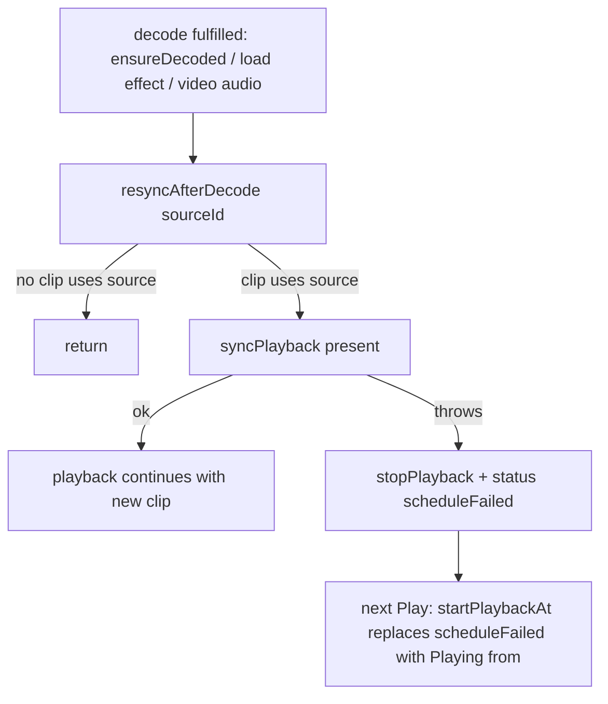

# Decode-ის შემდგომი resync-ის შეცდომები: GATE384-M1, A-R383-REVIEW-L1, GATE384-L2

**თარიღი:** 2026-11-07
**სტატუსი:** Completed (C round 386 PASS)
**შეცვლილი პროექტი:** Store (`app/contexts/ArrangementContext.tsx`, `app/lib/arrangement/strings.ts` და ტესტები).

## კონტექსტი

PERF-13b-i-მ (doc 248) decoded audio-ს გათავისუფლება და საჭიროებისას ხელახალი decode დაამატა. Gate 384-ის reviewer-მა და A-ს round 383-ის reviewer-მა სამი დაკავშირებული პრობლემა იპოვა `ensureDecoded`-სა და `startLibraryPreview`-ში:

- **GATE384-M1 (Medium):** წარმატებული decode-ის შემდეგ `syncPlayback(present, undefined, true)` იძახებოდა `.then(onFulfilled, onRejected)`-ის fulfilled handler-ში. `applySchedule`-ის შეცდომა `onRejected`-ში არ გადადიოდა, ამიტომ ჩნდებოდა unhandled rejection. ძველი graph აგრძელებდა დაკვრას ახალი clip-ის გარეშე, status კი არ იცვლებოდა. B-მ ეს რეალურ browser-ში გაიმეორა: 1 `pageerror`, clip ჩუმია.
- **A-R383-REVIEW-L1 (Low):** ძველი collection-ის `ensureDecoded` გამოძახება collection-ის შეცვლის შემდეგ ახალი collection-ის `AbortController`-ს იყენებდა და decode-ს ახალ cache-ში წერდა.
- **GATE384-L2 (Low):** deferred preview (buffer გათავისუფლებულია) timeline-ის playback-ს click-ის მომენტში აჩერებდა, მაშინაც კი, როცა decode შემდეგ ვერ სრულდებოდა და preview საერთოდ არ იწყებოდა.

იგივე დაუცველი გამოძახება ჰქონდა collection load-ის effect-სა და video audio-ს გზასაც (`tech-lead`-ის TL-R385-M1).

## მიდგომა

- **ერთი helper სამ გამოძახებაზე.** `resyncAfterDecode(sourceId)` (`useCallback`, deps: `setStatus`, `stopPlayback`, `syncPlayback`) არაფერს აკეთებს, თუ ამ source-ს არც ერთი clip არ იყენებს. სხვა შემთხვევაში `syncPlayback`-ს `try`-ში იძახებს. `catch` აჩერებს playback-ს და status-ში წერს `studioPlaybackStrings.scheduleFailed`-ს. Helper-ს სამივე ადგილი იყენებს: `ensureDecoded`, video audio და load effect. ასე ერთი root cause ერთად იხურება.
- **კონტრაქტი შეცდომის შემდეგ (D-29z1295):**
  - playback ჩერდება;
  - status-ში ჩანს `Playback stopped — the audio could not be scheduled. Press Play to try again.`;
  - decoded buffer რჩება და source `ready` რჩება;
  - შემდეგი წარმატებული Play ამ ტექსტს „Playing from …“-ით ცვლის.
- **რატომ გაჩერება და არა გაგრძელება.** შეცდომა `applySchedule`-ში handle-ის გაცვლამდე ხდება, ამიტომ ძველი graph ახალი clip-ის გარეშე აგრძელებს. გაგრძელება mix-ს ჩუმად არასწორს დატოვებდა. გაჩერება და status ყველაზე პატარა და გულწრფელი მდგომარეობაა.
- **Owner guard (L1).** `collectionControllerRef` ახლა ინახავს `{ collection, controller }`-ს. `ensureDecoded` controller-ს მხოლოდ მაშინ იყენებს, როცა `owner.collection` მისივე collection-ია; სხვა შემთხვევაში არაფერს შიფრავს. Reset `.controller`-ს ადარებს.
- **L2.** `startLibraryPreview`-ის deferred შტო click-ზე `stopPlayback()`-ს აღარ იძახებს. Decode-ის დროს timeline აგრძელებს დაკვრას, როგორც Live-ში (Live 12 manual, *Working with the Browser*, „Previewing Files“). Preview-ის დაწყებისას ხდება იგივე გაჩერება, რაც direct გზაზე. Direct preview-ის გაჩერება უცვლელია და Saba-ს კითხვაა (Q-PREVIEW-STOPS-TRANSPORT).
- **განხილული ალტერნატივა:** შეცდომის შემდეგ playback-ის გაგრძელება ძველი graph-ით უარყოფილია (ჩუმად არასწორი mix). `applySchedule`-ის all-or-nothing გადაწერა (`graph.client.ts`) ცალკე დავალებაა: GATE-B385-M2.

## არქიტექტურა

## შეცვლილი ფაილები

- `app/contexts/ArrangementContext.tsx`: `resyncAfterDecode` helper, სამი გამოძახება, owner guard `collectionControllerRef`-ზე, deferred preview-ს click-ის გაჩერება მოხსნილია, `startPlaybackAt`-ის status updater `scheduleFailed`-საც ცვლის.
- `app/lib/arrangement/strings.ts`: `studioPlaybackStrings.scheduleFailed`.
- `app/lib/arrangement/__tests__/strings.test.ts`: ST10-ის literal map-ს ახალი ტექსტი დაემატა.
- `app/lib/arrangement/__tests__/decoded-buffer-eviction-ui.test.tsx`: `applySchedule` spy-ით, რიგები EV11–EV15.
- `app/lib/arrangement/__tests__/peaks-worker-video.test.tsx`: რიგი PW20.

## პრობლემები და გადაწყვეტები

- **Problem (M1):** fulfilled handler-ში ნასროლი შეცდომა `onRejected`-ში არ ხვდება, ამიტომ unhandled rejection ჩნდება და playback ძველი graph-ით გრძელდება. → **Solution:** `resyncAfterDecode` შეცდომას თავად იჭერს, აჩერებს playback-ს და status-ს წერს.
- **Problem (load და video გზები):** collection load-სა და video audio-ს იგივე დაუცველი `syncPlayback` ჰქონდათ. → **Solution:** ორივე `resyncAfterDecode`-ს იძახებს, deps-ში `syncPlayback` helper-ით შეიცვალა.
- **Problem (L1):** ძველი `ensureDecoded` ახალ controller-ს იყენებდა. → **Solution:** ref ინახავს collection-საც და controller გამოიყენება მხოლოდ იგივე collection-ზე.
- **Problem (L2):** deferred preview click-ზე აჩერებდა timeline-ს, decode-ის წარუმატებლობის დროსაც. → **Solution:** click-ის გაჩერება მოხსნილია; წარუმატებელ decode-ზე timeline აგრძელებს და არსებული შეცდომის ტექსტი ჩანს.
- **Problem (load effect-ის identity, GATE384-L4):** load effect-ის deps შეიცვალა და შეიძლება იგივე collection-ზე ხელახლა გაშვებულიყო. → **Solution:** helper-ის deps სტაბილურია; EV14 ამოწმებს, რომ იგივე collection-ის re-render არაფერს ტვირთავს და `deleteMany`-ს არ იძახებს.

## ტესტირება

- **ახალი რიგები:**
  - **EV11** (×2): resync-ის შეცდომა playing-ის დროს: 0 unhandled rejection, playback გაჩერებულია, status `scheduleFailed`, source `ready`, buffer რჩება, შემდეგი Play „Playing from“-ს აჩვენებს. იგივე decode-ზე მოლოდინში მყოფი export მაინც render-დება.
  - **EV12:** collection-ის შეცვლამდე დაწყებული stale preview ახალ collection-ში არაფერს შიფრავს.
  - **EV13** (×2): preview-ის decode-ის დროს timeline აგრძელებს; წარუმატებელი decode-ის შემდეგაც აგრძელებს და შეცდომის ტექსტს აჩვენებს.
  - **EV14:** იგივე collection-ის re-render არაფერს ტვირთავს და არაფერს შლის.
  - **EV15:** პირველი load-ის შემდეგ resync-ის შეცდომა.
  - **PW20:** video audio-ს resync-ის შეცდომა: window error არ არის, playback გაჩერებულია, status ჩანს, audio `ready`.
- **Mutants** (B-ის `b-round-385/mutants`, A-მ ასლზე გაიმეორა, 7/7 წითელი): MU-386-NO-CATCH (EV11 ×2, EV15, PW20), MU-386-NO-OWNER-GUARD (EV12), MU-386-CLICK-STOP (EV13 ×2), MU-386-LOAD-PATH-DIRECT (EV15), MU-386-VIDEO-PATH-DIRECT (PW20), MU-386-REPLAY-STATUS (EV11), MU-386-UNSTABLE-RESYNC (EV14 და სხვები).
- **Covering set:** 34 ფაილი, 633 ტესტი გავიდა; `npm run typecheck` და `npm run lint` rc 0.
- **Browser:** C ამოწმებს resync-ის შეცდომას, preview-ს playback-ის დროს, join-while-playing-ს და auth guard-ს რეალურ Chromium-ში, ორივე viewport-ზე.

## TODO / შემდეგი ნაბიჯები

- **GATE-B385-M2-APPLY-SCHEDULE-ROLLBACK (Medium):** `applySchedule` all-or-nothing არ არის: `startPlan`-ის შუაში ნასროლი შეცდომა უკვე დაწყებულ source-ებს ჟღერადობაში ტოვებს. ეს ცალკე დავალებაა (`graph.client.ts`).
- TL-R385-L4 (მოგვიანებით მოსული „N failed“ settle `scheduleFailed`-ს ცვლის), L5, L6, L8 გადატანილია `deferred_low_polish`-ში.
- Q-PREVIEW-STOPS-TRANSPORT: direct preview-ის მიერ transport-ის გაჩერება Saba-ს კითხვაა (`awaiting_user`).
