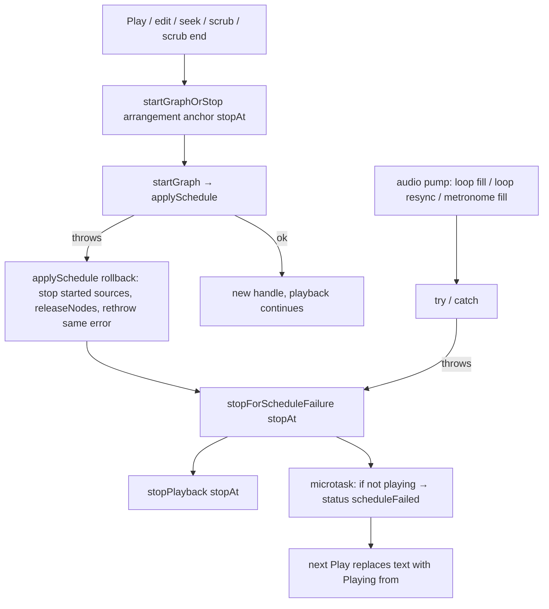

# Schedule-ის შეცდომის rollback: GATE-B385-M2, A-R386-REVIEW-M1, B-R386-UNGUARDED-GRAPH-CALLERS

**თარიღი:** 2026-11-07
**სტატუსი:** Completed (C round 388 PASS)
**შეცვლილი პროექტი:** Store (`app/lib/arrangement/graph.client.ts`, `app/contexts/ArrangementContext.tsx` და ტესტები).

## კონტექსტი

Doc 249-მა (round 386) decode-ის შემდგომი resync დაიცვა: `resyncAfterDecode` შეცდომისას playback-ს აჩერებს და status-ში `scheduleFailed`-ს წერს (D-29z1295). დარჩა სამი Medium პრობლემა ერთი root cause-ით — throw playback graph-ის აგებისას:

- **GATE-B385-M2 (Medium):** `applySchedule` all-or-nothing არ იყო. თუ Play-ის დროს მე-2 source-ის `start()` ვარდებოდა, 1-ლი source აგრძელებდა ჟღერადობას და Stop ვეღარ აჩერებდა; ყოველი throw uncaught page error იყო. B-მ ეს რეალურ browser-ში გაიმეორა HEAD-ზე (`leaked` 1).
- **A-R386-REVIEW-M1 (Medium):** Play-ის throw ტოვებდა `isPlaying` true-ს graph-ის გარეშე. შემდეგი დაჭერა Stop-ად მუშაობდა და clock ძველ anchor-ზე ხტებოდა (00:00.000 → 00:02.011).
- **B-R386-UNGUARDED-GRAPH-CALLERS (Medium):** graph-ის სხვა აგებები (`syncPlayback` edit-ებსა და loop resync-ზე, `seekTo`, `scrubPlayhead`, `endPlayheadScrub`, audio pump-ის loop/metronome fill) throw-ს გარეთ უშვებდა, ძველი graph კი ძველ arrangement-ს უკრავდა — ჩუმად არასწორი mix.

## მიდგომა

- **ორი დონე, ერთი გადაწყვეტილება (D-29z1303).** `graph.client.ts` იძლევა გარანტიას „throw ნიშნავს, რომ არაფერი შეცვლილა“ (TL-R385-ARCH). Provider-ის ერთი wrapper წყვეტს, რას ხედავს მომხმარებელი. ეს ორი მიდგომა ერთმანეთს არ ეწინააღმდეგება.
- **`applySchedule`-ის rollback.** აგება ერთ `try`-შია. Source ჩაიწერება მხოლოდ წარმატებული `start()`-ის შემდეგ. Throw-ზე ყველა დაწყებულ clip/click source-ს `stop()` ეძახება, შექმნილი node-ები `releaseNodes()`-ით იხსნება (იგივე helper-ს იყენებს `handle.disconnect()`), და იგივე error ხელახლა ისვრის. `stop()`-ის შეცდომა rollback-ში საწყის error-ს არ ცვლის. Meter tap-ები (`tap`, `trackTaps`) არ იხსნება — ისინი `applySchedule`-მა არ შექმნა.
- **ერთეულის დონე.** `startPlan`-ში ჩავარდნილი `start()` საკუთარ chain-ს ხსნის rethrow-მდე; ეს ფარავს `appendPlan`-ს live handle-ზეც. `startClicks` იგივეს აკეთებს metronome click-ისთვის (TL-R387-L2).
- **კონტრაქტი (D-29z1302), ახლა ყველგან:**
  - playback ჩერდება და არაფერი აგრძელებს ჟღერადობას;
  - status-ში ჩანს არსებული `studioPlaybackStrings.scheduleFailed` (ახალი ტექსტი არ დამატებულა);
  - edit, რომელმაც reschedule გამოიწვია, history-ში რჩება;
  - შემდეგი წარმატებული Play ტექსტს „Playing from …“-ით ცვლის.
- **`stopForScheduleFailure(stopAt?)`.** `stopPlayback(stopAt)` + microtask, რომელიც `scheduleFailed`-ს წერს მხოლოდ მაშინ, თუ playback შუალედში თავიდან არ დაწყებულა (SF10). ჩაწერა microtask-შია, რადგან commit action-ები reschedule-ის შემდეგ საკუთარ status-ს სინქრონულად წერენ და შეცდომის ტექსტს დაფარავდნენ.
- **`startGraphOrStop(arrangement, anchor, stopAt?)`.** `startGraph`-ის ერთადერთი პირდაპირი გამოძახება; აბრუნებს `boolean`-ს. იყენებენ:
  - `syncPlayback` — `stopAt` = `positionAt(anchor, startAt)`, ანუ ახალ timeline-ში remap-ილი პოზიცია (TL-R387-M1, SF8);
  - `startPlaybackAt` — `stopAt` = `from`; throw-ზე rAF tick და audio pump არ იწყება;
  - `seekTo`, `scrubPlayhead`, `endPlayheadScrub` — `stopAt` = target.
- **Audio pump.** Loop fill, loop resync და metronome fill `try`/`catch`-შია → `stopForScheduleFailure()`.
- **`tick`-ის guard (round 388, C-R387-01).** rAF `tick` `pumpPlaybackAudio()`-ს იძახებს; თუ pump-მა playback შეაჩერა, `tick` `isPlayingRef`-ს ამოწმებს, `frameRef`-ს ასუფთავებს და ბრუნდება — meter-ებს აღარ კითხულობს და ახალ frame-ს აღარ აყენებს. ნორმალურ playback-ზე guard არასდროს სრულდება.
- **`resyncAfterDecode`.** საკუთარი `catch` რჩება (round 386-ის კონტრაქტი) და ახლა `stopForScheduleFailure()`-ს იძახებს (TL-R387-L1). ის მეორე თავდაცვის ხაზია.
- **განხილული ალტერნატივა:** მხოლოდ provider-ის დონეზე დაჭერა, `graph.client.ts`-ის rollback-ის გარეშე. უარყოფილია: ნაწილობრივ აგებული graph-ის დაწყებული source-ები ჟღერადობას გააგრძელებდა და `handleRef`-ში არ ჩაიწერებოდა, ამიტომ Stop ვერ გააჩერებდა.

## არქიტექტურა

## შეცვლილი ფაილები

- `app/lib/arrangement/graph.client.ts` — `applySchedule`-ის rollback, `releaseNodes()`, `startPlan`/`startClicks`-ის ერთეულის detach.
- `app/contexts/ArrangementContext.tsx` — `stopForScheduleFailure`, `startGraphOrStop`, pump-ის `try`/`catch`, `resyncAfterDecode`-ის catch, `tick`-ის guard `pumpPlaybackAudio()`-ის შემდეგ (round 388).
- `app/lib/arrangement/__tests__/apply-schedule-rollback.test.ts` (ახალი) — AR1–AR5, რეალური `applySchedule` ჩამწერი fake context-ით.
- `app/lib/arrangement/__tests__/schedule-failure-ui.test.tsx` (ახალი) — SF1–SF10, provider fake `AudioContext`-ით, რომლის N-ე `start()` ვარდება; SF11 (round 388) — metered fake analyser-ებით და დაჭერილი rAF callback-ებით რეალურ `tick`-ს ატარებს.
- `docs/implementation/2026/quarter-IV/250-schedule-failure-rollback.md` — ეს დოკუმენტი.

## პრობლემები და გადაწყვეტები

- **პრობლემა:** ნაწილობრივ აგებული graph-ის source-ები ჟღერდა და Stop ვერ აჩერებდა (GATE-B385-M2). **გადაწყვეტა:** `applySchedule` throw-ზე აჩერებს ყველა დაწყებულ source-ს, ხსნის ყველა შექმნილ node-ს და იგივე error-ს ისვრის (AR1–AR5).
- **პრობლემა:** ჩავარდნილი Play `isPlaying`-ს true-ზე ტოვებდა და შემდეგი Stop clock-ს ძველ anchor-ზე აგდებდა (A-R386-REVIEW-M1). **გადაწყვეტა:** `startPlaybackAt` `startGraphOrStop`-ს იძახებს `stopAt` = `from`-ით და throw-ზე rAF-მდე ბრუნდება (SF1, SF2, SF9).
- **პრობლემა:** edit, seek, scrub, scrub end და pump throw-ს გარეთ უშვებდა, ძველი graph კი ძველ mix-ს უკრავდა (B-R386-UNGUARDED-GRAPH-CALLERS). **გადაწყვეტა:** ყველა გადის `startGraphOrStop`-ზე ან pump-ის `try`/`catch`-ზე (SF3–SF8).
- **პრობლემა:** commit action-ის საკუთარი status ფარავდა შეცდომის ტექსტს. **გადაწყვეტა:** ჩაწერა microtask-შია (SF3, SF8; mutant MU-387-STATUS-SYNC).
- **პრობლემა:** იმავე task-ში წარმატებული Play-ის შემდეგ microtask მის ტექსტს გადაწერდა (TL-R387-L4). **გადაწყვეტა:** microtask წერს მხოლოდ მაშინ, როცა playback არ მიმდინარეობს (SF10).
- **პრობლემა:** დროის ამომჭრელი edit-ის შემდეგ ჩავარდნილი reschedule ძველი timeline-ის პოზიციაზე ჩერდებოდა (TL-R387-M1). **გადაწყვეტა:** `syncPlayback`-ის `stopAt` = ახალ timeline-ში remap-ილი პოზიცია (SF8).
- **პრობლემა:** loop-იანი playback-ის დროს pump-ის schedule-ის შეცდომის შემდეგ meter-ები ბოლო დონეზე (დაახლ. −19.8 dB) იყინებოდა „Playback stopped“ ტექსტის გვერდით (C-R387-01): `tick` pump-ის შემდეგ analyser-ებს თავიდან კითხულობდა და ახალ frame-ს აყენებდა. **გადაწყვეტა:** `tick`-ში guard `pumpPlaybackAudio()`-ის შემდეგ — თუ playback აღარ მიმდინარეობს, `frameRef` სუფთავდება და `tick` ბრუნდება; `stopPlayback`-ის მიერ ჩაწერილი −∞ რჩება (SF11; mutant MU-388-TICK-NO-GUARD).

## ტესტირება

- **Unit:** AR1–AR5 (`apply-schedule-rollback.test.ts`) და SF1–SF11 (`schedule-failure-ui.test.tsx`), round 388-ის 66 covering ფაილთან ერთად (round 387-ის 65 + `master-hold-tick.test.tsx`).
- **SF11 (round 388):** loop 0–0.5 s, Play, −20 dBFS სიგნალი; pump-ის loop fill-ის `start()` throw-ის შემდეგ: ერთი throw, window `error` არ არის, playback გაჩერებულია, status `scheduleFailed`, არაფერი ჟღერს, master-ის `data-level-db`/`data-hold-db` და ორივე track meter-ის `data-level-db` = `-inf`, rAF-ის რიგში frame არ რჩება. SF11 მხოლოდ window `error`-ს უსმენს; unhandled rejection-ს არ ამოწმებს.
- **Mutants (15):** MU-387-NO-ROLLBACK-STOP, MU-387-NO-RELEASE, MU-387-REPLACE-ERROR, MU-387-NO-ITEM-DETACH, MU-387-CLICK-NO-DETACH, MU-387-PLAY-NO-GUARD, MU-387-PLAY-NO-STOPAT, MU-387-SYNC-DIRECT, MU-387-SYNC-NO-STOPAT, MU-387-SEEK-DIRECT, MU-387-SCRUB-DIRECT, MU-387-ENDSCRUB-DIRECT, MU-387-PUMP-NO-CATCH, MU-387-STATUS-SYNC, MU-387-MICROTASK-NO-PLAYING-GUARD — თითოეული თავის row-ს წითლად აქცევს. Round 388-ზე MU-387-PUMP-NO-CATCH წითელია SF6-სა და SF11-ზე.
- **Mutant MU-388-TICK-NO-GUARD:** `tick`-ის guard-ის მოხსნა SF11-ს წითლად აქცევს (master `-20.0` ნაცვლად `-inf`-ისა; `-20.0` SF11-ის fake −20 dBFS სიგნალია, ხოლო −19.8 dB browser-ში დაფიქსირებული მნიშვნელობა).
- **Browser (C):** Play-ის throw-ის flow ორ viewport-ზე (`leaked` 0, page error-ის გარეშე), round 386-ის resync-ის მეზობელი row და export-ის WAV, რომელიც HEAD-ს byte-ით ემთხვევა.

## TODO / შემდეგი ნაბიჯები

- TL-R387-L3: catch დიაგნოსტიკას არ წერს — Studio-ს client diagnostic არხი არ აქვს (TL-R385-L8-ის მსგავსად გადადებულია).
- Gate-386-ის S1–S5 და A-R386-REVIEW-L2 ჩაწერილია, არ არის დაგეგმილი.
- Round 387-ის code-reviewer-ის Low-ები L-a, L-b, L-d, L-e, L-f გადადებულია `deferred_low_polish`-ში (D-29z1309).
