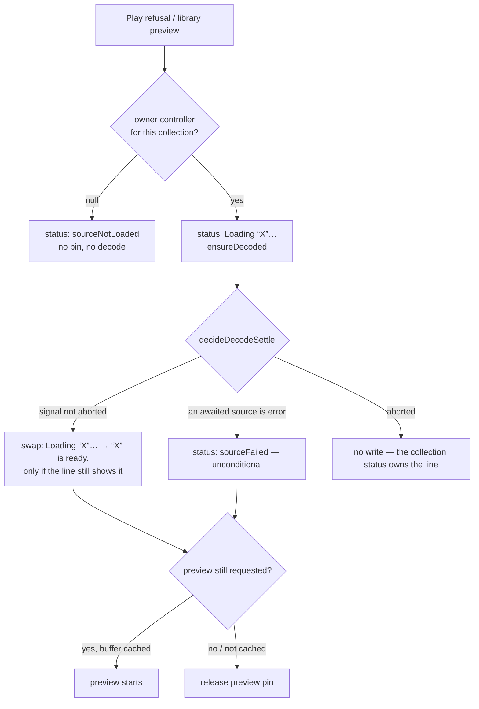

# PERF-13b-ii: decode-ის ლოდინის status და ჩავარდნილი source-ები (rounds 391–392)

**თარიღი:** 2026-11-07
**სტატუსი:** Completed (C round 392 PASS)
**შეცვლილი პროექტი:** Store (`app/contexts/ArrangementContext.tsx`, `app/lib/arrangement/strings.ts`, `perf/budgets.resources.json` და ტესტები).

## კონტექსტი

PERF-13b-i-მა (doc 248) Studio-ს ასწავლა, რომ decoded audio, რომელსაც არცერთი clip არ იყენებს, მეხსიერებიდან გადააგდოს (evict) და საჭიროებისას ხელახლა decode გააკეთოს. ამან სამი "პატიოსნების" ხარვეზი დატოვა:

- **ლოდინის ტექსტი.** ხელახალი decode-ის დროს Play წერდა `“X” has not loaded yet.`, რაც გატეხილ ხმას ჰგავდა. Library preview ლოდინისას საერთოდ არაფერს წერდა და მომხმარებელმა არ იცოდა, როდის იყო ხმა მზად.
- **ჩავარდნილი source (A-R382-ERROR-SOURCE-SKIPPED).** თუ განთავსებული clip-ის ხმის ხელახალი decode ჩავარდებოდა, Play და export ამ clip-ს ჩუმად ტოვებდნენ — exported WAV-ს clip შეიძლება აკლდეს, შეტყობინების გარეშე.
- **მეხსიერების budget-ები** `record` რჩებოდა.

Round 391-ში A-მ STOP დააფიქსირა (C-R391-01, Medium): preview, რომელსაც მეორე preview ან Stop ცვლის, status line-ზე `Loading “X”…`-ს სამუდამოდ ტოვებდა. მიზეზი სპეციფიკაციაში იყო: success-ის წესი („ყველა awaited source cache-შია“) შიდა state-ით იყო ჩამოყალიბებული, ხოლო superseded preview-ს buffer `ensureDecoded`-ის success handler-ში უკვე evict-დება caller-ის `.then`-მდე. Round 392 ამ წესს ცვლის.

დაპირება (L55): „რასაც ისმენ და რასაც ექსპორტს უკეთებ, timeline-ის clip-ებია. როცა ხმა მიუწვდომელია, Studio ამას ამბობს და ჩუმად არ აგდებს.“

## მიდგომა

- **D-29z1324 — assert flip.** `res.mem.pcm-live-mib-ready` (≤ 60 MiB) და `res.mem.pcm-live-decode-mib-ready` (≤ 0) `record`-იდან `assert`-ში გადავიდა, B-ის production sketch-ის მიხედვით.
- **D-29z1325 — ლოდინის ტექსტი.** ახალი React state არ დამატებულა. ორი ახალი string `studioLibraryStrings`-ში: `sourceDecoding(title)` → `Loading “<title>”…` და `sourceReady(title)` → `“<title>” is ready.`. Play-ის უარი და `ready`-მაგრამ-არა-cached source-ის preview ლოდინამდე loading ტექსტს წერს.
- **D-29z1326 — `error` source-ის clip.** Export (WAV და MP3) უარს ამბობს, როცა render-ში შემავალ clip-ს (range-ის შემთხვევაში მხოლოდ window-სთან გადამკვეთს) `error` source აქვს, არსებული `sourceFailed` ტექსტით. Play იწყება, როგორც Live-ში, და `playingFrom`-ის შემდეგ status-ში ჩავარდნილ source-ს ასახელებს.
- **D-29z1327** — A-R383-REVIEW-L1 დაიხურა კოდის გარეშე (owner check უკვე ფარავს).
- **D-29z1331 — settle-ის ერთი წესი (round 392).** ორივე call site (Play-ის უარი `startPlaybackAt`-ში და preview) ერთსა და იმავე წესს იყენებს:
  1. გამოძახების მომენტში owner იკითხება ზუსტად ისე, როგორც `ensureDecoded`-ში (`collectionControllerRef` + collection-ის შედარება).
  2. **Null owner (D-29z1332):** loading ტექსტი, preview pin და `ensureDecoded` არ ხდება; იწერება `sourceNotLoaded(title)` — ერთადერთი მართალი ტექსტი, რადგან decode საერთოდ არ დაიწყება.
  3. სხვა შემთხვევაში loading ტექსტი იწერება და `.then`-ში გადაწყვეტილება ამ რიგით მიიღება: **failure** (awaited source `error`-ია) → `sourceFailed`, უპირობოდ; **success** (owner-ის signal არ არის aborted) → პირობითი swap `cur === loadingText ? sourceReady : cur`; **არცერთი** (abort: collection-ის ცვლილება ან unmount) → ჩაწერა არ ხდება, line-ს collection-ის საკუთარი status ფლობს.
  4. cache-ზე დაფუძნებული success გამოსახულებები წაიშალა. Preview-ის **start**-ის გადაწყვეტილება supersession gate-ის შემდეგ ისევ cache-ზეა.
  5. `“X” is ready.` ნიშნავს: X-ის decode მიმდინარე collection-ში დასრულდა. ის არ გვპირდება, რომ X მეხსიერებაშია — superseded/stopped preview-ს buffer evict-დება და შემდეგი Preview ისევ `Loading “X”…`-ს აჩვენებს.
- **D-29z1333:** superseded preview, რომლის decode ჩავარდა, `sourceFailed`-ს წერს — failure ჩუმად არასდროს რჩება.
- **უარყოფილი ალტერნატივა:** loading ტექსტის წინა ტექსტის აღდგენა — გადაფარული ლოდინების bookkeeping-ს მოითხოვს (D-29z1325-ში უკვე უარყოფილი).
- Live-ს decode-ის ლოდინის ანალოგი არ აქვს (Live 12 manual ch. 5 — დისკიდან streaming); ეს CZABA-ს გადაწყვეტილებაა. Missing media-ს ქცევა (Live 12 manual 5.6) — Play ჩუმად უკრავს და აფრთხილებს.

## არქიტექტურა

## შეცვლილი ფაილები

- `app/contexts/ArrangementContext.tsx` — module-level `decideDecodeSettle` (არ არის export), owner-ის წაკითხვა და null-owner გზა ორივე call site-ზე, Play-ის გაფრთხილება `error` clip-ზე, `prepareExportSources`-ის render window-ზე დამოკიდებული `error` შემოწმება; `startPlaybackAt`/`startLibraryPreview`-ის dependency array-ებში `collection.sources` → `collection`.
- `app/lib/arrangement/strings.ts` — `sourceDecoding`, `sourceReady`.
- `app/lib/arrangement/__tests__/strings.test.ts` — ორი ახალი string-ის ზუსტი ტექსტები.
- `app/lib/arrangement/__tests__/decoded-buffer-eviction-ui.test.tsx` — EV3, EV9 (სამი შემთხვევა), EV12 გაფართოებული, EV16–EV25; MP3 encoder-ის stub.
- `perf/budgets.resources.json` — ორი memory row `assert`-ში.

## პრობლემები და გადაწყვეტები

- **პრობლემა:** superseded ან stopped preview status-ზე `Loading “X”…`-ს ტოვებდა (C-R391-01), რადგან success cache-ით მოწმდებოდა, buffer კი `ensureDecoded`-ის handler-ში caller-ზე ადრე evict-დებოდა. **გადაწყვეტა:** success = failure არ არის და owner-ის signal არ არის aborted (D-29z1331); `ensureDecoded`-ის body და cache უცვლელია.
- **პრობლემა:** ძველი collection-ის stale closure-დან გამოძახებული preview loading ტექსტს წერდა, თუმცა decode საერთოდ არ იწყებოდა. **გადაწყვეტა:** caller-side owner check; null owner → `sourceNotLoaded`, pin-ისა და decode-ის გარეშე (D-29z1332).
- **პრობლემა:** `sourceStates` ვერ არჩევს success-ს abort-ისგან (collection-ის ცვლილება ძველ entry-ებს არ შლის). **გადაწყვეტა:** გადაწყვეტილება გამოძახების მომენტში აღებული controller-ის `signal.aborted`-ით.
- **პრობლემა:** MP3 range export-ის call site-ზე render window-ის დაკარგვას არცერთი row არ იჭერდა. **გადაწყვეტა:** EV24 (MP3 encoder stub ტესტის ფაილში).

## ტესტირება

- jsdom (`decoded-buffer-eviction-ui.test.tsx`, 35 row): EV3 (Play-ის უარი → loading → ready), EV9 (loading → ready → preview; superseded → `“X” is ready.`; Stop-ის შემდეგ → `“X” is ready.`), EV12 (stale call → `sourceNotLoaded`, loading არასდროს, preview pin არა), EV16 (სხვა status გადარჩება success-ს; failure უპირობოა), EV17 (ყველა source-ს ელოდება; მეორის failure ასახელებს მას), EV18 (preview-ის failure), EV19/EV20 (WAV export უარი / window-ის გარეთ render), EV21 (Play `error` clip-ით), EV22 (record — pointer gesture), EV23 (superseded preview-ის failure), EV24 (MP3 range export window-ის გარეთ failed clip-ით render-დება და encode-დება), EV25 (abort-ის შემდეგ line-ზე collection-ის status რჩება).
- Mutant-ები scratch ასლზე (round 392): ყველა წითელია შესაბამის row-ზე, გარდა MU-392-IGNORE-ABORT-ისა (ეკვივალენტურია: collection-ის effect loading ტექსტს settle-მდე ცვლის, ამიტომ პირობითი swap ვერ მოქმედებს). EV25-ის assert-ები ქცევას აფიქსირებს და წითლდება, თუ collection-ის effect loading ტექსტს აღარ შეცვლის, მაგრამ abort branch-ს ცალკე ვერ ამოწმებს — მისი mutant ეკვივალენტურია (L52).
- Covering set (11 ფაილი), `npm run typecheck`, `npm run lint`, scoped Biome. Browser row-ებს (B1–B9, PERF-RES) C ამოწმებს `/studio-lab`-ზე.

## TODO / შემდეგი ნაბიჯები

- C-R391-02 (Low): export-ის preflight ჩავარდნილ clip-ზე „no clip with sound“-ს ამბობს — `deferred_low_polish`, COPY-PD lane (D-29z1334).
- „Offline“ ნიშანი clip-ზე (Saba Q1), ჩავარდნილი source-ის retry, purchased adapter-ის reload (SRW-21-PLAN).
- settle-ის წესის `lib/arrangement`-ში გატანა — ARCH-CHECKPOINT-DECODE-REGION სიგნალი.
- შემდეგი ეტაპი: PERF-13c (streaming library preview).
