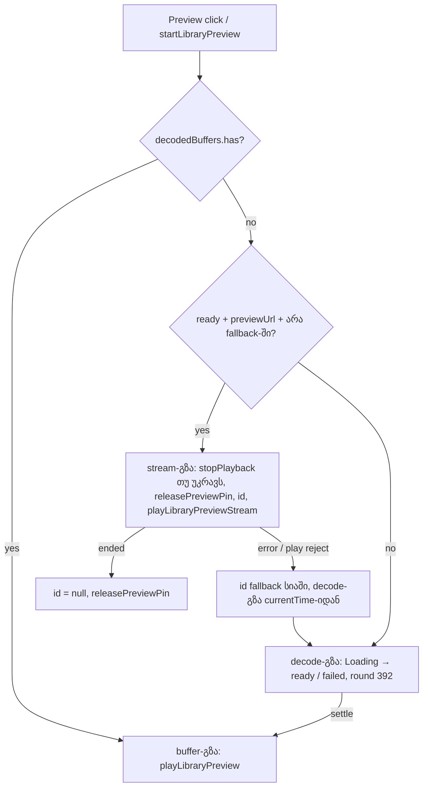
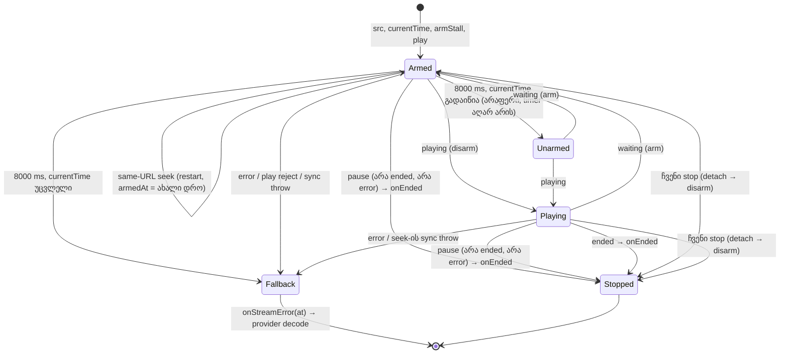

# PERF-13c: library preview-ს stream URL-იდან, decode-ის გარეშე (rounds 393–396)

**თარიღი:** 2026-11-07
**სტატუსი:** Completed (C round 396 PASS)
**შეცვლილი პროექტი:** Store (`app/contexts/ArrangementContext.tsx`, `app/lib/arrangement/preview.client.ts`, `app/types/arrangement.ts`, `app/data/studio-lab-demo.ts`, `app/lib/arrangement/collection.ts`, `perf/studio-lab-resources.perf.spec.ts`, `perf/budgets.resources.json` და ტესტები).

## კონტექსტი

Library-ის Preview ღილაკი URL-იან source-ს (მაგ. `/studio-lab`-ის ორი MP3) მთლიანად decode-ს უკეთებდა, სანამ ხმას დაუკრავდა. PERF-13b-მ (doc 248, doc 251) decode-ილი buffer-ების eviction ისწავლა, ამიტომ timeline-ზე გამოუყენებელი source-ის preview ყოველ ჯერზე ხელახალ decode-ს იწვევდა.

B-მ HEAD-ზე გაზომა (`tmp/studio-real-loop/b-round-392/premise/premise-head.json`):

| Source | `decodeAudioData` | დამატებული live PCM | პირველი ხმა click-იდან |
|---|---|---|---|
| Middle East — public preview | 278 ms | +37.1 MiB | 360 ms |
| CZABA hero — public preview | 673 ms | +55.1 MiB | 765 ms |
| Synth Full mix (უკვე მეხსიერებაში) | decode არ არის | 0 | 66 ms |

ანუ ყოველი URL source-ის preview ათეულობით MiB-ს იკავებდა, რაც სხვა არაფერს სჭირდებოდა, ხოლო ნელ მანქანაზე `Loading “X”…` ლოდინს აჩენდა.

### Stage 2 (PERF-13c-ii-a, rounds 394–395)

13c-i-ის stream-გზას element-ის lifecycle-ში სამი Medium ხარვეზი დარჩა:

- **REV-B393-M1-STALL** — stream, რომელსაც პასუხი არ მოსდის (`stalled`/`waiting`, `error`-ის გარეშე), არასდროს აღდგება. B-მ HEAD-ზე გაზომა (`tmp/studio-real-loop/b-round-393/premise/events-head.json`, 1440×900): media request-ზე პასუხის გარეშე 14 წამის შემდეგაც toggle `Stop`-ია, `currentTime` 0, fallback და decode არ ხდება. Event-ები: `play`, `waiting`, `loadstart`, `stalled` და მეტი არაფერი.
- **A-R393-REVIEW-M1-EXTERNAL-PAUSE** — გარე `pause()` (media key, OS-ის შეწყვეტა; console-ის `el.pause()` მისი proxy-ა) toggle-ს `Stop`-ზე ტოვებს გაყინული cursor-ით.
- **GATE393-M1-SYNC-THROW** — `element.currentTime = start` ან `element.play()` სინქრონულად შეიძლება ისროდეს; მაშინ preview აქტიური რჩება და UI სიჩუმეზე `Stop`-ს აჩვენებს.

Round 394-ის C შემოწმება ჩავარდა (C-R394-01, Medium): HOLD route-ზე (media პასუხს არ იძლევა) Preview-დან დაახლოებით 3.5 წამში preview-ს waveform-ზე click-ის შემდეგ toggle `Stop`-ზე სამუდამოდ რჩებოდა (23.6 s ორივე viewport-ზე), fallback და decode არ ხდებოდა (`tmp/studio-real-loop/c-round-394/rows-R1.json`, `R1b_seekBeforePlaying-*`). მიზეზი: `playing`-მდე same-URL seek `currentTime`-ს ცვლის (HAVE_NOTHING-ზე getter ახალ მნიშვნელობას აბრუნებს, `seeking`/`waiting` არ მოდის), ვადის ამოწურვისას watchdog გადაწეულ დროს ხედავს ("moved time wins") და არაფერს აკეთებს, ხელახლა კი არაფერი რთავს. Round 395 ამას ასწორებს (D-29z1348, იხ. მიდგომა).

HEAD-ზე გაზომილი event-ების თანმიმდევრობა (guard-ების საფუძველი): ბუნებრივ დასასრულზე `pause` `ended`-მდე მოდის და `element.ended` უკვე `true`-ა; გაუქმებული source `error`-ს `pause`-ის გარეშე იძლევა; seek იძლევა `seeking`, `waiting`, `seeked`, `canplay`, `playing`.

### Stage 3 (PERF-13c-ii-b, round 396)

PERF-13c-ის ბოლო ეტაპი. Purchased collection-ს (`createPurchasedWorkspaceCollection`) `previewUrl` არ ჰქონდა, ამიტომ ნაყიდი stem-ის Preview ისევ სრულ decode-ს აკეთებდა. B-ის sketch-ის `tech-lead` review-მ ერთი Medium იპოვა (TL-B395-SKETCH-M2-CROSSORIGIN): stream element-ი URL-ს no-cors რეჟიმში credential-ებით ითხოვდა, decode fetch კი `credentials: 'omit'`-ით; signed stem URL-ებზე ეს პირველად ახლა იჩენდა თავს. Perf harness-ს preview-ს row არ ჰქონდა, ამიტომ "preview არაფერს decode-ს" მხოლოდ unit ტესტებით მოწმდებოდა.

## მიდგომა

**D-29z1341 — preview-ს გზის არჩევა.** `startLibraryPreview` source-ისთვის პირველივე შესაბამის წესს ირჩევს:

1. **Cached buffer** — თუ decoded buffer cache-შია, ძველი buffer-გზა (უფასო და ზუსტი).
2. **Stream-გზა (ახალი)** — source `ready`-ია, cache-ში არ არის, `collection.previewUrl?.(source)` string-ს აბრუნებს და id ამ collection-ის fallback სიაში არ არის.
3. **დანარჩენი** — decode-გზა და not-ready შემთხვევები, ზუსტად როგორც round 392-ში.

Stream-გზა: `ensureAudioContext()` (თუ ვერ შეიქმნა — გასვლა, "audio unavailable" ქცევა უცვლელია); თუ transport უკრავს — `stopPlayback()` (preview transport-ს აჩერებს, როგორც ადრე); player-ი იქმნება საჭიროებისას; `previewRequestRef` სუფთავდება; `releasePreviewPin()` (stream buffer-ს არ იკავებს, ამიტომ წინა preview-ს pin თავისუფლდება); preview id player-ის გამოძახებამდე იწერება; ბოლოს `playLibraryPreviewStream(url, offset, onStreamError)`.

**Status line-ზე stream-გზა არაფერს წერს.** Toggle უკვე `Stop`-ს აჩვენებს, cursor კი მოთხოვნილ offset-ზე დგას, სანამ ხმა დაიწყება. Loading ტექსტი waveform-ზე ყოველ seek-ზე აციმციმდებოდა.

**Stream-ის ჩავარდნა.** Element-ის `error` ან უარყოფილი `play()` (როცა ეს preview ჯერ კიდევ აქტიურია) element-ს აჩერებს და ათავისუფლებს, provider კი id-ს collection-ის fallback სიაში ამატებს და იმავე წამიდან (`currentTime`) decode-გზას იწყებს — round-392-ის ტექსტებით (`Loading “X”…`, შემდეგ `“X” is ready.` ან `sourceFailed`). იმავე collection-ში ეს id შემდეგ აღარ stream-დება. `AbortError`, რომელიც ჩვენივე `pause()`-ის შემდეგ მოდის, ჩავარდნა არ არის — preview უკვე აღარ არის აქტიური.

**Player.** `LibraryPreviewPlayer`-ს ერთი აქტიური slot აქვს: ან buffer source, ან media element; ერთის დაწყება მეორეს აჩერებს. `HTMLAudioElement` იქმნება injectable factory-ით (`createAudioElement`, default `new Audio()`) და `createMediaElementSource`-ს არ იყენებს: buffer preview-ც პირდაპირ `ctx.destination`-ზე გადის (master-ის გვერდით), ხოლო bare element 13c-ii-ის signed URL-ებზე CORS-ის სიჩუმეს არიდებს. იგივე URL-ზე seek მხოლოდ `currentTime`-ს ცვლის. Stop: listener-ების მოხსნა, `pause()`, `removeAttribute('src')`, `load()` — resource თავისუფლდება (`networkState` 0). Provider-ის unmount cleanup-ის არსებული `stopLibraryPreview()` ახლა streaming element-საც აჩუმებს; დახურული `AudioContext` media element-ს არ აჩერებს, ამიტომ ეს გამოძახება აუცილებელია.

**ტიპი და demo.** `WorkspaceCollection`-ს დაემატა არასავალდებულო `previewUrl?: (source) => string | null` — ფუნქცია collection-ზე და არა ველი source-ზე, რომ 13c-ii-მ ყოველ გამოძახებაზე ახალი signed URL შექმნას. `studioLabDemoCollection.previewUrl` ორ MP3 id-ზე `demoUrls`-ის მნიშვნელობას აბრუნებს, დანარჩენზე `null`.

**ალტერნატივები.** (ა) `createMediaElementSource` master-ის გავლით — უარყოფილია: CORS-ის რისკი 13c-ii-ში და buffer preview-ც master-ს გვერდს უვლის. (ბ) Loading ტექსტი stream-ზე — უარყოფილია (seek-ზე ციმციმი). (გ) `ensurePreviewPlayer(ctx)` helper-ის გამოყოფა — ნებადართული იყო, მაგრამ არ გაკეთდა: B-ის reviewed sketch-ი ორ იდენტურ creation ბლოკს ინახავს და claims-ის `player-create` ამას ითვლის.

**Ableton.** Live-ის browser preview ფაილებს დისკიდან უკრავს Set-ში ჩატვირთვის გარეშე (Live 12 manual, ch. 5 "Managing Files and Sets", browser preview). 13c იმავე მიმართულებით მიდის; ეს "consistent in direction"-ია და არა იდენტური ქცევის მტკიცება.

### Stage 2: D-29z1344 (ყველაფერი `preview.client.ts`-შია, provider-ი უცვლელია)

**Stall watchdog.** თითო streamed preview-ს ერთი timer აქვს, `LIBRARY_PREVIEW_STREAM_STALL_MS = 8000`.
- **ირთვება:** stream-ის დაწყებისას (`currentTime`-ის დაყენების შემდეგ) და element-ის `waiting` event-ზე.
- **ითიშება:** `playing`-ზე და ყოველ stop-ზე (`detach`).
- **`progress`:** უკვე ჩართულ timer-ს თავიდან იწყებს, ახალს არასდროს რთავს. Byte-ები ჯერ კიდევ მოდის, ამიტომ ნელმა, მაგრამ მომუშავე კავშირმა 37–55 MiB-იანი decode არ უნდა გადაიხადოს.
- **same-URL seek (round 395, D-29z1348):** იგივე წესი, რაც `progress`-ზე — უკვე ჩართულ timer-ს თავიდან იწყებს და `armedAt`-ს ახალ დროზე კითხულობს, ახალს არასდროს რთავს. `ActiveStreamPreview`-ს დაემატა ველი `restartArmedStall`; stream-ის closure-ის `handleProgress` ამ სახელით გადაირქვა, `progress`-ზე რეგისტრირდება და preview-ს ობიექტზე ინახება. Seek-ის branch-ში ის არსებულ `try`-ში იძახება `active.element.currentTime = start`-ის **შემდეგ**, ამიტომ throw ისევ `catch` → `active.fail()`-ზე მიდის და timer-ს არ რთავს. რატომ: `playing`-მდე click-ი timer-ის ჩართულ მდგომარეობაში ხვდება; restart-ის შემდეგ საწყისი დრო seek-ის სამიზნეა, დრო იქვე რჩება და ვადის ამოწურვა fallback-ზე გადადის. `playing`-ის შემდეგ timer გამორთულია და seek მას არ რთავს (buffer-ის გარეთ seek `waiting`-ს იძლევა, რაც ისედაც რთავს). ალტერნატივა — ხარვეზის "ცნობილად" დატოვება — უარყოფილია: ჩვეულებრივი click-ით მიღწევადი Medium 2026-10-23-ის bug gate-ით ღიად ვერ დარჩება.
- **არ რთავს:** same-URL seek, როცა timer გამორთულია (buffer-ის შიგნით seek არც `waiting`-ს და არც `playing`-ს იძლევა), და `stalled`. Chromium `stalled`-ს დაახლოებით 3 წამში იძლევა მაშინაც, როცა buffer-ში არსებული აუდიო ჯერ კიდევ უკრავს.
- **ვადის ამოწურვა:** თუ preview ჯერ კიდევ აქტიურია და `element.currentTime` ჩართვის (ან ბოლო restart-ის) მომენტის მნიშვნელობის ტოლია, preview არსებულ error-გზას მიჰყვება: დრო იკითხება, `stopActive()`, შემდეგ `onStreamError(at)`. provider-ის round-393 fallback decode-ს იწყებს და round-392-ის ტექსტებს წერს. თუ დრო გადაიწია, არაფერი ხდება, რადგან Chromium მოკლე ლოდინის შემდეგ ზოგჯერ `playing`-ს გამოტოვებს.
- **რატომ 8 წამი:** ფარავს ნელ კავშირზე პირველ chunk-ს (`progress`-ის restart-თან ერთად) და background tab-ში timer-ის throttling-ს (დაახლოებით 1 წამი). **ცრუ დადებითის ფასი:** ერთი სრული decode (37–55 MiB live PCM, იხ. ზემოთ ცხრილი), და ეს source იმავე collection-ში შემდეგ აღარ stream-დება.
- **შუა დაკვრისას stall-იც decode-ზე გადადის.** ალტერნატივა, preview-ს ჩუმად დასრულება, ჩავარდნას დამალავდა.
- **Injection:** `LibraryPreviewPlayerOptions`-ს დაემატა `scheduleStallTimeout?: (callback, ms) => () => void` (cancel ფუნქციას აბრუნებს, ამიტომ timer handle-ის ტიპი და assertion არ სჭირდება; default `window.setTimeout`/`clearTimeout`) და `streamStallTimeoutMs?: number`.

**სინქრონული throw.** `element.src = url`, `element.currentTime = start`, watchdog-ის ჩართვა და `element.play()` ერთ `try`-შია, რომლის `catch` error handler-ს იძახებს. same-URL seek-ის branch-ში `currentTime = start` ცალკე `try`-შია და `catch` აქტიური preview-ს `fail`-ს იძახებს (`ActiveStreamPreview`-ის ახალი ველი, ამ preview-ს error handler). შედეგი იგივეა, რაც `error` event-ისას (decode fallback), და არა uncaught exception ან `Stop` სიჩუმეზე. `play()`-ზე `.catch(handleError)` და `src`-ის შემდეგ `if (active !== preview) return;` უცვლელია, ახლა `try`-ის შიგნით.

**გარე pause.** აქტიურ element-ზე `pause` event, როცა `!element.ended && !element.error`, preview-ს ასრულებს: `stopActive()`, შემდეგ `onEnded()`. Toggle `Preview`-ზე ბრუნდება, preview pin კი provider-ის არსებული `onEnded`-ით თავისუფლდება. Status line-ზე არაფერი იწერება.
- ჩვენი stop ამას არ იწვევს: `detach` listener-ს `pause()`-მდე და `load()`-მდე ხსნის.
- **`!element.error` და არა `=== null`:** jsdom `error`-ზე `undefined`-ს აბრუნებს. ეს guard fallback-ს ინარჩუნებს, როცა source error-ს `pause` უსწრებს: pause-ისა და error-ის შეხვედრისას error-გზა იმარჯვებს.
- **`!element.ended` browser-ში არ ჩანს:** მის გარეშე pause handler-ი preview-ს ასრულებს, `ended` listener-ი კი უკვე მოხსნილია, ამიტომ შედეგი იგივეა. მას მხოლოდ jsdom row PS21 (b) ამოწმებს.
- გაჩერებული stream-ის გაგრძელება (Live-ის მსგავსი "continue") არ აირჩა: გაჩერებული preview ყველაზე მცირე პატიოსანი მდგომარეობაა, ახალი Preview ან waveform click კი თავიდან იწყებს. Live-ის browser preview შეწყვეტისას ჩერდება და ახალი click-ით იწყება (Live 12 manual, ch. 5), ანუ ეს "consistent in direction"-ია.

**`NotAllowedError` ისევ decode-ზე გადადის (D-29z1344).** Safari/iOS-ზე element შეიძლება დაიბლოკოს, მაშინ როცა unlock-ილი `AudioContext` მუშაობს: fallback ხმას ნიშნავს, დასრულება კი სიჩუმეს. ეს ხურავს sketch-review #2-სა და GATE393-L2-NOTALLOWED-ს.

### Stage 3: D-29z1352 (ხუთი გადაწყვეტილება)

1. **Purchased adapter-ის `previewUrl`.** `createPurchasedWorkspaceCollection` აბრუნებს `previewUrl: (source) => stemUrls.get(source.id) ?? null` — იმავე `stemUrls` Map-იდან, რომელსაც `loadSource` იყენებს. Provider-ი უკვე იძახებს `collection.previewUrl?.(source)`-ს, ამიტომ ნაყიდი stem demo URL-ის მსგავსად stream-დება და provider-ი (`ArrangementContext.tsx`) უცვლელია.
2. **Seek-ის გასაღები ისევ URL-ია (A-R393-REVIEW-L6 დაიხურა).** Map ერთხელ იქმნება, ამიტომ `previewUrl` ერთ source-ზე collection-ის მთელი სიცოცხლის განმავლობაში ერთსა და იმავე string-ს აბრუნებს (PV2), და player-ის same-URL შემოწმება სტაბილური გასაღებია. Stage 1-ის ვარაუდი — "ყოველ გამოძახებაზე ახალი signed URL" — ამით შესწორდა: signed URL-ის მომავალი განახლება ახალ collection ობიექტს უნდა ქმნიდეს, რომელიც fallback-საც ანულებს (პუნქტი 3), ამიტომ URL-ების შედარება უსაფრთხოდ ჩავარდება.
3. **Fallback-ის სიცოცხლე = collection ობიექტი (GATE393-L4).** Timer არ არის. "Stream ჩავარდა → decode" სია collection ობიექტზეა მიბმული; ახალი collection იგივე source-ს ისევ stream-ით უკრავს (PS27).
4. **Cache-ის warm არ ხდება (SIG-R393-PREVIEW-NO-CACHE-WARM).** Stream-გზა decoded cache-ს, pin-ს და stem cache-ს არ წერს. Stall ან abort fallback ჩვეულებრივ decode-გზას მიჰყვება, უცვლელად; purchased source-ებიც ასევე.
5. **`crossOrigin = 'anonymous'` stream element-ზე (TL-B395-SKETCH-M2-CROSSORIGIN).** `playLibraryPreviewStream`-ში `createAudioElement()`-ის შემდეგ და `src`-მდე. Element ახლა URL-ს CORS რეჟიმში ითხოვს (credentials mode `same-origin`): cross-origin signed stem URL-ზე cookie-ები არ იგზავნება, ისევე როგორც decode fetch-ის `credentials: 'omit'`-ის დროს; same-origin demo URL-ზე ეს ორი რეჟიმი განსხვავდება. Same-origin demo-სთვის არაფერი იცვლება (B-ის browser probe `tmp/studio-real-loop/b-round-395/probe/rows-R8.json`). Cross-origin asset host-ს ახლა stream-ისთვისაც CORS header-ები სჭირდება; decode fetch-ს ისინი ისედაც სჭირდება, ხოლო header-ის არქონა stream error-ად და შემდეგ decode fallback-ად იქცევა, რომელიც დღევანდელივით ჩავარდება.

**Purchased-ის browser ნაწილი BLOCKED: "no mount point: SRW-21 deferred_user".** `createPurchasedWorkspaceCollection`-ს ტესტების გარდა გამომძახებელი არ ჰყავს (`app/**`, `perf/**`, `e2e/**`); purchased route-ის mount SRW-21-ია, რომელიც მომხმარებელმა გადადო. ამ ნაწილს unit row-ები PV1/PV2 და provider-ის row-ები PS6–PS14 ფარავს (ისინი ნებისმიერ `previewUrl`-ზე მუშაობს).

**Perf harness-ის row-ები (assert).** `perf/studio-lab-resources.perf.spec.ts`-ში "pcm ready"-ის შემდეგ ემატება მხოლოდ 1×-ის ნაბიჯი `a2`: library Preview default selection-ზე (Middle East), ლოდინი, სანამ media element ≥ 1 s-ზე უკრავს (15 s), live PCM GC ×2-ის შემდეგ, შემდეგ Stop და `Preview` label-ის ლოდინი. `HTMLMediaElement.prototype.play` გვერდში ეხვევა და `finally`-ში აღდგება. სამი row:
- `res.harness.preview-stream-playing` ≥ 1 — liveness guard, რომ stall-მა მეხსიერების row-ები ცრუდ არ გაატაროს;
- `res.mem.pcm-live-preview-delta-mib` ≤ 0;
- `res.mem.pcm-live-preview-decode-count` ≤ 0.

B-ის production sketch-ზე: 1 / 0 / 0 (`tmp/studio-real-loop/b-round-395/perf-sketch.log`). მუტანტი MU-396-DEMO-NO-STREAM (demo-ს `previewUrl` → `null`) სამივეზე წითელია: 0 / 37.1 / 1 (`tmp/studio-real-loop/b-round-395/mutants/perf-MU-396-DEMO-NO-STREAM.log`).

**Low-ები (D-29z1353, D-29z1354).** A-R395-REVIEW-L2-THROW-WHILE-ARMED დაიხურა row PS28-ით. B-R395-DOC248-STATUS: doc 248-ის სტატუსის ხაზი `Completed (C round 392 PASS)`-ზე გასწორდა.

**Status line-ზე** ეს ეტაპი არაფერს წერს.

## არქიტექტურა

Stage 2-ის stream lifecycle (`preview.client.ts`):

## შეცვლილი ფაილები

- `app/types/arrangement.ts` — `WorkspaceCollection.previewUrl` (optional).
- `app/data/studio-lab-demo.ts` — demo collection-ის `previewUrl` ორი MP3-ისთვის.
- `app/lib/arrangement/preview.client.ts` — `playLibraryPreviewStream`, `LibraryPreviewPlayerOptions.createAudioElement`, ერთი აქტიური slot (buffer ან stream).
- `app/contexts/ArrangementContext.tsx` — stream-ის branch `startLibraryPreview`-ის თავში და per-collection fallback ref.
- `app/lib/arrangement/__tests__/library-preview-stream.test.tsx` (ახალი) — PS1–PS14.
- `app/data/__tests__/studio-lab-demo.test.ts` — PS15.

Stage 2 (round 394):
- `app/lib/arrangement/preview.client.ts` — `LIBRARY_PREVIEW_STREAM_STALL_MS`, `scheduleStallTimeout`/`streamStallTimeoutMs` options, stall watchdog, გარე pause-ის handler, `try`/`catch` start-სა და seek-ზე, `ActiveStreamPreview.fail`.
- `app/lib/arrangement/__tests__/library-preview-stream.test.tsx` — PS16–PS24 ახალ `describe`-ში; PS1–PS14 უცვლელია.

Stage 2-ის შესწორება (round 395):
- `app/lib/arrangement/preview.client.ts` — `ActiveStreamPreview.restartArmedStall`, `handleProgress` → `restartArmedStall`, მისი გამოძახება same-URL seek-ის `try`-ში.
- `app/lib/arrangement/__tests__/library-preview-stream.test.tsx` — PS25, PS26 და PS22-ის ორი დამატებითი assert.

Stage 3 (round 396):
- `app/lib/arrangement/collection.ts` — purchased adapter-ის `previewUrl`.
- `app/lib/arrangement/preview.client.ts` — `element.crossOrigin = 'anonymous'`.
- `app/lib/arrangement/__tests__/collection.test.ts` — PV1, PV2 ახალ describe-ში.
- `app/lib/arrangement/__tests__/library-preview-stream.test.tsx` — PS27, PS28, PS29; PS1–PS26 უცვლელია.
- `perf/studio-lab-resources.perf.spec.ts` — ნაბიჯი `a2` (`measurePreviewStream`, `runPreviewStream`).
- `perf/budgets.resources.json` — სამი ახალი assert row.
- `docs/implementation/2026/quarter-IV/248-perf-decoded-buffer-cache.md` — მხოლოდ სტატუსის ხაზი.

## პრობლემები და გადაწყვეტები

- **პრობლემა:** B-ის sketch-ის ტესტები type assertion-ებს (`as unknown as`) იყენებდა, რაც პროექტის წესით აკრძალულია. **გადაწყვეტა:** player-ის ტესტებში `AudioContext`/`AudioBuffer` global stub-ით იქმნება (`new AudioContext()` სწორ ტიპს იძლევა), element-ები რეალური jsdom `<audio>`-ია, `play`/`pause`/`load` კი `HTMLMediaElement.prototype`-ზე spy-ით ითვლება.
- **პრობლემა:** jsdom `src` property-ს absolute URL-ად აბრუნებს. **გადაწყვეტა:** ტესტები `getAttribute('src')`/`hasAttribute('src')`-ს ამოწმებს.
- **პრობლემა:** sketch-ის stream პირობის `!decodedBuffers.has(sourceId)` ხაზი claims-ის K8 `not-cached-branch` grep-ს 1-დან 2-მდე ზრდიდა, რასაც task-ის §7 არ უშვებს. **გადაწყვეტა:** cache-ის შემოწმება `isCached` ცვლადში გავიდა; სემანტიკა უცვლელია, K8 1 რჩება.
- **პრობლემა (stage 1-ში დარჩენილი):** stream, რომელიც `stalled`/`waiting`-ში ჩერდება `error`-ის გარეშე, `Stop`-ს გაყინული cursor-ით ტოვებდა (REV-B393-M1-STALL). **გადაწყვეტა (stage 2):** 8 წამიანი watchdog, რომელიც უცვლელ `currentTime`-ზე error-გზით decode fallback-ს იწვევს. B-ის sketch-ზე (`tmp/studio-real-loop/b-round-393/sketch-events.json`) HOLD 8378 ms-ში გადავიდა fallback-ზე: `Loading “Middle East — public preview”…` → `“Middle East — public preview” is ready.`, ერთი decode და ერთი 101.35 s buffer start. `tmp/studio-real-loop/b-round-393/sketch-hold.json`: live PCM +1 buffer (101.35 s), click-ის შემდეგ ერთი `media` და ერთი `fetch` request, fallback-ის შემდეგ 0 request. ჩვეულებრივ 20 წამიან stream-ს seek-ით 0 decode აქვს, live PCM უცვლელია; END და ABORT უცვლელია.
- **პრობლემა:** stall timer-ის handle-ის ტიპი (`number` ბრაუზერში, `Timeout` Node-ში) assertion-ს მოითხოვდა. **გადაწყვეტა:** injectable `scheduleStallTimeout` cancel ფუნქციას აბრუნებს, ამიტომ handle player-ის კოდს არ ეხება.
- **პრობლემა:** jsdom-ში `element.error` `undefined`-ია, `null` არა. **გადაწყვეტა:** pause guard `!element.error`-ს იყენებს.
- **პრობლემა (C-R394-01, round 394 C FAIL):** stall-ის დროს `playing`-მდე waveform click-ი (same-URL seek) `currentTime`-ს გადაწევდა, watchdog ვადის ამოწურვისას "გადაწეულ დროს" ხედავდა და preview `Stop`-ზე სამუდამოდ რჩებოდა. **გადაწყვეტა (round 395):** seek ჩართულ timer-ს თავიდან იწყებს ახალი დროიდან. B-ის sketch-ზე (`tmp/studio-real-loop/b-round-394/probe/rows-R1b.json`) fallback seek-იდან 8296 ms (1440×900) და 8300 ms (1280×720) შემდეგ მოხდა; seek-ის შემდეგ დრო 4.99 იყო და უცვლელი დარჩა.
- **ცნობილი ხარვეზი (არ გამოსწორებულა):** stream, რომელიც byte-ებს გამუდმებით აწვდის (`progress` timer-ს თავიდან იწყებს), მაგრამ `playing`-მდე ვერ მიდის, watchdog-ს ვერ ააქტიურებს. დაზიანებული data `error`-ით მთავრდება, პათოლოგიური "წვეთოვანი" კავშირი კი არა. ამ მდგომარეობაში seek-იც timer-ს თავიდან იწყებს; ეს ხარვეზს არ აფართოებს.
- **პრობლემა (stage 3):** stream element-ი credential-ებით ითხოვდა URL-ს, decode fetch კი მათ გარეშე (TL-B395-SKETCH-M2-CROSSORIGIN). **გადაწყვეტა:** `crossOrigin = 'anonymous'` `src`-მდე; PS29 და მუტანტი MU-396-NO-CROSSORIGIN. Code-review-ის შემდეგ PS29 `src`-ის მინიჭების მომენტშიც ამოწმებს attribute-ს; მუტანტი MU-A396-CROSSORIGIN-AFTER-SRC (`crossOrigin` `src`-ის შემდეგ) PS29-ს აწითლებს.
- **პრობლემა (stage 3):** perf-ის მეხსიერების row-ები stall-ზეც გაივლიდა (preview რომ არ უკრავს, PCM-იც არ იზრდება). **გადაწყვეტა:** liveness guard `res.harness.preview-stream-playing`.

## ტესტირება

- **Player (`library-preview-stream.test.tsx`):** PS1 (url, offset, play, offset-ის წაკითხვა, stop ათავისუფლებს media-ს), PS2 (იგივე URL-ზე seek იმავე element-ით), PS3 (`ended` ერთხელ; ძველი element-ის `ended` stop-ის შემდეგ არაფერს აკეთებს), PS4 (აქტიურ stream-ზე `error` ან უარყოფილი `play()` აბრუნებს `currentTime`-ს და decode fallback-ს იწვევს; stop-ის შემდეგ `AbortError` ჩავარდნა არ არის), PS5 (buffer preview stream-ს აჩერებს).
- **Provider:** PS6 (evicted URL source stream-დება: decode არ არის, loading ტექსტი არ არის, pin არ არის), PS7 (cached buffer stream-ს ჯობნის), PS8 (error → decode fallback, buffer უკრავს, fallback ახსოვს), PS9 (Play streaming preview-ს აჩერებს), PS10 (unmount element-ს ათავისუფლებს), PS11 (preview transport-ს element-ის play-მდე აჩერებს), PS12 (ბუნებრივი დასასრული id-ს ასუფთავებს და pin-ს ათავისუფლებს), PS13 (fallback იმავე წამიდან იწყება), PS14 (stream status-ს არ წერს).
- **Demo (`studio-lab-demo.test.ts`):** PS15 (`previewUrl` მხოლოდ ორ MP3-ზე).
- 17 მუტანტი (`MU-393-*`, მათ შორის code-review-ის შემდეგ დამატებული `MU-393-PLAY-REJECT-IGNORED`) თითოეული თავის row-ზე წითელია; covering set (14 ფაილი) მწვანეა; ლოგები `tmp/studio-real-loop/a-round-393/`-შია.
- Browser-ში შემოწმება (stream, stop, seek, ended, Play/preview ურთიერთქმედება, unmount, fallback) C-ის round 393-ის ნაწილია; B-ის sketch-ის browser probe: `tmp/studio-real-loop/b-round-392/sketch-browser.json`.

**Stage 2 (round 394), `library-preview-stream.test.tsx`, describe "PERF-13c-ii-a stream lifecycle robustness":**
- PS16: stream, რომელიც არ იწყებს დაკვრას, 8000 ms-ის შემდეგ თავისი დროით (`onStreamError(7)`) გადადის fallback-ზე; `src` მოხსნილია, offset `null`.
- PS17: `playing` watchdog-ს თიშავს, `waiting` თავიდან რთავს, `progress` მხოლოდ ჩართულ timer-ს იწყებს თავიდან.
- PS18: თუ element-ის დრო გადაიწია, ვადის ამოწურვა არაფერს აკეთებს.
- PS19: stop, ახალი preview და same-URL seek timer-ს თავისით არ ტოვებს და არ რთავს.
- PS20: გარე pause preview-ს ერთხელ ასრულებს და element-ს ათავისუფლებს.
- PS21: (a) ჩვენი stop-ის შემდეგ pause, (b) ბუნებრივი დასასრული (`ended` = true) და (c) pause error-ით გარე pause-ად არ ითვლება.
- PS22: `currentTime`-ის ან `play()`-ის სინქრონული throw stream error-ია.
- PS23: same-URL seek-ის სინქრონული throw აქტიური preview-ს stream error-ია (`onStreamError(9)`).
- PS24: default scheduler 8000 ms-იან window timer-ს რთავს, stop კი თიშავს.
- 12 მუტანტი (`MU-394-*`) თითოეული თავის row-ზე წითელია, pristine მწვანეა; covering set (14 ფაილი, 256 ტესტი) მწვანეა. ლოგები `tmp/studio-real-loop/a-round-394/`-შია.
- Browser-ში watchdog-ის fallback, გარე pause, ცრუ დადებითის კონტროლი, ended, abort, stop და Play-ის ურთიერთქმედება C-ის browser row-ებია (R1–R7). სინქრონული throw (PS22, PS23) და `!element.ended` guard (PS21 (b)) მხოლოდ jsdom-ში მოწმდება.

**Stage 2-ის შესწორება (round 395), იგივე describe:**
- PS25: `playing`-მდე same-URL seek (0 → 5) ჩართულ timer-ს თავიდან იწყებს: 1 pending, delays `[8000, 8000]`, `src` რჩება; ვადის ამოწურვისას `onStreamError(5)` ერთხელ, `src` მოხსნილია, offset `null`.
- PS26: stop ზუსტად ექვს stream listener-ს ხსნის (`ended`, `error`, `pause`, `playing`, `progress`, `waiting`), და თითოეული `(type, handler)` წყვილი ზუსტად ის არის, რაც element-ზე დაემატა (code-review-ის შემდეგ: სხვა handler-ის მოხსნა, მაგ. `progress`-ზე `armStall`, PS26-ს აწითლებს — მუტანტი `MU-A395-PROGRESS-REMOVES-WRONG-HANDLER`, ლოგი `tmp/studio-real-loop/a-round-395/mutants/`).
- PS22-ს დაემატა: `currentTime`-ის throw-ის შემდეგ element-ს `src` აღარ აქვს; `play()`-ის throw-ის შემდეგ offset `null`-ია.
- PS19 უცვლელია და ახლა `MU-395-SEEK-ARMS-ALWAYS`-საც იჭერს (`playing`-ის შემდეგ seek timer-ს არ რთავს).
- სამი ახალი მუტანტი (`MU-395-SEEK-NO-REARM` → PS25, `MU-395-SEEK-ARMS-ALWAYS` → PS19, `MU-395-PAUSE-LISTENER-LEFT` → PS26) და 12 `MU-394-*` წითელია, pristine მწვანეა; covering set (14 ფაილი, 258 ტესტი) მწვანეა. ლოგები `tmp/studio-real-loop/a-round-395/`-შია.
- Browser-ში bug-ის row R1b (HOLD route, Preview, 3.5 წამში waveform click → fallback) და R1–R7-ის განმეორება C-ის round 395-ის ნაწილია. PS26 (listener-ების მოხსნა) მხოლოდ jsdom-ში მოწმდება.

**Stage 3 (round 396):**
- `collection.test.ts`, describe "PERF-13c-ii-b purchased adapter previewUrl (D-29z1352)": PV1 (4 stem-იანი purchased collection: `previewUrl` ფუნქციაა, დალაგებულ თითო source-ზე თავისი stem-ის URL-ს აბრუნებს, უცნობზე `null`-ს, `fetchAudio` არ იძახება), PV2 (drums-ის URL ორჯერ წაკითხვისას ერთი და იგივეა, შემავალი stem-ის `audioUrl`-ის შეცვლა მას არ სწვდება).
- `library-preview-stream.test.tsx`: PS27 (stream error → fallback ახსოვს; ახალ collection ობიექტზე იგივე source ისევ stream-დება, 0 pending decode), PS28 (`playing`-მდე armed stream-ზე same-URL seek-ის `currentTime` throw: throw არ ვრცელდება, `onError(3)` ერთხელ, 0 pending timer, `src` არ არის, offset `null`), PS29 (element-ის `crossorigin` attribute `anonymous`-ია უკვე `src`-ის მინიჭებისას, `src` = URL). PS1–PS26 უცვლელია.
- მუტანტები, თითოეული წითელი: MU-396-PURCHASED-NO-PREVIEW → PV1, PV2; MU-396-PREVIEW-LIVE-INPUT → PV2; MU-396-UNKNOWN-NOT-NULL → PV1; MU-396-FALLBACK-ANY-COLLECTION → PS27; MU-394-SYNC-THROW-SEEK → PS23, PS28; MU-396-NO-CROSSORIGIN → PS29; MU-A396-CROSSORIGIN-AFTER-SRC → PS29; MU-394-STALL-SURVIVES-STOP → PS19, PS22, PS28. Pristine მწვანეა; covering set (19 ფაილი, 314 ტესტი) მწვანეა. ლოგები `tmp/studio-real-loop/a-round-396/`-შია.
- Perf row-ები და MU-396-DEMO-NO-STREAM — იხ. მიდგომა, stage 3. Browser-ში `crossOrigin` (R8) და R1–R7, R1b-ის განმეორება C-ის round 396-ის ნაწილია; PV1, PV2, PS27, PS28 მხოლოდ jsdom-ში მოწმდება.

## TODO / შემდეგი ნაბიჯები

- ~~**Stage 3 = PERF-13c-ii-b**~~ — შესრულდა round 396-ში (D-29z1352): purchased `previewUrl`, seek-ის გასაღებად URL რჩება (ვარაუდი "ყოველ გამოძახებაზე ახალი signed URL" არასწორი იყო: URL collection-ის სიცოცხლეში სტაბილურია, განახლება ახალ collection-ს ქმნის), fallback collection ობიექტზეა მიბმული, perf-ის preview row-ები, cache warm არ ხდება.
- Architecture checkpoint ARCH-CHECKPOINT-PREVIEW-AFTER-13C (root-ის მოთხოვნა `tmp/studio-real-loop/b-round-393/root-request-arch-checkpoint-preview.md`) — PERF-13c-ის დასრულების შემდეგ root-ი უშვებს.
- TL-B395-SRW21-MEMO-ADAPTER: SRW-21-ის mount-ისას purchased adapter-ი memoise-ებული უნდა იყოს, რომ ყოველ render-ზე ახალი collection ობიექტი (და ახალი fallback) არ შეიქმნას — SRW-21-PLAN-ის შესატანი.
- "წვეთოვანი" stream-ის ხარვეზი (`progress` გამუდმებით, `playing` არასდროს): ჩაწერილია, ჯერ არ არის დაგეგმილი.
- A-R392-REVIEW-M1 და collection-ის შეცვლისას stream-ის გაჩერება — SRW-21-PLAN-ის row-ები (დღეს მიუწვდომელია: ერთი provider mount, მუდმივი collection).
- `decideDecodeSettle`-ის `lib/arrangement`-ში გადატანა — კანდიდატი PERF-13c-ის შემდეგ, root-ის თანხმობით.
