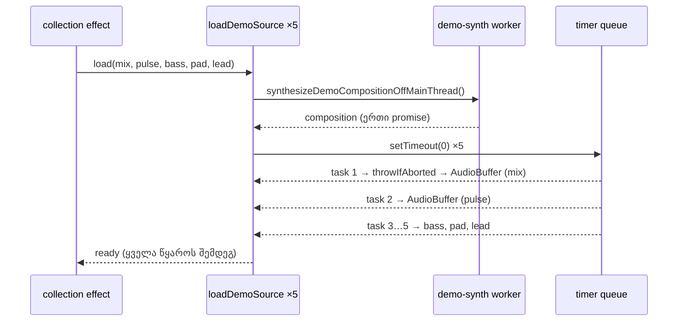

# PERF-13d: demo synth buffer-ები ხუთ task-ში, ერთი საერთო array-დან (round 397)

**თარიღი:** 2026-11-07
**სტატუსი:** Completed (C round 397 PASS)
**შეცვლილი პროექტი:** Store (`app/data/studio-lab-demo.ts`, `app/lib/arrangement/demo-synth.ts`, `app/data/__tests__/studio-lab-demo-synth-buffer.test.ts`).

## კონტექსტი

PERF-13-ის ბოლო ეტაპი (doc 247-ის TODO, პუნქტი 4) ხურავს ორ ჩანაწერს: R314-DEMO-BUFFER-LONGTASK-6X და PERF2-STEREO-COPY.

`/studio-lab`-ის ხუთი სინთეზირებული წყარო (mix და ოთხი stem, თითო 768000 sample, 16 წმ 48 kHz-ზე) ერთი worker-ის promise-ს ელოდება. ეს promise ერთხელ სრულდება, ამიტომ ხუთივე load ერთ task-ში გრძელდება და ხუთივე `AudioBuffer` ერთ long task-ში იქმნება. გარდა ამისა, `generateDemoStereoChannels` მარჯვენა არხისთვის ყოველ load-ზე ახალ 3 MB-იან `Float32Array`-ს აკოპირებდა.

B-მ HEAD-ზე (`4f28bff`) გაზომა, dev server-ზე, CPU 6×-ზე (`tmp/studio-real-loop/b-round-396/probe/head-6x-1.json`, `rows-summary.txt`, repository-ს გარეთ):

- ხუთივე build ერთ long task-შია ყველა 6 run-ში (1440×900 და 1280×720, თითოზე 3), 135–185 ms;
- ათი `copyToChannel` გამოძახება თითო 7–12 ms-ია;
- 0 build-ი იყენებს ერთ array-ს ორივე არხისთვის.

მომხმარებელი ხედავს და ისმენს იმავეს; ცვლილება მხოლოდ main thread-ის ერთ გრძელ task-ს ყოფს.

## მიდგომა

ხუთი გადაწყვეტილება (B-ის D-29z1356):

1. **ერთი array ორივე არხისთვის.** `loadDemoSource` ქმნის 2-არხიან buffer-ს და `copyToChannel(samples, 0)`, `copyToChannel(samples, 1)`-ს ერთსა და იმავე array-ით იძახებს. `copyToChannel` buffer-ის საკუთარ storage-ში აკოპირებს, ამიტომ ერთი array-ის ორჯერ გამოყენება უსაფრთხოა. `generateDemoStereoChannels` წაიშალა (სხვა importer არ ჰქონდა).
2. **ერთი build ერთ task-ში worker-ის გზაზე.** `synthesizeDemoSamples(sourceId, signal)` worker-ის promise-ის შემდეგ ელოდება `yieldToNextTask()`-ს (`setTimeout(resolve, 0)`). Timer-ები დაყენების რიგით სრულდება, ამიტომ ხუთი build ხუთ ცალკე task-შია.
3. **Abort.** yield-ის შემდეგ `signal.throwIfAborted()`: თუ load ლოდინის დროს გაუქმდა, ის `signal.reason`-ით უარყოფილია და buffer არ იქმნება. ორივე მომხმარებელი (collection-ის effect და re-decode) გაუქმებულ load-ს უკვე აიგნორებს, ამიტომ ეს ეკრანზე არაფერს ცვლის.
4. **Mono უარყოფილია.** ყოველი track gain-ს `StereoPannerNode`-ში ატარებს. Mono input pan 0-ზე equal-power კანონით მიდის (დაახლოებით −3 dB თითო მხარეს), ტოლი არხების stereo კი უცვლელად გადის. Peaks და WAV export არხების რაოდენობასაც კითხულობს. 2 არხი ხმას იდენტურს ტოვებს.
5. **ორ გენერირებულ SFX-ს (Soft impact, Slow rise) yield არ აქვს.** მათი array-ები 96000 და 240000 sample-ია (1–4 ms თითო copy-ზე 6×-ზე). B-ის პირველ sketch-ში yield მათზეც იყო და `studio-narrow-gate-ui.test.tsx`-ის NG5b და NG5c ჩავარდა (ისინი Soft impact-ის მზადყოფნას ერთ microtask-ს ელოდებიან). 1–4 ms-იანი build-ისთვის ტესტების შეცვლა არ ღირს; SB6 ამ არჩევანს ამაგრებს.

**`setTimeout` და არა `scheduler.yield`:** `scheduler.yield` Studio-ს ყველა მხარდაჭერილ browser-ში არ არის, feature-detect კი ახალ შტოს ამატებს, რომელსაც ჩავარდნის უნარიანი მწკრივი არ აქვს. `MessageChannel`-იც უარყოფილია იმავე მიზეზით.

**Status (L51):** ახალი status ჩანაწერი არ დამატებულა და არც გადატანილა. საბოლოო ტექსტი `Demo collection ready. Drag a sound onto a track, or press Enter to add it. Press ? for shortcuts.` ყველა წყაროს დასრულების შემდეგ იწერება, როგორც ადრე.

## არქიტექტურა

გენერირებული SFX წყაროები (Soft impact, Slow rise) worker-ს და timer-ს არ ეხება და buffer-ს იმავე task-ში ქმნის.

## შეცვლილი ფაილები

- `app/data/studio-lab-demo.ts`: `yieldToNextTask`, `synthesizeDemoSamples(sourceId, signal)` yield-ითა და abort-ის შემოწმებით, buffer ორი `copyToChannel` გამოძახებით ერთი array-დან.
- `app/lib/arrangement/demo-synth.ts`: `generateDemoStereoChannels` წაიშალა.
- `app/data/__tests__/studio-lab-demo-synth-buffer.test.ts` (ახალი): SB1–SB6.
- `docs/implementation/2026/quarter-IV/247-perf-pcm-live-baseline.md`: სტატუსი და TODO-ს პუნქტი 4.

## პრობლემები და გადაწყვეტები

- **პრობლემა:** ხუთი build ერთ long task-ში (135–185 ms 6×-ზე), რადგან ხუთივე load ერთი awaited promise-დან გრძელდება. **გადაწყვეტა:** ერთი `setTimeout(0)` yield ყოველ worker-ის load-ზე, რაც ხუთ ცალკე task-ს იძლევა.
- **პრობლემა:** მარჯვენა არხის ასლი (`new Float32Array(left)`) ყოველ load-ზე 3 MB-ს ხარჯავდა. **გადაწყვეტა:** ორივე `copyToChannel` ერთ array-ს იღებს.
- **პრობლემა:** yield SFX-ზეც რომ ყოფილიყო, NG5b და NG5c ჩავარდებოდა. **გადაწყვეტა:** yield მხოლოდ worker-ის გზაზეა; SB6 ამას ამაგრებს (MU-397-YIELD-ALL წითელია).
- **პრობლემა:** HEAD-ზე synth-ის გზა abort signal-ს აიგნორებდა და buffer-ს მაინც ქმნიდა. **გადაწყვეტა:** worker-ის გზაზე yield-ის შემდეგ `signal.throwIfAborted()` (SB5). ორი გენერირებული SFX signal-ს კვლავ არ ამოწმებს (yield არ აქვს, build იმავე task-შია); გაუქმებულ load-ს მომხმარებლები აიგნორებენ.

## ტესტირება

ახალი ფაილი `app/data/__tests__/studio-lab-demo-synth-buffer.test.ts`:

| მწკრივი | რას ამოწმებს | Mutant (წითელი) |
|---|---|---|
| SB1 (×5) | worker-ის წყარო: 2 არხი, სიგრძე = sample-ები, 48000 Hz, არხები `[0, 1]`, ორივე გამოძახება იღებს თავად composition-ის array-ს (`toBe`) | MU-397-SECOND-COPY, MU-397-MONO, MU-397-SKIP-RIGHT, MU-397-WRONG-STEM |
| SB2 (×2) | Soft impact / Slow rise: 2 არხი, ერთი array ორივე გამოძახებაში, არხი 0 = ახალი გენერაცია | MU-397-SECOND-COPY, MU-397-MONO, MU-397-SKIP-RIGHT |
| SB3 (×5) | ორივე არხი ემთხვევა წყაროს მნიშვნელობა-მნიშვნელობით | MU-397-MONO, MU-397-SKIP-RIGHT, MU-397-WRONG-STEM |
| SB4 | 5 load, `setTimeout` რიგში: პირველ callback-მდე 0 buffer, 5 callback, თითო callback-ზე ზუსტად ერთი ახალი buffer | MU-397-NO-YIELD |
| SB5 | abort ლოდინის დროს: `signal.reason`-ით უარყოფა, 0 buffer | MU-397-NO-YIELD, MU-397-NO-ABORT-CHECK |
| SB6 | ორი SFX: 0 timer, 2 buffer | MU-397-YIELD-ALL |

- Mutant-ები B-ის runner-ით scratch ასლზე: 7/7 წითელი, pristine rc 0 (`tmp/studio-real-loop/a-round-397/mutants/summary.txt`, repository-ს გარეთ).
- Covering set (16 ფაილი, 219 ტესტი) rc 0; `npm run typecheck`, `npm run lint` და scoped Biome rc 0.
- `studio-lab-demo.test.ts`-ის DL7 (უცნობი წყარო) უცვლელია და unknown-source შტოს ფარავს.
- Browser-ის მწკრივები (BUF-TASKS, BUF-SAME-ARRAY, BUF-HASH, BUF-STATUS, BUF-PLAY, PERF-LOAD) C round 397-ის მტკიცებულებაა (`tmp/studio-real-loop/c-round-397.json`, repository-ს გარეთ). B-ის sketch-ზე (`tmp/studio-real-loop/b-round-396/probe/rows-summary.txt`): 0 build long task-ში ყველა 6 run-ში (ერთ დამატებით 1280 run-ში 1 build 51 ms-იან task-ში), 5/5 build ერთი array-ით, channel hash-ები HEAD-ის ტოლია, play მუშაობს. B-ის perf spec run sketch-ზე (production build, `tmp/studio-real-loop/b-round-396/perf-sketch-load-rows.txt`): `load.script-max` 0 / 0 / 5 ms, `load.longtask-max` 79 / 55 / 55 (record, სხვადასხვა tree-ს შედარება, არა assert).

## TODO / შემდეგი ნაბიჯები

- გენერირებული SFX (Soft impact, Slow rise) ჯერ კიდევ effect-ის task-ში იქმნება (1–4 ms 6×-ზე); მწკრივი საჭირო არ არის.
- დამალულ tab-ში browser `setTimeout(0)`-ს დაახლოებით 1 წმ-მდე ანელებს, ამიტომ background tab-ში ჩატვირთული demo დაახლოებით 1 წმ-ით გვიან ხდება მზად. მიღებულია (`tmp/studio-real-loop/b-round-396/sketch-review.md` L1): background tab-ს არაფერი ელოდება.
- PERF-13 ამ ეტაპით დასრულებულია (doc 247). შემდეგი STUDIO-PERFORMANCE ნაბიჯები B-ის backlog-შია.
