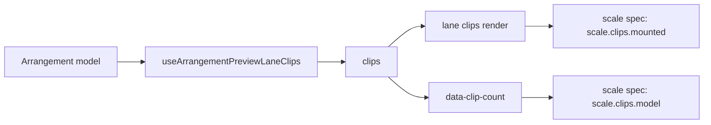

# PERF-14a: 200-clip-იანი scale harness და lane-ის clip count, რომელიც DOM-ზე არ არის დამოკიდებული (round 398)

**თარიღი:** 2026-11-07
**სტატუსი:** In Progress (stage 1 of 4; C round 398 PASS)
**შეცვლილი პროექტი:** Store (`app/components/arrangement/ArrangementLane.tsx`, `app/lib/arrangement/__tests__/lane-clip-count.test.tsx`, `perf/studio-lab-scale.perf.spec.ts`, `perf/budgets.scale.json`).

## კონტექსტი

PERF-14-ის მიზანია (`docs/technical/performance/perf-plan.md`, PERF-14): 200 clip-ზე გვერდზე ≤ 2000 DOM element და zoom-ის p95 < 50 ms. დღემდე არცერთი perf row არ ზომავდა 200 clip-ს: 30-clip-იანი row-ები interactions spec-შია და ყოველი შემდეგი row იმ მდგომარეობიდან იწყება, რომელსაც ისინი ტოვებენ.

B-მ HEAD-ზე (`c93d926`) dev server-ზე გაზომა (`tmp/studio-real-loop/b-round-397/probe/head-200-*.json`, repository-ს გარეთ): Add, name bar-ზე click, Ctrl+D ×199.

| გაზომვა | 1440×900 | 1280×720 |
|---|---|---|
| გვერდის element-ები | 4294 | 4277 |
| clip-ების subtree (17 თითო clip-ზე) | 3400 | 3400 |
| mount-ებული clip-ები | 200 | 200 |
| ფანჯარაში ჩანს, default zoom | 1 | 1 |
| ფანჯარაში ჩანს, min zoom | 19 | 16 |
| zoom keydown max, 1× | 48 ms | 40 ms |
| zoom keydown max, 6× | 272 ms | 280 ms |
| Ctrl+D ×199 | ≈5 წმ | ≈5 წმ |

დასკვნა: 2000-იანი მიზანი დღეს არ სრულდება, virtualization კი მას ნებისმიერ zoom-ზე მიაღწევს. Ruler უკვე windowed-ია, ამიტომ PERF-14-ის ძველი შენიშვნა „ruler პროექტთან ერთად იზრდება“ მოძველებულია (D-29z1360).

PERF-14b clip-ებს DOM-იდან ამოიღებს. ამის შემდეგ DOM-ში დათვლილი clip-ები mount-ებულ clip-ებს ნიშნავს და არა project-ის clip-ებს. ამიტომ harness-ს model-ის რიცხვი სჭირდება, რომელიც 14b-ის შემდეგაც იგივეს ნიშნავს.

## მიდგომა

D-29z1360-ის ფარგლები (B, `tech-lead` და `performance-optimizer` consult-ები):

1. **Lane-ის model clip count.** `ArrangementLane.tsx` row-ს, რომელსაც `data-track-id` აქვს, ემატება `data-clip-count={clips.length}`. `clips` არის არსებული `useArrangementPreviewLaneClips(arrangement, track.id)`, იგივე სია, რომელსაც lane ხატავს. ამიტომ count cross-lane drag preview-საც მიჰყვება.
2. **ახალი spec და budgets ფაილი** (`perf/studio-lab-scale.perf.spec.ts`, `perf/budgets.scale.json`). ყველა row `record`-ია: spec ამ round-ში A-ს კოდია და sketch-ზე არ გაშვებულა (L58). Harness-ის self-check-ები `problems`-ში იწერება და ნებისმიერი problem spec-ს ჩააგდებს.
3. **არსებული perf spec-ები და მათი budgets არ შეცვლილა.** Attribute element-ს და component-ს არ ამატებს.

უარყოფილი ალტერნატივები:
- clip-ების დათვლა DOM-ით (`[data-clip-kind="audio"]`) — 14b-ის შემდეგ ის mount-ებულ clip-ებს დათვლის და row-ის მნიშვნელობა შეიცვლება;
- harness-ის interactions spec-ში ჩამატება — 2059-ხაზიან ფაილში ყოველი row წინა row-ის მდგომარეობიდან იწყება, ამიტომ 200 clip ყველა შემდეგ row-ს შეცვლიდა.

### `data-clip-count`-ის კონტრაქტი

- ეს არის clip-ების რაოდენობა, რომელიც ამ lane-ს model-ში აქვს (preview ან committed). ის არასოდეს ითვლის mount-ებულ element-ებს და lane-ის fold-ზე არ იცვლება. PERF-14b-მა ის model-ს უნდა გაუტოლოს მაშინაც, როცა clip-ები აღარ არის mount-ებული.
- Collapsed group-ის member lane საერთოდ არ იხატება, მასთან ერთად არც attribute. Harness, რომელიც lane-ებზე ჯამს ითვლის, ჯერ ამოწმებს, რომ `data-group-collapsed="true"` element 0-ია.
- Cross-lane name-bar drag-ის დროს clip წყარო lane-ზე რჩება და target-ზე მხოლოდ release-ზე გადადის. Attribute და დახატული clip-ები ერთი `clips` სიიდან მოდის, ამიტომ HEAD-ზე attribute ყოველ მდგომარეობაში mount-ებულ რაოდენობას უდრის.
- Group row-ებსაც აქვთ `data-track-id`; ამიტომ scale spec lane-ებს მხოლოდ `[data-track-id][data-clip-count]`-ით ითვლის.

### Spec-ის ნაბიჯები (a–i)

თითო pass ახალ browser context-ში, 1440×900, perf instrumentation load-მდე. 3 pass.

- **a. Load:** `/studio-lab` → `waitForLibraryReady` → `waitForCollectionReady`.
- **b. 200 clip:** library Add, clip-ის name bar-ზე click (`perfMoveTitlePattern`), blur, Control+d ×199. ყოველ press-ზე ელოდება, სანამ clip-ის lane-ის (`closest('[data-track-id]')`) `data-clip-count` press + 1 გახდება. Self-check: lane count 200, ≥ 1 mount-ებული clip და თითო mount-ებულ clip-ზე ერთი განსხვავებული `data-clip-start` (PERF-14b-i-მდე: 200 განსხვავებული `data-clip-start`; HEAD-ზე ყველა clip mount-ებულია, ამიტომ ეს იგივე 200-ია), 0 collapsed group. Row: `scale.harness.build-ms` (Control+d loop-ის wallclock).
- **c. Default zoom, scroll 0, 1×:** `scale.dom.page`, `scale.dom.clip-subtree`, `scale.clips.model`, `scale.clips.mounted`, `scale.clips.in-window`. აქედან იწყება visible-gap self-check (იხ. ქვემოთ).
- **d. Zoom key-ები 1×-ზე:** 5 × `-`, შემდეგ 5 × `=`, თითო key-ს თავისი window quiet-მდე. Row-ები: `scale.zoom.keydown-p95-ms`, `scale.zoom.keydown-max-ms`, `scale.zoom.commits-per-key`, `scale.zoom.components-per-key`. 10 key-ზე `perf/lib/stats.ts`-ის `percentile` (`floor(n × 0.95)`) მაქსიმუმს იღებს, ამიტომ p95 row `keydown-max-ms`-ს უდრის; PERF-14-ის მიზანი „zoom p95 < 50 ms“ `keydown-max-ms`-ზე იკითხება (C-R398-SIGNAL-M3, D-29z1363). Wallclock row-ები `record` რჩება, key-ების რაოდენობა არ შეცვლილა. Self-check: Zoom slider ყოველ key-ზე სწორი მიმართულებით იცვლება და საწყის მნიშვნელობას უბრუნდება.
- **e. იგივე key-ები 6× CPU-ზე** (`Emulation.setCPUThrottlingRate`), იგივე id-ები `.6x` suffix-ით; შემდეგ rate ისევ 1.
- **f. Minimum zoom:** `-` სანამ slider-ის მნიშვნელობა მის `min`-ს არ გაუტოლდება (მაქსიმუმ 60 key, სხვაგვარად problem). Row-ები: `scale.dom.page.min-zoom`, `scale.clips.mounted.min-zoom`, `scale.clips.in-window.min-zoom`.
- **g. Minimum zoom, შუაში:** timeline scroller-ის `scrollLeft = round((scrollWidth − clientWidth) / 2)`. Row-ები: `scale.dom.page.min-zoom-mid`, `scale.clips.mounted.min-zoom-mid`, `scale.clips.in-window.min-zoom-mid`. Self-check: `scrollLeft` > 0 და `in-window` ≥ 1.
- **h. Scroll-ის გვერდის გადაკვეთა:** შუიდან 4-ჯერ `scrollLeft += clientWidth`, თითო ნაბიჯს თავისი window. Row-ები: `scale.scroll.commits-per-step`, `scale.scroll.components-per-step`, `scale.scroll.loaf-max-ms`. ყოველი ნაბიჯის შემდეგ (window-ის გარეთ) visible-gap self-check მეორდება.
- **i. Zoom key-ები minimum zoom-ზე (PERF-14c-i, round 403, doc 257):** იწყება იმ მდგომარეობიდან, რომელიც h-მა დატოვა (minimum zoom, h-ის scroll). Quiet-ის შემდეგ spec ინახავს `scrollLeft`-ს, შემდეგ 1×-ზე 5 × `=` და 5 × `-`, თითო key-ს თავისი window quiet-მდე. Row-ები: `scale.zoom.min.keydown-p95-ms`, `scale.zoom.min.keydown-max-ms`, `scale.zoom.min.commits-per-key`, `scale.zoom.min.components-per-key`. ამის შემდეგ `scrollLeft` i-ს დასაწყისის მნიშვნელობას უბრუნდება (თუ არ დაბრუნდა, problem იწერება) და იგივე key-ები 6×-ზე ეშვება, იგივე id-ებით `.6x` suffix-ით; შემდეგ rate ისევ 1. Self-check (d-ს იგივე `measureZoomKeys`): Zoom slider ყოველ key-ზე სწორი მიმართულებით იცვლება და minimum-ს უბრუნდება. `measureZoomKeys` ახლა `rowPrefix`-სა და პირველ key-ს იღებს; default-ები (`scale.zoom`, `-`) d და e ნაბიჯებს უცვლელად ტოვებს. `setTimelineScroll` რიცხვსაც იღებს.

Timeline scroller არის ruler-ის (`[data-testid="arrangement-ruler"]`) პირველი წინაპარი, რომლის `scrollWidth > clientWidth` და computed `overflowX` არის `auto` ან `scroll`; class-ის სახელი არ გამოიყენება. დამატებითი self-check-ები: c და f ნაბიჯებზე `scrollLeft` 0-ია, h-ზე ყოველი ნაბიჯი ზუსტად `clientWidth`-ით მოძრაობს, page error არ არის. `in-window` = audio clip-ები, რომელთა box **lane area**-ს კვეთს: scroller-ის box-ს გამოკლებული პირველი `[data-testid="arrangement-track-header"]`-ის გაზომილი სიგანე, რადგან header `sticky left-0`-ია და მის ქვეშ clip-ები არ ჩანს (C-R398-SIGNAL-M2, D-29z1363; HEAD-ზე `scale.clips.in-window.min-zoom-mid` = 19, ძველი განმარტებით 24 იყო).

**Visible-gap self-check (PERF-14b-i):** c, f, g ნაბიჯებზე და h-ის ყოველი ნაბიჯის შემდეგ spec ამოწმებს, რომ mount-ებული clip-ები lane area-ს model-ის ბოლომდე (`data-clip-count` × clip-ის სიგანე) ხვრელის გარეშე ფარავს: მარცხენა კიდე, მარჯვენა კიდე და მეზობელ clip-ებს შორის > 1 px ხვრელი problem-ად იწერება. ის b ნაბიჯის back-to-back Control+d build-ს ეყრდნობა (თანაბარი სიგრძის clip-ები, თითო წინას ბოლოში იწყება; TL-R398-SK-L2), და ეს დაშვება spec-ის `scaleSequence`-ის c ხაზშიც წერია. Liveness: B-ის shifted-window mutant-ი 36 gap problem-ს იძლევა (`tmp/studio-real-loop/b-round-398/perf-sketch-scale-mutant-shifted-window.log`). შედეგი: `test-results/perf/latest-scale.json` და დროის ნიშნულიანი ასლი.

### Budget-ები (PERF-14b-ii, round 402, D-29z1380)

PERF-14a-ში 23-ვე row `record` იყო (მიდგომის პუნქტი 2). PERF-14b-ii-დან (doc 256) `perf/budgets.scale.json`-ის 23 row-იდან 7 არის `assert`, დანარჩენი 16 `record` რჩება. ცვლილება მხოლოდ `mode`-ს, `budget`-სა და `note`-ს ეხება; თითო ახალი note HEAD-ის note-ით იწყება (` record — not run on sketch (L58)`-ის გარეშე). Row-ების id-ები და რიგი უცვლელია.

| Row | Budget | B-ის sketch run (production build, `tmp/studio-real-loop/b-round-401/perf-sketch-scale-final.json`) |
|---|---|---|
| `scale.dom.page` | `<= 2000` | 950 |
| `scale.dom.page.min-zoom` | `<= 2000` | 1532 |
| `scale.dom.page.min-zoom-mid` | `<= 2000` | 1868 |
| `scale.clips.model` | `== 200` | 200 |
| `scale.zoom.components-per-key` | `<= 60` | 42.4 |
| `scale.zoom.components-per-key.6x` | `<= 60` | 42.4 |
| `scale.scroll.components-per-step` | `<= 140` (ceiling) | 116.5 |

- Flip-ის ყოველი row whole-interval count-ია ან quiet-ის შემდეგ DOM count; 6× zoom row-ები 1×-ს უდრის (L37). Scroll row-ს 6× pass არ აქვს; მისი min = max 3 pass-ზე.
- **Scroll-ის ceiling (TL-R398-SK-L3)** ცნობილი, მიღებული ღირებულებაა და არა მიზანი: HEAD `c17d0e9`-ზე virtualization-ის გარეშე 57.75 იყო. გვერდის გადაკვეთა შემდეგი გვერდის clip-ებს ერთხელ ამაუნტებს, ამიტომ ნაბიჯის სამუშაო დაახლოებით ორმაგდება, გვერდის DOM კი 4.5-ჯერ პატარავდება. მისი შემცირება მოგვიანებითი კანდიდატია: PERF-CAND-14-SCROLL-HYSTERESIS.
- Wallclock row-ები, მათ შორის `scale.zoom.keydown-max-ms` (PERF-14-ის „zoom p95 < 50 ms“ მიზანი), `record` რჩება.
- **Premise:** HEAD `c17d0e9`-ზე (virtualization-ის გარეშე) გვერდის row-ები 2000-ს აჭარბებს (ქვემოთ, ტესტირება: `scale.dom.page` 4333), ამიტომ სამი `scale.dom.page*` assert და ორი `components-per-key` assert virtualization-ის გარეშე ჩავარდება; ამას ამოწმებს fix-removed mutant MU-399-NO-FILTER (`tmp/studio-real-loop/b-round-398/perf-sketch-scale-mutant-no-filter.log`). `scale.clips.model` (`== 200`) model count-ის guard-ია: ის mount-ზე არ არის დამოკიდებული, ამიტომ no-filter mutant მასზე არ მოქმედებს და HEAD-ზეც 200-ია. მისი JSON note-ის mutant-ის ციტატა ამ row-ზე არ ვრცელდება (A-R402-REVIEW-F2).
- `perf-sketch-scale-final.json` dispatched patch-ის run-ია; `perf-sketch-scale-run1.json` და `run2.json` (JSON note-ებში ციტირებული) review-ის pass 1-ის budget-ებით გაშვებული ადრინდელი run-ებია, იგივე მნიშვნელობებით (`tmp/studio-real-loop/b-round-401/sketch-review.md`).

**i ნაბიჯის row-ები (PERF-14c-i, round 403, doc 257).** ფაილი 23-დან 31 row-მდე იზრდება; პირველი 23 უცვლელია, `assert` კვლავ 7-ია. 8 ახალი row ყველა `record`-ია (`budget` null, `owner` `PERF-14c-i`), `kind` შესაბამისი `scale.zoom.*` row-იდან. მნიშვნელობები B-ის საბოლოო sketch run-იდანაა (production build, 3 pass, `tmp/studio-real-loop/b-round-402/perf-sketch-scale-v2.json`); JSON note-ები ადრინდელ run-ს `b-round-402/perf-sketch-scale.json`-ს ასახელებს, სადაც 1× row-ები იგივეა, 6× კი სხვა (components 112.4, wallclock 144/80/88).

| Row | Kind | B-ის sketch run (v2, 3 pass) |
|---|---|---|
| `scale.zoom.min.keydown-p95-ms` | wallclock | 24 / 24 / 24 |
| `scale.zoom.min.keydown-max-ms` | wallclock | 24 / 24 / 24 |
| `scale.zoom.min.commits-per-key` | deterministic | 1 / 1 / 1 |
| `scale.zoom.min.components-per-key` | deterministic | 121.1 / 121.1 / 121.1 |
| `scale.zoom.min.keydown-p95-ms.6x` | wallclock | 112 / 120 / 112 |
| `scale.zoom.min.keydown-max-ms.6x` | wallclock | 112 / 120 / 112 |
| `scale.zoom.min.commits-per-key.6x` | deterministic | 1 / 1 / 1 |
| `scale.zoom.min.components-per-key.6x` | deterministic | 121.1 / 121.1 / 121.1 |

ეს row-ები PERF-14c-ii-ის premise-ია: minimum zoom-თან 16–24 clip რჩება mount-ებული და ყოველ key-ზე იცვლება. 6× wallclock row-ები „zoom p95 < 50 ms“ მიზანს აჭარბებს, მათ budget-ს B PERF-14c-ii-ის გაზომვის შემდეგ წყვეტს.

## არქიტექტურა

14b-ის შემდეგ `R` მხოლოდ ფანჯრის clip-ებს დახატავს, `A` კი model-ს დარჩება. ამიტომ `scale.clips.model` 200 დარჩება, `scale.clips.mounted` კი შემცირდება.

## შეცვლილი ფაილები

- `app/components/arrangement/ArrangementLane.tsx` — ერთი attribute ხაზი lane row-ზე.
- `app/lib/arrangement/__tests__/lane-clip-count.test.tsx` — ახალი, LC1–LC5.
- `perf/studio-lab-scale.perf.spec.ts` — ახალი, PERF-14a harness.
- `perf/budgets.scale.json` — ახალი, 23 `record` row (round 402-დან 7 `assert`, იხ. „Budget-ები“).
- `docs/implementation/2026/quarter-IV/254-perf-scale-harness.md` — ეს doc.

## პრობლემები და გადაწყვეტები

- **Problem:** DOM-ში clip-ების დათვლა 14b-ის შემდეგ მნიშვნელობას შეიცვლის (51 test/perf ფაილი clip-ებს DOM-ით პოულობს, `tmp/studio-real-loop/b-round-397/sweep-clip-dom-locators.txt`). → **Solution:** model-ის რიცხვი lane-ზე attribute-ად; harness ორივეს ცალ-ცალკე წერს.
- **Problem:** `[data-track-id]` group row-ებსაც ემთხვევა. → **Solution:** lane-ები `[data-track-id][data-clip-count]`-ით ითვლება.
- **Problem:** Zoom slider native `input type="range"`-ია და `aria-valuenow`/`aria-valuemin` attribute არ აქვს. → **Solution:** f ნაბიჯი slider-ის `inputValue()`-ს მის `min` attribute-ს ადარებს.
- **Problem:** min zoom-მდე ბევრი key-ა საჭირო და ეს ნაბიჯი თავად არ იზომება. → **Solution:** key-ებს შორის მხოლოდ slider-ის ცვლილებას ველოდებით (თუ key slider-ს არ ცვლის, problem იწერება), quiet-ს კი ერთხელ, ბოლოს.
- **Problem (code-reviewer):** page error pass-ს არ აგდებდა, ruler-იდან დაწყებული ძებნა თავად ruler-ზე შეიძლება გაჩერებულიყო, scroll 0 და scroll ნაბიჯის სიგრძე არ მოწმდებოდა. → **Solution:** page error-ები problem-ად იწერება; scroller-ის ძებნა ruler-ის parent-იდან იწყება და `overflowX` `auto`/`scroll`-ს მოითხოვს; c და f ნაბიჯებზე `scrollLeft` 0 უნდა იყოს, h-ზე ყოველი ნაბიჯი ზუსტად `clientWidth`-ით უნდა გადაადგილდეს.

## ტესტირება

Unit row-ები (`lane-clip-count.test.tsx`):

| Row | რას ამოწმებს |
|---|---|
| LC1 | video 1, music 2, sfx 0 → lane count `['1', '2', '0']` |
| LC2 | duplicate, undo და delete lane count-ს ცვლის: music 3 → 2 → 1 |
| LC3 | ყოველი ნაბიჯის შემდეგ lane count model-ს უდრის; duplicate-ის შემდეგ music 4 |
| LC4 | cross-lane preview count-ს გადაიტანს, preview-ის მოხსნა აღადგენს |
| LC5 | fold count-ს არ ცვლის |

Mutant-ები (`tmp/studio-real-loop/a-round-398/mutants/summary.txt`): MU-398-NO-ATTR, MU-398-TOTAL, MU-398-STALE, MU-398-COMMITTED და MU-398-FOLD-ZERO — 5-ვე წითელი, pristine rc 0 მანამდეც და მერეც.

Scale spec, A-ს run, production build, 1440×900, 3 pass (`tmp/studio-real-loop/a-round-398/perf-results/latest-scale.json`): `failures` ცარიელია, self-check-ები გავიდა. Median-ები: `scale.dom.page` 4333, `scale.dom.clip-subtree` 3400, `scale.clips.model` 200, `scale.clips.mounted` 200, `scale.clips.in-window` 1, `scale.zoom.keydown-max-ms` 40 ms (6×: 192 ms), `scale.clips.in-window.min-zoom` 19, `scale.clips.in-window.min-zoom-mid` 24, `scale.harness.build-ms` 4342 ms. ეს ჩანაწერებია და არა assert-ები.

## TODO / შემდეგი ნაბიჯები

1. **PERF-14b — clip virtualization lane-ში**, იმ page window-ის გამოყენებით, რომელსაც `ArrangementClip.tsx` უკვე ითვლის. მოიცავს: რომელი clip-ები რჩება mount-ებული (`Q-14B-PIN-SELECTED`, select-all-ით გაზომილი); 51-ფაილიანი DOM-locator sweep, როგორც პირველი collision ბლოკი; scale row-ების `assert`-ად გადაქცევას B-ის sketch run-იდან (გვერდი ≤ 2000 default zoom-ზე, min zoom-ზე და min zoom-ის შუაში; zoom p95 < 50 ms 1×-ზე).
2. **PERF-14c — peak pyramid და canvas tiles.** peaks worker-ში power-of-two pyramid და canvas tile-ები. ხურავს round-315-ის Low-ებს: C-R315-T1, C-R315-T2, A-R315-REVIEW-L1…L4, GATE315-S2, GATE315-S8 (D-29z854).
3. ეს doc 14b-სა და 14c-ს შემდეგ დაიხურება.
