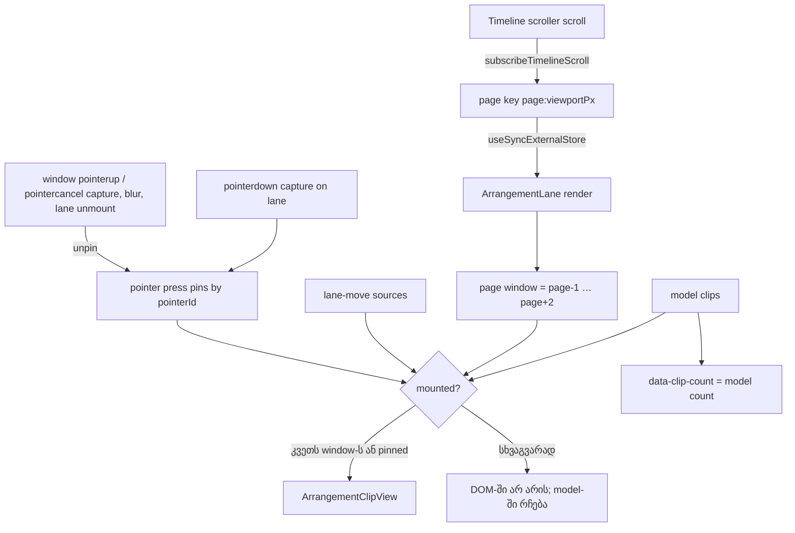

# PERF-14b-ii: lane-ის clip virtualization — lane მხოლოდ ხილული window-ის ახლოს მყოფ clip-ებს ხატავს (round 402)

**თარიღი:** 2026-11-08
**სტატუსი:** In Progress (stage 3 of 4; C round 402 PASS)
**შეცვლილი პროექტი:** Store (`app/components/arrangement/ArrangementLane.tsx`, `app/lib/arrangement/__tests__/lane-virtualization.test.tsx`, `app/lib/arrangement/__tests__/waveform-window-ui.test.tsx`, `perf/studio-lab-interactions.perf.spec.ts`, `perf/budgets.interactions.json`, `perf/budgets.scale.json`).

## კონტექსტი

PERF-14 ოთხ ეტაპადაა დაყოფილი: 14a (scale harness და lane-ის `data-clip-count`, doc 254), 14b-i (perf harness-ები clip-ებს model-იდან ითვლის, doc 255), 14b-ii (ეს doc) და 14c (peak pyramid და canvas tiles).

HEAD `c17d0e9`-ზე lane თავის ყველა clip-ს ხატავს. 200 clip-ით default zoom-ზე გვერდზე 4333 element იყო (doc 254-ის A-ს run), და ყოველი zoom key ყველა clip-ის component-ს ხელახლა არენდერებდა. გრძელ პროექტში ეს zoom-ს, scroll-სა და ნებისმიერ edit-ს ანელებს.

პროდუქტის დაპირება (L55): გრძელი პროექტი სწრაფი რჩება. Lane ხატავს მხოლოდ ხილული window-ის ახლოს მყოფ clip-ებს, ხოლო ის, რასაც მომხმარებელი ხედავს ან Undo-თი აბრუნებს, არ იცვლება. Model-ის ოპერაციები (select-all, Delete, group move, Undo) DOM-ში დაუხატავ clip-ებზეც მუშაობს.

## მიდგომა

კოდი B-ის reviewed patch-ია (`tmp/studio-real-loop/b-round-401/sketch-402.patch.txt`, sha256 `28569ea2d35c479b…`, 6 file diff). A-მ ის `git apply`-ით byte-for-byte დაამატა და ეს 6 ფაილი შემდეგ აღარ შეუცვლია (D-29z1378, L58: reviewed = dispatched).

### Window-ის წესი

- Lane timeline scroll-ს `useSyncExternalStore`-ით უსმენს (`timelineWindow.subscribeTimelineScroll`). Snapshot არის page key `page:viewportPx`, სადაც `page = floor(scrollLeft / viewportPx)`. ამიტომ lane მხოლოდ გვერდის გადაკვეთაზე ან viewport-ის სიგანის ცვლილებაზე რენდერდება და არა ყოველ scroll pixel-ზე.
- Page window არის `[page − 1, page + 2]` გვერდი pixel-ებში (`timelinePageWindow`, `app/lib/arrangement/view.ts`). Clip mount-ებულია, თუ მისი span `[start × pxPerSecond, (start + duration) × pxPerSecond]` ამ window-ს კვეთს (`spanInTimelineWindow`). Window იგივეა, რომელსაც `ArrangementClip.tsx` waveform-ის rebuild-ისთვის უკვე იყენებს (PERF-3d, doc 223).
- თუ viewport ჯერ არ არის გაზომილი (page key ცარიელია, SSR-იც), window არ არსებობს და ყველა clip mount-ებულია (VZ1).
- `data-clip-count` ისევ model-ის სრულ სიას (`clips.length`) ითვლის და არა mount-ებულ clip-ებს (doc 254-ის კონტრაქტი, VZ2).

### Pin-ები: რომელი clip რჩება mount-ებული window-ის გარეთ

1. **Lane-move წყაროები** (`selectLaneMoveSourceKey`): cross-lane გადატანისას წყარო clip mount-ებული რჩება, სანამ move გრძელდება (VZ6).
2. **აქტიური pointer press-ის clip:** lane-ის `onPointerDownCapture` press-ის target-იდან `[data-clip-id]`-ს პოულობს და `pointerId`-ზე ერთ entry-ს ინახავს თავისი `unpin`-ით. მიზეზი: `ArrangementClip`-ის unmount effect gesture-ს აუქმებს, ამიტომ დაჭერილი clip gesture-ის შუაში არ უნდა მოიხსნას (VZ5).
   - Press მთავრდება window-ის `pointerup`/`pointercancel`-ზე (capture, იგივე `pointerId`) და window-ის `blur`-ზე — იმავე event-ზე, რომელზეც `claimPointerGesture` gesture-ს აუქმებს (TL-R398-SK-M1, VZ8).
   - `unpin` სამივე listener-ს შლის. იგივე `pointerId`-ის მეორე press ჯერ ძველ entry-ს ასრულებს.
   - Lane-ის unmount effect ყოველ ცოცხალ `unpin`-ს უშვებს, ამიტომ listener არ რჩება (TL-R398-SK-L1, VZ9).
   - `unpin` რენდერს არ იწვევს: unpin-ებული clip DOM-იდან lane-ის შემდეგ რენდერზე ქრება (scroll, zoom, edit).
3. **არჩეული clip-ები არ არის pinned** (Q-14B-PIN-SELECTED): select-all ყველა clip-ს არ ამაუნტებს, Delete კი model-ით ყველას აღწევს (VZ7).

### D-29z1379: same-lane group member-ები არ არის pinned

Group move-ის დროს იმავე lane-ის member-ები არ pin-დება: ეს select-all + drag-ზე ყოველ არჩეულ clip-ს დაამაუნტებდა და VZ7-ის მიზანს გააუქმებდა. Cross-lane member-ები უკვე pinned-ია, როგორც lane-move წყაროები. Group preview model-ზეა დაფუძნებული, ამიტომ member, რომელიც gesture-ის შუაში window-ში შემოდის, preview-ის პოზიციაზე mount-დება (VZ10 jsdom-ში და B-ის browser probe `b-round-401/probe/pin-blur-group.cjs`).

### Interactions spec (R-b′-ის ცვლილება, doc 255)

- Group copy-ის setup ჯერ Ctrl+D-ს (ასლი), შემდეგ ორიგინალ clip-ზე Ctrl+click-ს აკეთებს, შემდეგ **ერთ** reveal-ს, რომელიც ასლის id-სა და `ClipState`-ს ერთად კითხულობს (A-R400-REVIEW-SPEC-LOWS Low 1 და Low 2). `CopyReveals` ახლა reveal-ების ნამდვილი რაოდენობაა (თითო reveal = ერთი scroll და ერთი restore).
- `copyDelta` წაუკითხავ ასლზე `null`-ია და არა NaN; check (c) `null`-ზე პირდაპირ ფეილდება (Low 4).
- Check (f) სამ branch-ად გაიყო (D-29z1379, TL-R401-SK-M3); დეტალები doc 255-ის R-b′ სექციაშია.
- A-R400 spec Low 3 შენარჩუნებულია (ruling): Follow-ის ხელახლა ჩართვამ playback-ის დროს შეიძლება კანონიერად scroll-ი გამოიწვიოს, ამიტომ 1 px restore check მის წინ რჩება. Low `deferred_low_polish`-ში რჩება.

### უარყოფილი ალტერნატივები

- არჩეული ან same-lane group member clip-ების pin — select-all + drag ყველა clip-ს დაამაუნტებდა (VZ7).
- Scroll pixel-ზე რენდერი page key-ის ნაცვლად — ყოველი scroll event lane-ის რენდერს გამოიწვევდა.
- Hysteresis გვერდის საზღვარზე — მოგვიანებით, PERF-CAND-14-SCROLL-HYSTERESIS.

## არქიტექტურა

## შეცვლილი ფაილები

| ფაილი | დანიშნულება |
|---|---|
| `app/components/arrangement/ArrangementLane.tsx` | page window-ის subscription, mount-ის filter, pointer press-ის pin-ები და მათი გაწმენდა |
| `app/lib/arrangement/__tests__/lane-virtualization.test.tsx` | ახალი: VZ1–VZ10 |
| `app/lib/arrangement/__tests__/waveform-window-ui.test.tsx` | WG2–WG5-ს ემატება `pinOutsideClips`; 0 assertion წაშლილი |
| `perf/studio-lab-interactions.perf.spec.ts` | ერთი reveal setup-ში, სამ-branch-იანი check (f), `copyDelta` null |
| `perf/budgets.scale.json` | 7 row: 6 flip `assert`-ზე და scroll ceiling |
| `perf/budgets.interactions.json` | `interact.zoom.30.out.path-rewrites` `== 3` → `== 2` |
| `docs/implementation/2026/quarter-IV/254-perf-scale-harness.md`, `255-perf-harness-model-count.md` | კონტრაქტის სექციები (l.4 უცვლელი) |

**WG2–WG5 და `pinOutsideClips` (TL-R401-SK-L3):** `waveform-window-ui.test.tsx`-ის WG2–WG5 ამოწმებს, რომ window-ის გარეთ მყოფი clip-ის waveform ძველ path-ს ინარჩუნებს. Virtualization-ის შემდეგ ასეთი clip საერთოდ არ არის mount-ებული, ამიტომ ეს ტესტები `pinOutsideClips`-ით clip-ს lane-move-ის ghost-ის pin-ით ინარჩუნებენ DOM-ში. თუ lane-move pin-ის წესი შეიცვლება, ეს ტესტებიც შესაბამისად უნდა განახლდეს.

### Budget-ების ცვლილება (D-29z1380)

`perf/budgets.scale.json`-ში ზუსტად 7 row შეიცვალა, მხოლოდ `mode`, `budget` და `note`. თითო ახალი note HEAD-ის note-ით იწყება (` record — not run on sketch (L58)`-ის გარეშე).

| Row | ახალი budget | B-ის sketch (production build) |
|---|---|---|
| `scale.dom.page` | `<= 2000` | 950 |
| `scale.dom.page.min-zoom` | `<= 2000` | 1532 |
| `scale.dom.page.min-zoom-mid` | `<= 2000` | 1868 |
| `scale.clips.model` | `== 200` | 200 |
| `scale.zoom.components-per-key` | `<= 60` | 42.4 |
| `scale.zoom.components-per-key.6x` | `<= 60` | 42.4 |
| `scale.scroll.components-per-step` | `<= 140` (ceiling) | 116.5 |

- Scroll-ის ceiling ცნობილი, მიღებული ღირებულებაა და არა მიზანი (TL-R398-SK-L3): HEAD-ზე virtualization-ის გარეშე 57.75 იყო. გვერდის გადაკვეთა შემდეგი გვერდის clip-ებს ერთხელ ამაუნტებს, ამიტომ ნაბიჯის სამუშაო დაახლოებით ორმაგდება, გვერდის DOM კი 4.5-ჯერ პატარავდება.
- Interactions-ში მხოლოდ `interact.zoom.30.out.path-rewrites` შეიცვალა: 3 → 2. Key 4-ის anchored scroll window-ში შემოტანილ clip-ს ახლა ახალ band-ზე ახლად ამაუნტებს (mount და არა attribute rewrite). perKey `0,0,1,0,0,0,0,1,0,0`.
- Flip-ის ყოველი row whole-interval count-ია ან quiet-ის შემდეგ DOM count; 6× zoom row-ები 1×-ს უდრის (L37).

## პრობლემები და გადაწყვეტები

- **პრობლემა:** დაჭერილი clip scroll-ზე window-ის გარეთ გადიოდა და unmount-ზე gesture უქმდებოდა. **გადაწყვეტა:** pointer press-ის pin `pointerId`-ზე, VZ5.
- **პრობლემა (TL-R398-SK-M1, Medium):** round-398-ის sketch-ში pin მხოლოდ ერთ `pointerup`-ს ელოდა; window-ის blur-ზე clip სამუდამოდ pinned რჩებოდა. **გადაწყვეტა:** entry `pointerId`-ზე, `pointerup`/`pointercancel` capture და `blur`, `unpin` სამივე listener-ს შლის; VZ8.
- **პრობლემა (TL-R398-SK-L1, Low):** lane-ის unmount-ზე press-ის listener-ები რჩებოდა. **გადაწყვეტა:** unmount effect ყოველ ცოცხალ `unpin`-ს უშვებს; VZ9 capture flag-საც ადარებს.
- **პრობლემა (TL-R401-SK-M3, Medium):** same-lane member-ების unpin-ის შემდეგ check (f) ვეღარ ჩავარდებოდა. **გადაწყვეტა:** სამ-branch-იანი check (f).
- **პრობლემა (TL-R401-SK-M2, Medium):** round-398-ის flip patch-ს 14b-i-ის note-ები დაკარგული ჰქონდა. **გადაწყვეტა:** B-მ budgets HEAD-იდან script-ით ააწყო.

## ტესტირება

Unit row-ები (`lane-virtualization.test.tsx`):

| Row | რას ამოწმებს |
|---|---|
| VZ1 | გაუზომავი viewport ყველა clip-ს ამაუნტებს |
| VZ2 | გაზომილი viewport მხოლოდ page window-ის clip-ებს ამაუნტებს; count model-ად რჩება |
| VZ3 | გვერდების გადაკვეთა clip-ებს ამაუნტებს და ხსნის |
| VZ4 | zoom out შორეულ clip-ს window-ში შემოიტანს |
| VZ5 | აქტიური pointer gesture-ის clip pointer-ის აშვებამდე mount-ებული რჩება |
| VZ6 | window-ის გარეთ მყოფი lane-move წყარო move-ის განმავლობაში mount-ებული რჩება |
| VZ7 | select-all window-ის გარეთ clip-ებს არ ამაუნტებს, Delete მაინც აღწევს მათ |
| VZ8 | press-ის დროს window blur clip-ს unpin-ს უკეთებს, შემდეგი scroll ხსნის |
| VZ9 | press-ის დროს workspace-ის unmount press-ის ყოველ window listener-ს შლის (capture flag-ით) |
| VZ10 | window-ის გარეთ მყოფი same-lane group member gesture-ის შუაში preview-ის პოზიციაზე mount-დება |

Mutant-ები B-ის sketch-ზე (`tmp/studio-real-loop/b-round-401/mutants/summary.txt`, runner `mutants/run.py`): pristine rc 0 მანამდეც და მერეც, 11/11 წითელი.

| Mutant | წითელი row-ები |
|---|---|
| MU-402-NO-FILTER | VZ2, VZ3, VZ4, VZ5, VZ6, VZ7, VZ8, VZ10 |
| MU-402-NO-GESTURE-PIN | VZ5, VZ8, VZ10 |
| MU-402-NO-MOVE-PIN | VZ6 |
| MU-402-NO-UNPIN | VZ5, VZ8 |
| MU-402-STATIC-PAGE | VZ3, VZ5, VZ8, VZ10 |
| MU-402-PIN-SELECTED | VZ5, VZ7, VZ8, VZ10 |
| MU-402-STALE-PX | VZ4 |
| MU-402-NO-BLUR-UNPIN | VZ8, VZ9 |
| MU-402-NO-UNMOUNT-CLEANUP | VZ9 |
| MU-402-NO-CANCEL-REMOVE | VZ9 |
| MU-402-NO-CAPTURE-REMOVE | VZ9 |

Perf (production build, თითო spec ცალკე, L38): B-ის run-ები dispatched patch-ზე — scale `b-round-401/perf-sketch-scale-final.json` (7 assert PASS; budget note-ებში ციტირებული `perf-sketch-scale-run1.json`/`run2.json` review-ის pass 1-ის budget-ებით გაშვებული ადრინდელი run-ებია, იგივე მნიშვნელობებით), interactions `perf-sketch-interactions-final.json` (`complete` true, `failures` []), resources და `studio-lab` spec-ები. A-ს გაშვებები და შედარება: `tmp/studio-real-loop/a-round-402.md`. Browser probe-ები (C row 4–5): `b-round-398/probe/frames200.cjs` და `b-round-401/probe/pin-blur-group.cjs`.

## TODO / შემდეგი ნაბიჯები

1. **PERF-14c — peak pyramid და canvas tiles** (doc 254-ის TODO 2).
2. Scroll hysteresis — PERF-CAND-14-SCROLL-HYSTERESIS (`scale.scroll.components-per-step`-ის ceiling-ის შემცირება).
3. `readBesideClip`-ის `perf/lib`-ში გადატანა — A-R400-ARCH-READBESIDECLIP, `architecture_signals`-ში, არ არის დაგეგმილი.
4. REGRESSION-2026-11-10 export-ს browser-ში ხელახლა ამოწმებს ამ ეტაპის შემდეგ.
5. ეს doc 14c-ის შემდეგ დაიხურება.
