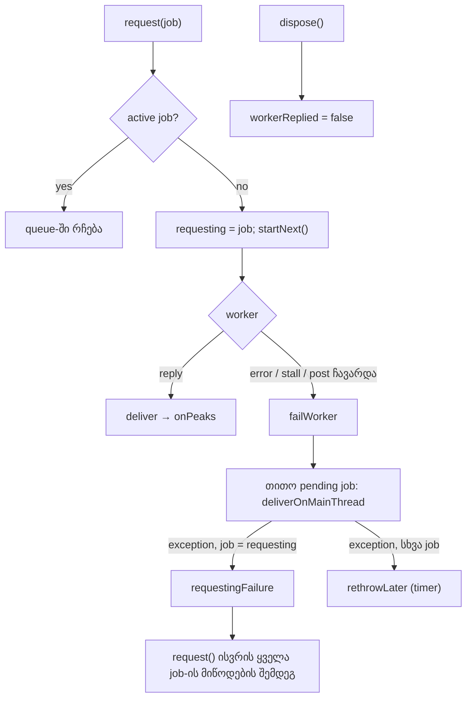

# PERF-14c-i: peaks client-ის გამაგრება და minimum zoom-ის zoom key-ების harness row-ები (round 403)

**თარიღი:** 2026-11-08
**სტატუსი:** In Progress (stage 4 of 6; C round 403 PASS)
**შეცვლილი პროექტი:** Store (`app/lib/arrangement/peaks.client.ts`, `app/lib/arrangement/__tests__/peaks-worker.test.ts`, `perf/studio-lab-scale.perf.spec.ts`, `perf/budgets.scale.json`, docs 228, 254, 257).

## კონტექსტი

PERF-14 ახლა ექვს ეტაპადაა დაყოფილი (D-29z1383): 14a (scale harness, doc 254), 14b-i (model-იდან დათვლა, doc 255), 14b-ii (lane-ის clip virtualization, doc 256), **14c-i (ეს doc)**, 14c-ii (peak pyramid ან near-min-zoom mount churn) და 14c-iii (canvas tiles ხილული window-ისთვის).

**Premise-ის ხელახალი გაზომვა (L37).** B-მ HEAD `7d7d7b2`-ის production build-ზე 200 clip-ით გაზომა zoom key-ები (`tmp/studio-real-loop/b-round-402/probe/head-minzoom-*.json`):

| Viewport | CPU | Default zoom, max keydown | Minimum zoom-თან, max keydown | Mount-ებული clip-ები minimum zoom-თან | Column-ები clip-ზე |
|---|---|---|---|---|---|
| 1440×900 | 1× | 24 ms | 24 ms | 19–24 | 159 |
| 1440×900 | 6× | 64 ms | 88 ms | 19–24 | 159 |
| 1280×720 | 1× | 24 ms | 24 ms | 16–20 | 159 |
| 1280×720 | 6× | 64 ms | 80 ms | 16–20 | 159 |

1×-ზე PERF-14-ის მიზანი „zoom p95 < 50 ms“ უკვე სრულდება. 6×-ზე minimum zoom-თან clip-ზე მხოლოდ 159 column იხატება, მაგრამ 16–24 mount-ებული clip ყოველ key-ზე იცვლება. `performance-optimizer`-ის დასკვნით (`tmp/studio-real-loop/b-round-402/consult-perf-14c-ii.md`) იქ ღირებულება mount churn-ია და არა peak-ების აგება, ამიტომ pyramid-ის სარგებელი ჯერ უნდა გაიზომოს. ამის გამო 14c გაიყო: ეს ეტაპი ასუფთავებს peaks client-ის ვალს და harness-ს minimum zoom-ის სცენარს `record` row-ებად აძლევს.

**8 Low (D-29z854, fix home „PERF-14, `peaks.client.ts`-ის შემდეგი owner“):** A-R315-REVIEW-L1, A-R315-REVIEW-L2, A-R315-REVIEW-L3, A-R315-REVIEW-L4, C-R315-T1, C-R315-T2, GATE315-S2, GATE315-S8. ერთი owner-ის ერთი კლასტერია, ამიტომ ერთად იხურება, როგორც ერთი ფუნქციური ეტაპი.

პროდუქტის დაპირება (L55): waveform ყოველთვის ჩნდება. გაჭედილი, ჩავარდნილი ან არარსებული worker ხმას „loading“-ში არ ტოვებს, ხოლო ხმა, რომლის საკუთარი decode ჩავარდა, ამას კვლავ თავის გამომძახებელს ატყობინებს.

## მიდგომა

კოდი B-ის reviewed patch-ია (`tmp/studio-real-loop/b-round-402/sketch-403.patch.txt`, sha256 `5cc6d6341a34712b…`, 4 ფაილი). A-მ ის `git apply`-ით byte-for-byte დაამატა და ეს 4 ფაილი შემდეგ აღარ შეუცვლია (D-29z1384, L58: reviewed = dispatched). Review: `tech-lead` pass 1 (3 Medium, 5 Low, ყველა გადაწყვეტილი) და delta pass 2 საბოლოო sha-ზე — „no new Medium+“ (`tmp/studio-real-loop/b-round-402/sketch-review.md`).

### 8 Low და როგორ დაიხურა

| Id | პრობლემა | გადაწყვეტა | Row |
|---|---|---|---|
| A-R315-REVIEW-L1 | `dispose()` `workerReplied`-ს არ აბრუნებდა | `dispose()` flag-ს ანულებს; ახალი worker dispose-ის შემდეგ ისევ cold-start budget-ს იღებს | PW25 |
| A-R315-REVIEW-L2 | `failWorker`-ის fallback loop-ში ერთი job-ის main-thread გამოთვლის exception დანარჩენ job-ებს აჩერებდა | თითო job ცალკე `try`-შია; exception `rethrowLater`-ით timer-ზე ისვრის, loop გრძელდება | PW27, PW29 |
| A-R315-REVIEW-L3 | „`Worker` არ არის + throwing `onPeaks`“ path-ს row არ ჰქონდა | ახალი row: `request()` არ ისვრის, error timer-ზე ისვრის | PW26 |
| A-R315-REVIEW-L4 | `PW12-PW13` describe-ის `afterEach` `vi.useRealTimers()`-ს არ იძახებდა | დაემატა | — (test hygiene) |
| C-R315-T1 | PW14 budget-ს მხოლოდ შეფარდებით ამოწმებდა; 5 000 ms-იანი mutant ცოცხალი რჩებოდა | PW14b 10 000 / 3 000 ms-ს პირდაპირ ამოწმებს | PW14b |
| C-R315-T2 | პირველ reply-მდე გაუგებარი message cold-start budget-ს არ უნდა ამთავრებდეს — row არ იყო | ორი row: junk პირველ reply-მდე და junk idle worker-ზე pre-aborted request-ის შემდეგ | PW24, PW24b |
| GATE315-S2 | PW18 unmount-ს მხოლოდ წარმატებისას აკეთებდა | describe-scope `view` და unmount `afterEach`-ში | PW18 |
| GATE315-S8 | doc 228 stage 1-ის browser row-ებს C round 314-ს მიაწერდა | doc 228-ში `C round 312` | — (doc) |

`rethrowLater` ის helper-ია, რომელსაც `deliver` უკვე inline იყენებდა.

### ორი error path

- **Requesting job (TL-R402-SK-M2):** როცა `failWorker` სინქრონულად ეშვება იმავე `request()`-ის შიგნით (მაგ. `postMessage` ჩავარდა), იმ job-ის exception, რომელიც ამ `request()`-მა რიგში ჩადო (ის შეიძლება არ იყოს ის job, რომელიც `startNext()`-მა დაიწყო), `request()`-იდან ისვრის — ყველა სხვა pending job-ის მიწოდების შემდეგ, როგორც patch-მდე. ასე გამომძახებლების error handling უცვლელია: video decode-ის `catch` → `error`, collection-ის `.then` → `.catch`. Timer-ზე დამატებითი rethrow არ ხდება (PW29).
- **Queued job:** სხვა job-ის exception loop-ს აღარ აჩერებს და timer-ზე ისვრის (PW27).
- **`Worker`-ის გარეშე:** `request()`-ის path უცვლელია და კვლავ სინქრონულად ისვრის (PW28).

**Residual (Low, ჩაწერილი):** queued job, რომლის საკუთარი გამოთვლა ისვრის, peaks-ს ვერ იღებს და მისი source `loading`-ში რჩება; error timer-ზე ისვრის. Patch-მდე იგივე exception ყველა მომდევნო job-ს აჩერებდა და ხშირად სხვა გამომძახებელს ხვდებოდა. Error-ის საკუთარ source-მდე მიტანას `request` API-ში error callback სჭირდება, რაც `ArrangementContext.tsx`-ს ცვლის (არ არის granted): `A-R403-L2-RESIDUAL-QUEUED-THROW`, deferred Low.

### Step i (scale spec)

Spec-ს ემატება ნაბიჯი **i** h-ის შემდეგ: minimum zoom-იდან 5 × `=` და 5 × `-`, თითო key-ს თავისი window quiet-მდე, 1×-ზე; შემდეგ `scrollLeft` i-ს დასაწყისის მნიშვნელობას უბრუნდება და იგივე key-ები 6×-ზე ეშვება. 8 ახალი row ყველა `record`-ია. დეტალები და მნიშვნელობები: doc 254, `### Spec-ის ნაბიჯები (a–i)` და `### Budget-ები (PERF-14b-ii, round 402, D-29z1380)` სექციის ბოლო ნაწილი „i ნაბიჯის row-ები“.

8 ახალი row (`perf/budgets.scale.json`), ყველა `record`, `budget` null, `owner` `PERF-14c-i`. მნიშვნელობები B-ის საბოლოო sketch run-იდან (`tmp/studio-real-loop/b-round-402/perf-sketch-scale-v2.json`, 3 pass); JSON note-ები ადრინდელ run-ს `perf-sketch-scale.json`-ს ასახელებს.

| Row | Kind | B-ის sketch run (v2) |
|---|---|---|
| `scale.zoom.min.keydown-p95-ms` | wallclock | 24 / 24 / 24 |
| `scale.zoom.min.keydown-max-ms` | wallclock | 24 / 24 / 24 |
| `scale.zoom.min.commits-per-key` | deterministic | 1 / 1 / 1 |
| `scale.zoom.min.components-per-key` | deterministic | 121.1 / 121.1 / 121.1 |
| `scale.zoom.min.keydown-p95-ms.6x` | wallclock | 112 / 120 / 112 |
| `scale.zoom.min.keydown-max-ms.6x` | wallclock | 112 / 120 / 112 |
| `scale.zoom.min.commits-per-key.6x` | deterministic | 1 / 1 / 1 |
| `scale.zoom.min.components-per-key.6x` | deterministic | 121.1 / 121.1 / 121.1 |

### უარყოფილი ალტერნატივები

- **Error callback `request` API-ში ამ ეტაპზე:** residual-ს დახურავდა, მაგრამ `ArrangementContext.tsx`-ს შეცვლის; შემდეგი owner-ის საქმეა.
- **Pyramid ახლავე (14c მთლიანად):** premise-ის გაზომვამ აჩვენა, რომ minimum zoom-თან ღირებულება mount churn-ია; pyramid-ის სარგებელი ჯერ mutant-ებით უნდა გაიზომოს.

## არქიტექტურა

## შეცვლილი ფაილები

- `app/lib/arrangement/peaks.client.ts` — `rethrowLater`, fallback loop-ის თითო job-ის `try`, requesting job-ის error-ის `request()`-იდან სროლა, `dispose()`-ში `workerReplied`-ის reset (patch).
- `app/lib/arrangement/__tests__/peaks-worker.test.ts` — PW14b, PW24, PW24b, PW25–PW29; PW12–PW13-ის `afterEach`-ში `vi.useRealTimers()`; PW18-ის unmount `afterEach`-ში (patch). 0 assertion წაშლილია; PW-id-ები 19 → 27 (literal `it('PW…')` row-ების unique id-ები, claims K20-ის დათვლა; `it.each` row-ები PW13 და PW13b არ ითვლება).
- `perf/studio-lab-scale.perf.spec.ts` — step i; `measureZoomKeys`-ს `rowPrefix` / `firstKey`; `setTimelineScroll` რიცხვს იღებს (patch).
- `perf/budgets.scale.json` — 8 ახალი `record` row; პირველი 23 უცვლელი (patch).
- `docs/implementation/2026/quarter-IV/254-perf-scale-harness.md` — step i და 8 row (contract სექციები; l.4 უცვლელი).
- `docs/implementation/2026/quarter-IV/228-perf-peaks-worker.md` — GATE315-S8 და TODO bullet-ის დახურვის სუფიქსი (l.4 უცვლელი).
- `docs/implementation/2026/quarter-IV/257-perf-peaks-client-hardening.md` — ეს doc.

## პრობლემები და გადაწყვეტები

- **პრობლემა:** L2-ის პირველი ვერსია requesting job-ის exception-საც timer-ზე გადადებდა, და video decode / collection-ის გამომძახებლები error-ს ვეღარ იჭერდნენ (TL-R402-SK-M2). **გადაწყვეტა:** `requesting` / `requestingFailure` — ამ job-ის exception `request()`-იდან ისვრის, ყველა სხვა job-ის მიწოდების შემდეგ (PW29).
- **პრობლემა:** MU-403-REPLIED-ON-GARBAGE თავიდან ექვივალენტურ mutant-ად ჩაითვალა, მაგრამ `tech-lead`-მა აჩვენა, რომ pre-aborted request-ით მისაწვდომია (TL-R402-SK-M1). **გადაწყვეტა:** PW24b მას red-ად აქცევს.
- **პრობლემა:** 6× wallclock row-ები minimum zoom-თან „zoom p95 < 50 ms“-ს აჭარბებს. **გადაწყვეტა:** ამ ეტაპზე `record`; budget-ს B PERF-14c-ii-ის გაზომვის შემდეგ წყვეტს.
- **Stage count:** PERF-14-ს D-29z1383-დან 6 ეტაპი აქვს. Doc 254, 255, 256 l.4-ზე „of 4“-ს ინარჩუნებს, სანამ საბოლოო ეტაპი ყველა ადრინდელ l.4-ს `Completed (C round M PASS)`-ად არ გადაწერს (L28).
- **Deferred Low-ები:** TL-R402-SK-L3 (6× abort `cpuRate`-ს `abortedAt`-მდე აბრუნებს, როგორც step e), TL-R402-SK2-L1 (`requestingFailure` `finally`-ში არ სუფთავდება; დღეს ვერ გაჟონავს), TL-R402-SK2-L2 (nested request სინქრონულ fake reply-ზე `requesting`-ს ცვლის; მხოლოდ ტესტში) → `deferred_low_polish`.

## ტესტირება

### ახალი row-ები (`peaks-worker.test.ts`)

| Row | რას ამოწმებს |
|---|---|
| PW14b | cold-start budget 10 000 ms და stall timeout 3 000 ms |
| PW24 | გაუგებარი message პირველ reply-მდე cold-start budget-ს არც ამთავრებს და არც თავიდან იწყებს |
| PW24b | გაუგებარი message idle worker-ზე pre-aborted request-ის შემდეგ შემდეგ job-ს cold-start budget-ს უტოვებს |
| PW25 | `dispose()`-ის შემდეგ ახალი worker cold-start budget-ს იღებს |
| PW26 | `Worker`-ის გარეშე throwing `onPeaks` `request()`-იდან არ ისვრის და timer-ზე ისვრის |
| PW27 | worker-ის ჩავარდნისას job-ები იმ job-ის შემდეგ, რომლის main-thread peaks ისვრის, მაინც მიიღებენ peaks-ს; error timer-ზე |
| PW28 | `Worker`-ის გარეშე throwing main-thread გამოთვლა კვლავ `request()`-იდან ისვრის |
| PW29 | `request()`-ის შიგნით ჩავარდნილი post-ისას requesting job-ის error `request()`-იდან ისვრის, deferred rethrow-ის გარეშე |

### Mutant-ები (B-ის sketch-ზე, `tmp/studio-real-loop/b-round-402/mutants/summary.txt`)

Pristine before და after rc 0; 8/8 red.

| Mutant | მოსალოდნელი row | Red row-ები |
|---|---|---|
| MU-403-NO-LOOP-CATCH | PW27 | PW27 |
| MU-403-REQUESTING-DEFERRED | PW29 | PW29 |
| MU-403-CATCH-IN-DELIVER-MAIN | PW28 | PW28, PW29 |
| MU-403-NO-DISPOSE-RESET | PW25 | PW25 |
| MU-403-COLD-5000 | PW14b | PW14b |
| MU-403-REPLIED-ON-GARBAGE | PW24b | PW24b |
| MU-403-DELIVER-NO-TRY | PW26 | PW12, PW16, PW26 |
| MU-403-JUNK-REARMS | PW24 | PW24 |

`summary.txt`-ის „failing“ სიაში `PW4` describe-ის label-ია (`PW4-PW10`), არა ცალკე ტესტი.

### Scale spec (step i)

B-ის sketch run (production build, `tmp/studio-real-loop/b-round-402/perf-sketch-scale-v2.json`): complete, failures []. HEAD-ის 23 row-ის deterministic sample-ები `c-round-402/perf-scale.json`-ს უდრის. ახალი: components 121.1 (1× და 6×), commits 1 / 1.

### A-ს check-ები (round 403)

შედეგები და ფაილები: `tmp/studio-real-loop/a-round-403.md`.

### Browser

Fallback probe B-ის sketch build-ზე ორივე viewport-ზე, `normal`, `none`, `failing` რეჟიმებით (`tmp/studio-real-loop/b-round-402/probe/sketch-fallback-*`, HEAD control `head-fallback-*`). `failing` ამოწმებს, რომ გვერდი მკვდარი worker-იდან აღდგება; მრავალ-job-იანი fallback loop jsdom-ში PW27-ით მოწმდება; PW29 requesting job-ის path-ს ამოწმებს ერთი job-ით. C-ის browser row-ები: C round 403.

## TODO / შემდეგი ნაბიჯები

- **PERF-14c-ii:** დაგეგმვა იწყება გაზომვით (`tmp/studio-real-loop/b-round-402/consult-perf-14c-ii.md` §1): mutant A (`PEAK_SHAPE_MAX_COLUMNS` 512) და mutant B (fixed path) 6×-ზე ≥ 10 key-ით, პლუს CPU profile. თუ path-ის ღირებულება მცირეა, 14c-ii ჯერ near-min-zoom mount churn-ს იღებს (PERF-CAND-14-SCROLL-HYSTERESIS), pyramid შემდეგ. Pyramid-ის საწყისი დიზაინი: max-only, exact range-max (byte-identical path-ები), lazy level-ები, `sourcePeaks`-ის ტიპი უცვლელი.
- **PERF-14c-iii:** canvas tiles ხილული window-ისთვის; starved `path-rewrites` row-ები და `arrangement-clip-waveform` locator-ები ხელახლა წყდება.
- **8 `record` row-ის budget:** PERF-14c-ii-ის შემდეგ.
- **A-R403-L2-RESIDUAL-QUEUED-THROW:** error callback `request` API-ში (შემდეგი owner).
- **`commitDecodedSource` architecture note** (ARCH-R315-COMMIT-DECODED-SOURCE): signal-ად რჩება.
- **Stage count:** საბოლოო PERF-14 ეტაპი docs 254–257-ის l.4-ს `Completed (C round M PASS)`-ად გადაწერს.
