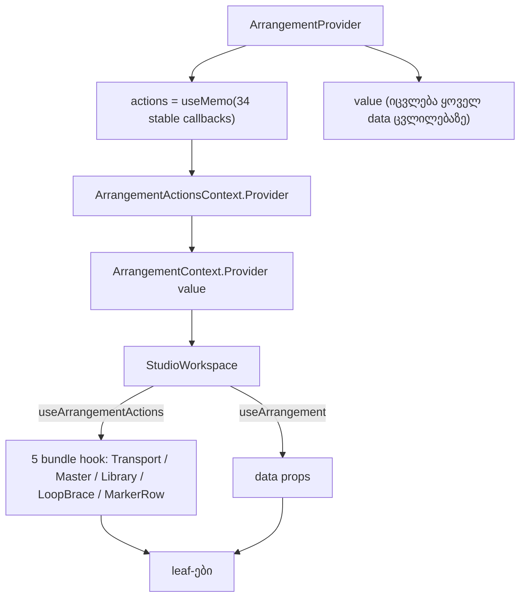

# SYS-R385-LEAF-ACTIONS-CONTEXT: Arrangement-ის სტაბილური actions context ხუთი action-bundle leaf-ისთვის (rounds 404–405)

**თარიღი:** 2026-11-08
**სტატუსი:** Completed (C round 405 PASS)
**შეცვლილი პროექტი:** Store (`app/contexts/ArrangementContext.tsx`, `app/components/arrangement/{StudioWorkspace,ArrangementLibrary,ArrangementLoopBrace,ArrangementMarkerRow,ArrangementMaster,ArrangementTransport}.tsx`, `app/lib/arrangement/__tests__/actions-context.test.tsx`, ეს doc). ეტაპი 2 (round 405): `app/components/arrangement/ArrangementLibrary.tsx`, `app/lib/arrangement/__tests__/{actions-context,fader-pointer-preview,master-ui,render-budget,selection-wrappers-render}.test.tsx`.

## კონტექსტი

ხუთი leaf (Transport, Master, Library, loop brace და marker row) action-ებს bundle hook-ებიდან იღებს: `useArrangementTransportActions`, `useArrangementMasterActions`, `useArrangementLibraryActions`, `useArrangementLoopBraceActions` და `useArrangementMarkerRowActions`. აქამდე ამ hook-ებს მთელი `ArrangementContextValue` გადაეცემოდა, ანუ ის object, რომელიც ყოველ data ცვლილებაზე (mute, zoom, commit, undo) ახლდება. hook-ები bundle-ს უკვე field-by-field `useMemo`-ით აწყობდა, ამიტომ runtime-ში მათი object-ები data ცვლილებაზე ისედაც არ იცვლებოდა. თუმცა ეს მხოლოდ ცალკეული `useCallback`-ების შეთანხმებაზე იყო დამოკიდებული: არც ერთი ადგილი არ იცავდა, არც ტესტი და არც ტიპი. ამიტომ ამ ეტაპის სარგებელი ახალი runtime სტაბილურობა არ არის. სარგებელი სხვაა: ვიწრო ტიპები, ერთი memo და ერთი ადგილი, სადაც რეგრესიას ტესტი იჭერს.

ARCH-CHECKPOINT-PERF11C-LEAF-PLUMBING-მა ორი ვარიანტი შეადარა. Saba-ს პასუხი არ მოსულა (`user-review/questions-arch-leaf-plumbing.md`), ამიტომ L46-ის მიხედვით ძალაში შევიდა default **B-actions**: action-ების ცალკე, სტაბილური context. PERF-11c-iii-d/e (VideoDock, Lane) ამ ეტაპის C PASS-მდე შეჩერებულია.

პროდუქტის დაპირება (L55): Studio ზუსტად ისე იქცევა, როგორც ადრე. იცვლება მხოლოდ ის, რომ leaf-ების action-ები ერთ სტაბილურ object-ში გაერთიანდა, რომელსაც data ცვლილება ვეღარ ჩაანაცვლებს.

## მიდგომა

**არჩეული: B-actions.** `ArrangementProvider`-ში ემატება `ArrangementActionsContext`. მისი value არის `useMemo` ზუსტად 34 callback-ზე, dependency-ებად კი ამ callback-ების identity-ები აქვს. `tech-lead`-ის consult-მა (`b-round-403/consult-tech-lead-sys-r385.md`) აჩვენა, რომ provider-ის lifetime-ში 34-ივე callback უკვე identity-stable-ია. ამიტომ memo ერთხელ იქმნება და data ცვლილებაზე აღარ იცვლება. ერთი წინაპირობა აქვს: `collection` prop-ის reference იგივე უნდა დარჩეს. მასზე პირდაპირ დამოკიდებულია `startLibraryPreview` და `addSourceToActiveTrack`, ხოლო შიდა `ensureDecoded`-ისა და `startPlaybackAt`-ის გავლით playback callback-ებიც, ამიტომ ახალი `collection` actions object-ს ლეგიტიმურად ჩაანაცვლებს. დღევანდელი ერთადერთი mount (`studio-lab.tsx`) module constant-ს გადასცემს. თუ რომელიმე callback-ს მომავალში არასტაბილური dependency დაემატება, actions object შეიცვლება და პრობლემა არ დაიმალება. AC1/AC2 ამას იჭერს იმ state-ისთვის, რომელსაც ტესტი ცვლის: undo history, `pxPerSecond`, track mute (მაგ. MU-404-MASTER-MUTE-DEP). dependency-ს, რომელიც მხოლოდ სხვა state-ზეა (მაგ. `selectedSourceId`, `sourceStates`, export state), AC1 არ ამოწმებს; მათ ეტაპი 2-ის AC7 ფარავს (A-R404-REVIEW-AC1-COVERAGE).

**უარყოფილი: A (ref delegation).** stable wrapper-ები, რომლებიც `ref.current`-ს იძახებენ, არასტაბილურობას მალავს: wrapper ყოველთვის ერთია, მაშინაც კი, როცა მის უკან callback ყოველ render-ზე იცვლება. გარდა ამისა, ~34 ხელით დაწერილ wrapper-ს მოითხოვს.

**ცვლილებები:**
- ახალი ტიპი `ArrangementActions = Pick<ArrangementContextValue, …34 key…>`, export-ირებული როგორც type.
- ახალი hook `useArrangementActions()`. guard ისეთივეა, როგორიც `useArrangement`-ს აქვს, ოღონდ შეცდომა სხვაა: `useArrangementActions must be used within an ArrangementProvider`.
- `ArrangementActionsContext.Provider` პირდაპირ `ArrangementContext.Provider`-ის გარშემოა, provider-ების არსებულ nest-ში.
- `useArrangement()` და სრული `value` უცვლელია.
- ოთხი bundle hook (loop brace, Master, Transport, marker row) საკუთარ ვიწრო `Pick<>` ტიპს იღებს და პარამეტრს ჰქვია `actions` (ადრე `workspace`). Library hook-ს ვიწრო ტიპი უკვე ჰქონდა.
- `StudioWorkspace.tsx`-ის 5 call site-ი და ოთხი wrapper (`ArrangementLoopBrace`, `ArrangementLibrary`, `ArrangementMaster`, `ArrangementTransport`) action-ებს `useArrangementActions()`-დან იღებს. data props-ისთვის wrapper-ები `useArrangement()`-ს ინარჩუნებს, ამიტომ render count-ები არ იცვლება.

**34 key:** `addSourceToActiveTrack`, `beginLibraryDrag`, `beginMasterGainGesture`, `blurMasterGain`, `claimPointerGesture`, `commitArrangement`, `commitLoopRange`, `commitMasterGain`, `deleteSelection`, `endLibraryDrag`, `getArrangement`, `getLibraryPreviewOffset`, `getLocatorPosition`, `getStatus`, `getStatusPreviewText`, `isPointerGestureActive`, `playFrom`, `previewArrangement`, `previewLoopArrangement`, `previewMasterGain`, `redo`, `resetMasterPeak`, `returnToStart`, `seekTo`, `selectSource`, `setStatus`, `splitSelection`, `startLibraryPreview`, `stepLoopRange`, `stopLibraryPreview`, `toggleLoopSelection`, `toggleMasterMute`, `togglePlayback`, `undo`.

პატჩი B-ის review-გავლილი sketch-ია (`b-round-403/sketch-404.patch.txt`, sha256 `9c0cdbc99e9e0b1c…`, v2). A-მ ის byte-for-byte გამოიყენა (L58: reviewed = dispatched).

## არქიტექტურა



data ცვლილება ახლიდან ქმნის მხოლოდ `value`-ს. `actions` იგივე object რჩება, ამიტომ action-bundle-ებს ახალი identity არ ეძლევა.

## შეცვლილი ფაილები

- `app/contexts/ArrangementContext.tsx`: `ArrangementActions` ტიპი, `ArrangementActionsContext`, actions memo, provider-ის nest და `useArrangementActions()`.
- `app/components/arrangement/StudioWorkspace.tsx`: 5 bundle hook-ის call site იღებს `useArrangementActions()`-ს.
- `app/components/arrangement/ArrangementLoopBrace.tsx`, `ArrangementMarkerRow.tsx`, `ArrangementMaster.tsx`, `ArrangementTransport.tsx`: hook-ის ვიწრო ტიპი, პარამეტრის rename (`workspace` → `actions`), wrapper-ები (marker row-ის გარდა) action-ებს ახალი hook-იდან იღებს.
- `app/components/arrangement/ArrangementLibrary.tsx`: wrapper იღებს `useArrangementActions()`-ს.
- `app/lib/arrangement/__tests__/actions-context.test.tsx` (ახალი): AC1–AC6.
- `docs/implementation/2026/quarter-IV/258-sys-arrangement-actions-context.md` (ეს doc).

**ეტაპი 2 (round 405, B-ის sketch `b-round-404/sketch-405.patch.txt`, sha256 `c64a5589ed319464…`, byte-for-byte):**
- `app/components/arrangement/ArrangementLibrary.tsx`: `useArrangementLibraryActions`-ის პარამეტრი `workspace` → `actions`.
- `app/lib/arrangement/__tests__/actions-context.test.tsx`: ახალი AC7, AC4-ის გაძლიერება.
- `app/lib/arrangement/__tests__/master-ui.test.tsx`: render count-ები `'ArrangementMasterViewInner'`-ზე, footer ტესტი count-ებს ჯერ ასუფთავებს.
- `app/lib/arrangement/__tests__/fader-pointer-preview.test.tsx`: `PARENT_NAMES` `'ArrangementMasterViewInner'`-ზე, ახალი FP0.
- `app/lib/arrangement/__tests__/render-budget.test.tsx`: RB-LEAF1-ის vacuous `'ArrangementMaster'` `toBe(0)` ხაზი წაიშალა.
- `app/lib/arrangement/__tests__/selection-wrappers-render.test.tsx`: GH5 render log-ში `group.id`-ს იწერს.

## პრობლემები და გადაწყვეტები

- **პრობლემა:** ტესტი, რომელიც მხოლოდ identity-ს ამოწმებს, შეიძლება მაშინაც გავიდეს, როცა action საერთოდ არ მოქმედებს (TL-R403-SK-M1). **გადაწყვეტა:** AC1 ყოველ ნაბიჯზე ამოწმებს შედეგსაც: `pxPerSecond` იცვლება, commit-ის შემდეგ marker-ების რაოდენობა +1-ით იზრდება, undo-ს შემდეგ კი ძველ რიცხვს უბრუნდება.
- **პრობლემა:** loop-ის immutability-ს pin-ი in-place ჩაწერას ვერ ხედავდა (TL-R403-SK-M2). **გადაწყვეტა:** AC4 mount-ის შემდეგ `loop`-სა და ყოველ marker-ს freeze-ავს, ამიტომ in-place ჩაწერა exception-ს აგდებს. ამას MU-404-LOOP-INPLACE ამტკიცებს.
- **პრობლემა:** transition API-ის guard-ს comment-ში ნახსენები სახელი შეიძლებოდა მოეტყუებინა (TL-R403-SK-M3). **გადაწყვეტა:** AC5 სკანირებამდე block comment-ებსა და მთლიანად `//`-ით დაწყებულ ხაზებს აშორებს. ერთი mutant რეალურ import-ს ამატებს და წითლდება, control mutant-ს კი სახელი მხოლოდ comment-ში აქვს და მწვანე რჩება.
- **პრობლემა:** პარამეტრის ძველი სახელი `workspace` მთელ workspace-ს გულისხმობდა (TL-R403-SK-L2). **გადაწყვეტა:** სახელი გახდა `actions`.

## ტესტირება

**Unit (`app/lib/arrangement/__tests__/actions-context.test.tsx`; provider + probe, fake `AudioContext`, `OfflineAudioContext` და `AudioBuffer`):**

| Row | რას ამოწმებს |
|---|---|
| AC1 | lane mute-ის, zoom step-ის, marker commit-ისა და undo-ს შემდეგ actions object იგივეა (`toBe`), context value object კი იცვლება. ყოველი ნაბიჯი მოქმედებს: `pxPerSecond` იცვლება, marker-ები commit-ის შემდეგ +1-ია, undo-ს შემდეგ კი ძველი რიცხვია |
| AC2 | `toggleMasterMute`, `commitArrangement`, `undo` და `togglePlayback` თავად provider-ის callback-ებია (`toBe`). ესენი და `getArrangement` lane mute-სა და zoom step-ზე identity-ს ინარჩუნებს |
| AC3 | სტაბილური actions-ის `getArrangement()` commit-ის შემდეგაც და მისი undo-ს შემდეგაც უახლეს `present`-ს აბრუნებს |
| AC4 | fixture-ს აქვს loop და ერთი marker, რომლებიც mount-ის შემდეგ freeze-დება. lane mute-ის, Master mute-ისა და marker commit-ის შემდეგ `loop` identity-სა და მნიშვნელობას ინარჩუნებს, marker-ები კი 1-დან 2-მდე იზრდება (GATE378-L2) |
| AC5 | `app/components/arrangement`-სა და `app/contexts`-ში (test folder-ების გარდა) არცერთი source არ იყენებს `startTransition`-ს, `useTransition`-ს ან `useDeferredValue`-ს. სკანირებამდე იშლება block comment-ები და მთლიანად `//`-ით დაწყებული ხაზები (GATE377-L1). `entry.client.tsx` სკანირებაში შეგნებულად არ შედის, რადგან hydration `startTransition`-ს იყენებს |
| AC6 | provider-ის გარეთ ისვრის შეცდომას `useArrangementActions must be used within an ArrangementProvider` |

**Mutants** (B-ის sketch-ზე, `tmp/studio-real-loop/b-round-403/mutants/summary.txt`, runner `mutants/run.py`; pristine rc 0 როგორც მანამდე, ისე მერე, scratch status 0 line):

| Mutant | შედეგი | rc | წითელი row-ები | მოსალოდნელი |
|---|---|---|---|---|
| MU-404-ACTIONS-DEP-HISTORY | RED | 1 | AC1 | AC1 |
| MU-404-ACTIONS-NO-MEMO | RED | 1 | AC1 | AC1 |
| MU-404-MASTER-MUTE-DEP | RED | 1 | AC1, AC2 | AC2 |
| MU-404-ACTIONS-WRAPPER | RED | 1 | AC2 | AC2 |
| MU-404-GETARRANGEMENT-STALE | RED | 1 | AC3 | AC3 |
| MU-404-LOOP-SPREAD | RED | 1 | AC4 | AC4 |
| MU-404-LOOP-INPLACE | RED | 1 | AC4 | AC4 |
| MU-404-TRANSITION | RED | 1 | AC5 | AC5 |
| MU-404-TRANSITION-COMMENTED (control) | GREEN-AS-EXPECTED | 0 | — | NONE |
| MU-404-NO-THROW | RED | 1 | AC6 | AC6 |

`summary.txt` სიტყვასიტყვით:

```text
pristine-before rc 0 failed []
MU-404-ACTIONS-DEP-HISTORY RED rc 1 failed ['AC1'] expected AC1
MU-404-ACTIONS-NO-MEMO RED rc 1 failed ['AC1'] expected AC1
MU-404-MASTER-MUTE-DEP RED rc 1 failed ['AC1', 'AC2'] expected AC2
MU-404-ACTIONS-WRAPPER RED rc 1 failed ['AC2'] expected AC2
MU-404-GETARRANGEMENT-STALE RED rc 1 failed ['AC3'] expected AC3
MU-404-LOOP-SPREAD RED rc 1 failed ['AC4'] expected AC4
MU-404-LOOP-INPLACE RED rc 1 failed ['AC4'] expected AC4
MU-404-TRANSITION RED rc 1 failed ['AC5'] expected AC5
MU-404-TRANSITION-COMMENTED GREEN-AS-EXPECTED rc 0 failed [] expected NONE
MU-404-NO-THROW RED rc 1 failed ['AC6'] expected AC6
pristine-after rc 0 failed []
scratch-status-lines 0
```

**Interactions perf spec** (`perf/studio-lab-interactions.perf.spec.ts`, ცალკე გაშვებული v2 sketch-ის production build-ზე): rc 0, `complete` true, 0 failure. 189-ივე deterministic row ემთხვევა `c-round-402/perf-interactions.json`-ს, det-diff 0 (`tmp/studio-real-loop/b-round-403/interactions-compare.txt`). RB-LEAF1–6 და RB-LEAF4b უცვლელია.

**A-ს შემოწმებები და C-ის browser შემოწმება** (round 404): შედეგები იხ. `tmp/studio-real-loop/a-round-404.md`-სა და `c-round-404.json`-ში. სრული vitest, verify და build gate-ის row-ებია.

### ეტაპი 2 (round 405)

**დახურული ID-ები:** C-R404-A-AC1-COVERAGE და A-R404-REVIEW-AC1-COVERAGE, A-R404-REVIEW-AC2-ALL-KEYS, A-R404-REVIEW-LIBRARY-PARAM, TL-R403-SK2-L1, TL-R403-SK2-L2, TL-R405-SK-L1, B-R374-MASTER-VACUOUS-NAME-COUNTS, A-R371-REVIEW-GH5-IDENTITY. GATE371-L2-COMPARATOR-PER-KEY და GATE375-L2-COMPARATOR-UNSTABLE-PROP იხურება როგორც უკვე დაფარული (D-29z1399), როცა C-ის mutant row ოთხივე comparator mutant-ს tree-ზე წითლად აჩვენებს.

| Row | ფაილი | რას ამოწმებს |
|---|---|---|
| AC7 | `actions-context.test.tsx` | მეორე source (`hit`). actions object mount-ის load flush-მდე იჭერს და `toBe`-თი ამოწმებს თითო ქმედით ნაბიჯის შემდეგ: source-ების ჩატვირთვა (`song` `ready`), `selectSource('hit')`, library preview-ის დაწყება და გაჩერება, Play/Stop, Master mute და Master gain step (`gainDb` −6, `undoLabel` `'Master Volume'`). ბოლოს 34-ივე entry provider value-ის იმავე key-ის entry-ის `toBe`-ა, ხოლო entry-ების რაოდენობა 34-ზეა pin-ული (`ACTION_KEY_COUNT`) |
| AC4 (გაძლიერებული) | `actions-context.test.tsx` | ზედმეტი `not.toBeNull` წაიშალა; `start.markers` freeze-ირებულია და track და Master mute-ის შემდეგ `arrangement.markers` იგივე frozen array-ა (`toBe`) |
| FP0 | `fader-pointer-preview.test.tsx` | `PARENT_NAMES`-ის ყოველი სახელი mount-ზე რეალურად render-დება, ამიტომ count-ები vacuous ვერ იქნება |
| master-ui footer | `master-ui.test.tsx` | "sits in the footer's last row…" ტესტი count-ებს ჯერ ასუფთავებს და `'ArrangementMasterViewInner'`-ს ითვლის; positive control აღარ იკვებება წინა ტესტის mount-ით |
| RB-LEAF1 | `render-budget.test.tsx` | vacuous `'ArrangementMaster'` `toBe(0)` წაიშალა; `ArrangementMasterViewInner`-ის `toBe(0)` და `toBe(1)` რჩება |
| GH5 | `selection-wrappers-render.test.tsx` | render log `ArrangementGroupHeader`-ის ყოველი render-ის `group.id`-ს იწერს; mute-ის შემდეგ ზუსტად ერთი ჯგუფია დადუმებული და render-ის id-ები უდრის `[ამ ჯგუფის id]`-ს. დამატებითი `not.toBe('g1')` ვერ ჩავარდება, რადგან ჯგუფის id `crypto.randomUUID()`-ია; ის, რომ დადუმებული ჯგუფი დაკეცილი პირველი ჯგუფი არ არის, id-ით არ მოწმდება (A-R405-REVIEW-GH5-G1-VACUOUS, B-სთვის) |

**Comparator-ები (D-29z1399, production ცვლილების გარეშე):** type-ის წესი `Object.is`-ს ვერ უარყოფს, რადგან ის `(any, any) => boolean` ტიპისაა. სამაგიეროდ GH2 და RB-LEAF3 უკვე წითლდება აღწერილ რეგრესიებზე: MU-405-GH2-CANDIDATES-OBJECTIS, MU-405-GH2-OVERVIEW-OBJECTIS, MU-405-RBLEAF3-INLINE-WORKSPACE და MU-405-RBLEAF3-INLINE-LIBRARY.

**Mutants** (B-ის sketch-ზე, `tmp/studio-real-loop/b-round-404/mutants/summary.txt`, runner `mutants/run.py`; 14/14 RED, gap mutant-ების must-stay-green row-ები მწვანე დარჩა, pristine rc 0 ხუთივე ფაილზე მანამდეც და მერეც, scratch status 0 line). `summary.txt` სიტყვასიტყვით:

```text
pristine-before actions-context.test.tsx rc 0 failed 0
pristine-before fader-pointer-preview.test.tsx rc 0 failed 0
pristine-before master-ui.test.tsx rc 0 failed 0
pristine-before render-budget.test.tsx rc 0 failed 0
pristine-before selection-wrappers-render.test.tsx rc 0 failed 0
MU-405-SELECTED-DEP RED rc 1 expected AC7 failed-rows 1 must-stay-green ['AC1'] red []
MU-405-SOURCESTATES-DEP RED rc 1 expected AC7 failed-rows 1 must-stay-green ['AC1'] red []
MU-405-PREVIEW-DEP RED rc 1 expected AC7 failed-rows 1 must-stay-green ['AC1'] red []
MU-405-SEEKTO-WRAP RED rc 1 expected AC7 failed-rows 1 must-stay-green ['AC2'] red []
MU-405-FP-OLD-NAME RED rc 1 expected FP0 failed-rows 1
MU-405-MU-OLD-NAME RED rc 1 expected sits in the footer failed-rows 1
MU-405-GH5-RECORDER RED rc 1 expected GH5 failed-rows 1
MU-405-GH2-CANDIDATES-OBJECTIS RED rc 1 expected GH2 failed-rows 2
MU-405-GH2-OVERVIEW-OBJECTIS RED rc 1 expected GH2 failed-rows 2
MU-405-RBLEAF3-INLINE-WORKSPACE RED rc 1 expected RB-LEAF3 failed-rows 3
MU-405-RBLEAF3-INLINE-LIBRARY RED rc 1 expected RB-LEAF3 failed-rows 1
MU-405-MARKERS-INPLACE RED rc 1 expected AC4 failed-rows 1
MU-405-MARKERS-COPY RED rc 1 expected AC4 failed-rows 1
MU-405-MASTER-COMMIT-SKIP RED rc 1 expected AC7 failed-rows 1
pristine-after actions-context.test.tsx rc 0 failed 0
pristine-after fader-pointer-preview.test.tsx rc 0 failed 0
pristine-after master-ui.test.tsx rc 0 failed 0
pristine-after render-budget.test.tsx rc 0 failed 0
pristine-after selection-wrappers-render.test.tsx rc 0 failed 0
scratch-status-lines 0
```

GH5-ის ახალ id assertion-ს არ აქვს source mutant, რომელიც მას გააწითლებდა, ხოლო ძველ `aria-pressed`-სა და count assert-ებს მწვანედ დატოვებდა: header-ის არასწორი render დაჭერილი header-ის `aria-pressed`-საც მოძველებულს დატოვებდა. MU-405-GH5-RECORDER ამტკიცებს, რომ recorder ცოცხალია.

**Perf:** runtime-ში მხოლოდ ლოკალური პარამეტრის სახელი შეიცვალა, ამიტომ render count-ები ვერ შეიცვლება; perf spec ამ ეტაპზე არ გაშვებულა (L58: `record — not run on sketch: no runtime change`).

**A-ს შემოწმებები და C-ის browser შემოწმება** (round 405): შედეგები იხ. `tmp/studio-real-loop/a-round-405.md`-სა და `c-round-405.json`-ში. სრული vitest, verify და build gate-ის row-ებია.

## TODO / შემდეგი ნაბიჯები

**SYS-R385 stage 2 (შესრულდა, round 405):**
- [x] GATE371-L2-COMPARATOR-PER-KEY და GATE375-L2-COMPARATOR-UNSTABLE-PROP: დაფარულია GH2-ითა და RB-LEAF3-ით (D-29z1399, ოთხი comparator mutant).
- [x] A-R371-REVIEW-GH5-IDENTITY: GH5 `group.id`-ს ამოწმებს.
- [x] B-R374-MASTER-VACUOUS-NAME-COUNTS: count-ები `'ArrangementMasterViewInner'`-ზეა, FP0 და master-ui-ის clear.
- [x] A-R404-REVIEW-AC1-COVERAGE, A-R404-REVIEW-AC2-ALL-KEYS: AC7.
- [x] A-R404-REVIEW-LIBRARY-PARAM: პარამეტრს ჰქვია `actions`.
- [x] TL-R403-SK2-L1, TL-R403-SK2-L2: AC4.
- GATE375-L1-UNUSED-WRAPPERS: export-ირებული wrapper-ების წაშლა მფლობელის ნებართვას საჭიროებს; Saba-სთანაა (`user-review/questions-unused-leaf-wrappers.md`, `awaiting_user`, D-29z1398). ამ ეტაპზე wrapper არ წაშლილა და არ გადატანილა.

**Deferred Low-ები (reviewed = dispatched; არ შეცვლილა):**
- TL-R403-SK2-L3: comment strip-ის საზღვრები.
- TL-R403-SK-L1: 34 სახელი სამ ადგილასაა, `exhaustive-deps` კი მხოლოდ `warn`-ია.
- GATE404-L2, GATE404-L3.

**A-ს code-reviewer-ის შენიშვნა (round 405; patch-ის ფაილი არ შეცვლილა, reviewed = dispatched):**
- A-R405-REVIEW-GH5-G1-VACUOUS (Medium, ტესტის სიძლიერე): GH5-ის `expect(muted[0].id).not.toBe('g1')` vacuous-ია, რადგან ჯგუფის id `crypto.randomUUID()`-ით იქმნება. შემოთავაზება: შეამოწმოს, რომ დადუმებულ ჯგუფს ჰქვია `Group 2`, ან რომ მისი id დაკეცილი `Group 1`-ის id-ს არ უდრის.

**AC4-ის ფარგლები:** GATE378-L2 დაფარულია mount-ისას არსებული loop-ისთვის, marker object-ებისა და `markers` array-ისთვის, track mute-ის, Master mute-ისა და marker commit-ის დროს. არ არის დაფარული მოგვიანებით შექმნილი loop object-ები და სხვა edit path-ები (drag, trim, split, loop-brace step).

**შემდეგი:** PERF-11c-iii-d/e (VideoDock, Lane).

**ფარგლებს გარეთ:** zustand data store-ები, დანარჩენი ~76 action field (export, clip gain, pan, track volume).
