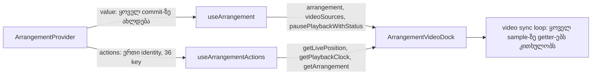

# PERF-11c-iii-d: video dock-ის leaf — actions context-ი dock-ის playback getter-ებს გასცემს (round 406, stage 1 of 2)

**თარიღი:** 2026-11-08
**სტატუსი:** Completed (C round 407 PASS)
**შეცვლილი პროექტი:** Store (`app/contexts/ArrangementContext.tsx`, `app/components/arrangement/ArrangementVideoDock.tsx`, `app/lib/arrangement/__tests__/actions-context.test.tsx`, ეს doc)

## კონტექსტი

`ArrangementVideoDock` ყოველ workspace commit-ზე re-render-დება, ასევე Play-სა და Stop-ზე. HEAD-ზე გაზომვით (leaf probe, ორივე viewport-ზე ერთნაირი): audio add-ზე 3, zoom step-ზე 1, audio-lane mute-ზე 1, Ctrl+Z-ზე 1, Undo/Redo ღილაკზე 1-1, preview start-ზე 1 და preview stop-ზე 2 render. PERF-11c-iii-d-ის მიზანია, dock-მა მხოლოდ საკუთარ მონაცემებზე (video track, video clip-ები) დაიწყოს render.

სამუშაო ორ ეტაპად გაიყო (D-29z1405, `tech-lead`):

- **d-i (ეს round)** მხოლოდ actions contract-ს აფართოებს, ქცევის შეცვლის გარეშე;
- **d-ii (შემდეგი round)** render-ის დაზოგვას აკეთებს: memoised inner view, video lane-ის reader და memoised caption.

ასე d-ii-ს სუფთა baseline აქვს და მისი render ცვლილება, ისევე როგორც გაჩერებული ვიდეოს სისწორის რისკი, ცალკე ფასდება. პროდუქტის დაპირება (L55): Studio და მისი ვიდეო ზუსტად ისე იქცევა, როგორც ადრე. lane-ზე დამატებული ვიდეო sync-ში უკრავს და ეკრანზე არაფერი იცვლება.

## მიდგომა

ARCH-CHECKPOINT-SYS-R385-ACTIONS-ზე root-ის პასუხი არ მოსულა, ამიტომ მოთხოვნის საკუთარი პირობით ძალაში შევიდა ვარიანტი 1: არსებული `ArrangementActions` გაფართოვდა (SYS-R385-ის, doc 258-ის, B-actions default).

- `ArrangementActions`-ის `Pick` ორ ახალ key-ს იღებს: `getLivePosition` და `getPlaybackClock`. key-ების რაოდენობა 34-დან 36-მდე იზრდება.
- actions memo-ში `getLivePosition` provider-ის შიდა `livePosition` callback-ზე მიუთითებს, `getPlaybackClock` კი იმავე სახელის callback-ზე. ორივე `useCallback([])`-ია, ამიტომ actions object ერთ identity-ს ინარჩუნებს.
- `ArrangementVideoDock` `getLivePosition`, `getPlaybackClock` და `getArrangement` getter-ებს `useArrangementActions()`-დან კითხულობს. `arrangement`, `videoSources` და `pausePlaybackWithStatus` კვლავ `useArrangement()`-დან მოდის, ამიტომ dock-ის render-ების რაოდენობა ამ ეტაპზე არ იცვლება.
- `getArrangement` უკვე action იყო. `pausePlaybackWithStatus` `useArrangement()`-ზე რჩება: მისი dependency chain-ის სტაბილურობა დამტკიცებული არ არის, და dock მას ისედაც ref-ით კითხულობს.

**უარყოფილი ალტერნატივები:**

- **ცალკე props** (`performance-optimizer`-ის შეთავაზება). ორივე ფორმა ერთსა და იმავე function identity-ს იძლევა. SYS-R385-ის convention და `tech-lead` ერთ actions წყაროს ამჯობინებენ, ხოლო AC7 ახალ key-ებს ამაგრებს.
- **const-tuple derivation** (TL-R403-SK-L1). `tech-lead`-მა აჩვენა, რომ ის memo object-ისა და deps სიის ორივეს ვერ მოაშორებს აკრძალული type assertion-ის ან Biome-ის literal deps-ის დარღვევის გარეშე. ის deferred Low რჩება და Lane (e)-ის დაგეგმვისას ხელახლა განიხილება.

კოდი B-ის reviewed sketch-იდან byte-for-byte არის გადატანილი (`sketch-406.patch.txt`, D-29z1407): reviewed patch = dispatched patch (L58).

## არქიტექტურა



d-ii-ში dock-ის inner view `useArrangement()`-ის value-ს აღარ გამოიწერს და render მხოლოდ video track-სა და commit-ებულ video clip-ებზე იქნება დამოკიდებული.

## შეცვლილი ფაილები

- `app/contexts/ArrangementContext.tsx` — `ArrangementActions` type-ში და actions memo-ში ორი ახალი key, deps სიაში ორი ახალი ჩანაწერი.
- `app/components/arrangement/ArrangementVideoDock.tsx` — სამი getter `useArrangementActions()`-დან იკითხება; დანარჩენი ველები `useArrangement()`-დან.
- `app/lib/arrangement/__tests__/actions-context.test.tsx` — `ACTION_KEY_COUNT` 36-ია, AC7-ის სათაური "all 36"-ს ამბობს, და all-keys loop ახალ ორ entry-საც ამოწმებს (`toBe` provider value-ის entry).
- `docs/implementation/2026/quarter-IV/259-perf-video-dock-actions.md` — ეს doc.

## პრობლემები და გადაწყვეტები

- **პრობლემა:** provider-ის შიდა callback `livePosition` ჰქვია, საჯარო key კი `getLivePosition`. → **გადაწყვეტა:** memo-ში alias (`getLivePosition: livePosition`), deps სიაში შიდა სახელი. სახელის გაერთიანება rename-ის კანდიდატია (TL-R406-SK-L2, deferred).
- **პრობლემა:** dock getter-ს `useArrangement()`-დან თუ `useArrangementActions()`-დან კითხულობს, function identity ერთი და იგივეა, ამიტომ d-i-ში ამას ვერცერთი ტესტი ვერ განასხვავებს (TL-R406-SK-L4). → **გადაწყვეტა:** ეს ეკვივალენტობა აღრიცხულია; მტკიცებულება d-ii-ის render-budget row-ა, როცა dock მხოლოდ actions context-ზე იქნება დამოკიდებული.
- **პრობლემა:** ახალი action key-ის დამატება შეიძლება შეუმჩნეველი დარჩეს. → **გადაწყვეტა:** AC7 წითლდება, სანამ `ACTION_KEY_COUNT` და სათაური არ განახლდება. ეს pin განზრახ არის.

## ტესტირება

- **AC7** (`actions-context.test.tsx`, "AC7 keeps one actions object … and hands out all 36 provider callbacks (C-R404-A-AC1-COVERAGE)"): key-ების რაოდენობა 34 → 36. all-keys loop ამოწმებს, რომ actions-ის ყოველი entry, მათ შორის `getLivePosition` და `getPlaybackClock`, provider value-ის შესაბამის entry-ს `toBe` უდრის.
- **Mutants** (B-ის sketch-ზე, `b-round-405/mutants/summary.txt`):

  | Mutant | შედეგი |
  |---|---|
  | MU-406-DROP-LIVEPOS | RED rc 1, expect AC7, named-in-log True |
  | MU-406-DROP-CLOCK | RED rc 1, expect AC7, named-in-log True |
  | MU-406-WRAP-LIVEPOS | RED rc 1, expect AC7, named-in-log True |
  | MU-406-WRAP-CLOCK | RED rc 1, expect AC7, named-in-log True |

  `summary.txt`-ის mutant row-ები სიტყვასიტყვით:

  ```
  MU-406-DROP-LIVEPOS RED rc 1 expect AC7 named-in-log True
  MU-406-DROP-CLOCK RED rc 1 expect AC7 named-in-log True
  MU-406-WRAP-LIVEPOS RED rc 1 expect AC7 named-in-log True
  MU-406-WRAP-CLOCK RED rc 1 expect AC7 named-in-log True
  ```

  pristine run mutant-ებამდე და მათ შემდეგ: rc 0.
- **Leaf probe** (dev, sketch vs HEAD): 0 სხვაობა 22 leaf × 13 step × 2 viewport-ზე. VideoDock-ის render-ები step-ების მიხედვით უცვლელია: `[0,3,1,1,1,0,1,1,1,1,1,1,2]`.
- **Video drift** (რეალური ვიდეო, `public/videos/hero/1.mp4`, 2 play window × 3 sample, `b-round-405/video/drift-summary.txt`):

  | Tree | Viewport | max \|drift\| | paused |
  |---|---|---|---|
  | HEAD | 1440×900 | 0.007 s | false |
  | HEAD | 1280×720 | 0.013 s | false |
  | sketch | 1440×900 | 0.012 s | false |
  | sketch | 1280×720 | 0.009 s | false |

- **A-ს შემოწმება (round 406, working tree):** `npm run typecheck`, `npm run lint` და Biome სამ patch ფაილზე — rc 0. 8 covering ფაილი (actions-context, floating-video, video-fades-ui, video-dock-strings-ui, render-budget, library-video-return-focus, drag-preview-render, overview-visibility-ui) — 180/180 pass.

## TODO / შემდეგი ნაბიჯები

- **d-ii (PERF-11c-iii-d-ii):** memoised `ArrangementVideoDockViewInner`; video lane-ის reader, რომელიც video track-ზე და commit-ებული video clip-ების signal-ზეა დამოკიდებული; memoised caption; და გაჩერებულ მდგომარეობაში video Undo-ს შემდეგ re-seek-ის row.
- **Deferred Lows:** TL-R406-SK-L1 (AC7-ის სათაურში "36" hardcoded-ია; TL-R403-SK-L1-ის const-tuple გადაწყვეტილებასთან ერთად), TL-R406-SK-L2 (`livePosition` / `getLivePosition` alias ორ ადგილას; rename-ის კანდიდატი), TL-R406-SK-L3 (deps სია შიდა სახელით არის დალაგებული, object კი key-ით; კოსმეტიკური).
