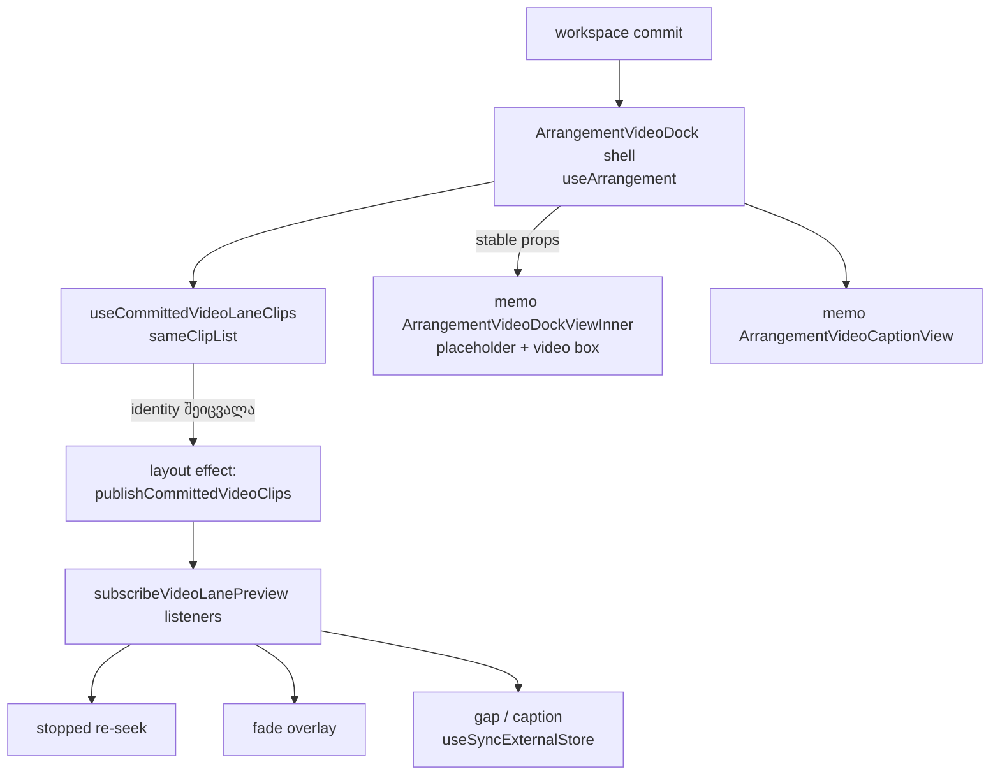

# PERF-11c-iii-d-ii: video dock-ის memo inner და video-lane commit signal

**თარიღი:** 2026-11-08
**სტატუსი:** Completed (C round 407 PASS)
**შეცვლილი პროექტი:** Store (`app/components/arrangement/ArrangementVideoDock.tsx`, `app/lib/arrangement/__tests__/drag-preview-render.test.tsx`, ეს doc, doc 259-ის სტატუსის ხაზი)

## კონტექსტი

PERF-11c-iii-d-ის პირველმა ეტაპმა (doc 259, round 406) dock-ის playback getter-ები actions context-ზე გადაიტანა. მეორე ეტაპამდე `ArrangementVideoCaption` და მთელი video box dock-თან ერთად ყოველ workspace commit-ზე re-render-დებოდა. HEAD-ზე leaf probe-ის 13 ნაბიჯზე (ორივე viewport-ზე ერთნაირი) შედეგი იყო `[0,3,1,1,1,0,1,1,1,1,1,1,2]`, მათ შორის audio-only commit-ებზეც: zoom, audio clip-ის move, audio mute, Undo და Redo.

მიზეზი ის იყო, რომ ყოველი commit `videoLane`-ს ახალ identity-ს აძლევდა და ყველა მომხმარებელი თავიდან ეშვებოდა: stopped re-seek, fade overlay-ის subscribe, gap-ისა და caption-ის წაკითხვა. მიზანი: box და caption მხოლოდ video lane-ის ცვლილებაზე დაიწყოს render. Studio და ვიდეო ზუსტად ისე უნდა იქცეოდეს, როგორც ადრე.

## მიდგომა

B-ის reviewed sketch byte-for-byte გამოვიყენეთ (D-29z1410). Patch-ი loop-ის evidence-ა, repo-ს გარეთ: `tmp/studio-real-loop/b-round-406/sketch-407.patch.txt` (sha256 `4ec62e316b8776b7…`).

- **Memo inner.** float state, მისი handler-ები და placeholder + video box JSX გადავიდა `ArrangementVideoDockViewInner`-ში. ის `memo`-თი შეიფუთა (`ArrangementVideoDockView`). Fragment-ის გამო DOM-ის რიგი არ შეცვლილა. Props: `videoLane`, `hasVideoClips`, `isVideoExpanded`, `videoFloatAnchor`, `onVideoExpandedChange`, `claimPointerGesture`, `firstVideoRef`, `secondVideoRef`.
- **Memo caption.** `ArrangementVideoCaptionView = memo(ArrangementVideoCaption)`.
- **Reader.** `useVideoLanePreviewReader` აღარ არის `arrangement`-ზე მიბმული. მისი key-ია `[videoTrackId, getArrangement, previewStore]`.
- **Commit signal.** `useCommittedVideoLaneClips` გასცემს identity-stable video-lane clip სიას. შედარება element-identity-ით ხდება (`sameClipList`). layout effect-ი იძახებს `videoLane.publishCommittedVideoClips(videoClips)`-ს. სიის identity-ის ცვლილებისას ის აცნობებს `subscribeVideoLanePreview`-ის ყველა listener-ს. პირველი publish ჩუმია.
- **Shell უცვლელია.** `useArrangement()`, pause ref, ორივე sync effect, `<section ref={rootRef}>` counter-ებით, caption row და `{overview}` shell-ში დარჩა (D-29z1411, R406-CR-L2).

ძველი per-commit re-identity-ის ყველა გვერდითი ეფექტი B-მ ცალ-ცალკე გადაწყვიტა (L49). stopped re-seek, fade overlay-ის განახლება, gap და caption commit notify-ით შენარჩუნდა. audio commit-ებზე box-ისა და caption-ის re-render განზრახ მოიხსნა.

## არქიტექტურა



## შეცვლილი ფაილები

- `app/components/arrangement/ArrangementVideoDock.tsx` — memo inner, memo caption, reader-ის key-ი და video-lane commit signal (patch, byte-for-byte).
- `app/lib/arrangement/__tests__/drag-preview-render.test.tsx` — `ArrangementVideoDockViewInner` დაემატა `VIDEO_DOCK_COMPONENTS`-ში. ახალი describe `PERF-11c-iii-d-ii` შეიცავს DP73–DP75 row-ებს (patch, byte-for-byte).
- `docs/implementation/2026/quarter-IV/259-perf-video-dock-actions.md` — მხოლოდ სტატუსის ხაზი (l.4) შეიცვალა: PERF-11c-iii-d დასრულდა.
- `docs/implementation/2026/quarter-IV/260-perf-video-dock-memo.md` — ეს doc.

## პრობლემები და გადაწყვეტები

- **პრობლემა:** memo-ს შემდეგ Undo/Redo-ს stopped frame შეიძლება ძველ კადრზე დარჩენილიყო, რადგან commit-ს აღარ მოჰყვებოდა `videoLane`-ის ახალი identity. მისი re-seek-ი სწორედ ამაზე იყო დამოკიდებული.
  **გადაწყვეტა:** video-lane commit signal (`publishCommittedVideoClips`) listener-ებს აცნობებს video clip სიის identity-ის ცვლილებისას. commit-notify mutant-ზე Ctrl+Z-ის შემდეგ ცდომილება 1.5 s-ია, sketch-ზე 0.
- **პრობლემა:** reader-ი `arrangement`-ზე იყო მიბმული და ყოველ commit-ზე ახალ identity-ს იღებდა, ამიტომ memo-ს უაზროს ხდიდა.
  **გადაწყვეტა:** reader-ის key-ია `[videoTrackId, getArrangement, previewStore]`. MU-407-READER-PER-RENDER ამას ამოწმებს.
- **პრობლემა:** dock shell-ის render count-ი არ მცირდება.
  **გადაწყვეტა:** განზრახ არის ასე (D-29z1411). shell-ი `useArrangement()`-ზე რჩება და sync effect-ებს მართავს. memo მხოლოდ inner-ზე და caption-ზეა.

## ტესტირება

**Unit row-ები (`drag-preview-render.test.tsx`, describe `PERF-11c-iii-d-ii`):**
- **DP73:** zoom, audio move, audio mute, Undo ×2 და Redo. dock shell-ი render-დება, ხოლო inner, caption, fade და gap 0-ჯერ. box-ისა და overlay-ის element-ები იგივე node-ებია.
- **DP74:** stopped video-clip move, შემდეგ Undo და Redo. inner 0-ჯერ render-დება. gap და overlay-ის opacity ყოველ commit-ს მიჰყვება. stopped re-seek-ის unit gate Undo-ს შემდეგ არსებული DP72-ია; Redo-ს re-seek-ს unit row არ ამოწმებს, მას browser-ის stopped-seek recipe ფარავს.
- **DP75 (positive control):** inner render-დება პირველი video clip-ის დამატებისას და box-ის expand-ზე.

**Mutant-ები** (loop-ის evidence, repo-ს გარეთ: `tmp/studio-real-loop/b-round-406/mutants/summary.txt`; mutant-ების ID-ები round 407-ისაა, ფოლდერი 406-ის planning-ისა):

| Mutant | შედეგი | მოსალოდნელი row |
|---|---|---|
| MU-407-NO-INNER-MEMO | RED rc 1 | DP73 |
| MU-407-NO-CAPTION-MEMO | RED rc 1 | DP73 |
| MU-407-READER-PER-RENDER | RED rc 1 | DP73 |
| MU-407-NO-COMMIT-NOTIFY | RED rc 1 | DP74 |
| MU-407-NO-COMMIT-SUBSCRIBE | RED rc 1 | DP74 |
| MU-407-NO-PUBLISH-EFFECT | RED rc 1 | DP74 |
| MU-407-HAS-VIDEO-STUCK | RED rc 1 | DP75 |

`summary.txt` სიტყვასიტყვით:

```text
PRISTINE-BEFORE rc 0
MU-407-NO-INNER-MEMO RED rc 1 expect DP73 named-in-log True
MU-407-NO-CAPTION-MEMO RED rc 1 expect DP73 named-in-log True
MU-407-READER-PER-RENDER RED rc 1 expect DP73 named-in-log True
MU-407-NO-COMMIT-NOTIFY RED rc 1 expect DP74 named-in-log True
MU-407-NO-COMMIT-SUBSCRIBE RED rc 1 expect DP74 named-in-log True
MU-407-NO-PUBLISH-EFFECT RED rc 1 expect DP74 named-in-log True
MU-407-HAS-VIDEO-STUCK RED rc 1 expect DP75 named-in-log True
PRISTINE-AFTER rc 0
SCRATCH-STATUS 2 lines (B uncommitted sketch: 2; a committed scratch: 0)
```

pristine run-ები mutant-ებამდე და მათ შემდეგ: rc 0. commit notify-ის გარეშე არსებული DP70 და DP72 row-ებიც წითლდება.

**Browser (B-ის sketch run-ები, loop-ის evidence `tmp/studio-real-loop/b-round-406/probe/` და `video/`):**
- **Leaf probe:** `ArrangementVideoCaption` და `ArrangementVideoDockViewInner` 13 ნაბიჯზე 0-ჯერ render-დება. `ArrangementVideoDock` shell-ი უცვლელია: `[0,3,1,1,1,0,1,1,1,1,1,1,2]`.
- **Stopped seek:** 4 ნაბიჯი (ruler click, move release, Ctrl+Z, Ctrl+Shift+Z). ცდომილება 0 HEAD-ზე და sketch-ზე, ორივე viewport-ზე. commit-notify mutant-ზე Ctrl+Z-ის შემდეგ 1.5 s.
- **Play drift (რეალური ვიდეო):** max 0.008 s (1440×900) და 0.012 s (1280×720).

საბოლოო PASS-ის წყაროა `c-round-407.json` (C round 407).

## TODO / შემდეგი ნაბიჯები

- **TL-R407-SK-L1** (deferred_low_polish): cached lane-ის top-level ველები (`tracks`, `loop` და სხვა) შეიძლება ჩამორჩეს ნებისმიერი commit-ის შემდეგ, რომელიც video clip-ებს არ ცვლის (audio move, mute, tempo, track-only). ხილული ეფექტი დღეს არ აქვს. Hardening: cached lane ყოველთვის მიმდინარე base-იდან აიგოს, clip სიის identity-ის შენარჩუნებით.
- **TL-R407-SK-L2** (deferred_low_polish): caption-ის ტექსტს unit row არ ამოწმებს.
- **PERF-11c-iii-e (Lane):** მომდევნო ეტაპი.
