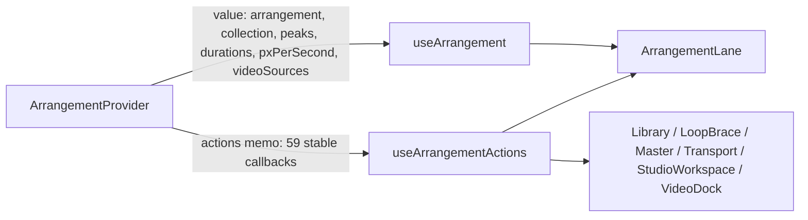

# PERF-11c-iii-e-i: Lane-ის callback-ები actions context-იდან

**თარიღი:** 2026-11-08
**სტატუსი:** Completed (C round 409 PASS)
**შეცვლილი პროექტი:** Store (`app/contexts/ArrangementContext.tsx`, `app/components/arrangement/ArrangementLane.tsx`, `app/lib/arrangement/__tests__/actions-context.test.tsx`, ეს doc)

## კონტექსტი

PERF-11c-iii-ის ბოლო `useArrangement()` leaf არის `ArrangementLane`. HEAD-ზე dev-build leaf probe აჩვენებს, რომ Lane workspace-ის ყოველ commit-ზე ოთხივე ხაზს ხელახლა არენდერებს: 13 probe ნაბიჯზე `[0,12,4,4,0,0,0,4,4,4,4,4,8]`. Lane 29 callback-ს იღებდა მთლიანი `useArrangement()` value-დან. ამიტომ მას არ შეეძლო მხოლოდ სტაბილური actions-ის გამოწერა.

სამუშაო ორ ეტაპად იყოფა, როგორც VideoDock-ის (d) შემთხვევაში:
- **e-i (ეს ეტაპი):** მხოლოდ plumbing. Lane callback-ებს stable actions context-იდან კითხულობს, render-ების რაოდენობა კი არ იცვლება.
- **e-ii (შემდეგი ეტაპი):** memo inner per-lane props-ით, რომელიც render-ის რეალურ დაზოგვას იძლევა.

მომხმარებლისთვის Studio ზუსტად ისე მუშაობს, როგორც ადრე: Mute, Solo, Volume, Pan, clip selection, time range, active track, insert marker, library drop, video import და lane drag.

## მიდგომა

- `ArrangementActions` Pick-ს ემატება 23 key: `previewClipGeometry`, `previewStatus`, `selectClip`, `toggleClipSelection`, `getSelectedClipIds`, `setTimeRange`, `setActiveTrack`, `setInsertMarker`, `toggleTrackMute`, `toggleTrackSolo`, `previewTrackVolume`, `commitTrackVolume`, `beginTrackVolumeGesture`, `blurTrackVolume`, `setTrackPan`, `beginTrackPanGesture`, `previewTrackPan`, `commitTrackPan`, `cancelTrackPan`, `importVideoFiles`, `getLibraryDragSource`, `dropLibrarySource` და `setClipLaneDrag`. ჯამში 36-ის ნაცვლად 59 key-ია. Pick, actions memo object და მისი deps სია სამი ერთნაირად დალაგებული სიაა.
- ყოველი ახალი key transitive-ად მიდის store-ებამდე, ref-ებამდე და stable callback-ებამდე (მაგ. `applyEdit`, `refuseEditDuringGesture`, `setRange`, `withNameBarHint`); ერთადერთი prop dep არის `collection.sources`. არცერთი არ არის დამოკიდებული `arrangement`-სა და `history`-ზე. ამიტომ actions object-ის identity commit-ზე არ იცვლება. `getLibraryDragSource` დამოკიდებულია `collection.sources`-ზე, ისევე როგორც არსებული `addSourceToActiveTrack`. identity იცვლება მხოლოდ `collection` prop-ის შეცვლისას.
- Lane `arrangement`, `collection`, `sourcePeaks`, `sourceDurations`, `pxPerSecond` და `videoSources` მნიშვნელობებს ისევ `useArrangement()`-დან კითხულობს, 29 callback-ს კი `useArrangementActions()`-დან. JSX, handler-ები და focus call-ები ბაიტ-ბაიტ უცვლელია. იცვლება მხოლოდ იმავე function reference-ის წყარო.
- Provider-ის შიდა `livePosition` ეწოდა `getLivePosition` (TL-R406-SK-L2/L3). memo-ში shorthand გამოიყენება და alias აღარ არის. სხვა ფაილებში ამავე სახელის ლოკალური სახელები, მაგალითად `video-sync.ts`-ის parameter, დაუკავშირებელია და არ შეცვლილა.
- AC7 key-ების რაოდენობას აღარ ინახავს მყარად ჩაწერილ რიცხვად (TL-R406-SK-L1). ის source ფაილიდან კითხულობს Pick-ს და ამოწმებს key-ების ზუსტ სიმრავლეს.
- **უარყოფილი ალტერნატივა:** const-tuple-ით key-ების მიღება (TL-R403-SK-L1). მას სჭირდება `as const`, ანუ type assertion, ან helper. ის დაამატებდა მესამე სიას, ამიტომ deferred რჩება.
- კოდი არის B-ს მიერ რევიუირებული patch (loop-ის evidence, repo-ს გარეთ: `/home/runner/czaba-project/tmp/studio-real-loop/b-round-407/sketch-408.patch.txt`, sha256 `029e5f8a12e55c8f…`). ის ბაიტ-ბაიტ გამოიყენება.

## არქიტექტურა



Lane ჯერ კიდევ value context-ის გამოწერაზეა. ამიტომ მისი render-ები commit-ზე არ მცირდება, სანამ e-ii-ში memo inner არ დაემატება.

## შეცვლილი ფაილები

- `app/contexts/ArrangementContext.tsx`: `ArrangementActions` Pick, actions memo object და deps (59 key); `livePosition` → `getLivePosition`.
- `app/components/arrangement/ArrangementLane.tsx`: ორი destructure (value და actions) და `useArrangementActions` import.
- `app/lib/arrangement/__tests__/actions-context.test.tsx`: `ACTION_KEY_COUNT`-ს ცვლის `declaredActionKeys()`; AC7-ს ახალი სათაური აქვს; ემატება AC8.
- `docs/implementation/2026/quarter-IV/261-perf-lane-actions.md`: ეს doc.

## პრობლემები და გადაწყვეტები

- **Problem:** AC7 key-ების რაოდენობას მყარად ჩაწერილი რიცხვით (36) ამოწმებდა. ყოველი ახალი key ტესტის ხელით განახლებას მოითხოვდა, ხოლო გადარქმეული key შეუმჩნეველი რჩებოდა. **Solution:** AC7 Pick-ს source-იდან კითხულობს და `toEqual`-ით ადარებს actions-ის key-ების დალაგებულ სიას. ამიტომ ტესტი ვარდება დაკარგულ, ზედმეტ ან გადარქმეულ key-ზე. ყოველი entry ისევ `toBe` provider value-ის შესაბამისი entry-ს.
- **Problem:** ახალი key-ები შეიძლებოდა commit-ზე actions-ის identity-ს ცვლიდნენ. **Solution:** deps trace (`/home/runner/czaba-project/tmp/studio-real-loop/b-round-407/deps-trace.txt`, loop-ის evidence, repo-ს გარეთ) 58 traced callback სახელს (ახალი key-ები და მათი transitive dep-ები, არა actions key-ების რაოდენობას) აჩვენებს: 0 ვერ მოიძებნა და 0 `arrangement`/`history` dep არის. AC8 identity-ს ამოწმებს lane-ის Solo, Volume, Pan, selection, time range, active track, insert marker და Undo path-ებზე, ხოლო MU-408-DEPS-PER-COMMIT ამ შემთხვევას წითლად აჩვენებს.
- **Problem:** browser LANE-ACTIONS probe-ის პირველი sketch გაშვება cold server-ზე timeout-ით დასრულდა. **Solution:** ეს გარემოს პრობლემაა (L38). განმეორებითი გაშვება წარმატებული იყო, timeout კი შენახულია (`/home/runner/czaba-project/tmp/studio-real-loop/b-round-407/lane/sketch-cold-timeout-1440x900.json`).

## ტესტირება

Unit (`app/lib/arrangement/__tests__/actions-context.test.tsx`):
- **AC7:** actions object ერთი რჩება source selection-ზე, library preview-ზე, Play/Stop-სა და Master mute/gain-ზე. actions-ის key-ების სიმრავლე ზუსტად უდრის `ArrangementActions` Pick-ს, რომელიც source-იდან იკითხება. თითო entry არის function და `toBe` provider value-ის entry-ს.
- **AC8:** ერთი actions object რჩება track Solo-ზე, Volume preview + commit-ზე, Pan set-ზე, clip selection-ზე, time range-ზე, active track-ზე, insert marker-სა და Undo-ზე. ასევე მოწმდება Solo true, Volume 0.5, Pan 0.5, მონიშნული id-ები და Undo-ს შემდეგ აღდგენილი Pan.

**Mutant-ები** (loop-ის evidence, repo-ს გარეთ: `/home/runner/czaba-project/tmp/studio-real-loop/b-round-407/mutants/summary.txt`; mutant-ების ID-ები round 408-ისაა, ფოლდერი 407-ის planning-ისა):

| Mutant | შედეგი | მოსალოდნელი row |
|---|---|---|
| MU-408-DROP-SOLO | RED rc 1 | AC7, AC8 |
| MU-408-MISMAP-SOLO | RED rc 1 | AC7, AC8 |
| MU-408-WRAP-PAN | RED rc 1 | AC7 |
| MU-408-DEPS-PER-COMMIT | RED rc 1 | AC1, AC8 |
| MU-408-DROP-DRAG-SOURCE | RED rc 1 | AC7 |

`summary.txt` სიტყვასიტყვით:

```text
PRISTINE-BEFORE rc 0
MU-408-DROP-SOLO RED rc 1 expect AC7+AC8 named-in-log True
MU-408-MISMAP-SOLO RED rc 1 expect AC7+AC8 named-in-log True
MU-408-WRAP-PAN RED rc 1 expect AC7 named-in-log True
MU-408-DEPS-PER-COMMIT RED rc 1 expect AC1+AC8 named-in-log True
MU-408-DROP-DRAG-SOURCE RED rc 1 expect AC7 named-in-log True
PRISTINE-AFTER rc 0
SCRATCH-STATUS 3 lines (B uncommitted sketch: 3; a committed scratch: 0)
```

pristine run-ები mutant-ებამდე და მათ შემდეგ: rc 0.

**Browser (B-ის sketch run-ები, Playwright, `/studio-lab`, 1440×900 და 1280×720; loop-ის evidence, repo-ს გარეთ: `/home/runner/czaba-project/tmp/studio-real-loop/b-round-407/probe/` და `lane/`):**
- **Leaf probe** (`/home/runner/czaba-project/tmp/studio-real-loop/b-round-407/probe/leaf-sketch-vs-head-408.txt`): sketch-სა და HEAD-ს შორის 0 სხვაობაა, 24 leaf × 13 ნაბიჯი × 2 viewport. `ArrangementLane` ორივე ვერსიაზე `[0,12,4,4,0,0,0,4,4,4,4,4,8]`-ია.
- **LANE-ACTIONS probe** (`/home/runner/czaba-project/tmp/studio-real-loop/b-round-407/lane/lane-actions-probe.mjs`): ექვსივე ნაბიჯი (`mute`, `solo`, `volume-drag`, `pan-drag`, `undo-mix`, `active-track`) `pass` არის HEAD-სა და sketch-ზე, ორივე viewport-ზე. MISMAP-SOLO mutant-ზე `solo` ნაბიჯი ჩავარდა, რადგან Solo click-მა track დაადუმა (`/home/runner/czaba-project/tmp/studio-real-loop/b-round-407/lane/mutant-MISMAP-SOLO-1440x900.json`). `active-track` ნაბიჯი მხოლოდ non-regression შემოწმებაა: click-მდე მდგომარეობას არ იწერს.

**A-ს შემოწმებები** (loop-ის evidence, repo-ს გარეთ: `/home/runner/czaba-project/tmp/studio-real-loop/a-round-408/`): typecheck, lint და სამი patch ფაილის Biome rc 0; covering set (46 ფაილი, `/home/runner/czaba-project/tmp/studio-real-loop/b-round-407/sketch-logs/covering.txt`) 911/911. ყველაზე ნელი ტესტი (`render-budget.test.tsx`) 1988 ms-ია, 15000 ms timeout-ის 13.3 %.

## TODO / შემდეგი ნაბიჯები

- **e-ii:** Lane-ის memo inner per-lane props-ით, რომელიც commit-ზე render-ებს შეამცირებს. probe-ში ასევე უნდა გასწორდეს B-R408-PROBE-ACTIVE-TRACK-VACUOUS: არჩეულ იქნას დაუჭერელი lane და ჩაიწეროს მდგომარეობა click-მდე და მის შემდეგ.
- **TL-R408-SK-L1** (AC7-ის key regex `[A-Za-z]+`) და **TL-R408-SK-L2** (AC8-ის ბოლო `?? 0`): deferred_low_polish.
- **TL-R403-SK-L1** (const-tuple key derivation): deferred.
