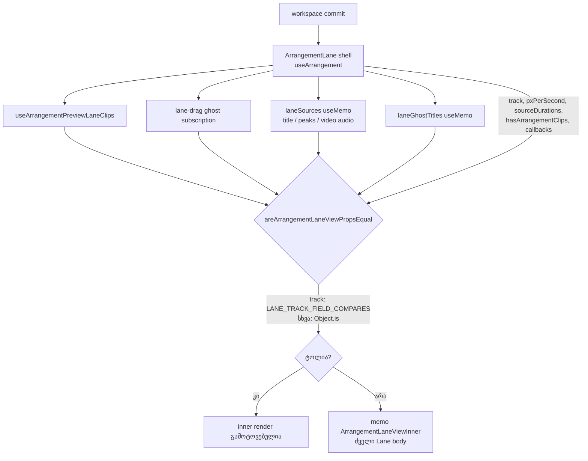

# PERF-11c-iii-e-ii: Lane-ის memo inner და ხაზის props

**თარიღი:** 2026-11-08
**სტატუსი:** Completed (C round 409 PASS)
**შეცვლილი პროექტი:** Store (`app/components/arrangement/ArrangementLane.tsx`, `app/lib/arrangement/__tests__/render-budget.test.tsx`, ეს doc, doc 261-ის სტატუსის ხაზი)

## კონტექსტი

PERF-11c-iii-e-ის პირველმა ეტაპმა (doc 261, round 408) Lane-ის callback-ები actions context-ზე გადაიტანა. მეორე ეტაპამდე `ArrangementLane` ყველა 4 ხაზს ყოველ workspace commit-ზე render-დებოდა. HEAD-ზე dev-build-ის leaf probe-ის 15 ნაბიჯზე (ორივე viewport-ზე ერთნაირი) შედეგი იყო `[0,12,4,4,0,0,0,4,4,4,4,4,8,4,4]`.

ერთი ხაზის Mute, Solo ან library preview-ის დაწყება და გაჩერებაც კი ოთხივე ხაზს თავიდან ხატავდა. მიზანი: ხაზი მხოლოდ მაშინ დაიწყოს render, როცა მისი საკუთარი მონაცემები იცვლება. Studio ზუსტად ისე უნდა იქცეოდეს, როგორც ადრე: Mute, Solo (exclusive და Ctrl), Volume, Pan, clip-ების სათაურები და waveform-ები, video audio-ს შენიშვნები, lane-move ghost-ები, ცარიელი ხაზის hint-ი, library drop, video import და ხაზის drag.

## მიდგომა

B-ის reviewed sketch byte-for-byte გამოვიყენეთ (D-29z1418–D-29z1420). Patch-ი loop-ის evidence-ა, repo-ს გარეთ: `tmp/studio-real-loop/b-round-408/sketch-409.patch.txt` (sha256 `1beedffbda3eca0f…`). ფორმა იგივეა, რაც `ArrangementVideoDock.tsx`-ში (doc 260): shell + `memo` inner.

- **Shell.** `ArrangementLane` თხელი shell-ია. მასში დარჩა `useArrangement()` და `useArrangementPreviewLaneClips`, ხოლო lane-drag ghost-ის subscription inner-იდან shell-ში ავიდა. Shell ითვლის ხაზის props-ს: `clips`, `pxPerSecond`, `laneSources` (`useMemo` `[clips, collection, sourcePeaks, videoSources]`-ზე: თითო source-ის სათაური, peaks და video audio-ს სტატუსი), მთლიანი `sourceDurations`, `laneGhosts`, `laneGhostTitles` (`useMemo`; ghost-ების გარეშე მუდმივი ცარიელი სია) და `hasArrangementClips`.
- **Inner.** `ArrangementLaneViewInner` ძველი Lane-ის body-ა. JSX, handler-ები, focus-ის გამოძახებები და `data-testid`-ები უცვლელია. შეიცვალა მხოლოდ ზემოთ ჩამოთვლილი მნიშვნელობების წყარო. ის `memo(ArrangementLaneViewInner, areArrangementLaneViewPropsEqual)`-ით render-დება.
- **Comparator.** `track` ველ-ველ დარდება `LANE_TRACK_FIELD_COMPARES` ცხრილით, რომლის ტიპია `keyof Required<ArrangementTrack>`. მისი 8 ჩანაწერი `ArrangementTrack`-ის 8 ველს უდრის. მიზეზი: exclusive Solo ყველა track object-ს თავიდან აგებს. `ArrangementTrack`-ის ახალი ველი compile error-ია, type assertion-ის გარეშე. დანარჩენი props `Object.is`-ით დარდება.
- **რატომ `useMemo` და არა content compare `laneSources`-ზე.** peaks ინახება იმავე callback-ში, რომელიც source-ს მზადად ნიშნავს, ამიტომ `sourceDurations` ყოველთვის იმავე commit-ში იცვლება. Content compare-ის საჭიროების დამტკიცება შეუძლებელი იყო: sketch v1-ის always-equal mutant-ი jsdom-შიც და browser-შიც გადარჩა. `useMemo`-ით ყოველი input-ის ცვლილება render-ს იწვევს.
- **რატომ მთლიანი `sourceDurations`.** ხაზის მასშტაბის map, რომელიც inner-ის ყოველ render-ზე თავიდან აიგება, `ArrangementClipView`-ის prop identity-ს შეცვლიდა და ამ ხაზის ყველა clip-ი re-render-დებოდა. `performance-optimizer` დაეთანხმა.
- **StudioWorkspace-ის 6 callback და `timelineWindow`** უკვე stable-ია (`useCallback` / `useMemo`), ამიტომ comparator-ი მხოლოდ რეალურ ცვლილებას ხედავს.

ძველი body-დან shell-ში გადატანილ სამ ნაწილს (loop-ის წესი: ჩანაცვლებული გამოძახების გვერდითი ეფექტები ინახება) თავისი ეფექტი შერჩა: clip-ები იგივე `useShallow` შედეგია, ghost-ები იგივე `useShallow` selector-ია, სათაურების ძებნის რიგი იგივეა (video-ს სახელი, შემდეგ collection-ის სათაური, შემდეგ source id).

## არქიტექტურა



## შეცვლილი ფაილები

- `app/components/arrangement/ArrangementLane.tsx` — shell, `memo` inner, comparator, ტიპიზებული track-ველების ცხრილი და ხაზის props (patch, byte-for-byte).
- `app/lib/arrangement/__tests__/render-budget.test.tsx` — ორი helper და RB-LEAF7, RB-LEAF8, RB-LEAF9 row-ები. არსებული row-ები byte-identical-ია (patch, byte-for-byte).
- `docs/implementation/2026/quarter-IV/261-perf-lane-actions.md` — მხოლოდ სტატუსის ხაზი (l.4) შეიცვალა: PERF-11c-iii-e დასრულდა.
- `docs/implementation/2026/quarter-IV/262-perf-lane-memo.md` — ეს doc.

## პრობლემები და გადაწყვეტები

- **პრობლემა:** exclusive Solo ყველა track object-ს ახალ identity-ს აძლევს, ამიტომ `track`-ის `Object.is` შედარება ოთხივე ხაზს render-დებდა.
  **გადაწყვეტა:** `track` ველ-ველ დარდება ტიპიზებული ცხრილით. PLAIN-MEMO mutant-ზე browser-ის Solo-ს ორი ნაბიჯი ისევ `4,4`-ს აჩვენებს, sketch-ზე `1,1`-ს.
- **პრობლემა:** `ArrangementTrack`-ზე დამატებული ახალი ველი comparator-ში ჩუმად გამოტოვდებოდა და ხაზი ძველ მნიშვნელობაზე დარჩებოდა.
  **გადაწყვეტა:** ცხრილის ტიპია `{ [Field in keyof Required<ArrangementTrack>]: … }`. ახალი ველი tsc-ის შეცდომაა (MU-409-TSC-NEW-TRACK-FIELD, rc 2).
- **პრობლემა:** sketch v1-ში `laneSources`-ის content compare-ის always-equal mutant-ი ვერცერთმა ტესტმა ვერ დაიჭირა.
  **გადაწყვეტა:** content compare მოიხსნა. `laneSources` `useMemo`-ა, ამიტომ peaks-ის ან სათაურის ყოველი ცვლილება render-ს იწვევს. MU-409-SOURCES-DEPS-NO-PEAKS ამას ამოწმებს.
- **პრობლემა:** სხვა ხაზიდან გადატანილი clip-ის ghost-ს სათაური სჭირდება, რომელიც ამ ხაზის clip-ებში არ არის.
  **გადაწყვეტა:** ghost-ის სათაური shell-ში `arrangement.clips`-იდან იძებნება (RB-LEAF9, MU-409-GHOST-TITLE-EMPTY).

## ტესტირება

**Unit row-ები (`render-budget.test.tsx`):**
- **RB-LEAF7:** ხაზის Mute, მისი Undo, clip-ის გადატანა პროექტის სიგრძის შიგნით და Pan-ის commit მხოლოდ შეცვლილ ხაზს render-დებს; Pan-ის commit-ის შემდეგ Pan slider-ის მნიშვნელობაა `25`. zoom-ის ნაბიჯი ყველა ხაზს render-დებს. exclusive Solo მხოლოდ იმ ხაზებს render-დებს, რომელთა Solo იცვლება. shell-ის ღირებულება მიბმული არ არის (`toBeLessThanOrEqual(3)`).
- **RB-LEAF8:** ყოველი audio clip-ი peaks-ის მოსვლისას waveform-ს აჩვენებს; clip-ის სათაური name-bar-ის `title`-ით იძებნება და ზუსტად ერთია.
- **RB-LEAF9:** სხვა ხაზზე lane-move ghost-ს გადატანილი clip-ის სათაური აქვს. blocked ghost-ი მხოლოდ სამიზნე ხაზს render-დებს (1), ვალიდური წყარო ხაზსაც (2). drag-ის გასუფთავება ghost-ს შლის.
- **LSU9** (`lane-strings-ui.test.tsx`, არსებული): ცარიელი ხაზის hint-ი.

**Mutant-ები** (loop-ის evidence, repo-ს გარეთ: `tmp/studio-real-loop/b-round-408/mutants/summary.txt`; mutant-ების ID-ები round 409-ისაა, ფოლდერი 408-ის planning-ისა):

| Mutant | შედეგი | მოსალოდნელი row |
|---|---|---|
| MU-409-PLAIN-MEMO | RED rc 1 | RB-LEAF7 |
| MU-409-TRACK-IDENTITY | RED rc 1 | RB-LEAF7 |
| MU-409-DROP-SOLO-FIELD | RED rc 1 | RB-LEAF7 |
| MU-409-DROP-PAN-FIELD | RED rc 1 | RB-LEAF7 |
| MU-409-SOURCES-PER-COMMIT | RED rc 1 | RB-LEAF7 |
| MU-409-SOURCES-DEPS-NO-PEAKS | RED rc 1 | RB-LEAF8 |
| MU-409-REST-IGNORED | RED rc 1 | RB-LEAF7 |
| MU-409-GHOST-TITLE-EMPTY | RED rc 1 | RB-LEAF9 |
| MU-409-EMPTY-HINT-ALWAYS-CLIPS | RED rc 1 | LSU9 |

`summary.txt` სიტყვასიტყვით:

```text
PRISTINE-BEFORE rc 0
MU-409-PLAIN-MEMO RED rc 1 expect RB-LEAF7 named-in-log True
MU-409-TRACK-IDENTITY RED rc 1 expect RB-LEAF7 named-in-log True
MU-409-DROP-SOLO-FIELD RED rc 1 expect RB-LEAF7 named-in-log True
MU-409-DROP-PAN-FIELD RED rc 1 expect RB-LEAF7 named-in-log True
MU-409-SOURCES-PER-COMMIT RED rc 1 expect RB-LEAF7 named-in-log True
MU-409-SOURCES-DEPS-NO-PEAKS RED rc 1 expect RB-LEAF8 named-in-log True
MU-409-REST-IGNORED RED rc 1 expect RB-LEAF7 named-in-log True
MU-409-GHOST-TITLE-EMPTY RED rc 1 expect RB-LEAF9 named-in-log True
MU-409-EMPTY-HINT-ALWAYS-CLIPS RED rc 1 expect LSU9 named-in-log True
PRISTINE-AFTER rc 0
SCRATCH-STATUS 2 lines (B uncommitted sketch: 2; a committed scratch: 0)
MU-409-TSC-NEW-TRACK-FIELD (optional 'colour' added to ArrangementTrack): tsc rc 2, error names colour in ArrangementLane.tsx: 1
```

pristine run-ები mutant-ებამდე და მათ შემდეგ: rc 0. tsc-guard: `ArrangementTrack`-ზე `colour?: string`-ის დამატება tsc-ს rc 2-ით ამთავრებს, შეცდომა `ArrangementLane.tsx`-ში `colour`-ს ასახელებს.

**Browser leaf probe** (dev build, 15 ნაბიჯი, ორივე viewport-ზე ერთნაირი; loop-ის evidence `tmp/studio-real-loop/b-round-408/probe/`):
- `ArrangementLane` (shell): `[0,12,4,4,0,0,0,4,4,4,4,4,8,4,4]` — HEAD-ის ტოლი.
- `ArrangementLaneViewInner`: `[0,8,4,4,0,0,0,1,1,4,4,0,0,1,1]` — loaded replicate-შიც იგივე. Mute, მისი Undo, exclusive Solo და მისი Undo 4-ის ნაცვლად 1 ხაზს render-დებს; library preview-ის start და stop 4-ისა და 8-ის ნაცვლად 0-ს. zoom ყველა ხაზს render-დებს (`pxPerSecond` იცვლება); transport-ის Undo და Redo Bass-ის დამატებას აუქმებს და აბრუნებს, პროექტის სიგრძე იცვლება და ყველა ხაზი render-დება (TL-R409-SK-5).
- PLAIN-MEMO mutant-ის inner: `[0,8,4,4,0,0,0,1,1,4,4,0,0,4,4]` — Solo-ს ორ ნაბიჯზე `4,4`.
- `StudioWorkspace` და დანარჩენი leaf-ები HEAD-ის ტოლია; `ArrangementLibraryPreviewViewInner` loaded replicate-ის ბოლო ნაბიჯზე 1-ით განსხვავდება (ცნობილი preview jitter).

**Browser LANE-ACTIONS probe** (`lane-actions-probe.mjs`, loop-ის evidence `tmp/studio-real-loop/b-round-408/lane/`): 8 ნაბიჯი — `bass-waveform`, `mute`, `solo`, `volume-drag`, `pan-drag`, `undo-mix`, `active-track`, `exclusive-solo`. HEAD-ზე და sketch-ზე ორივე viewport-ზე `ok`, `pageErrors` ცარიელი. DROP-SOLO-FIELD mutant-ზე (1440×900) `solo` და `exclusive-solo` ჩავარდა.

საბოლოო PASS-ის წყაროა `c-round-409.json` (C round 409).

## TODO / შემდეგი ნაბიჯები

- **PERF-15:** STUDIO-PERFORMANCE-ის მომდევნო დავალება.
- **Boundary checkpoint:** root-ის მოთხოვნა PERF-11c-iii-ის საზღვრებზე (`tmp/studio-real-loop/b-round-408/root-request-arch-checkpoint-perf11c-iii.md`, არ ბლოკავს), მათ შორის `ACTION_KEYS`-ის წინადადება (SIG-R408-ACTIONS-TRIPLE-LIST).
- **TL-R409-SK-6 (info):** `sourceDurations` მთლიანად გადაეცემა და context-ში `sourceStates`-იდან აიგება, ამიტომ `sourceStates`-ის ნებისმიერი ცვლილება (duration-ის მოსვლა, loading სტატუსი) ყველა ხაზს render-დებს. `laneSources`-ის გამო იგივე ხდება `collection`-ის, `sourcePeaks`-ის ან `videoSources`-ის ცვლილებაზეც. UI ძველ მნიშვნელობაზე არ რჩება, მხოლოდ დამატებითი render-ია. შესაძლო გაგრძელება: `sourceDurations`-ის identity `ArrangementContext`-ში stable გახდეს.
- **Evidence:** mutant-ების, browser probe-ებისა და patch-ის evidence loop-ის ფოლდერშია, repo-ს გარეთ, და repo-დან ვერ განმეორდება. repo-ში მოწმდება მხოლოდ RB-LEAF7/8/9 და LSU9.
