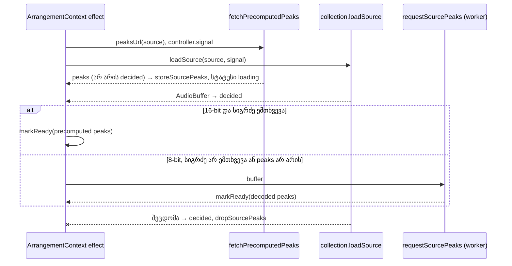

# PERF-15a: წინასწარ გამოთვლილი peaks (audiowaveform) და worker fallback

**თარიღი:** 2026-11-08
**სტატუსი:** Completed (C round 413 PASS)
**შეცვლილი პროექტი:** Store (`app/lib/arrangement/precomputed-peaks.ts`, `app/contexts/ArrangementContext.tsx`, `app/types/arrangement.ts`, ორი ახალი ტესტის ფაილი, ეს doc)

## კონტექსტი

perf-plan-ის PERF-15 გვპირდება, რომ waveform decode-მდე გამოჩნდება: backend წინასწარ ითვლის peaks-ს (BBC audiowaveform), ხოლო ბრაუზერის worker რჩება fallback-ად. HEAD-ზე (`9616d3a`) peaks მხოლოდ `loadSource`-ის დასრულების შემდეგ ითვლებოდა: collection-ის ჩატვირთვაში ერთი ჯაჭვია `loadSource` → `requestSourcePeaks` → `storeSourcePeaks` + `ready`.

.NET backend-ი cloud-ში არ არის, ამიტომ ეს ეტაპი მხოლოდ client-ის მხარეს აშენებს. Backend-ის მხარე აღწერილია handoff note-ში (repo-ს გარეთ).

**შეზღუდვა:** ამ ფუნქციაში „decode-მდე“ მოგება მხოლოდ library preview-შია. Library preview `sourcePeaks`-ს ნებისმიერ load state-ში ხატავს (loading-ის დროს დაბნელებულად, `opacity-40`). Lane-ის clip-ებს `ready` სჭირდება: `sourceDurations` მხოლოდ ready source-ებს შეიცავს, და source-ის დამატება ready-მდე შეუძლებელია.

ეტაპი 1 (15a) ქცევის მიხედვით ნეიტრალურია `/studio-lab`-ისთვის: არც ერთ collection-ს `peaksUrl` ჯერ არ აქვს, ამიტომ Studio ზუსტად ისე იქცევა, როგორც HEAD-ზე. ახალ გზას jsdom-ის row-ები ამტკიცებს.

## მიდგომა

B-ის reviewed sketch byte-for-byte გამოვიყენეთ (D-29z1423–D-29z1426). Patch-ი loop-ის evidence-ა, repo-ს გარეთ: `tmp/studio-real-loop/b-round-409/sketch-410.patch.txt` (sha256 `8f22c005447dc388…`).

- **ახალი მოდული `precomputed-peaks.ts`.** სუფთაა, გარდა `fetch`-ისა, რომელიც `SourceFetch`-ით გადის.
  - `parseAudiowaveformPeaks` კითხულობს audiowaveform JSON v1-ს (mono, `channels` არ არის ან 1) და v2-ს (`channels` ≥ 1). ველები: `sample_rate`, `samples_per_pixel`, `bits` (8 ან 16), `length`, `data`. `data` არის min/max წყვილები თითო pixel-ზე თითო channel-ზე, სიგრძით `length × channels × 2`. ყოველი მნიშვნელობა მთელი რიცხვია `bits`-ის დიაპაზონში.
  - თითო pixel-ის მნიშვნელობა: channel-ებზე `max(|min|, |max|)`-ის მაქსიმუმი, გაყოფილი 128-ზე (8-bit) ან 32768-ზე (16-bit), 1-ზე შეზღუდული.
  - pixel-ები გადაითვლება `PEAK_BUCKETS_PER_SECOND`-ზე (100/წმ) max-pooling-ით: bucket-ი იღებს ყველა pixel-ის მაქსიმუმს, რომელიც მის sample-ების მონაკვეთს ფარავს. bucket-ების რაოდენობა `peakBucketCount`-ით ითვლება, ისევე როგორც `computePeaks`-ში.
  - 100/წმ-ზე უხეში ფაილი (`samples_per_pixel > sample_rate / 100`) უარყოფილია (`null`): pooling მხოლოდ ქვემოთ მიდის. ნებისმიერი არასწორი ველიც `null`-ს იძლევა.
  - `precomputedPeaksMatchDecodedLength` bucket-ებს ადარებს (ხანგრძლივობას, არა sample-ების რაოდენობას): სხვაობა ≤ `PRECOMPUTED_PEAKS_BUCKET_TOLERANCE` (1). მოსალოდნელი რაოდენობა 0 — false.
  - `fetchPrecomputedPeaks` არასდროს აგდებს შეცდომას და `null`-ს აბრუნებს: არა-ok status-ზე, `content-length`-ზე 4 MiB-ზე მეტი (`PRECOMPUTED_PEAKS_MAX_BYTES`; header-ის არქონა გადის, არარიცხვითი header-ი უარყოფილია), ცუდ JSON-ზე ან data-ზე, fetch-ის reject-ზე და body-ს კითხვისას abort-ზე. caller-ის `signal` fetch-ს გადაეცემა.
- **`WorkspaceCollection.peaksUrl?`** არასავალდებულოა. `undefined` ან `null` ნიშნავს HEAD-ის გზას, fetch-ის გარეშე.
- **Collection-ის ჩატვირთვა (`ArrangementContext.tsx`).**
  - url-იანი თითო source-ისთვის `fetchPrecomputedPeaks` იწყება effect-ის `controller.signal`-ით, `loadSource`-ის პარალელურად.
  - **ადრეული შენახვა:** თუ შედეგი non-null-ია, signal არ არის aborted და ამ source-ის peaks ჯერ არ არის „გადაწყვეტილი“, peaks ინახება effect-ის run-ში და `storeSourcePeaks`-ით. სტატუსი რჩება `loading`.
  - **decode-ის დროს:** source „გადაწყვეტილად“ ინიშნება. თუ შენახული peaks **16-bit**-ია და decode-ის სიგრძეს ემთხვევა, ready step-ი მათ worker-ის job-ის გარეშე იყენებს. სხვა შემთხვევაში `requestSourcePeaks` მუშაობს, როგორც HEAD-ზე, და მისი შედეგი ადრეულ peaks-ს ცვლის (decode-ის შედეგი ყოველთვის იგებს). **8-bit peaks მხოლოდ placeholder-ია** (`performance-optimizer`-ის consult: ჩუმი stem-ების ნორმალიზაციისას 8-bit-ის საფეხურები ჩანს).
  - **გვიან მოსული peaks** decode-ის შემდეგ არაფერს ცვლის.
  - **decode-ის შეცდომა:** source „გადაწყვეტილად“ ინიშნება, ხოლო შენახული ადრეული peaks ახალი `dropSourcePeaks`-ით იშლება (no-op, თუ id არ არის), ამიტომ error source-ს waveform არ აქვს. error სტატუსი და ტექსტი უცვლელია.
  - **Abort** (unmount ან collection-ის შეცვლა) არსებული controller-ის abort-ია და fetch-საც აუქმებს.
  - **Collection-ის შეცვლისას გასუფთავება (TL-R410-SK-2):** effect-ის cleanup `dropSourcePeaks`-ით შლის ყველა იმ source-ის ადრეულ peaks-ს, რომელიც ამ run-ში ready არ გახდა. ready source-ი peaks-ს ინარჩუნებს, ისევე როგორც HEAD-ზე decode-ის peaks. HEAD-ზე peaks საერთოდ არ იშლებოდა; ready source-ების აღრიცხვა (`peaksReady`) ახალია და მხოლოდ იმისთვის არსებობს, რომ cleanup-მა ისინი არ წაშალოს.
- **უცვლელი:** ready patch-ი და მისი რიგი (decodedBuffers-ის set და evict, შემდეგ peaks, შემდეგ `ready`, შემდეგ `settle`, შემდეგ `resyncAfterDecode`), video-ს peaks, re-decode-ის გზა (PERF-13), სტატუსის ტექსტები, demo და purchased collection-ები. ახალი status ჩანაწერი, focus-ის ცვლილება ან ხილული ცვლილება არ არის.
- **4 MiB cap** defence in depth-ია და არა გარანტია (TL-R410-SK-1): header-ის გარეშე პასუხი გადის, ხოლო gzip-ისას header შეკუმშულ ზომას აჩვენებს.
- **ალტერნატივა:** parse-ი worker-ში. ამ ეტაპზე main thread-ზე დარჩა (consult-ის რჩევა): ფაილი პატარაა და parse-ი ერთჯერადია.

## არქიტექტურა



## შეცვლილი ფაილები

- `app/lib/arrangement/precomputed-peaks.ts` (ახალი) — audiowaveform-ის parser-ი, სიგრძის შედარება და fetch-ი ზომის cap-ით.
- `app/lib/arrangement/__tests__/precomputed-peaks.test.ts` (ახალი) — PP1–PP7.
- `app/lib/arrangement/__tests__/precomputed-peaks-context.test.tsx` (ახალი) — PPC1–PPC11.
- `app/contexts/ArrangementContext.tsx` — `dropSourcePeaks` და collection-ის ჩატვირთვის effect-ის wiring.
- `app/types/arrangement.ts` — `WorkspaceCollection.peaksUrl?`.
- `docs/implementation/2026/quarter-IV/263-perf-precomputed-peaks.md` — ეს doc.

## პრობლემები და გადაწყვეტები

- **პრობლემა:** sketch v1-ში ადრეული peaks collection-ის შეცვლის შემდეგაც რჩებოდა (TL-R410-SK-2).
  **გადაწყვეტა:** effect-ის cleanup შლის ready-მდე ვერმისული source-ების ადრეულ peaks-ს (PPC10). ready source-ი მათ ინარჩუნებს (PPC11).
- **პრობლემა:** decode-ის შეცდომა peaks-ის მოსვლამდე — გვიან მოსული peaks error source-ზე waveform-ს დახატავდა.
  **გადაწყვეტა:** შეცდომის გზაც source-ს „გადაწყვეტილად“ ნიშნავს (PPC9).
- **პრობლემა:** 8-bit peaks ჩუმ stem-ზე ნორმალიზაციისას საფეხურებად ჩანს.
  **გადაწყვეტა:** worker-ის გამოტოვება მხოლოდ 16-bit-ზეა; 8-bit მხოლოდ placeholder-ია (PPC2).
- **პრობლემა:** `peaksUrl`-ის გამოძახება დაუცველია, ისევე როგორც HEAD-ზე `previewUrl` (TL-R410-SK-3).
  **გადაწყვეტა:** deferred Low; `previewUrl`-თან ერთად გასწორდება.
- **ეკვივალენტური mutant:** effect-ის `controller.signal.aborted` შემოწმების მოხსნა ადრეულ შენახვაში მწვანე რჩება, რადგან `fetchPrecomputedPeaks` abort-ის შემდეგ უკვე `null`-ს აბრუნებს (PP7d). შემოწმება დაცვად დარჩა (loop-ის evidence, repo-ს გარეთ: `tmp/studio-real-loop/b-round-409/mutants/equivalent.txt`).

## ტესტირება

**Unit row-ები (`precomputed-peaks.test.ts`):**
- **PP1:** v2 16-bit stereo, ერთი pixel ერთ bucket-ზე: channel-ებზე `|min|`-ისა და `|max|`-ის მაქსიმუმი, გაყოფილი 32768-ზე.
- **PP2:** v1 8-bit mono `channels` ველის გარეშე: მნიშვნელობები 128-ზე; -128 სრული მასშტაბია.
- **PP3:** უფრო წვრილი pixel-ები max-ით იკრიბება bucket-ში; bucket-ების რაოდენობა `peakBucketCount`-ს მიჰყვება.
- **PP4:** არამთელ pixel/bucket შეფარდებაზე შედეგი `computePeaks`-ს ემთხვევა 1/32768-ის ფარგლებში, ერთი მეზობელი bucket-ის ჩათვლით.
- **PP5:** ყოველი არასწორი ან მხარდაუჭერელი ფაილი `null`-ს იძლევა.
- **PP6:** `precomputedPeaksMatchDecodedLength` ერთი bucket-ის სხვაობას იღებს decode-ის ნებისმიერ sample rate-ზე.
- **PP7a:** ok პასუხი parse-დება და abort signal fetch-ს გადაეცემა.
- **PP7b:** არა-ok status, ცუდი JSON, არასწორი data ან fetch-ის reject — `null`.
- **PP7c:** cap-ზე დიდი გამოცხადებული ზომა parse-მდე უარყოფილია; ზუსტად cap და header-ის არქონა გადის.
- **PP7d:** body-ს კითხვისას abort — `null`.

**Context row-ები (`precomputed-peaks-context.test.tsx`):**
- **PPC1:** 16-bit peaks loading-ის დროს ჩანს და ready-ზე recompute-ის გარეშე რჩება.
- **PPC2:** 8-bit peaks placeholder-ია: loading-ში ჩანს, ready-ზე decode-ის peaks ცვლის.
- **PPC3:** decode-ის სიგრძიდან ორი bucket-ით დაშორებული 16-bit peaks decode-ის peaks-ით იცვლება.
- **PPC4:** decode-ის შემდეგ მოსული peaks decode-ის peaks-ს არასდროს ცვლის.
- **PPC5:** decode-ის შეცდომა წინასწარ peaks-ს შლის; error source-ს waveform არ აქვს.
- **PPC6:** `peaksUrl`-ის გარეშე ან null url-ზე არაფერი fetch-დება და decode-ის peaks გამოიყენება.
- **PPC7:** 404 peaks ფაილი ადრე არაფერს აჩვენებს; decode-ის peaks ready-ზე მოდის.
- **PPC8:** unmount peaks-ის fetch-ს აუქმებს; გვიანი პასუხი შეცდომის გარეშე იკარგება.
- **PPC9:** peaks-ის მოსვლამდე ჩავარდნილი decode error source-ს waveform-ის გარეშე ტოვებს.
- **PPC10:** loading-ის დროს collection-ის შეცვლა ready-მდე ვერმისული source-ების ადრეულ peaks-ს შლის.
- **PPC11:** წინასწარ peaks-ზე ready გამხდარი source-ი მათ collection-ის შეცვლის შემდეგაც ინარჩუნებს, ისევე როგორც decode-ის peaks-ს.

**Mutant-ები** (loop-ის evidence, repo-ს გარეთ: `tmp/studio-real-loop/b-round-409/mutants/summary.txt`). `summary.txt` სიტყვასიტყვით:

```text
PRISTINE-BEFORE rc 0 failed []
MU-410-NO-SKIP RED rc 1 expected PPC1 failed ['PPC1']
MU-410-SKIP-8BIT RED rc 1 expected PPC2 failed ['PPC2']
MU-410-NO-LENGTH-CHECK RED rc 1 expected PPC3 failed ['PPC3']
MU-410-LATE-OVERWRITE RED rc 1 expected PPC4 failed ['PPC4', 'PPC9']
MU-410-ERROR-KEEPS-PEAKS RED rc 1 expected PPC5 failed ['PPC5']
MU-410-NO-EARLY-STORE RED rc 1 expected PPC1 failed ['PPC1', 'PPC2', 'PPC3', 'PPC5', 'PPC10']
MU-410-FIRST-CHANNEL-ONLY RED rc 1 expected PP1 failed ['PP1']
MU-410-MAX-ONLY RED rc 1 expected PP2 failed ['PPC1', 'PPC2', 'PPC10', 'PP1', 'PP2', 'PP3', 'PP4', 'PP7a']
MU-410-COARSE-ACCEPTED RED rc 1 expected PP5 failed ['PP5']
MU-410-POOL-FIRST-PIXEL RED rc 1 expected PP3 failed ['PP3', 'PP4']
MU-410-NO-SIZE-CAP RED rc 1 expected PP7c failed ['PP7c']
MU-410-NO-SIGNAL RED rc 1 expected PP7a failed ['PPC8', 'PP7a']
MU-410-TOLERANCE-ANY RED rc 1 expected PP6 failed ['PPC3', 'PP6']
MU-410-ERROR-NOT-DECIDED RED rc 1 expected PPC9 failed ['PPC9']
MU-410-SWAP-KEEPS-EARLY RED rc 1 expected PPC10 failed ['PPC10']
MU-410-READY-NOT-MARKED RED rc 1 expected PPC11 failed ['PPC11']
MU-410-ABORT-IGNORED RED rc 1 expected PP7d failed ['PP7d']
PRISTINE-AFTER rc 0 failed []
SCRATCH-STATUS 0 lines
```

17 mutant-იდან 17 RED-ია; pristine run-ები mutant-ებამდე და მათ შემდეგ rc 0.

**Browser probe-ები** (loop-ის evidence, repo-ს გარეთ: `tmp/studio-real-loop/b-round-409/probe/` და `tmp/studio-real-loop/b-round-409/lane/`): HEAD-ზე და sketch-ზე ორივე viewport-ზე 9-ვე demo source-ს preview-ში 96 სვეტი აქვს, `peaks` request 0, page error 0. Lane probe-ის 8 ნაბიჯი `ok`-ია. ეს ამტკიცებს მხოლოდ, რომ demo არ შეცვლილა; „waveform ready-მდე“ browser-ში 15b ამტკიცებს.

საბოლოო PASS-ის წყაროა `c-round-410.json` (C round 410).

## TODO / შემდეგი ნაბიჯები

- **PERF-15b:** demo-ს URL-იან source-ებს `peaksUrl`; „waveform ready-მდე“ რეალურ browser-ში `page.route` stub-ებით; purchased adapter-ის input; `product-designer`-ის consult დაბნელებულ loading waveform-ზე. PERF-15 მხოლოდ ამის შემდეგ სრულდება.
- **Backend handoff:** `/home/runner/czaba-project/docs/technical/studio-real-workspace/perf-15-backend-peaks-handoff.md` (repo-ს გარეთ): `-b 16`, `--split-channels`, `spp = sample_rate/100`, იგივე decode-ილი asset, დაცული `peaksUrl` შეძენილი ფაილებისთვის, MP3-ის trimming offset (SK-5) და versioned URL-ები (SK-6).
- **TL-R410-SK-3 (deferred Low):** `peaksUrl`-ის და `previewUrl`-ის გამოძახების დაცვა ერთად.
