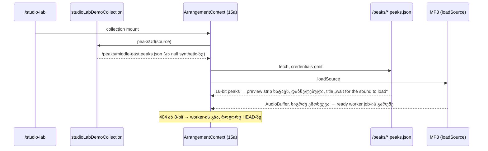

# PERF-15b-i: demo-ს წინასწარ გამოთვლილი peaks და preview strip-ის tooltip

**თარიღი:** 2026-11-08
**სტატუსი:** Completed (C round 413 PASS)
**შეცვლილი პროექტი:** Store (`app/data/studio-lab-demo.ts`, `app/lib/arrangement/precomputed-peaks.ts`, `app/components/arrangement/ArrangementLibraryPreview.tsx`, ორი ახალი peaks ფაილი `public/peaks/`-ში, generator script `scripts/peaks/`-ში, სამი ტესტის ფაილი, ეს doc და doc 263-ის სტატუსის ხაზი)

## კონტექსტი

PERF-15 გვპირდება, რომ waveform decode-მდე გამოჩნდება. ეტაპმა 1-მა (15a, doc 263) client-ის გზა ააშენა: `WorkspaceCollection.peaksUrl` და `fetchPrecomputedPeaks`. თუმცა არც ერთ collection-ს `peaksUrl` არ ჰქონდა, ამიტომ `/studio-lab`-ის მომხმარებელი ახალს ვერაფერს ხედავდა.

ეს ეტაპი (15b-i) დაპირებას რეალურ `/studio-lab`-ში ასრულებს: „როცა demo-ს მუსიკის preview ჯერ კიდევ იტვირთება, მისი ნამდვილი waveform უკვე ჩანს (დაბნელებული, seek არ ხდება), ხოლო მზადყოფნის შემდეგ Studio მას თავიდან აღარ ითვლის“.

PERF-15 სამ ეტაპად დაიყო (D-29z1428): 15a (client-ის გზა), 15b-i (demo, ეს doc), 15b-ii (purchased adapter-ის `peaksUrl`, signed URL-ები, streamed bytes-ის cap და Firefox-ის probe). ამიტომ doc 263-ის სტატუსი ახლა „stage 1 of 3“-ია.

## მიდგომა

B-ის reviewed sketch byte-for-byte გამოვიყენეთ (D-29z1427, D-29z1430, D-29z1433). Patch-ები loop-ის evidence-ა, repo-ს გარეთ: `tmp/studio-real-loop/b-round-410/sketch-411.patch.txt` (v5, sha256 `e9b149c4be701ad1…`) და მის ზემოთ `tmp/studio-real-loop/b-round-411/sketch-412-delta.patch.txt` (v6.1, sha256 `833196f8ccf086ab…`, generator და PS17).

- **ორი ახალი peaks ფაილი:** `public/peaks/middle-east.peaks.json` და `public/peaks/hero-music.peaks.json`.
  - ფორმატი: audiowaveform JSON v1, mono (min/max ორივე channel-ზე), 16-bit, `sample_rate` 44100, `samples_per_pixel` 441.
  - წყარო: Chromium-ის `decodeAudioData` `/middle-east.mp3`-ზე (4,054,080 byte) და `/videos/hero/hero-music.mp3`-ზე (3,610,677 byte). Decode-ის სიგრძეა 4,469,623 და 6,631,424 sample, ფაილებში 10,136 და 15,038 pixel-ია.
  - ზომა 121,855 და 188,440 byte-ია, 4 MiB cap-ზე გაცილებით ნაკლები.
  - **Clipping (შეგნებული):** full scale-ს ზემოთ decode-ილი MP3 sample-ები int16-მდე იჭრება, როგორც audiowaveform-ში. Preview-ში HEAD-ის worker peaks-სა და ჩაშენებულ peaks-ს შორის სვეტის სიმაღლის უდიდესი სხვაობა სრული სიმაღლის 0.0133-ია და ვიზუალურად არ ჩანს.
- **Generator:** `scripts/peaks/generate-demo-peaks.mjs` და მისი output `scripts/peaks/demo-peaks-meta.json`.
  - გაშვება: გაშვებულ dev server-თან `node scripts/peaks/generate-demo-peaks.mjs [baseUrl]` (default `http://127.0.0.1:5173`). Script-ი Playwright Chromium-ში ორივე MP3-ს decode-ს უკეთებს და გადაწერს ორივე peaks ფაილსა და meta ფაილს.
  - ყველა path script-ის საკუთარი მდებარეობიდან ითვლება, ამიტომ ნებისმიერი working directory-დან მუშაობს.
  - **ფიქსირებული rate:** `AudioContext` იხსნება `sampleRate: 44100`-ით, და თუ context-ის rate სხვაა, script-ი წყდება. ამიტომ decode-ის სიგრძე host-ის audio device-ის rate-ზე აღარ არის დამოკიდებული.
  - **შეცდომები:** არა-ok audio პასუხზე script-ი წყდება, browser-ი `finally`-ში იხურება, ხოლო peaks ფაილები და meta იწერება მხოლოდ ორივე decode-ის წარმატების შემდეგ (decode-ის შეცდომისას ნახევრად გადაწერილი set არ რჩება).
  - **`rate / 100`:** browser-ის მხარის კოდი TS-ს ვერ import-ავს, ამიტომ `PEAK_BUCKETS_PER_SECOND`-ს (100) იმეორებს. PS17 header-ის `samples_per_pixel`-ს `sampleRate / PEAK_BUCKETS_PER_SECOND`-თან ადარებს, ასე რომ სხვაობა ტესტს აწითლებს.
  - meta ფაილი ინახავს MP3-ის byte-ებს, decode-ის სიგრძეს, sample rate-ს და user agent-ს. PS17 ტესტი სწორედ meta-დან კითხულობს byte-ებს, სიგრძესა და rate-ს, ამიტომ ტესტი და meta ერთმანეთს ვერ დაშორდება.
  - Backend-ი ამ ყველაფერს რეალური audiowaveform-ის output-ით ჩაანაცვლებს (handoff note).
- **`studio-lab-demo.ts`:** `demoPeaksUrls` map (ორი demo MP3 id → `/peaks/<name>.peaks.json`) და `peaksUrl` `studioLabDemoCollection`-ზე. სხვა ყველა source `null`-ს აბრუნებს. `previewUrl`, `canReloadSource`, `loadSource`, label-ები, 9 source და notice უცვლელია.
- **`fetchPrecomputedPeaks` (A-R410-REV-S1/S2):**
  - request-ი `credentials: 'omit'`-ს გადასცემს, ისევე როგორც audio request-ი `source-fetch.ts`-ში. Signed URL-ებისთვის ეს სწორია. Injected `SourceFetch`-ის დამატებული bearer header მაინც მუშაობს tech-lead-ის ruling-ის D-29z1427 item 4-ის მიხედვით; ტესტი 15b-ii-ში ემატება.
  - არა-ok პასუხზე ან cap-ზე დიდ declared ზომაზე წაუკითხავი body უქმდება, სანამ `null` დაბრუნდება.
  - Parser, tolerance, cap და context-ის wiring უცვლელია.
- **Preview strip-ის tooltip:** strip (`data-testid="arrangement-library-preview-wave"`) იღებს `title`-ს იმავე მიზეზის ტექსტით, რომელსაც Preview ღილაკი აჩვენებს (`product-designer`, D-29z1429):
  - source არ არის არჩეული: „Preview — select a sound in the list first“;
  - იტვირთება: „Preview — wait for the sound to load“;
  - შეცდომა: „Preview — this sound could not load; choose another“;
  - მზადაა: `title` არ არის, როგორც HEAD-ზე.

  Strip-ზე სხვა არაფერი შეცვლილა: `opacity-40`, `cursor-not-allowed`, `aria-disabled`, `tabIndex` და სვეტები იგივეა. Strip-ს უკვე აქვს `aria-label`, ამიტომ title description ხდება და არა სახელი.
- **უარყოფილი ვარიანტები (`product-designer`):** shimmer ან pulse (placeholder-ად აღიქმება, თუმცა ფორმა ნამდვილია), peaks-ის დამალვა ready-მდე (სანდო ინფორმაციის გადაგდებაა), live-region-ის განცხადება ready-ზე (source row და status line უკვე აცხადებს), უფრო რბილი dim (token-ის მიზეზი არ არის).
- **უცვლელი:** `ArrangementContext.tsx` და მთელი 15a wiring, synthetic source-ები (peaks ფაილი არ აქვთ, worker-ის გზით რჩებიან), lane-ები (`ready` სჭირდებათ), სტატუსის ტექსტები, focus და პოზიციები. მუდმივი ახალი ტექსტი ეკრანზე არ ემატება: tooltip ყველაზე წყნარი ადგილია.

### Reference: Ableton Live 12

Live 12 manual, თავი 5.1.2 „Analysis Files (.asd)“ (https://www.ableton.com/en/live-manual/12/managing-files-and-sets/, შემოწმდა 2026-11-08):

| პუნქტი | Live (manual-ით დადასტურებული) | CZABA ამ ეტაპის შემდეგ |
|---|---|---|
| შენახული waveform data | „The analyzed data is also used to quickly draw the audio's waveform in the Sample Editor.“ `.asd` ფაილი sample-ის გვერდით ინახება | peaks ფაილი source-ის გვერდით (backend ან `public/peaks`) და waveform-ს decode-მდე ხატავს |
| სანამ მზად არ არის | „the audio waveform is grayed out until it is fully drawn, and the sample cannot be played back.“ | 40 %-ით დაბნელებული, not-allowed cursor, seek და focus არ ხდება |
| Browser preview-ის timing | დაუდასტურებელია: თავი 5.1.1 (Decoding Cache) decode-ის დროს indicator-ს არ აღწერს | reference არ მოიძებნა |

**Live-ზე უკეთესი:** Live ჯერ დაუხატავ waveform-ს ნაცრისფრად აჩვენებს. CZABA სრულ შენახულ waveform-ს დაბნელებულად აჩვენებს, რადგან data უკვე სრულია. „ჯერ ვერ დაუკრავ“ მნიშვნელობა იგივეა.

**Deviation:** tooltip-ის ტექსტი CZABA-ს საკუთარი მიზეზის string-ია, Preview ღილაკთან საერთო. ეს უკვე მიღებული English-only label-ების კლასია და არა ახალი შეგნებული განსხვავება.

## არქიტექტურა



## შეცვლილი ფაილები

- `app/data/studio-lab-demo.ts` — `demoPeaksUrls` და `peaksUrl` demo collection-ზე.
- `app/lib/arrangement/precomputed-peaks.ts` — `credentials: 'omit'` და უარყოფილი body-ს cancel.
- `app/components/arrangement/ArrangementLibraryPreview.tsx` — preview strip-ის `title`.
- `public/peaks/middle-east.peaks.json`, `public/peaks/hero-music.peaks.json` — ახალი, ჩაშენებული peaks.
- `scripts/peaks/generate-demo-peaks.mjs`, `scripts/peaks/demo-peaks-meta.json` — ახალი generator და მისი meta.
- `app/data/__tests__/studio-lab-demo.test.ts` — PS16, PS17.
- `app/lib/arrangement/__tests__/precomputed-peaks.test.ts` — PP8, PP9.
- `app/lib/arrangement/__tests__/library-preview.test.tsx` — LPA3b.
- `docs/implementation/2026/quarter-IV/263-perf-precomputed-peaks.md` — მხოლოდ სტატუსის ხაზი („stage 1 of 3“).
- ეს doc.

## პრობლემები და გადაწყვეტები

- **პრობლემა:** peaks ფაილსა და მის MP3-ს შორის კავშირი არაფერს ეჭირა (TL-R411-L2). **გადაწყვეტა:** meta ფაილი MP3-ის byte-ებსა და decode-ის სიგრძეს ინახავს, PS17 კი ორივეს meta-დან ადარებს (TL-R411-L8).
- **პრობლემა:** generator-ი repo-ში არ იყო, ამიტომ ფაილების ხელახლა მიღება შეუძლებელი იყო (TL-R411-M1). **გადაწყვეტა:** script-ი და მისი meta commit-დება. B-მ script-ი სხვა directory-დანაც გაუშვა და byte-ით იდენტური ფაილები მიიღო. ეს იდენტურობა დადასტურებულია **loop runner-ის HeadlessChrome 143 build-ზე**; სხვა CPU-ზე ან Chromium-ის სხვა ვერსიაზე მნიშვნელობები შეიძლება ერთი quantisation step-ით განსხვავდებოდეს, თუმცა სიგრძე და rate იგივე რჩება და PS17 მწვანეა.
- **პრობლემა:** script-ი relative path-ებს იყენებდა და header comment-ი პროექტის no-comments წესს არღვევდა (TL-R411-L6, L7). **გადაწყვეტა:** path-ები `import.meta.url`-დან ითვლება, comment-ები წაიშალა. გამოყენება ამ doc-შია.
- **პრობლემა:** უარყოფილი პასუხის body წაუკითხავი რჩებოდა, ხოლო peaks request-ს default credentials ჰქონდა (A-R410-REV-S1/S2). **გადაწყვეტა:** body-ს cancel და `credentials: 'omit'`, PP8/PP9-ით.
- **პრობლემა:** generator-ი `AudioContext`-ს rate-ის გარეშე ხსნიდა, PS17 კი სიგრძეს hardcoded 44100-ით ადარებდა და meta-ს `sampleRate`-ს არ კითხულობდა. 48 kHz host-ზე ხელახალი გენერაცია PS17-ს ცრუ წითელს მისცემდა (A-R411-REVIEW-M1). **გადაწყვეტა:** generator-ი context-ს ფიქსირებული 44.1 kHz-ით ხსნის და სხვა rate-ზე წყდება. PS17 rate-ს meta-დან კითხულობს, ამოწმებს რომ ის 44100-ია, და peaks ფაილის header-ს (`sample_rate`, `samples_per_pixel`) მას უკავშირებს; სიგრძის შედარება და 48 kHz-ის cross-check meta-ს rate-ით ითვლება.
- **პრობლემა:** generator-ი არა-ok audio პასუხს არ ამოწმებდა, browser-ს შეცდომისას არ ხურავდა და პირველი ფაილი მეორის decode-მდე იწერებოდა (A-R411-REVIEW-L3, TL L-c). **გადაწყვეტა:** `response.ok`-ის შემოწმება, browser-ის დახურვა `finally`-ში და ყველა ჩაწერა ორივე decode-ის შემდეგ.

## ტესტირება

ახალი row-ები:

- **PP8** (`precomputed-peaks.test.ts`) — peaks request-ი `credentials: 'omit'`-ს გადასცემს.
- **PP9** (`precomputed-peaks.test.ts`) — 404 ან cap-ზე დიდი პასუხის body უქმდება, ok body იკითხება და არ უქმდება.
- **PS16** (`studio-lab-demo.test.ts`) — `peaksUrl` peaks ფაილს მხოლოდ ორ demo MP3-ს უბრუნებს, დანარჩენს `null`.
- **PS17** (`studio-lab-demo.test.ts`) — თითო ჩაშენებული ფაილი 16-bit-ად parse-დება, cap-ში ეტევა და MP3-ს byte-ების ზომით ეკუთვნის. meta-ს `sampleRate` generator-ის pin-ს (44100) უდრის, ფაილის header-ის `sample_rate` meta-ს rate-ს უდრის, ხოლო `samples_per_pixel` — `sampleRate / PEAK_BUCKETS_PER_SECOND`-ს. Peaks meta-ში ჩაწერილ decode-ის სიგრძეს meta-ს rate-ზე ემთხვევა, და 48 kHz-ზე გადათვლილ სიგრძესაც.
- **LPA3b** (`library-preview.test.tsx`) — strip-ს Preview-ს იგივე მიზეზის title აქვს, სანამ მზად არ არის, ხოლო მზადყოფნისას title არ აქვს.

A-ს შემოწმებები (round 412): `npm run typecheck` rc 0, `npm run lint` rc 0, Biome `studio-lab-demo.test.ts`-ზე rc 0, covering set vitest-ით: 24 ფაილი, 425/425 (ყველაზე ნელი ტესტი 1,719 ms 15,000 ms timeout-დან, 11 %; detail panel-ის row 1,393 ms 5,000 ms default-დან, 28 %). სრული suite, build და verify root-ის gate-ს ეკუთვნის. `scripts/` Biome-ის `includes`-ში არ შედის, ამიტომ generator-ი lint-ით არ მოწმდება და წაკითხვით შემოწმდა. A ფაილებს ხელახლა არ აგენერირებს: commit-ში შემავალი peaks და meta ფაილები ის byte-ებია, რომლებიც B-ის reviewed sketch-მა მოიტანა, ხოლო v6.1-ით (44.1 kHz pin) ხელახალი გენერაცია ამ runner-ზე სამივე ფაილს byte-ით იდენტურს აძლევს (B-ის sketch-ის შემოწმება; C ამას scratch-ში იმეორებს).

B-ის mutant-ები sketch-ზე (`b-round-411/mutants/summary.txt`):

```
MU-411-NO-DEMO-PEAKS RED rc 1 expected PS16 failed ['PS16']
MU-411-SWAPPED-PEAKS RED rc 1 expected PS16 failed ['PS16']
MU-411-CREDENTIALS-DEFAULT RED rc 1 expected PP8 failed ['PP8']
MU-411-NO-CANCEL RED rc 1 expected PP9 failed ['PP9']
MU-411-FIXTURE-8BIT RED rc 1 expected PS17 failed ['PS17']
MU-411-FIXTURE-WRONG-SPP RED rc 1 expected PS17 failed ['PS17']
MU-411-MP3-SIZE-UNTIED RED rc 1 expected PS17 failed ['PS17']
MU-411-META-LENGTH-DRIFT RED rc 1 expected PS17 failed ['PS17']
MU-411-NO-STRIP-TITLE RED rc 1 expected LPA3b failed ['LPA3b']
MU-411-STRIP-TITLE-WHEN-READY RED rc 1 expected LPA3b failed ['LPA3b']
MU-412-META-RATE-48K RED rc 1 expected PS17 failed ['PS17']
MU-412-HEADER-RATE-48K RED rc 1 expected PS17 failed ['PS17']
MU-412-REGEN-48K RED rc 1 expected PS17 failed ['PS17']
```

ორი rate mutant (`MU-412-META-RATE-48K`, `MU-412-HEADER-RATE-48K`) round 411-ის (v5) PS17-ზე ცოცხალი რჩებოდა, ანუ ახალი შემოწმებები დაფარვას ამატებს. `MU-412-REGEN-48K` ნამდვილი 48 kHz-ის გენერაციაა (pin 48000-ზე).

ბრაუზერში (B-ის sketch, Chromium, 1440×900 და 1280×720): MP3-ის დაყოვნებისას preview-ში 96 სვეტი ჩანს `aria-disabled` true-თი, opacity 0.4-ით, not-allowed cursor-ით, `tabindex` -1-ით და title-ით „Preview — wait for the sound to load“. Ready-ს შემდეგ ორივე MP3-ზე 0 worker job-ია და ზუსტად 2 peaks request. 404-ისა და 8-bit-ის შემთხვევაში worker-ის გზა მუშაობს. C-ის browser row-ები იგივეს working tree-ზე ფარავს; ამ round-ის runtime ქცევა წინა round-ისას ემთხვევა, რადგან runtime ფაილი არ შეცვლილა.

## TODO / შემდეგი ნაბიჯები

- **15b-ii:** purchased adapter-ის `peaksUrl` (არასავალდებულო `AudioStem` ველი და signed URL-ები, expiring URL-ით cache-ის გარეშე).
- **TL-R411-L4:** cap ახლა მხოლოდ `content-length`-ის არსებობისას მუშაობს; 15b-ii ამატებს streamed bytes-ის cap-ს.
- **TL-R411-L3:** ყველა მტკიცებულება HeadlessChrome-ისაა. Firefox-ში ან Safari-ში decode-ის სიგრძე შეიძლება 1 bucket-ზე მეტით განსხვავდებოდეს და მაშინ worker-ის გზა იმუშავებს (უსაფრთხოა); 15b-ii ამატებს ერთ non-Chromium probe-ს.
- PERF-15-ის დახურვა 15b-ii-ში, doc 263-ისა და ამ doc-ის სტატუსის ხაზებით.
