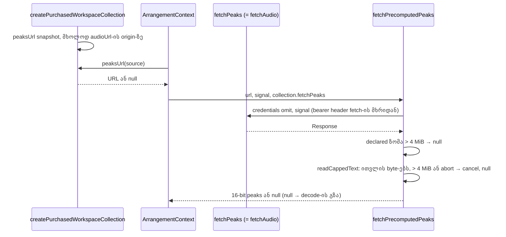

# PERF-15b-ii-a: ნაყიდი სტემების peaks URL, streamed bytes-ის cap და abort-ის მოსმენა

**თარიღი:** 2026-11-08
**სტატუსი:** Completed (C round 413 PASS)
**შეცვლილი პროექტი:** Store (`app/lib/arrangement/precomputed-peaks.ts`, `app/lib/arrangement/collection.ts`, `app/types/arrangement.ts`, `app/types/audio.ts`, `app/contexts/ArrangementContext.tsx`-ის ერთი გამოძახება, ოთხი ტესტის ფაილი, ეს doc და doc 263/264-ის სტატუსის ხაზები)

## კონტექსტი

PERF-15 გვპირდება, რომ waveform decode-მდე გამოჩნდება. ეტაპმა 1-მა (doc 263) client-ის გზა ააშენა, ეტაპმა 2-მა (doc 264) ის demo-ზე ჩართო. ეს მესამე და ბოლო ეტაპია (15b-ii-a): ნაყიდი სტემების adapter-ი (`createPurchasedWorkspaceCollection`) peaks-ის URL-ს იღებს და peaks-ის მოთხოვნა იმავე fetch-ით მიდის, რომლითაც აუდიო.

ამავე ეტაპზე დაიხურა ორი სისუსტე, რომლებიც ნაყიდ (ვადიან, ავტორიზებულ) URL-ებზე უფრო მნიშვნელოვანი ხდება:

- **ზომის cap მხოლოდ header-ს ენდობოდა** (TL-R411-L4 = GATE410-L2). ზომის ერთადერთი შემოწმება `content-length` იყო, body კი `response.json()`-ით მთლიანად იკითხებოდა. Header-ის არქონა 0-ად ითვლებოდა და გადიოდა, gzip-ის header კი შეკუმშულ ზომას აჩვენებს, ამიტომ წაკითხვა შეუზღუდავი იყო.
- **Abort შეჩერებულ body-ს ვერ ამთავრებდა**, თუ injected fetch `init.signal`-ს უგულებელყოფდა.

ნაყიდი route-ი ამ adapter-ს ჯერ არ იყენებს (SRW-21 `deferred_user`, დაცული ფაილები). ამიტომ ნაყიდი გზა unit ტესტებით დამტკიცდა, demo-ს გზა კი ბრაუზერში (C round 413).

## მიდგომა

B-ის reviewed sketch byte-for-byte გამოვიყენეთ (D-29z1434): `tmp/studio-real-loop/b-round-412/sketch-413.patch.txt` (v4, sha256 `a7913dece594db71…`). Patch loop-ის evidence-ა, repo-ს გარეთ.

- **Streamed cap (`readCappedText`):**
  - body იკითხება `body.getReader()`-ით და stream-ის byte-ები ითვლება (HTTP decompression-ის შემდეგ, `TextDecoder`-მდე);
  - `PRECOMPUTED_PEAKS_MAX_BYTES`-ს (4 MiB) გადაცილებისას (მკაცრი `>`) reader უქმდება და `null` ბრუნდება; ზუსტად cap-ის ზომის body parse-დება;
  - declared `content-length`-ის უარი უცვლელია, ანუ cap ორივე მხრიდან მუშაობს: header-ით, თუ ის არის, და დათვლილი byte-ებით ყოველთვის;
  - პატარა declared ზომა უფრო გრძელ body-ს ვეღარ გაატარებს.
- **Abort:**
  - უკვე aborted signal-ზე reader მაშინვე უქმდება და `null` ბრუნდება;
  - abort-ის listener (`{ once: true }`, `finally`-ში იშლება) შეჩერებულ read-ს აუქმებს, ასე რომ stalled body მაინც სრულდება, მაშინაც კი, როცა injected fetch signal-ს არ იყენებს;
  - caller-ი `JSON.parse`-მდე ისევ ამოწმებს `text === null || signal.aborted`-ს, რათა ბოლო chunk-ის შემდეგ მოსული abort-იც `null`-ს იძლეოდეს.
- **უცვლელი:** `credentials: 'omit'`, never-throw კონტრაქტი (ნებისმიერი შეცდომა `null`-ია), parser, tolerance და context-ის ლოგიკა.
- **`WorkspaceCollection.fetchPeaks`:** ახალი არასავალდებულო ველი, inline function type-ით (`(url, init) => Promise<Response>`), რათა types ფაილმა lib-ს import არ გაუკეთოს. `ArrangementContext`-ის ერთადერთი `fetchPrecomputedPeaks` გამოძახება მას მესამე არგუმენტად გადასცემს. Demo collection-ს `fetchPeaks` არ აქვს, ამიტომ ის ძველებურად `plainSourceFetch`-ს იყენებს.
- **`AudioStem.peaksUrl`:** ახალი არასავალდებულო ველი (additive; ყველა importer უცვლელად compile-დება).
- **ნაყიდი adapter:**
  - `peaksUrl` შექმნის მომენტის snapshot-ია, stem id-ით. შემდგომი ცვლილება input მასივში მას აღარ ეხება.
  - **იგივე origin:** stem-ის `peaksUrl` მიიღება მხოლოდ მაშინ, როცა მისი origin იმავე stem-ის `audioUrl`-ის origin-ს ემთხვევა. ორივე URL `https://base.invalid`-ის მიმართ ითვლება, ამიტომ ორი relative URL ტოლად ითვლება. ცარიელი ან parse-ისთვის უვარგისი URL უგულებელყოფილია.
  - **Fail-closed (TL-R413-L-a):** სხვა origin-ის peaks უბრალოდ იგნორდება. მიზეზი: peaks-ის მოთხოვნა იმავე `fetchAudio`-ით მიდის, რომელსაც შეიძლება bearer header ჰქონდეს, და token სხვა ჰოსტზე არ უნდა წავიდეს. ეს მხოლოდ შესრულების დანაკარგია: **დაგდებული peaks URL ნიშნავს, რომ waveform ძველებურად decode-ის შემდეგ ითვლება** (TL-R413-L-c). Backend-ისთვის ეს წესი ჩაწერილია handoff doc-ში (პროექტის root-ის `docs/technical/studio-real-workspace/perf-15-backend-peaks-handoff.md`, store repo-ს გარეთ): `peaksUrl` აუდიოს origin-ზე უნდა იყოს.
  - **`fetchPeaks: fetchAudio`:** peaks-ის მოთხოვნა იმავე injected fetch-ით მიდის, რაც აუდიო, ასე რომ bearer header შენარჩუნებულია, `credentials: 'omit'` კი რჩება. `fetchAudio`-ს გარეშე გამოიყენება გლობალური `fetch` გამოძახების მომენტში.
  - **Cache ვადიანი URL-ით არ იქმნება:** peaks მეხსიერებაში source id-ით ინახება; storage-ში არაფერი იწერება.
- **უარყოფილი ვარიანტები:** sha256 meta-ში (A-R411-REVIEW-L2) `deferred_low_polish`-შია — byte-იდენტურობა უკვე ხელახალი გენერაციით მტკიცდება, hash კი byte-ებს ერთ runner-ზე მიაბამდა. სხვა origin-ის allowlist ცალკე გადაწყვეტილებაა, თუ ის ოდესმე დასჭირდება.
- **Reference-first:** არ ეხება — შესრულების, მდგრადობისა და უსაფრთხოების ეტაპია ეკრანის ცვლილების გარეშე. ხილული ნაწილი (დაბნელებული waveform ჩატვირთვისას) doc 264-შია, Live 12 manual 5.1.2-თან შედარებით.

## არქიტექტურა



## შეცვლილი ფაილები

- `app/lib/arrangement/precomputed-peaks.ts` — `readCappedText`, streamed cap, abort listener, `JSON.parse` მხოლოდ შემოწმების შემდეგ.
- `app/lib/arrangement/collection.ts` — `peaksUrl` snapshot, იგივე origin-ის წესი და `fetchPeaks: fetchAudio` ნაყიდ adapter-ში.
- `app/types/arrangement.ts` — `WorkspaceCollection.fetchPeaks`.
- `app/types/audio.ts` — `AudioStem.peaksUrl`.
- `app/contexts/ArrangementContext.tsx` — ერთი გამოძახება `collection.fetchPeaks`-ით (Biome-მა `.then(` callback-ი ხელახლა შეფუთა).
- `app/lib/arrangement/__tests__/precomputed-peaks.test.ts` — PP7d გადაწერილი; PP7e, PP10, PP11, PP12, PP12b ახალი.
- `app/lib/arrangement/__tests__/precomputed-peaks-context.test.tsx` — PPC12.
- `app/lib/arrangement/__tests__/collection.test.ts` — PK1–PK4.
- `app/data/__tests__/studio-lab-demo.test.ts` — PS18.
- `docs/implementation/2026/quarter-IV/263-perf-precomputed-peaks.md`, `264-perf-precomputed-peaks-demo.md` — მხოლოდ სტატუსის ხაზი.
- ეს doc.

## პრობლემები და გადაწყვეტები

- **პრობლემა:** `content-length`-ის გარეშე ან gzip-ით body შეუზღუდავად იკითხებოდა (TL-R411-L4, GATE410-L2). **გადაწყვეტა:** stream-ის წაკითხვა byte-ების დათვლით და cancel cap-ის გადაცილებისას (PP10, PP11).
- **პრობლემა:** injected fetch, რომელიც signal-ს უგულებელყოფს, abort-ის შემდეგ body-ს უსასრულოდ ტოვებდა. **გადაწყვეტა:** abort-ის listener reader-ს აუქმებს; უკვე aborted signal-ზე reader მაშინვე უქმდება (PP12, PP12b, PP7d).
- **პრობლემა:** ძველი PP7d `response.json()`-ს ცვლიდა, რომელსაც ახალი კოდი აღარ იძახებს. **გადაწყვეტა:** PP7d გადაიწერა — abort ახლა stream-ის შუაში ხდება, და row ამოწმებს, რომ body-ს დარჩენილი ნაწილი უქმდება. Assertion არ დაკარგულა.
- **პრობლემა:** peaks-ის მოთხოვნა ვერ მიიღებდა bearer header-ს, რომელსაც ნაყიდი აუდიოს fetch ამატებს (A-R411-REVIEW-L5). **გადაწყვეტა:** `fetchPeaks: fetchAudio` და context-ის გამოძახება `collection.fetchPeaks`-ით (PK2, PPC12).
- **პრობლემა:** სხვა ჰოსტზე მიმავალი peaks URL ამ header-ს სხვა origin-ზე გაგზავნიდა. **გადაწყვეტა:** იგივე origin-ის fail-closed წესი (PK4).
- **პრობლემა:** meta-ს `file` ველი და collection-ის მიერ გაცემული peaks path ერთმანეთს არ ედარებოდა (TL-R411-L9). **გადაწყვეტა:** PS18.

## ტესტირება

ახალი და შეცვლილი row-ები:

- **PP7d** (`precomputed-peaks.test.ts`) — abort body-ს წაკითხვის დროს `null`-ს იძლევა და body-ს დარჩენილ ნაწილს აუქმებს.
- **PP7e** — ბოლო chunk-ის შემდეგ, read-ის დასრულებამდე მოსული abort მაინც `null`-ს იძლევა.
- **PP10** — `content-length`-ის გარეშე cap-ზე გრძელი stream უარყოფილი და გაუქმებულია; ბოლომდე არ იკითხება.
- **PP11** — პატარა declared ზომა გრძელ body-ს ვერ ატარებს; ზუსტად cap-ის ზომის body parse-დება.
- **PP12** — შეჩერებულ body-ზე abort `null`-ით სრულდება და body-ს აუქმებს, signal-ის უგულებელმყოფელი fetch-ის შემთხვევაშიც.
- **PP12b** — უკვე aborted signal მაშინვე `null`-ს იძლევა და body-ს აუქმებს.
- **PPC12** (`precomputed-peaks-context.test.tsx`) — collection-ის `fetchPeaks` იღებს peaks URL-ს `credentials: 'omit'`-ით, გლობალური fetch არ გამოიყენება და peaks ჩატვირთვისას ჩანს.
- **PK1** (`collection.test.ts`) — `peaksUrl` მხოლოდ არაცარიელ stem URL-ს აბრუნებს, სხვა შემთხვევაში `null`-ს; არაფერი fetch-დება და input-ის შემდგომი ცვლილება მას არ ეხება.
- **PK2** — peaks-ის მოთხოვნა ზუსტად ერთხელ მიდის injected `fetchAudio`-ით (იგივე URL, credentials `omit`), გლობალური fetch არ გამოიყენება. ეს ამტკიცებს, რომ `fetchPeaks` იგივე ფუნქციაა, რაც `fetchAudio`, ამიტომ მის მიერ დამატებული bearer header peaks-ის მოთხოვნასაც მიჰყვება; header-ს ტესტის stub-ი ამატებს და ცალკე არ მოწმდება.
- **PK3** — `fetchAudio`-ს გარეშე `fetchPeaks` გლობალურ fetch-ს გამოძახების მომენტში იყენებს.
- **PK4** — სხვა origin-ის, parse-ისთვის უვარგისი ან relative აუდიოს გვერდით ცარიელი peaks URL იგნორდება; relative აუდიოს გვერდით relative peaks URL რჩება.
- **PS18** (`studio-lab-demo.test.ts`) — generator-ის meta თითო demo MP3-ისთვის იმავე peaks ფაილს ასახელებს, რომელსაც collection გასცემს.

B-ის mutant-ები sketch-ზე (`b-round-412/mutants/summary.txt`):

```
MU-413-NO-STREAM-CAP RED rc 1 expected PP10 failed ['PP10', 'PP11']
MU-413-NO-STREAM-CAP-LYING RED rc 1 expected PP11 failed ['PP10', 'PP11']
MU-413-CAP-OFF-BY-ONE RED rc 1 expected PP11 failed ['PP11']
MU-413-NO-ABORT-LISTENER RED rc 1 expected PP12 failed ['PP7d', 'PP12']
MU-413-NO-ABORT-LISTENER-PP7D RED rc 1 expected PP7d failed ['PP7d', 'PP12']
MU-413-NO-PRE-ABORT RED rc 1 expected PP12b failed ['PP12b']
MU-413-NO-CALLER-ABORT-CHECK RED rc 1 expected PP7e failed ['PP7e']
MU-413-NO-CTX-FETCHPEAKS RED rc 1 expected PPC12 failed ['PPC12']
MU-413-NO-ADAPTER-FETCHPEAKS RED rc 1 expected PK2 failed ['PK2']
MU-413-ADAPTER-FETCH-STUB RED rc 1 expected PK3 failed ['PK2', 'PK3']
MU-413-NO-ADAPTER-PEAKSURL RED rc 1 expected PK1 failed ['PK1', 'PK4', 'PK2']
MU-413-EMPTY-PEAKSURL-KEPT RED rc 1 expected PK4 failed ['PK4']
MU-413-PEAKSURL-LIVE-READ RED rc 1 expected PK1 failed ['PK1', 'PK4']
MU-413-NO-ORIGIN-CHECK RED rc 1 expected PK4 failed ['PK4']
MU-413-META-FILE-SWAPPED RED rc 1 expected PS18 failed ['PS18']
```

A-ს შემოწმებები (round 413): `npm run typecheck` rc 0, `npm run lint` rc 0, Biome ცხრა code/test ფაილზე rc 0, covering set vitest-ით: 24 ფაილი, 436/436 (ყველაზე ნელი ტესტი 1,710 ms 15,000 ms timeout-დან, 11 %; detail panel-ის row 1,370 ms 5,000 ms default-დან, 27 %). Log-ები `tmp/studio-real-loop/a-round-413/`-შია. სრული suite, build და verify root-ის gate-ს ეკუთვნის.

ბრაუზერში C ამოწმებს, რომ demo-ს გზა უცვლელია (1440×900 და 1280×720): ჩატვირთვისას 96 სვეტი დაბნელებულად, ready-ს შემდეგ 96 სვეტი, ზუსტად 2 peaks request, 404-სა და 8-bit-ზე decode-ის გზა. ნაყიდი გზა ბრაუზერში ვერ მოწმდება, სანამ ნაყიდი route-ი adapter-ს არ იყენებს (SRW-21).

## TODO / შემდეგი ნაბიჯები

- **TLM-PERF15-FIREFOX** (`record`, Low): Firefox-ში decode-ის სიგრძის probe (TL-R411-L3). Runner-ზე Playwright Firefox არ არის (ROOT-REQ-PLAYWRIGHT-FIREFOX). შეუსაბამობისას decode-ის გზა მუშაობს, რაც უსაფრთხოა; PERF-15 ხელახლა მხოლოდ `crashed` შედეგზე გაიხსნება.
- **SRW-21:** ნაყიდი route-ის mount (დაცული ფაილები) — მაშინ ნაყიდი peaks-ის გზა ბრაუზერშიც შემოწმდება.
- **Backend:** API-ს პასუხში `peaksUrl` აუდიოს origin-ზე, იგივე ავტორიზაციითა და ვერსიით (handoff doc).
- `deferred_low_polish`: A-R411-REVIEW-L2 (sha256 meta-ში), TL-R413-L-b (PP12/PP12b-ის 1 წამიანი race timer-ები).
