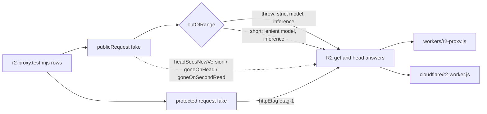

# SYS-R2-FAKE-FIDELITY: R2-ის fake worker-ის ტესტებში R2-ივით იქცევა

**თარიღი:** 2026-11-08
**სტატუსი:** Completed (C round 414 PASS)
**შეცვლილი პროექტი:** Store (მხოლოდ `workers/r2-proxy.test.mjs` და ეს doc; ორივე worker — `workers/r2-proxy.js` და `cloudflare/r2-worker.js` — უცვლელია)

## კონტექსტი

`workers/r2-proxy.test.mjs` ორივე worker-ს (proxy და alternate) ერთი და იმავე R2 fake-ით ამოწმებს. Fake R2-ზე უფრო "ლმობიერი" იყო, ამიტომ worker-ის ზოგიერთი branch-ის mutant-ი ტესტებს გადაურჩებოდა (D-29z886). ეს ერთი root cause-ი ოთხ ღია Low-ს ხსნის:

- **C-R311-01:** If-Range re-read-ის 304-ზე CORS header-ები არავინ ამოწმებდა; re-read-ის `else headers.delete('ETag')` branch-ს კი fake ვერ აღწევდა.
- **A-R311-REVIEW-L4:** PR14/PR15-ში `opened` body-ების რაოდენობა არ მოწმდებოდა, ამიტომ "body გაიხსნა და გაუქმდა" ვაკუუმური პირობა იყო.
- **GATE311-L1:** fake-ის `TypeError` (არა safe integer მნიშვნელობა) ორივე რეჟიმში ისროდა, ანუ `short` რეჟიმი შიგნიდან წინააღმდეგობრივი მოდელი იყო.
- **A-R309-REVIEW-TEST-GAPS:** დაცული route-ები If-None-Match-ით, padded Range, "head-ის შემდეგ get null", ვერსიის შეცვლა head-სა და get-ს შორის, cover-ის body და `Accept-Ranges`.

ეს test-only რაუნდია: worker-ის კოდი, დაცული ფაილები და `app/` არ შეცვლილა.

## მიდგომა

B-ის reviewed sketch byte-for-byte გამოვიყენეთ (D-29z1439): `tmp/studio-real-loop/b-round-413/sketch-414.patch.txt` (v2, sha256 `5279fce53efec300…`). Patch loop-ის evidence-ა, repo-ს გარეთ. `tech-lead`-მა v1 უარყო ერთი Medium-ით (დაცული `request` fake-ის ობიექტებს `httpEtag` არ ჰქონდა); v2 ამას ასწორებს.

### დოკუმენტირებული და დასკვნა (documented vs inferred)

- **დოკუმენტირებული** (R2 Workers API reference, loop-ის ასლი `b-round-310/r2-workers-api-reference-2026-11-03.md.txt`, ხელახლა შემოწმდა 2026-11-08): `httpEtag` გამოცხადებულია როგორც `string` და optional არ არის, მაშინ როცა `range` optional-ად არის მონიშნული.
- **დოკუმენტში არ წერია:** რას აბრუნებს R2, როცა offset ობიექტის ზომას უდრის ან აღემატება, ან როცა მნიშვნელობა safe integer არ არის.

### Rulings 1–6

1. **ორი equivalent mutant; non-R2 ობიექტი fake-ში არ ემატება.** C-R311-01-ის პირველი mutant-ი (re-read-ის `else headers.delete('ETag')` ამოღებული) და A-R309-ის `If-None-Match: *` `httpEtag`-ის გარეშე ორივე მოითხოვს R2 ობიექტს `httpEtag`-ის გარეშე, რასაც R2 არ აბრუნებს. ორივე R2-ის მიმართ equivalent-ია და ამ ruling-ით იხურება. Branch-ები worker-ებში რჩება.
2. **ორი თვითთანმიმდევრული R2 მოდელი (GATE311-L1).** `TypeError` არა safe integer მნიშვნელობაზე ახლა მხოლოდ `outOfRange: 'throw'` რეჟიმში ისვრის. `throw` მკაცრ R2-ს აღწერს (უარყოფს unsafe მნიშვნელობას და ბოლოს მიღმა offset-ს), `short` ლმობიერ R2-ს (clamp). **ორივე მოდელი inference-ია და არა დოკუმენტაცია** — არც ეს doc და არც ტესტების სახელები არ ამბობს "R2 აკეთებს X-ს". შედეგი: PR16-ის far შემთხვევა (`bytes=<400 nines>-`, R2-ში `{ offset: Infinity }`) `short` რეჟიმში ლმობიერ გზას გადის: 0 head, ერთი გახსნილი და გაუქმებული body, და 416 `resolveRangeSpec`-იდან.
3. **ვერსიის შეცვლა.** Fake-ს ემატება `headSeesNewVersion` (head უკვე `etag-2`-ს ხედავს) და `goneOnSecondRead` (მეორე `get` null-ს აბრუნებს). საპირისპირო რიგი (head ხედავს `etag-1`-ს, re-read `get` — `etag-2`-ს) უკვე PR17-ით არის დაფარული (throw რეჟიმი, `bytes=500-`).
4. **`Bytes=` არ არის pinned.** RFC 9110 §14.1-ით range-unit-ის სახელი case-insensitive-ია, §14.2-ით კი სერვერს MAY Range-ის იგნორირება. დღეს `Bytes=0-9` სრულ 200-ს იღებს — დასაშვებია, მაგრამ სასურველი არ არის, ამიტომ ტესტი მას არ აფიქსირებს. ჩაწერილია Low-ად: **B-R414-RANGE-UNIT-CASE**.
5. **HEAD + Range ჩაწერილი Low-ია.** PR6 HEAD + `Range` → 206-ს აფიქსირებს, RFC 9110 §14.2 კი ამბობს, რომ GET-ის გარდა სხვა მეთოდზე Range MUST იგნორირდეს. ეს round-309-ის კონტრაქტია; ნაყიდ route-ებს არ ეხება. ჩაწერილია როგორც **B-R414-HEAD-RANGE-206**; PR6 უცვლელია.
6. **MU-414-RANGE-NO-TRIM equivalent-ია,** რადგან fetch `Headers` მნიშვნელობებს თავად აკეთებს trim-ს (პლატფორმის გარანტია, ტესტით დამტკიცებული არა). PR22-ის padded შემთხვევა აფიქსირებს იმას, რასაც client ხედავს, და worker-ის საკუთარ `.trim()`-ს არ ამოწმებს.

### Fake-ის ოფციები

- **`publicRequest` fake:** ახალი ოფციები `headSeesNewVersion`, `goneOnHead` (head null-ს აბრუნებს) და `goneOnSecondRead`. არსებული ოფციები (`missing`, `outOfRange`, `failGet`, `changedOnSecondRead`, `empty`, `cancelRejects`) სახელით და default-ით უცვლელია, მაგრამ `outOfRange`-ს (`throw` / `short`) ახალი მნიშვნელობა აქვს: ის ახლა `TypeError`-საც მართავს, რომელიც მხოლოდ `throw` რეჟიმში ისვრის (ruling 2).
- **დაცული `request` fake:** ობიექტებს ახლა აქვს `etag` და `httpEtag` `"etag-1"` (ruling 1-ის მიხედვით R2-ის ობიექტს ყოველთვის აქვს `httpEtag`). ამის გარეშე public 304-ის ლოგიკის ასლი `handleProtected`-ში PR21-ს გადაურჩებოდა. 40 დაცული row-ის assertion-ები byte-იდენტურია.

## არქიტექტურა



ორივე worker ერთი და იმავე row-ებით მოწმდება. Fake მხოლოდ R2-ის `get`/`head`-ის ქცევას ცვლის; worker-ის კოდი იგივეა.

## შეცვლილი ფაილები

- `workers/r2-proxy.test.mjs` — fake-ის ოფციები, დაცული fake-ის `httpEtag`, გაძლიერებული row-ები PR9, PR14, PR15, PR16, PR17 და ახალი row-ები PR19, PR20, PR21, PR22 (თითო ორივე worker-ზე). არც ერთი assertion არ წაშლილა.
- `docs/implementation/2026/quarter-IV/266-sys-r2-fake-fidelity.md` — ეს doc.

## პრობლემები და გადაწყვეტები

- **პრობლემა:** დაცული fake-ის ობიექტებს `httpEtag` არ ჰქონდა, ამიტომ `etagMatches` ყოველთვის false იყო და public 304-ის ასლი დაცულ route-ებში შეუმჩნეველი რჩებოდა. **გადაწყვეტა:** fake-ს `etag`/`httpEtag` დაემატა და MU-414-PROTECTED-ETAG-304 ახლა PR21-ზე წითელია.
- **პრობლემა:** PR14/PR15 "ყველა გახსნილი body გაუქმდა" პირობას ამოწმებდა, რაც ცარიელ სიაზეც სრულდება. **გადაწყვეტა:** `opened.length` რეჟიმის მიხედვით: throw — 0, short — 1; PR14-ის stale შემთხვევა: throw `[false]`, short `[true, false]`.
- **პრობლემა:** `short` რეჟიმში `TypeError` throw-ის გზაზე აგზავნიდა PR16-ის far შემთხვევას. **გადაწყვეტა:** ruling 2; PR16 far: heads throw 1 / short 0, `opened` throw `[]` / short `[true]`.
- **პრობლემა:** re-read-ის 304-ზე CORS header-ები არ მოწმდებოდა. **გადაწყვეტა:** PR17 ამოწმებს `Access-Control-Allow-Origin: *`-ს და public `Access-Control-Expose-Headers`-ს, ასევე `served.heads`-ს რეჟიმის მიხედვით.

## ტესტირება

- `node --test workers/r2-proxy.test.mjs`: 83/83 (HEAD-ზე 75). Row-ები:
  - **PR9:** cover-ი `Range`-ით სრულ body-ს (100 byte) იძლევა, `Content-Range` და `Accept-Ranges` გარეშე, `get` range-ის გარეშე.
  - **PR14, PR15, PR16, PR17:** ზემოთ აღწერილი რეჟიმის მიხედვით assertion-ები.
  - **PR19:** head უკვე ახალ ვერსიას ხედავს — If-None-Match `"etag-2"` → 304 ერთი `get`-ით და ერთი `head`-ით, body არ იხსნება; If-Range `"etag-1"` If-None-Match-ის გარეშე → სრული 200 ETag `"etag-2"`-ით.
  - **PR20:** ობიექტი წაიშალა If-Range re-read-მდე ან throw გზის head-მდე (`goneOnHead`) — ყველა შემთხვევა preview-ს 404 ტექსტს იძლევა.
  - **PR21:** `download`, `recordings` და `originals` If-None-Match-ს (`*` და ETag) უგულებელყოფს: granted ფაილი — სრული private 200, ETag-ის გარეშე, ერთი read; სხვა handle — 403, 0 read; არარსებული ობიექტი — 404.
  - **PR22:** padded `Range` worker-ს უკვე trimmed სახით აღწევს და 206-ს (`bytes 0-9/100`) იღებს; `bytes = 0-9` იგნორდება — სრული 200, `get` range-ის გარეშე.
- `npx vitest run app/lib/__tests__/r2-tokens.server.test.ts app/lib/__tests__/download-routes.test.ts`: 2 ფაილი, 32/32 (უცვლელი).
- Mutant-ები (B-ის runner, loop-ის `b-round-413/mutants/summary.txt`; C იმეორებს):

```text
MU-414-REREAD-304-NO-CORS expect PR17 | SKETCH RED (2 failed; expected-row-red True) ['alternate: PR17', 'proxy: PR17'] | HEAD-TESTS GREEN(survives) (0 failed) []
MU-414-CATCH-REREAD-304-NO-CORS expect PR17 | SKETCH RED (2 failed; expected-row-red True) ['alternate: PR17', 'proxy: PR17'] | HEAD-TESTS GREEN(survives) (0 failed) []
MU-414-PROTECTED-INM-304 expect PR21 | SKETCH RED (2 failed; expected-row-red True) ['alternate: PR21', 'proxy: PR21'] | HEAD-TESTS GREEN(survives) (0 failed) []
MU-414-REREAD-NULL-UNGUARDED expect PR20 | SKETCH RED (2 failed; expected-row-red True) ['alternate: PR20', 'proxy: PR20'] | HEAD-TESTS GREEN(survives) (0 failed) []
MU-414-CATCH-REREAD-NULL-UNGUARDED expect PR20 | SKETCH RED (2 failed; expected-row-red True) ['alternate: PR20', 'proxy: PR20'] | HEAD-TESTS GREEN(survives) (0 failed) []
MU-414-CATCH-IFRANGE-FIRST-ETAG expect PR19 | SKETCH RED (2 failed; expected-row-red True) ['alternate: PR19', 'proxy: PR19'] | HEAD-TESTS GREEN(survives) (0 failed) []
MU-414-COVER-ACCEPT-RANGES expect PR9 | SKETCH RED (1 failed; expected-row-red True) ['proxy: PR9 '] | HEAD-TESTS GREEN(survives) (0 failed) []
MU-414-SHORT-416-NO-RELEASE expect PR16 | SKETCH RED (6 failed; expected-row-red True) ['alternate: PR15', 'alternate: PR16', 'alternate: PR4 ', 'proxy: PR15', 'proxy: PR16', 'proxy: PR4 '] | HEAD-TESTS RED (4 failed) ['alternate: PR15', 'alternate: PR4 ', 'proxy: PR15', 'proxy: PR4 ']
MU-414-RANGE-OWS-ACCEPTED expect PR22 | SKETCH RED (2 failed; expected-row-red True) ['alternate: PR22', 'proxy: PR22'] | HEAD-TESTS GREEN(survives) (0 failed) []
MU-414-PROTECTED-ETAG-304 expect PR21 | SKETCH RED (2 failed; expected-row-red True) ['alternate: PR21', 'proxy: PR21'] | HEAD-TESTS GREEN(survives) (0 failed) []
MU-414-PROTECTED-INM-BEFORE-SCOPE expect PR21 | SKETCH RED (2 failed; expected-row-red True) ['alternate: PR21', 'proxy: PR21'] | HEAD-TESTS GREEN(survives) (0 failed) []
MU-414-CATCH-HEAD-NULL-UNGUARDED expect PR20 | SKETCH RED (2 failed; expected-row-red True) ['alternate: PR20', 'proxy: PR20'] | HEAD-TESTS GREEN(survives) (0 failed) []
MU-414-CATCH-META-ETAG-DROPPED expect PR19 | SKETCH RED (6 failed; expected-row-red True) ['alternate: PR15', 'alternate: PR19', 'alternate: PR4 ', 'proxy: PR15', 'proxy: PR19', 'proxy: PR4 '] | HEAD-TESTS RED (4 failed) ['alternate: PR15', 'alternate: PR4 ', 'proxy: PR15', 'proxy: PR4 ']
MU-414-RANGE-NO-TRIM expect PR22 (expected equivalent: fetch Headers trims) | SKETCH GREEN (0 failed; expected-row-red False) [] | HEAD-TESTS GREEN(survives) (0 failed) []
```

- 13 mutant-ი sketch-ზე წითელია მოსალოდნელ row-ზე; MU-414-RANGE-NO-TRIM equivalent-ია (ruling 6). 11 mutant-ი HEAD-ის ტესტებს გადაურჩებოდა — ეს ახალი დაფარვაა.
- Worker-ის ტესტები `npm run verify`-ში არ შედის (ROOT-REQ-VERIFY-WORKER-TESTS); ამ რაუნდში ისინი A-სა და C-ის ცალკე row-ებია.

## TODO / შემდეგი ნაბიჯები

- **B-R414-RANGE-UNIT-CASE (Low):** `Bytes=` case-insensitive range unit — მომავალი worker-ის რაუნდი.
- **B-R414-HEAD-RANGE-206 (Low):** HEAD + Range → 206 RFC 9110 §14.2-ს ეწინააღმდეგება — მომავალი worker-ის რაუნდი.
- **ROOT-REQ-VERIFY-WORKER-TESTS:** `node --test workers/r2-proxy.test.mjs` gate-ში ჩართვა (root).
- **Pointer (A-R311-REVIEW-L1):** `r2RangeOf` unsafe start-ს შემოწმების გარეშე ატარებს; ეს round-311 §4.1-ის კონტრაქტია, R2-ის პასუხი უცნობია, worker ორივე გზაზე 416-ს აბრუნებს.
