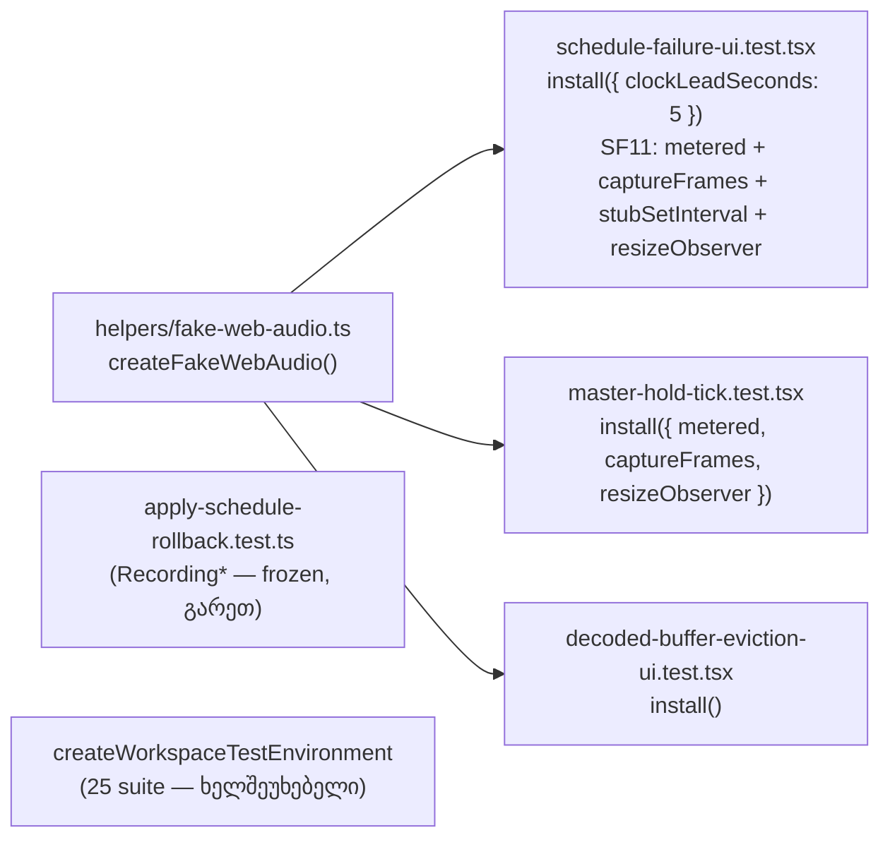

# SYS-R388-FAKE-WEB-AUDIO-HELPER: ერთი საერთო fake Web Audio helper სამი jsdom playback suite-ისთვის

**თარიღი:** 2026-11-08
**სტატუსი:** Completed (C round 415 PASS)
**შეცვლილი პროექტი:** Store (მხოლოდ სამი test suite, ახალი test helper და ეს doc; runtime კოდი — `app/contexts/ArrangementContext.tsx`, `app/lib/arrangement/graph.client.ts`, `meter.ts` — უცვლელია)

## კონტექსტი

Playback-ის ბაგების რაუნდებში (385–388) ყოველმა ახალმა suite-მა საკუთარი fake Web Audio graph-ი დააკოპირა (signal SIG-R388). სამი jsdom suite — `schedule-failure-ui.test.tsx` (SF1–SF11), `master-hold-tick.test.tsx` (HT1–HT3) და `decoded-buffer-eviction-ui.test.tsx` (EV1–EV25, 35 row) — თითოეული ცალკე აცხადებდა `FakeParam/FakeNode/FakeGain/FakePanner/FakeSource/FakeAudioContext/FakeOfflineAudioContext/FakeAudioBuffer`-ს, metered ვარიანტებს, rAF capture-ს, `runFrames`-სა და `setInterval`-ის stub-ს.

ამას დაემატა ღია Low **A-R388-REVIEW-L3**: SF11 ჩუმად იყო დამოკიდებული `setInterval`-ის stub-ზე. stub-ის მოხსნისას SF11 მწვანე რჩებოდა (interval pump თავად იწვევდა failure-ს), ანუ დამოკიდებულება არავის ჰქონდა asserted.

ეს test-only რაუნდია: runtime, დაცული ფაილები და `createWorkspaceTestEnvironment` არ შეცვლილა.

## მიდგომა

B-ის reviewed sketch byte-for-byte გამოვიყენეთ: `tmp/studio-real-loop/b-round-414/sketch-415.patch.txt` (sha256 `2d04d6eb73025527…`). `tech-lead`-მა დიზაინი APPROVE WITH CHANGES-ით შეაფასა; ყველა ცვლილება sketch-შია. ყოველი `it(...)` ბლოკი HEAD-ის byte-identical-ია (11 + 3 + 35 row; AR1–AR5 frozen ფაილშია).

### Rulings (B, D-29z1442)

1. **Scope = სამი jsdom suite:** SF1–SF11, HT1–HT3, EV1–EV25 (35 row).
2. **`apply-schedule-rollback.test.ts` გარეთ რჩება** (SIG-R388-ის ოთხფაილიანი სიიდან გადახვევა). მისი `Recording*` კლასები typed `ScheduleAudioContext<string>` interface-ებს ახორციელებს global-ების გარეშე: string buffer-ები, disconnect-ის მთვლელები, owner-ის მართული `throwOnStart`/`stopThrows`. გაერთიანება AR1–AR5-ის აზრს შეცვლიდა (`tech-lead` ეთანხმება). ფაილი frozen-ია.
3. **`createWorkspaceTestEnvironment` (25 suite) ხელშეუხებელია.** ახალი helper იგივე სახელებს აბრუნებს (`fakeClock`, `FakeAudioContext`, `FakeOfflineAudioContext`, `FakeAudioBuffer`, `FakeResizeObserver`), რომ მომავალში ერთხაზიანი delegation იყოს შესაძლებელი. ჩაწერილია signal-ად SIG-R415-WORKSPACE-ENV-CONVERGENCE, დაგეგმილი არ არის.
4. **Wall clock რჩება.** `currentTime` კვლავ `Date.now()`-ს მიჰყვება; ეს SYS-CLOCK-DETERMINISM-ის საქმეა. A-R388-REVIEW-L4 (SF11-ის real-clock ლოდინი) მას გადაეცა და აქ **არ** იხურება.
5. **A-R388-REVIEW-L3 იხურება C PASS-ზე:** `install({ stubSetInterval: true })` ისვრის, თუ `window.setInterval` stub-ი არ არის (`Object.is`). მხოლოდ stub-ის მოხსნა SF11-ს guard-ის გამო აწითლებს; stub-ისა და guard-ის ერთად მოხსნა SF11-ს მწვანეს ტოვებს — ეს ზუსტად ძველი unasserted დამოკიდებულებაა. შეზღუდვა — იხ. „პრობლემები და გადაწყვეტები“.
6. **ერთგული default-ები (tech-lead):** `metered`, `captureFrames`, `stubSetInterval`, `resizeObserver` default-ად გამორთულია, რადგან `ArrangementContext.tsx` metering-ს `typeof ctx.createAnalyser/createChannelSplitter`-ით ამოიცნობს. Clock lead suite-ის მიხედვითაა: SF გადასცემს `clockLeadSeconds: 5`-ს (HEAD: `base = now - 5`), HT და EV — 0-ს (HEAD: `base = now`). `install()` ყველა state ველს ანულებს (frames, sources, start-failure მთვლელები, meter signal, clock), ამიტომ SF-ის ორ describe-ს შორის არაფერი გადადის.
7. **Superset მიგრირებული row-ებისთვის ინერტულია:** `FakeParam.setValueAtTime/linearRampToValueAtTime` no-op-ებია, რომლებსაც `graph.client.ts` `?.()`-ით იძახებს; `.outputs`-ს არცერთი suite არ კითხულობს (HT-ის გამოუყენებელი `outputs` tracking მოხსნილია); `started/stops` და start-failure hook მხოლოდ armed მდგომარეობაში მოქმედებს.
8. **Owned ფაილების Low-ები deferred რჩება:** A-R388-REVIEW-L1 (resync branch-ის row) და A-R388-REVIEW-L2 (SF11 track hold) აქ არ სწორდება, თუმცა `schedule-failure-ui.test.tsx` ამ რაუნდს ეკუთვნის: byte-identical `it()` contract-ი უპირატესია cheap-Low წესზე.

## არქიტექტურა



### Helper API

`createFakeWebAudio()` ყოველ გამოძახებაზე ახალ, დამოუკიდებელ state-ს ქმნის და აბრუნებს:

- **State:** `fakeClock` (`{ base }`), `meterSignal` (`{ value }`), `startFailure` (`{ armedAt, calls, thrown }`), `frames` (captured rAF callback-ები), `createdSources`.
- **კლასები:** `FakeAudioContext`, `MeteredAudioContext`, `FakeOfflineAudioContext`, `FakeAudioBuffer`, `FakeResizeObserver`.
- **`armStartFailure(nth)`:** n-ე `start()` ისვრის.
- **`install(options)`:** state-ს ანულებს და global-ებს `vi.stubGlobal`-ით აყენებს. Options (ყველა default-ად გამორთული / 0):
  - `metered` — `MeteredAudioContext` (analyser და channel splitter), სხვა შემთხვევაში `FakeAudioContext`;
  - `captureFrames` — `requestAnimationFrame` callback-ებს `frames`-ში აგროვებს, სხვა შემთხვევაში `() => 1`;
  - `stubSetInterval` — `setInterval` → `() => 0`, plus `Object.is` guard;
  - `resizeObserver` — `FakeResizeObserver`;
  - `clockLeadSeconds` — `fakeClock.base = Date.now() / 1000 - lead`.
- **`runFrames(count = 1)`:** captured frame-ებს `act()`-ში ასრულებს.

`afterEach` (`vi.unstubAllGlobals`, `vi.restoreAllMocks`), error listener-ები, HT-ის `HTMLMediaElement` spy-ები და EV-ის `vi.mock`-ები suite-ებში რჩება.

## შეცვლილი ფაილები

- `app/lib/arrangement/__tests__/helpers/fake-web-audio.ts` (ახალი)
- `app/lib/arrangement/__tests__/schedule-failure-ui.test.tsx`
- `app/lib/arrangement/__tests__/master-hold-tick.test.tsx`
- `app/lib/arrangement/__tests__/decoded-buffer-eviction-ui.test.tsx`
- `docs/implementation/2026/quarter-IV/267-sys-fake-web-audio-helper.md` (ეს doc)

## პრობლემები და გადაწყვეტები

- **Problem:** სამ suite-ში fake graph-ის სამი ასლი; ერთის შესწორება დანარჩენებს არ ეხებოდა. → **Solution:** ერთი `createFakeWebAudio()` factory, per-call state-ით.
- **Problem:** SF11-ის `setInterval` stub-ზე დამოკიდებულება asserted არ იყო (A-R388-REVIEW-L3). → **Solution:** `stubSetInterval`-ის `Object.is` guard; თუ helper-ის stub-ი `window.setInterval`-ს ვერ ჩაანაცვლებს, SF11 წითლდება (MU-415-NO-SETINTERVAL-STUB). შეზღუდვა (code-reviewer, Low): guard ამოწმებს, რომ helper-მა stub-ი დააყენა; თუ SF11-ის `install({...})`-დან `stubSetInterval: true` საერთოდ მოიხსნება, guard არ გაეშვება და SF11 მწვანე რჩება — იგივე, რასაც MU-415-GUARD-AND-STUB-REMOVED აჩვენებს.
- **Problem:** საერთო helper-ს შეეძლო metering ყველა suite-ში ჩაერთო და EV-ის ქცევა შეეცვალა. → **Solution:** ყველა flag default-ად გამორთულია; suite თავად ირჩევს.
- **Problem:** ორ SF describe-ს შორის state-ის გაჟონვა. → **Solution:** `install()` ყველა ველს ანულებს (MU-415-RESET-LEAK ამას ამოწმებს).

## ტესტირება

- `npx vitest run` ოთხ ფაილზე (SF, HT, EV, AR): 4 ფაილი, 54/54 (11 + 3 + 35 + 5), როგორც HEAD-ზე.
- `npm run typecheck`, `npm run lint` და `npx biome check` ოთხ code path-ზე — rc 0.
- B-ის mutant-ები helper-ზე (`b-round-414/mutants/run.py`, sketch-ზე გაშვებული; C მათ იმეორებს working tree-ზე):

```
PRISTINE-BEFORE rc 0 failed [] tests 49
MU-415-START-NO-FAIL RED expected-rows-red True failed ['SF1', 'SF10', 'SF11', 'SF2', 'SF3', 'SF4', 'SF5', 'SF6', 'SF7', 'SF8', 'SF9']
MU-415-SOURCES-UNRECORDED RED expected-rows-red True failed ['EV3', 'SF10', 'SF2']
MU-415-STOP-UNCOUNTED RED expected-rows-red True failed ['SF1', 'SF10', 'SF11', 'SF2', 'SF3', 'SF4', 'SF5', 'SF6', 'SF7', 'SF8', 'SF9']
MU-415-ANALYSER-SILENT RED expected-rows-red True failed ['HT1', 'HT2', 'HT3', 'SF11']
MU-415-NO-SETINTERVAL-STUB RED expected-rows-red True failed ['SF11']
MU-415-METERED-IGNORED RED expected-rows-red True failed ['HT1', 'HT2', 'HT3', 'SF11']
MU-415-FRAMES-NOT-RUN RED expected-rows-red True failed ['HT1', 'HT2', 'HT3', 'SF11']
MU-415-RESET-LEAK RED expected-rows-red True failed ['SF10', 'SF11', 'SF2', 'SF3', 'SF4', 'SF5', 'SF6', 'SF7', 'SF8', 'SF9']
MU-415-CLOCK-LEAD-IGNORED GREEN expected-rows-red True failed []
MU-415-CONTROL-METERED-ALWAYS GREEN expected-rows-red True failed []
MU-415-GUARD-AND-STUB-REMOVED GREEN expected-rows-red True failed []
PRISTINE-AFTER rc 0 failed [] tests 49
SCRATCH-STATUS 0 lines
```

- `tests 49` = სამი მიგრირებული suite (11 + 3 + 35); ზემოთ მოცემული 54 მათ AR1–AR5-საც ამატებს.
- GREEN mutant-ები განზრახ მწვანეა: CLOCK-LEAD-IGNORED — lead HEAD-ის ერთგულია, მაგრამ არცერთ row-ს არ ატარებს; CONTROL-METERED-ALWAYS — control (flag unmetered suite-ებზე არ მოქმედებს); GUARD-AND-STUB-REMOVED — აჩვენებს A-R388-REVIEW-L3-ის დამოკიდებულებას, რომელსაც ახლა guard ამოწმებს.
- Runtime უცვლელია; C real Chromium-ში `/studio-lab`-ზე master და track meter-ების Play/Stop ქცევას ამოწმებს (no-regression).

## TODO / შემდეგი ნაბიჯები

- SIG-R415-WORKSPACE-ENV-CONVERGENCE: `createWorkspaceTestEnvironment`-ის ამ helper-ზე delegation (დაგეგმილი არ არის).
- SYS-CLOCK-DETERMINISM: deterministic clock; A-R388-REVIEW-L4 (SF11-ის real-clock ლოდინი) იქ იხურება.
- A-R388-REVIEW-L1 და A-R388-REVIEW-L2 deferred რჩება.
