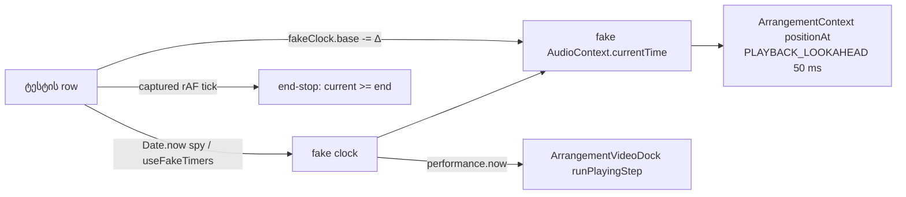

# SYS-CLOCK-DETERMINISM: ხუთი jsdom ტესტი აღარ არის დამოკიდებული wall clock-ზე

**თარიღი:** 2026-11-08
**სტატუსი:** Completed (C round 417 PASS)
**შეცვლილი პროექტი:** Store (მხოლოდ ხუთი test ფაილი და ეს doc; runtime კოდი და ორივე test helper — `helpers/fake-web-audio.ts`, `helpers/workspace-test-environment.ts` — უცვლელია)

## კონტექსტი

jsdom-ის playback ტესტებში fake `AudioContext.currentTime` მიჰყვება `Date.now()`-ს (`app/lib/arrangement/__tests__/helpers/fake-web-audio.ts`: `return Date.now() / 1000 - fakeClock.base;`), ხოლო `app/contexts/ArrangementContext.tsx`-ში `PLAYBACK_LOOKAHEAD = 0.05` — position play-ის შემდეგ 50 ms ჩერდება. ამიტომ ტესტი, რომელიც playing მდგომარეობაში ცოცხალ position-ს კითხულობს ან რეალურ დროს ელოდება, დატვირთულ runner-ზე ცურავს ან flaky ხდება.

ხუთი row ამ კლასს ეკუთვნოდა:

| Row | ფაილი | ძველი დამოკიდებულება |
|---|---|---|
| EN10 | `app/lib/arrangement/__tests__/marker-edge-nav-ui.test.tsx` | position-ის ფანჯარა `≥ 2.25` და `< 2.75` — დატვირთვისას wall clock ფანჯარას სცდება |
| VDS3 | `app/lib/arrangement/__tests__/video-dock-strings-ui.test.tsx` | `waitFor` რეალურ დროს ელოდებოდა, სანამ dock `play`-ს გამოიძახებდა |
| SF11 | `app/lib/arrangement/__tests__/schedule-failure-ui.test.tsx` | ორი რეალური `setTimeout(150)` ლოდინი; `stubSetInterval`-ის არსებობა არ მოწმდებოდა |
| IM24 | `app/lib/arrangement/__tests__/insert-marker-ui.test.tsx` | playing კუდი `[2, 6, 10, 16, 16]` და „Playing at 16“ — მდგომარეობა, რომელიც მხოლოდ jsdom-ში არსებობდა, რადგან end-stop არასოდეს ეშვებოდა |
| BW5 | `app/lib/arrangement/__tests__/tempo-window.test.ts` | `elapsed < 100` ms timing assert |

## მიდგომა

B-ის rulings (D-29z1452), round 417:

1. **Scope — 5 row 5 ფაილში.** იხურება GATE77-S4-EN10-CLOCK, GATE148-S2-VDS3-WALLCLOCK, A-R388-REVIEW-L4-SF11-REAL-CLOCK, A-R415-REVIEW-L1-CALLSITE-FLAG, C-R326-01 და ROOT-R70-L4-BW5-WALLCLOCK. B-R184-FAKECLOCK-UNASSERTED და GATE325-IM24-WALLCLOCK დაკავშირებულია, მაგრამ არ იხურება.
2. **ორივე helper უცვლელია (frozen).** SF11 იყენებს `helpers/fake-web-audio.ts`-ს, რომელიც უკვე აბრუნებს `fakeClock`-ს; IM24 იღებს `fakeClock`-სა და fake-ებს `createWorkspaceTestEnvironment()`-იდან და file-local აქვს მხოლოდ rAF capture. EN10 და VDS3 თავიანთ file-local fake-ს ინარჩუნებენ; მათი helper-ზე გადატანა არის სიგნალი SIG-R415-WORKSPACE-ENV-CONVERGENCE და არ არის დაგეგმილი.
3. **თითო row იყენებს იმ clock მეთოდს, რომელიც რეალურად სჭირდება:**
   - **EN10:** `Date.now` იყინება (`vi.spyOn(Date, 'now')`, IM24-ის house pattern). დაშვების წერტილი ზუსტია (`toBe(2.25)`); შემდეგ fake-clock-ის 0.3 s ნაბიჯი იძლევა `toBeCloseTo(2.5, 6)`-ს და transport ისევ playing-ია — ეს ამტკიცებს, რომ playback გრძელდება.
   - **VDS3:** `vi.useFakeTimers({ toFake: ['Date', 'performance'] })`. მხოლოდ `Date.now`-ის გაყინვა საკმარისი არ არის, რადგან dock `performance.now()`-ით დგამს ნაბიჯს (`app/components/arrangement/ArrangementVideoDock.tsx`: `runPlayingStep(clock, performance.now());`). ტესტი წინ მიდის **ზუსტად 50 ms-ით** (= `PLAYBACK_LOOKAHEAD`), შემდეგ ერთი frame flush — და `play` ერთხელ გამოიძახება. describe-ის `afterEach`-ს ემატება `vi.useRealTimers()`.
   - **SF11:** `Date.now` იყინება; ორივე რეალური `setTimeout(150)` ლოდინი ხდება `fakeClock.base -= 0.15` ნაბიჯი. ემატება assert, რომ `window.setInterval(() => undefined, 1_000)` აბრუნებს `0`-ს — ეს ამტკიცებს, რომ stub დაყენებულია (A-R415-REVIEW-L1). Pump `setInterval`-ით მუშაობს (`ArrangementContext.tsx`: `window.setInterval(pumpPlaybackAudio, AUDIO_PUMP_INTERVAL_MS)`), რომელიც აქ stub-ია.
   - **IM24 (C-R326-01, origin `B spec`):** playing კუდი ახლა ბრაუზერის ქცევას ემთხვევა (c-round-326 B-IM24, c-round-272 B-ATEND) — იხ. „პრობლემები და გადაწყვეტები“.
   - **BW5 (L4, ტოლი ან უფრო ძლიერი ჩანაცვლება):** `elapsed < 100` იშლება; სანაცვლოდ ითვლება window ობიექტის `fromPx`/`toPx` getter-ების წაკითხვები და მოითხოვება **≤ 1,000**.
4. **ხუთ ფაილში ყველა სხვა `it()` სხეული byte-identical-ია HEAD-თან.** იცვლება მხოლოდ ხუთი row, VDS describe-ის ერთი `afterEach` და SF helper-ის destructuring.
5. **Doc:** ეს ფაილი, ნომერი 268 (ბოლო იყო 267).

ალტერნატივა იყო საერთო helper-ის გაფართოება (მაგ. `createWorkspaceTestEnvironment`-ში frozen clock), მაგრამ ორივე helper ამ რაუნდში frozen-ია: 25 suite იყენებს `createWorkspaceTestEnvironment`-ს (B-ის claims K9 `env-helper-users`), ხოლო 3 suite — `fake-web-audio.ts`-ს (doc 267). რისკი მცირე სარგებლისთვის დიდია.

## არქიტექტურა



Wall clock აღარ შედის ჯაჭვში: დრო მოძრაობს მხოლოდ ტესტის მიერ ცხადად გადადგმული ნაბიჯით (`fakeClock.base -= Δ` ან `vi.advanceTimersByTime`).

## შეცვლილი ფაილები

- `app/lib/arrangement/__tests__/marker-edge-nav-ui.test.tsx` — EN10: გაყინული `Date.now`, ზუსტი 2.25 და 0.3 s ნაბიჯი.
- `app/lib/arrangement/__tests__/video-dock-strings-ui.test.tsx` — VDS3: fake `Date` + `performance`, 50 ms advance; describe `afterEach`-ში `vi.useRealTimers()`.
- `app/lib/arrangement/__tests__/schedule-failure-ui.test.tsx` — SF11: გაყინული `Date.now`, `fakeClock` ნაბიჯები, `setInterval` stub-ის assert; helper destructuring-ში `fakeClock`.
- `app/lib/arrangement/__tests__/insert-marker-ui.test.tsx` — IM24: captured rAF tick, end-stop 16-ზე და stopped none-ტექსტი.
- `app/lib/arrangement/__tests__/tempo-window.test.ts` — BW5: window-read მთვლელი timing-ის ნაცვლად.
- `docs/implementation/2026/quarter-IV/268-sys-clock-determinism.md` — ეს doc.

## პრობლემები და გადაწყვეტები

**პრობლემა:** VDS3-ში მხოლოდ `Date.now`-ის გაყინვა + `fakeClock.base -= 0.1` — `play` არასოდეს გამოიძახება (B-ის probe, `tmp/studio-real-loop/b-round-416/probe/vds3-advance.md`).
**გადაწყვეტა:** dock `performance.now()`-საც კითხულობს, ამიტომ ორივე ყალბდება. 50 ms advance → `play` ერთხელ; 100 ms advance → `play` 0-ჯერ (იგივე probe). ამიტომ 50 ms მნიშვნელობა load-bearing-ია.

**პრობლემა:** BW5-ის არსებული count bound (180–240 mark) ვერ ამტკიცებდა „სრული build არ ხდება“-ს; ამას მხოლოდ timing ამტკიცებდა, რაც flaky იყო.
**გადაწყვეტა:** window getter-ების წაკითხვების დათვლა. წყარო — `tmp/studio-real-loop/b-round-416/probe/vds3-advance.md` (BW5 window-read probe): HEAD-ის windowed walk კითხულობს **442**-ჯერ (190 mark); full-build mutant (firstBar = 0, window break მოხსნილი) — **6,784,880**-ჯერ, ხოლო 180–240 bound მწვანე რჩება. Bound **≤ 1,000** (windowed მნიშვნელობის 2.26×, full build-ზე 6,785×-ით ნაკლები).

**პრობლემა (IM24, C-R326-01):** ძველი contract — „Playing at 16 + `No more markers after the playhead`“ — არსებობდა მხოლოდ იმიტომ, რომ jsdom-ში end-stop (`ArrangementContext.tsx`: `if (!loopScheduleRef.current && current >= end) {`) არასოდეს ეშვებოდა. ბრაუზერში transport project-ის ბოლოს ჩერდება.
**გადაწყვეტა:** Ctrl+Right playing-ში სტუმრობს `[2, 6, 10, 16]`-ს; შემდეგ 0.05 s clock ნაბიჯის შემდეგ ერთი captured rAF tick ეშვება და transport 16-ზე ჩერდება; მე-5 Ctrl+Right იძლევა **stopped** ტექსტს `No more markers after the insert marker`, insert marker `16.000`-ზეა. ეს უმცირესი პატიოსანი contract-ია და app-ის ცვლილება არ არის.

## ტესტირება

- `npx vitest run` ხუთ ფაილზე: 5 ფაილი, 63/63 (HEAD-ის იგივე რაოდენობა). Row-ების დრო A-ის run-ში: EN10 126 ms, VDS3 178 ms, SF11 76 ms, IM24 73 ms, BW5 11 ms.
- `npm run typecheck` rc 0; `npm run lint` rc 0 (205 warning, 1 info — round 415-ის იგივე); `npx biome check` ხუთ ფაილზე rc 0.
- Mutant-ები (`tmp/studio-real-loop/b-round-416/mutants/run.py`, ლოგები იმავე ფოლდერში). `summary.txt` byte-for-byte:

```
MU-EN10-SLEEP600 head applied=1 red rc=1
MU-EN10-SLEEP600 sketch applied=1 green rc=0
MU-VDS3-SLEEP200 head applied=1 red rc=1
MU-VDS3-SLEEP200 sketch applied=1 green rc=0
MU-SF11-STALL head applied=1 red rc=1
MU-SF11-STALL sketch applied=1 green rc=0
MU-SF11-NOFLAG head applied=1 green rc=0
MU-SF11-NOFLAG sketch applied=1 red rc=1
MU-BW5-FULLBUILD head applied=2 red rc=1
MU-BW5-FULLBUILD sketch applied=2 red rc=1
MU-IM24-NO-ENDSTOP head applied=1 green rc=0
MU-IM24-NO-ENDSTOP sketch applied=1 red rc=1
```

  - EN10-SLEEP600, VDS3-SLEEP200 და SF11-STALL: HEAD-ზე წითელი, sketch-ზე მწვანე — wall-clock დამოუკიდებლობა.
  - SF11-NOFLAG: HEAD-ზე მწვანე, sketch-ზე წითელი — `stubSetInterval`-ის assert (A-R415-REVIEW-L1).
  - BW5-FULLBUILD: ორივეზე წითელი — sketch-ზე read count-ით (6,784,880 > 1,000), HEAD-ზე მხოლოდ timing-ით.
  - IM24-NO-ENDSTOP: HEAD-ზე მწვანე, sketch-ზე წითელი — end-stop ახლა pinned-ია.
- ბრაუზერში IM24-ის end-stop contract-ს და play/stop smoke-ს C ამოწმებს (round 417, rows 4–5).

## TODO / შემდეგი ნაბიჯები

- SIG-R415-WORKSPACE-ENV-CONVERGENCE: EN10-ისა და VDS3-ის file-local fake-ების საერთო helper-ზე გადატანა — არ არის დაგეგმილი, B-ის გადაწყვეტილებას ელოდება.
- B-R184-FAKECLOCK-UNASSERTED და GATE325-IM24-WALLCLOCK ღიად რჩება როგორც დაკავშირებული საკითხები.
