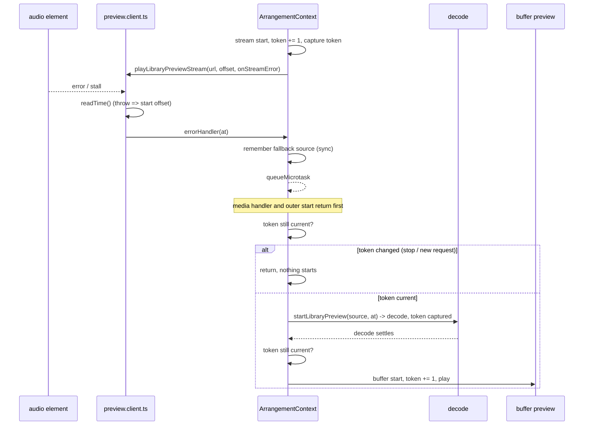

# SYS-R416-PREVIEW-CONTROLLER: library preview-ს request token, გადადებული stream fallback და re-entrancy-safe media handler-ები

**თარიღი:** 2026-11-09
**სტატუსი:** Completed (C round 418 PASS)
**შეცვლილი პროექტი:** Store (ორი runtime ფაილი, ერთი test ფაილი და ეს doc; მომხმარებლისთვის ხილული ქცევა უცვლელია)

## კონტექსტი

Library preview-ს ორი გზა აქვს: URL წყარო იწყება **stream**-ით (`<audio>` element), ხოლო decode-ს საჭიროებს წყარო ჯერ decode-დება და შემდეგ **buffer**-ით უკრავს. Stream-ის error-ზე ან stall-ზე preview გადადის decode → buffer fallback-ზე.

ძველ კოდში `app/contexts/ArrangementContext.tsx` preview request-ებს **source id**-ით ანაცვლებდა (`previewRequestRef: string | null`), ხოლო `app/lib/arrangement/preview.client.ts` media handler-ებში mutable `active`-სა და დაუცველ `element.currentTime`-ს კითხულობდა. აქედან შვიდი Low finding მოდიოდა:

| ID | პრობლემა | Row |
|---|---|---|
| A-R392-REVIEW-L3 | stop, შემდეგ იმავე წყაროს re-preview მისი decode-ის დროს — ერთხელ იწყებოდა, მაგრამ **პირველი** გამოძახების offset-ით | PC1 |
| A-R392-REVIEW-L2 | decode branch `stopLibraryPreview()`-ს null-owner შემოწმებამდე იძახებდა: stale გამოძახება ცოცხალ preview-ს აჩერებდა და მხოლოდ `sourceNotLoaded`-ს წერდა | PC3 |
| GATE393-L3 | stream error callback fallback-ს **სინქრონულად** იწყებდა, media `error` handler-ის შიგნით | PC4 |
| A-R394-REVIEW-L3 | სინქრონული `src`/`play()` throw-ზე fallback re-entrant-ად ეშვებოდა გარე `startLibraryPreview` გამოძახების შიგნით | PC5 |
| A-R395-REVIEW-L1 | same-url seek branch `restartArmedStall()`-სა და `fail()`-ს mutable `active`-ით იძახებდა; `currentTime` setter-ში სინქრონული `pause` `active`-ს ანულებდა და შემდეგი გამოძახება throw-ს აკეთებდა | PC8 |
| GATE395-L1 | `handleError` `element.currentTime`-ს დაუცველად კითხულობდა, stall watchdog კი ერთ tick-ში ორჯერ; throwing getter გარეთ გადიოდა | PC9, PC10 |
| A-R393-REVIEW-L3 | არ არსებობდა row, რომ განსხვავებული URL-ის stream წინა element-ს ათავისუფლებს და stream start pending decode request-ს აუქმებს | PC11, PC2 |

## მიდგომა

B-ის rulings (D-29z1456, `tmp/studio-real-loop/b-round-417/sketch-review.md`):

1. **ერთი per-request token.** `previewRequestRef` გახდა `previewTokenRef` (counter). Token იზრდება stream start-ზე, `stopLibraryPreview`-ზე (და ამიტომ decode start-ზეც, რომელიც მას პირველ რიგში იძახებს) და buffer start-ზე. Decode settle და stream fallback მოქმედებს მხოლოდ მაშინ, როცა მათ მიერ დაჭერილი token ჯერ კიდევ მიმდინარეა.
2. **Stream fallback გადადებულია `queueMicrotask`-ით.** Remembered-fallback set მაინც სინქრონულად იწერება, მაშინაც კი, როცა request უკვე ჩანაცვლებულია — media error რეალურია. Microtask ყველაზე მცირე deferral-ია: ჯერ media handler და გარე start გამოძახება სრულდება, შემდეგ კი fallback ეშვება ნებისმიერ მომდევნო task-მდე. ამიტომ browser-ში ხილული რიგი (error → Loading ტექსტი → decode → buffer უკრავს) უცვლელია.
3. **Null-owner decode გამოძახება:** ჯერ იწერება უარი (`sourceNotLoaded`), ცოცხალი preview კი ხელუხლებელი რჩება.
4. **Same-url seek error handler-ს ხელახლა მიმართავს** (`setErrorHandler`), ამიტომ stream-ის error და stall fallback-ს უახლესი request-ის token-ით აკეთებს.
5. **Player დროს კითხულობს `readTime`-ით.** Throwing getter აბრუნებს stream element-ის შექმნისას დაფიქსირებულ start offset-ს (same-url seek მას არ ანახლებს — A-R418-REVIEW-L1); watchdog ერთ tick-ში ერთხელ კითხულობს. Seek branch იყენებს local `const`-ს.
6. **Provider unmount token-ს არ ზრდის.** Unmount-ზე controller abort decode-ს უკვე აგდებს. PC7 lock row-ია (მწვანეა HEAD-ზეც და ყველა mutant-ზეც), არა fix row.
7. **მომხმარებლისთვის ხილული ცვლილება არ არის.** Public hook surface (`startLibraryPreview`, `stopLibraryPreview`, `libraryPreviewSourceId`, `getLibraryPreviewOffset`) და `LibraryPreviewPlayer`-ის public მეთოდები უცვლელია; `setErrorHandler` მხოლოდ შიდა `ActiveStreamPreview`-ზეა.
8. **შეცვლილი არსებული row-ები:** PS8, PS13 და PS27 error dispatch-ს `await act(async () => …)`-ში ახვევს `act(() => …)`-ის ნაცვლად — ეს ruling 2-ის შედეგია; ყველა assertion შენარჩუნებულია. დანარჩენი არსებული `it()` body-ები HEAD-ის იდენტურია.
9. **Doc:** ეს ფაილი, ნომერი 269 (268 ბოლო იყო).

**ალტერნატივები:** task-ზე დაფუძნებული deferral (მაგ. `setTimeout`) არ შეირჩა — microtask ყველაზე მცირე deferral-ია, რომელიც handler-იდან და გარე გამოძახებიდან გამოსვლას უკვე უზრუნველყოფს; source id-ით supersede-ის შენარჩუნება PC1-ის შემთხვევას ვერ ხსნის, რადგან ორივე request-ს ერთი id აქვს.

## არქიტექტურა



## შეცვლილი ფაილები

| ფაილი | დანიშნულება |
|---|---|
| `app/contexts/ArrangementContext.tsx` | `previewTokenRef` counter; stream fallback `queueMicrotask`-ით და token შემოწმებით; null-owner უარი `stopLibraryPreview`-მდე; decode settle token-ით |
| `app/lib/arrangement/preview.client.ts` | `readTime` დაცული წაკითხვა; `reportError`; watchdog ერთი წაკითხვით; same-url seek local `const`-ით და `setErrorHandler`-ით |
| `app/lib/arrangement/__tests__/library-preview-stream.test.tsx` | PS8/PS13/PS27 async `act`; ახალი row-ები PC1–PC12 |
| `docs/implementation/2026/quarter-IV/269-sys-preview-controller.md` | ეს doc |

## პრობლემები და გადაწყვეტები

**პრობლემა:** sketch-ის პირველ ვერსიაში (`setErrorHandler`-ის გარეშე, არასოდეს dispatched) same-url seek-ს ახალი error handler არ მიჰქონდა. B-ის browser pre-check-მა (R1b: seek, შემდეგ stall) აჩვენა, რომ fallback არ ხდებოდა — ძველი handler-ის token უკვე ჩანაცვლებული იყო.
**გადაწყვეტა:** `ActiveStreamPreview`-ს დაემატა `setErrorHandler`, რომელსაც seek branch უახლესი request-ის callback-ით იძახებს. unit დონეზე handler-ის ხელახლა მიმართვას ამაგრებს PC12 (seek-ის შემდეგ `error` event, fallback seek-ის დროიდან) და mutant MU-SEEK-KEEPS-OLD-HANDLER; error და stall ერთსა და იმავე `errorHandler`-ს გადიან. Seek-ის შემდეგ **stall** პირდაპირ მხოლოდ browser row R1b-ში მოწმდება — PC12-ის სათაური „stall“-ს ახსენებს, მაგრამ body `error`-ს აგზავნის (A-R418-REVIEW-L3). Mutant-ები, სრული suite და browser run-ები საბოლოო sha-ზე თავიდან გაეშვა.

**პრობლემა:** fallback-ის გადადების შემდეგ PS8, PS13 და PS27 სინქრონული `act`-ით fallback-ს ვეღარ ხედავდნენ.
**გადაწყვეტა:** ამ სამ row-ში error dispatch გადავიდა `await act(async () => …)`-ში; assertion-ები უცვლელია.

## ტესტირება

- A-ის targeted run (5 ფაილი: `library-preview-stream`, `failed-source-refusal`, `decoded-buffer-eviction-ui`, `actions-context`, `bars-ruler-ui`): 117/117 (`tmp/studio-real-loop/a-round-418/a2-vitest.log`).
- `npm run typecheck` rc 0; `npm run lint` rc 0 (205 warning, 1 info — HEAD-ის ტოლი); Biome სამ code ფაილზე rc 0.
- Mutant-ები (`tmp/studio-real-loop/b-round-417/mutants/summary.txt`, ბაიტ-ბაიტ):

```
SKETCH: red none | Tests  40 passed (40)
MU-HEAD-SRC: red PC1,PC3,PC4,PC5,PC6,PC8,PC9,PC10 | Tests 8 ⎯⎯⎯⎯⎯⎯⎯
MU-STREAM-NO-TOKEN: red PC2 | Tests 1 ⎯⎯⎯⎯⎯⎯⎯
MU-SYNC-FALLBACK: red PC4,PC5,PC6 | Tests 3 ⎯⎯⎯⎯⎯⎯⎯
MU-FALLBACK-NO-TOKEN-CHECK: red PC6 | Tests 1 ⎯⎯⎯⎯⎯⎯⎯
MU-STOP-BEFORE-OWNER: red PC3 | Tests 1 ⎯⎯⎯⎯⎯⎯⎯
MU-DECODE-NO-TOKEN-CHECK: red PC1,PC2 | Tests 2 ⎯⎯⎯⎯⎯⎯⎯
MU-SEEK-READS-ACTIVE: red PC8 | Tests 1 ⎯⎯⎯⎯⎯⎯⎯
MU-SEEK-KEEPS-OLD-HANDLER: red PC12 | Tests 1 ⎯⎯⎯⎯⎯⎯⎯
MU-STALL-READS-TWICE: red PC9 | Tests 1 ⎯⎯⎯⎯⎯⎯⎯
MU-ERROR-RAW-READ: red PC10 | Tests 1 ⎯⎯⎯⎯⎯⎯⎯
MU-NEW-URL-NO-STOP: red PC11 | Tests 1 ⎯⎯⎯⎯⎯⎯⎯
```

- Browser (C round 418, row 4): `/studio-lab` 1440×900 და 1280×720 — R1, R1b, R5, R6, R7, R9, R10 შედარებულია HEAD-თან; ქცევა უნდა იყოს ტოლი.

## TODO / შემდეგი ნაბიჯები

- Q-PREVIEW-STOPS-TRANSPORT რჩება `awaiting_user`.
- A-R418-REVIEW-L1 (Low): same-url seek-ის შემდეგ throwing time read fallback-ს თავდაპირველი start offset-ით აკეთებს და არა seek-ის დროით.
- A-R418-REVIEW-L2 (Low): `getLibraryPreviewOffset` stream-ის დროს ჯერ კიდევ დაუცველად კითხულობს.
- A-R418-REVIEW-L3 (Low): PC12-ის სათაური body-ს არ ემთხვევა.
- ARCH-CHECKPOINT-PREVIEW-AFTER-13C-ის root request ჯერ უპასუხოა; preview controller-ის ცალკე მოდულად გამოყოფა ამ round-ში არ გაკეთებულა.
