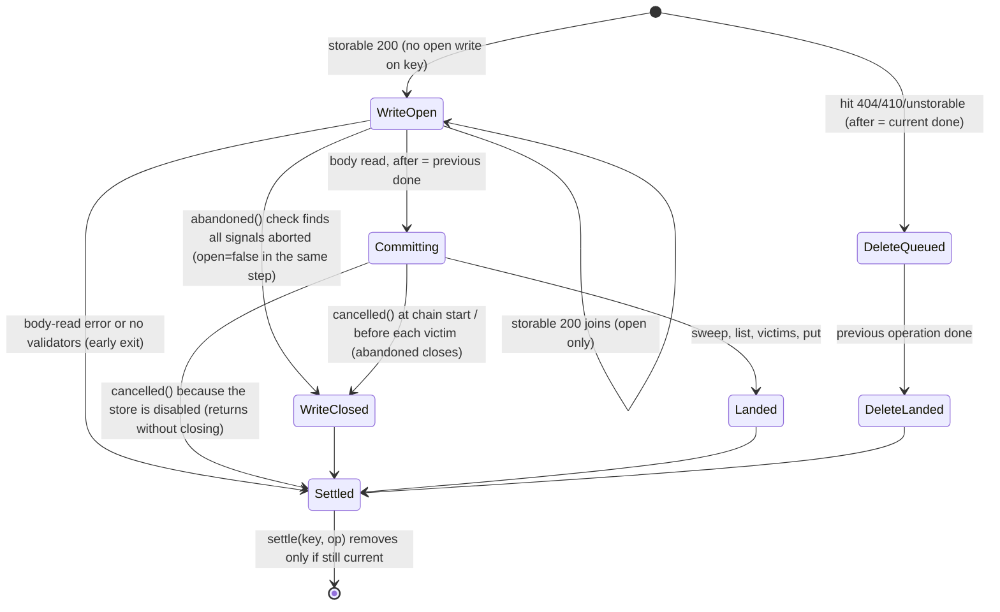
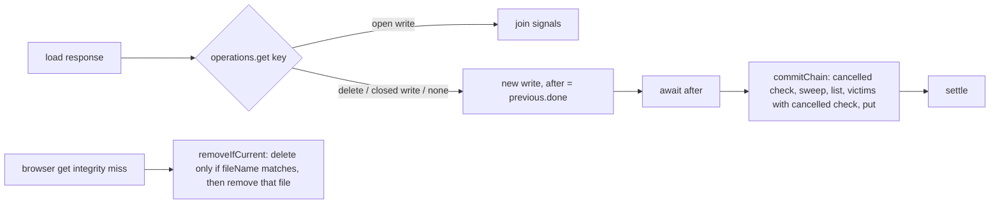

# SYS-R369-STEM-CACHE-WRITE-COORDINATOR: stem cache-ის per-key operation მოდელი, integrity delete მხოლოდ წაკითხულ ჩანაწერზე და უნიკალური ფაილის სახელები

**თარიღი:** 2026-11-09
**სტატუსი:** Completed (C round 419 PASS)
**შეცვლილი პროექტი:** Store (ერთი runtime ფაილი, ერთი test ფაილი და ეს doc; მომხმარებლისთვის ხილული ქცევა უცვლელია)

## კონტექსტი

Public demo preview-ები `publicPreviewSourceFetch`-ით stem cache-ში (`app/lib/arrangement/stem-cache.client.ts`) იტვირთება. `createCachedSourceFetch` HEAD-ზე (`3579fcc`) ორ ცალკე სტრუქტურას ინახავდა: `writes` map-ს და `deletes` set-ს, ხოლო browser store-ის `get` დაზიანებულ ჩანაწერს `remove(key)`-ით შლიდა. STEM-LANES ერთდროულად მთელ stem set-ს დაამატებს, ამიტომ რამდენიმე key ერთ commit chain-ში ერთად გაივლის — per-key მოდელი მანამდე უნდა დამდგარიყო. ამ რაუნდმა რვა Low finding დახურა:

| ID | პრობლემა | Row |
|---|---|---|
| A-R368-REVIEW-L1 | hit 200 → hit 404 (delete pending write-ის შემდეგ) → storable 200 pending write-ს უერთდებოდა; write ჯდებოდა, შემდეგ delete, და key ქრებოდა | SC34 |
| B-R367-TL3-1 | load, რომელიც უკვე abandon-ის გადაწყვეტილების მქონე write-ს უერთდებოდა, იკარგებოდა | ruling 3 (MU-JOIN-IGNORES-OPEN — accepted equivalent mutant, სტრუქტურული მიზეზით; იხ. ქვემოთ) |
| A-R367-REVIEW-L-c | `idle()`-ის delete-ებზე ლოდინს საკუთარი row არ ჰქონდა | SC35 |
| A-R367-REVIEW-L-d | victim loop-ში victim delete-ებს შორის `cancelled()` შემოწმება არ იყო | SC36 |
| A-R367-REVIEW-L-e | integrity miss `remove(key)`-ს იძახებდა, რომელიც ჩანაწერს თავიდან კითხულობდა და ამასობაში ჩაწერილ ახალ ვალიდურ ჩანაწერს და ფაილს შლიდა | SC37 |
| GATE368-L1 | წარუმატებელ put-ზე `removeFile(record.fileName)` წინა ჩანაწერის ფაილს შლიდა, თუ სახელები ემთხვეოდა | SC38, SC39 |
| A-R368-REVIEW-L3 | chain-start `cancelled()` შემოწმებას mutant არ ჰქონდა | SC40 |
| A-R367-REVIEW-L-g | SC26-ის `x-injected` assert ვერასოდეს ჩავარდებოდა | SC26 (შეცვლილი assert) |

## მიდგომა

B-ის rulings (D-29z1460; დეტალები და ordering matrix — `tmp/studio-real-loop/b-round-418/sketch-review.md`):

1. **ერთი per-key operation map.** `writes` და `deletes` შეიცვალა `operations: Map<key, write | delete>`-ით. Write ინახავს `signals`-სა და `open` flag-ს; delete — მხოლოდ თავის `done`-ს. Operation map-იდან მხოლოდ მაშინ გადის (`settle`), თუ ის ჯერ კიდევ თავისი key-ის მიმდინარე operation-ია.
2. **Tombstone (A-R368-REVIEW-L1).** Storable response pending write-ს მხოლოდ მაშინ უერთდება, როცა ის write `open`-ია. თუ key-ის მიმდინარე operation delete ან დახურული write-ია, response საკუთარ write-ს იწყებს: body მაშინვე იკითხება, commit კი წინა operation-ის `done`-ს ელოდება. ასე 200 → 404 → 200 მესამე response-ის შენახვით მთავრდება (SC34).
3. **Atomic close (B-R367-TL3-1).** Write `open = false`-ს abandon-ის გადაწყვეტილების იმავე სინქრონულ ნაბიჯში აყენებს, ამიტომ უარყოფილ write-ს ვეღარცერთი შემდგომი load ვერ შეუერთდება.
4. **`idle()` (A-R367-REVIEW-L-c)** loop-ში ელოდება, სანამ per-key operation აღარ დარჩება, შემდეგ კი commit chain-ს (SC35).
5. **Victim loop (A-R367-REVIEW-L-d).** ყოველი victim delete-ის წინ `cancelled()` მოწმდება (SC36).
6. **Integrity miss შლის მხოლოდ წაკითხულს (A-R367-REVIEW-L-e).** `get` იყენებს `removeIfCurrent(record)`-ს: ერთი `readwrite` transaction კითხულობს key-ს და შლის მხოლოდ მაშინ, თუ მისი `fileName` `get`-ის მიერ წაკითხულს ემთხვევა; შემდეგ ეს ფაილი იშლება (SC37; SC15 და SC28 უცვლელია). `delete(key)` (victim-ებისა და 404-ისთვის) უცვლელია.
7. **უნიკალური სახელები და name guard (GATE368-L1).** ფაილის სახელი ახლა `time-counter-random` ფორმისაა (per-instance counter — production-ში `publicPreviewSourceFetch`-ის ერთი instance, ანუ ერთი page session; პირველი segment კვლავ base-36 დროა, რომელსაც `sweep` კითხულობს) (SC38). Browser store-ის `put` `InvalidStateError`-ით უარყოფს, ნებისმიერი ფაილის შეხებამდე, ჩანაწერს, რომლის `fileName` შენახულისას ემთხვევა (SC39). Write path ამის შემდეგ store-ს თიშავს (non-quota error) — ეს უკვე არსებული წესია ნებისმიერი წარუმატებელი put-ისთვის; უნიკალური სახელებით ერთ session-ში მიუღწეველია.
8. **SC40** chain-start შემოწმებას აფიქსირებს (A-R368-REVIEW-L3). **SC26**-ში vacuous assert შეიცვალა `served.headers`-ის key-ების ცარიელი სიის შემოწმებით (A-R367-REVIEW-L-g); SC26-ის სხვა assertion-ები შენარჩუნებულია.
9. **SC41 lock row-ია:** cached fetch ზუსტად `{ fetchSource, idle }`-ს აჩვენებს.
10. **GATE368-L3 (queued buffer retention) ამ რაუნდში არ შედის** — cap-ს გაზომილი ლიმიტი სჭირდება, რომელსაც STEM-LANES ცვლის.
11. **მომხმარებლისთვის ხილული ცვლილება არ არის.** სხვა არსებული `it()` body-ები HEAD-ის ბაიტ-ბაიტ ტოლია; test ფაილს დაემატა `holdNextGetFile` hook fake OPFS harness-ზე.
12. **Doc:** ეს ფაილი (270).

ალტერნატივა იყო კოდის ცალკე sibling module-ში გატანა (ARCH-CHECKPOINT-PERF9-STEM-CACHE); root-ის პასუხი არ მოიძებნა, ამიტომ L46-ის default-ით კოდი `stem-cache.client.ts`-ში დარჩა.

### `open`-ის ინვარიანტი (ruling 3)

MU-JOIN-IGNORES-OPEN (join, რომელიც `open`-ს არ ამოწმებს) **accepted equivalent mutant**-ია და მწვანე რჩება — სტრუქტურული მიზეზით (TL-R419-L1): იმ მომენტს შორის, როცა `abandoned()` `open = false`-ს აყენებს, და `settle()`-ს შორის არცერთი გზა store-ს ან network call-ს არ ელოდება, joiner კი მხოლოდ task-იდან (fetch ან IndexedDB event) შეიძლება მოვიდეს — ამ ფანჯარაში ვერცერთი ვერ გაეშვება. `open` მაინც რჩება დაზღვევად: თუ მომავალში `cancelled()`-ის return-ის შემდეგ awaited cleanup დაემატება, ფანჯარა გაიხსნება და mutant ცოცხალი გახდება.

### `idle()`-ის drain ცვლილება (ruling 4)

HEAD-ზე `idle()` გამოძახების მომენტის snapshot-ს ელოდებოდა. ახლა ის drain-ს აკეთებს: ელოდება, სანამ map-ში operation აღარ დარჩება, მათ შორის `idle()`-ის გამოძახების შემდეგ დაწყებულებსაც (TL-R419-L3). უწყვეტი traffic-ის დროს ის არ დასრულდებოდა, მაგრამ production caller არ აქვს — მხოლოდ ტესტები და teardown. ეს მიღებული ქცევის ცვლილებაა.

## არქიტექტურა





## შეცვლილი ფაილები

- `app/lib/arrangement/stem-cache.client.ts` — per-key `operations` map, `settle`, tombstone და atomic close, `idle()` drain, victim loop-ის `cancelled()` შემოწმება, `removeIfCurrent`, `time-counter-random` სახელები და `put`-ის name guard.
- `app/lib/arrangement/__tests__/stem-cache.test.ts` — `holdNextGetFile` harness hook, SC26-ის assert-ის ჩანაცვლება და ახალი `SYS-R369` describe ბლოკი (SC34–SC41).
- `docs/implementation/2026/quarter-IV/270-sys-stem-cache-write-coordinator.md` — ეს doc.

## პრობლემები და გადაწყვეტები

- **პრობლემა:** 200 → 404 → 200 სცენარში მესამე response უკვე დაგეგმილ write-ს უერთდებოდა და delete მას შლიდა. **გადაწყვეტა:** join მხოლოდ `open` write-ზე; სხვა შემთხვევაში ახალი write წინა operation-ის `done`-ის შემდეგ (SC34).
- **პრობლემა:** integrity miss ხელახლა წაკითხულ, უკვე ახალ ჩანაწერს შლიდა. **გადაწყვეტა:** `removeIfCurrent` ერთ transaction-ში `fileName`-ს ადარებს (SC37).
- **პრობლემა:** ერთ milliseconds-ში შესაძლო სახელების დამთხვევა წინა ჩანაწერის ფაილს შლიდა. **გადაწყვეტა:** counter სახელში და name guard `put`-ში (SC38, SC39).
- **პრობლემა:** abort victim delete-ებს შორის არ ჩერდებოდა. **გადაწყვეტა:** `cancelled()` ყოველი victim-ის წინ (SC36).

## ტესტირება

- A-ის targeted run (`stem-cache.test.ts`, `source-fetch.test.ts`): 2 ფაილი, 49/49 (`tmp/studio-real-loop/a-round-419/a2-vitest.log`).
- `npm run typecheck` rc 0; `npm run lint` rc 0 (205 warning, 1 info — HEAD-ის ტოლი); Biome ორ code ფაილზე rc 0.
- Mutant-ები (`tmp/studio-real-loop/b-round-418/mutants/summary.txt`, ბაიტ-ბაიტ):

```
SKETCH: red none | Tests  43 passed (43)
MU-HEAD-SRC: red SC34,SC36,SC37,SC38,SC39 | Tests 5 ⎯⎯⎯⎯⎯⎯⎯
MU-WRITE-NOT-AFTER-DELETE: red SC34 | Tests 1 ⎯⎯⎯⎯⎯⎯⎯
MU-JOIN-IGNORES-OPEN: red none | Tests  43 passed (43)
MU-IDLE-COMMIT-ONLY: red SC4,SC5,SC7,SC11,SC15,SC17,SC19,SC20,SC25,SC26,SC32,SC34,SC35,SC38 | Tests 14 ⎯⎯⎯⎯⎯⎯⎯
MU-IDLE-WRITES-ONLY: red SC25,SC32,SC35 | Tests 3 ⎯⎯⎯⎯⎯⎯⎯
MU-NO-VICTIM-LOOP-CHECK: red SC36 | Tests 1 ⎯⎯⎯⎯⎯⎯⎯
MU-INTEGRITY-REREAD: red SC37 | Tests 1 ⎯⎯⎯⎯⎯⎯⎯
MU-INTEGRITY-NO-CHECK: red SC37 | Tests 1 ⎯⎯⎯⎯⎯⎯⎯
MU-INTEGRITY-NO-FILE: red SC28 | Tests 1 ⎯⎯⎯⎯⎯⎯⎯
MU-NAME-NO-COUNTER: red SC38 | Tests 1 ⎯⎯⎯⎯⎯⎯⎯
MU-PUT-NO-NAME-GUARD: red SC39 | Tests 1 ⎯⎯⎯⎯⎯⎯⎯
MU-NO-CHAIN-START-CHECK: red SC40 | Tests 1 ⎯⎯⎯⎯⎯⎯⎯
MU-SERVED-EXTRA-HEADER: red SC26 | Tests 1 ⎯⎯⎯⎯⎯⎯⎯
MU-SERVED-EXTRA-HEADER-HEAD-TEST: red none | Tests  35 passed (35)
```

- MU-JOIN-IGNORES-OPEN მწვანეა, როგორც accepted equivalent mutant (იხ. „`open`-ის ინვარიანტი“).
- Browser (C round 419, row 4): production build, 1440×900 და 1280×720, ოთხი phase (cold, truncate, delete-file, stale-etag) HEAD-თან შედარებით; ქცევა უნდა იყოს ტოლი.

## TODO / შემდეგი ნაბიჯები

- **GATE368-L3 (Low):** queued buffer retention-ის cap. Buffer ორ ადგილას ინახება: write, რომელიც `await after`-ზე ელოდება, და write, რომელიც commit chain-ში დგას (TL-R419-L2-L3-TWO-HOLDING-POINTS). ლიმიტი ორივეს უნდა ითვლიდეს; STEM-LANES-ის დაგეგმვისას ერთად ჩატვირთული preview stem-ების გაზომილი რაოდენობით განისაზღვრება.
- **TL-R419-L4 (a), Low, HEAD-ზეც არსებული:** joiner იკარგება, თუ პირველი load shared body-ის კითხვისას abort-დება — clone-ის body error-ით მთავრდება.
- **TL-R419-L4 (b), Low, HEAD-ზეც არსებული:** ახალი storable 200, რომელიც same-key open write-ის დროს მოდის, მას უერთდება და ძველი bytes ინახება; ჩანაწერი და bytes ერთმანეთს ემთხვევა, შემდეგი conditional request კი ასწორებს.
- **TL-R419-L4 (c), Low:** თუ injected `now()` throw-ს აკეთებს, იმავე key-ის შემდგომი write-ები `await after`-ზე reject-დება; ასეთ clock-ს არცერთი caller არ გადასცემს.
