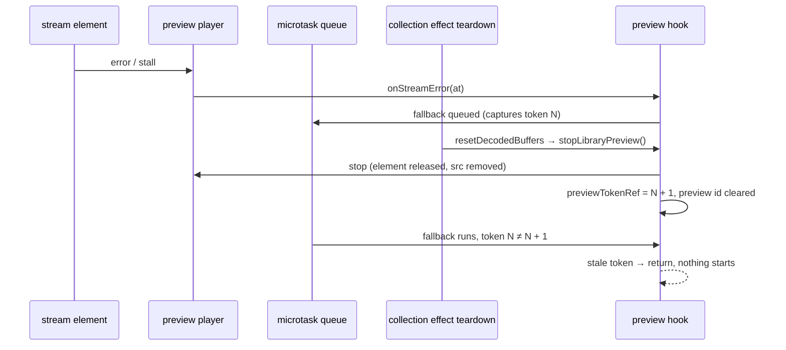

# SYS-R418-PREVIEW-LIFECYCLE: library preview ჩერდება collection-ის ცვლილებასა და unmount-ზე, დროის წაკითხვა კი seek-ის შემდეგაც დაცულია

**თარიღი:** 2026-11-09
**სტატუსი:** Completed (C round 421 PASS)
**შეცვლილი პროექტი:** Store (ორი runtime ფაილი, ერთი test ფაილი და ეს doc; `/studio-lab`-ში მომხმარებლისთვის ხილული ქცევა უცვლელია)

## კონტექსტი

Library preview-ს (`app/lib/arrangement/preview.client.ts`-ის `createLibraryPreviewPlayer` და `app/contexts/ArrangementContext.tsx`-ის preview hook-ები) round 418-ის შემდეგ რამდენიმე Low finding დარჩა. HEAD-ზე (`6609dfa`) collection effect-ის teardown (`resetDecodedBuffers`) controller-ს abort-ს უკეთებდა და decoded buffer-ებს შლიდა, მაგრამ preview-ს არ აჩერებდა და `previewTokenRef`-ს არ ზრდიდა. გარდა ამისა, stream preview-ის `readTime` fallback-ად element-ის შექმნისას დაფიქსირებულ `start`-ს იყენებდა, რომელსაც same-url seek არ ანახლებდა, ხოლო `getLibraryPreviewOffset` `currentTime`-ს დაუცველად კითხულობდა.

ამ რაუნდმა რვა Low finding დახურა:

| ID | პრობლემა | Row |
|---|---|---|
| TL-R418-L4 | collection-ის ცვლილებამდე დაგეგმილი stream fallback ახალი collection-ის `startLibraryPreviewRef.current`-ს იძახებდა; ძველი collection-ის preview კი ჟღერდა | PL1, PL2, PL3 (lock) |
| TL-R418-L1 | provider unmount-ზე token არ იზრდებოდა; დაგეგმილი fallback მხოლოდ refusal branch-ზე ჩერდებოდა | PL4 (lock) |
| GATE418-L4 | იგივე, რაც TL-R418-L1 (gate-ის ჩანაწერი) | PL4 (lock) |
| TL-R418-L2 | `readTime`-ის და watchdog tick-ის fallback ძველ `start`-ს ეყრდნობოდა | PL6, PL7 |
| A-R418-REVIEW-L1 | same-url seek `start`-ს არ ანახლებდა | PL6 |
| TL-R418-L3 | `getLibraryPreviewOffset` `currentTime`-ს დაუცველად კითხულობდა | PL8 |
| A-R418-REVIEW-L2 | იგივე, review-ის ჩანაწერი | PL8 |
| A-R418-REVIEW-L3 | PC12-ის სათაური „stall after the seek“-ს ამბობდა, body კი `error`-ს აგზავნიდა; seek-then-stall jsdom-ში დაფარული არ იყო | PC12 (სათაური), PL9 |

`/studio-lab` module constant-ს `studioLabDemoCollection`-ს გადასცემს, ამიტომ იქ collection-ის ცვლილება მიუღწეველია; ახალი stop trigger jsdom-ში მტკიცდება.

## მიდგომა

B-ის rulings (D-29z1469; დეტალები და ordering matrix — `tmp/studio-real-loop/b-round-420/sketch-review.md`):

1. **Collection teardown აჩერებს preview-ს.** `resetDecodedBuffers` იძახებს `stopLibraryPreview()`-ს: player ჩერდება, token იზრდება, preview id სუფთავდება და pin თავისუფლდება. `stopLibraryPreview` effect-ის deps-ში დაემატა. ეს teardown collection-ის ცვლილებაზეც და provider unmount-ზეც ეშვება, ამიტომ ორივე გზა token-ს ზრდის. ჩვეულებრივი re-render preview-ს არ აჩერებს — `tech-lead`-მა ათივე dependency-ის identity-ის სტაბილურობა შეამოწმა (PL5; browser row R11).
2. **`start` მიჰყვება same-url seek-ს.** შიდა `ActiveStreamPreview` იღებს `setStart`-სა და `readTime`-ს. Seek branch `currentTime` setter-მდე იძახებს `playing.setStart(start)`-ს; `readTime(fallback = start)` მიმდინარე `start`-ს კითხულობს.
3. **Watchdog tick-ის წაკითხვის fallback არის `armedAt`** (`readTime(armedAt)`): tick-ზე throw-ის მქონე წაკითხვა armed დროზე stall-ია.
4. **`getLibraryPreviewOffset` იყენებს დაცულ `active.readTime()`-ს.** Throw-ის მქონე getter-ზე ბრუნდება ბოლო seek offset და არასოდეს throw-დება; `null` კვლავ ნიშნავს „preview არ არის“.
5. **PC12-ის სათაური** ახლა ამბობს „an error after the seek“, რასაც body აკეთებს. ახალი PL9 seek-then-stall-ს jsdom-ში ამოწმებს.
6. **Transport-ის ქცევა უცვლელია.** `stopPlayback()`-ის არცერთი გამოძახება არ დამატებულა და არ მოხსნილა. Hook-ის public surface და `LibraryPreviewPlayer`-ის public მეთოდები უცვლელია; `setStart` და `readTime` მხოლოდ შიდა `ActiveStreamPreview`-შია.
7. **TL-R418-L1 და GATE418-L4 იხურება როგორც defence იმავე ხაზზე.** PL4 lock row-ია (TL-R421-01): unmount-ს design-ით ხილული ეფექტი არ აქვს, რადგან HEAD-ზეც fallback refusal branch-ზე ჩერდება. Token-ის ზრდას იგივე teardown ხაზი აკეთებს, რომელსაც MU-COLLECTION-NO-STOP შლის, და მის გარეშე PL1/PL2 წითლდება.
8. **არსებული row-ები:** ყველა არსებული `it()` body HEAD-ის ბაიტ-ბაიტ ტოლია; შეიცვალა მხოლოდ PC12-ის სათაური.
9. **Doc:** ეს ფაილი (271).

**Lock row-ები და რატომ არიან lock:**
- **PL3** — decode preview-ს ორი guard აქვს (controller-ის abort და token), ამიტომ ნებისმიერ ერთ mutant-ზე მწვანე რჩება (TL-R421-02).
- **PL4** — unmount-ის შემდეგ player ref და collection controller უკვე გასუფთავებულია, ამიტომ HEAD-ზეც არაფერი იწყება; token-ის ზრდის ხაზს PL1/PL2 აფიქსირებს (TL-R421-01).
- **PL5** — ruling 1-ის უარყოფითი მხარე (re-render არ აჩერებს); მისი browser ნახევარია R11.

განხილული ალტერნატივა: teardown-ში მხოლოდ token-ის გაზრდა, player-ის გაჩერების გარეშე. უარყოფილია, რადგან ძველი collection-ის preview ჟღერას გააგრძელებდა წყაროზე, რომელიც შეიძლება ბიბლიოთეკაში აღარ იყოს.

## არქიტექტურა



## შეცვლილი ფაილები

- `app/contexts/ArrangementContext.tsx` — `resetDecodedBuffers`-ში `stopLibraryPreview()` და effect-ის deps-ში `stopLibraryPreview`.
- `app/lib/arrangement/preview.client.ts` — `ActiveStreamPreview`-ის `setStart`/`readTime`, `let start`, seek branch-ში `setStart`, `readTime(fallback)`, tick-ზე `readTime(armedAt)`, `getLibraryPreviewOffset`-ში `active.readTime()`.
- `app/lib/arrangement/__tests__/library-preview-stream.test.tsx` — PC12-ის სათაური, `rerenderWith` და `throwingTimeAfter` helper-ები, PL1–PL9.
- `docs/implementation/2026/quarter-IV/271-sys-preview-lifecycle.md` — ეს doc.

## პრობლემები და გადაწყვეტები

- **პრობლემა:** collection-ის ცვლილებამდე დაგეგმილი fallback ახალ collection-ში იმავე id-ის წყაროს იწყებდა. **გადაწყვეტა:** teardown აჩერებს preview-ს და ზრდის token-ს; microtask ძველ token-ს ხედავს და არაფერს იწყებს (PL1, PL2).
- **პრობლემა:** same-url seek-ის შემდეგ throw-ის მქონე წაკითხვა პირველ `start`-ს აბრუნებდა. **გადაწყვეტა:** `setStart` seek branch-ში (PL6, PL8).
- **პრობლემა:** watchdog tick-ზე throw-ის მქონე წაკითხვა `start`-ზე ბრუნდებოდა და armed დროსთან შედარება stall-ს ტოვებდა. **გადაწყვეტა:** tick-ის fallback `armedAt`-ია (PL7).
- **პრობლემა:** `getLibraryPreviewOffset` შეიძლებოდა throw-დებულიყო. **გადაწყვეტა:** დაცული `readTime()` (PL8).

## ტესტირება

- A-ის targeted run (`b-round-420/covering-files.txt`, library preview-ის 14 test ფაილი): 14 ფაილი, 286/286 (`tmp/studio-real-loop/a-round-421/a2-vitest.log`). Stream ფაილი ცალკე: 49/49 (HEAD-ის 40 + PL1–PL9).
- `npm run typecheck` rc 0; `npm run lint` rc 0 (205 warning, 1 info); Biome სამ code ფაილზე rc 0.
- Mutant-ები (`tmp/studio-real-loop/b-round-420/mutants/summary.txt`, ბაიტ-ბაიტ):

```
SKETCH: red none | Tests  49 passed (49)
MU-HEAD-SRC: red PL1,PL2,PL6,PL7,PL8 | Tests 5 ⎯⎯⎯⎯⎯⎯⎯
MU-COLLECTION-NO-STOP: red PL1,PL2 | Tests 2 ⎯⎯⎯⎯⎯⎯⎯
MU-NO-SET-START: red PL6,PL8 | Tests 2 ⎯⎯⎯⎯⎯⎯⎯
MU-TICK-FALLBACK-START: red PL7 | Tests 1 ⎯⎯⎯⎯⎯⎯⎯
MU-OFFSET-RAW-READ: red PL8 | Tests 1 ⎯⎯⎯⎯⎯⎯⎯
MU-SEEK-KEEPS-OLD-HANDLER: red PC12,PL9 | Tests 2 ⎯⎯⎯⎯⎯⎯⎯
```

- Browser (C round 421, row 4): `/studio-lab`, 1440×900 და 1280×720, R1 (R1b, R10, R11), R5, R6, R7, R9 HEAD-თან შედარებით: ქცევა HEAD-ის ტოლია (B-ის precheck: `b-round-420/probe/compare-head-vs-sketch.txt`, ALL EQUAL, 16 უჯრა). R11 ამოწმებს, რომ preview ორ Snap toggle-სა და ორ zoom ნაბიჯში ჟღერას აგრძელებს.
- მეზობელი ქცევა, რომელსაც covering ფაილები ფარავს: `decoded-buffer-eviction-ui.test.tsx` EV12; `library-preview-stream.test.tsx` PC3, PS27, PS9, PS11, PS16–PS19, PS24, PS25, PS10.

## TODO / შემდეგი ნაბიჯები

- **Q-PREVIEW-STOPS-TRANSPORT (`awaiting_user`):** აჩერებს თუ არა preview timeline-ის playback-ს — Saba-ს გადაწყვეტილებას ელოდება.
- **A-R421-REVIEW-L1 (Low):** უკვე მჟღერი decoded buffer preview-ის გაჩერებას collection-ის ცვლილებაზე საკუთარი row არ აქვს; კოდი მას იმავე `stopLibraryPreview()` ხაზით ფარავს, რომელსაც PL1/PL2 აფიქსირებს.
- STEM-LANES-ის შემდეგ, როცა collection-ის ცვლილება მომხმარებლისთვის ხელმისაწვდომი გახდება, PL1/PL2-ის browser ნახევარი უნდა დაემატოს.
