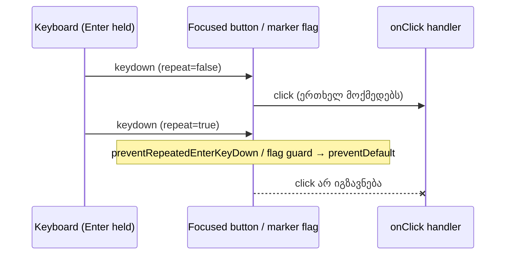

# SYS-2 stage 1: დაჭერილი Enter ერთხელ მოქმედებს Split, Follow, Back to start, Loop, Zoom to range და marker flag-ზე

**თარიღი:** 2026-11-09
**სტატუსი:** Completed (C round 422 PASS)
**შეცვლილი პროექტი:** Store (ორი component ფაილი, ერთი test ფაილი და ეს doc; ერთჯერადი დაჭერის და mouse click-ის ქცევა უცვლელია)

## კონტექსტი

Chromium focused `<button>`-ზე ყოველ auto-repeat Enter keydown-ზე `click`-ს აგზავნის, თუ ეს keydown `preventDefault`-ით არ შეჩერდა. HEAD-ზე (`4786c13`) `ArrangementTransport.tsx`-ს უკვე ჰქონდა `preventRepeatedEnterKeyDown` helper-ი (Play, Stop, Undo, Redo, Delete, Zoom back), Export-ს კი იგივე guard inline ჰქონდა. დაუცველი დარჩა Split, Follow, Back to start, Loop, Zoom to range და Fit, ასევე `ArrangementMarkerRow.tsx`-ის marker flag-ის `handleFlagKeyDown`.

რეალურ Chromium-ში (`/studio-lab`, B-ის HEAD probe) დაჭერილი Enter:

- Follow-ს და Loop-ს ხელახლა ცვლიდა (Loop-ზე undo history-საც ამატებდა);
- Back to start-ზე და marker flag-ზე playback-ს ხელახლა იწყებდა (ახალი source start-ები).

ამ რაუნდმა დახურა:

| ID | პრობლემა | Row |
|---|---|---|
| GATE107-S1-MARKER-FLAG-HELD-ENTER | marker flag-ზე დაჭერილი Enter `jumpToMarker`-ს იმეორებდა და playing-ის დროს graph-ს თავიდან იწყებდა | HE6 |
| A-R107-SWEEP-HELD-ENTER-TOOLBAR | ნაწილობრივ: Follow, Loop, Back to start, Split, Zoom to range | HE1–HE5 |

A-R107-SWEEP-HELD-ENTER-TOOLBAR ღია რჩება SYS-2 stage 2-ისთვის.

## მიდგომა

B-ის rulings (D-29z1473):

1. **Transport:** Split, Follow, Back to start, Loop და Zoom to range იღებს `onKeyDown={preventRepeatedEnterKeyDown}`-ს. ამ ელემენტებში სხვა არაფერი იცვლება.
2. **Marker flag:** `handleFlagKeyDown`-ის პირველი statement არის repeated Enter-ის guard (`event.key === 'Enter' && event.repeat` → `preventDefault` და return). ის target/modifier early return-მდეა, ამიტომ repeated Ctrl+Enter-იც ჩერდება, როგორც transport helper-ში, რომელიც modifier-ებს არ ამოწმებს. სხვა key სხვა branch-ში არ ხვდება (TL-R422-01).
3. **ერთჯერადი დაჭერა უცვლელია.** ახალი Enter (`repeat` false) და mouse click ისე მოქმედებს, როგორც HEAD-ზე. Space არ შეხებია; მას workspace გლობალურად ამუშავებს.
4. **`stopPropagation` არ არის.** Enter-ის არცერთი path `defaultPrevented`-ს არ კითხულობს (TL-R422-02).
5. **Focus და ვიზუალი უცვლელია.** არაფერი mount/unmount-დება; text, label, title და class არ იცვლება.
6. **SYS-2 stage 2** (არა ამ რაუნდში) A-R107 sweep-ის დანარჩენ site-ებს ფარავს: თითოეული ან guard-ს იღებს, ან idempotent გამონაკლისად ჩაიწერება.
7. **Doc:** ეს ფაილი (272).

**რატომ რჩება Fit დაუცველი.** `export-toolbar-hold-enter.test.tsx`-ის TH5 Fit-ის repeated Enter-ს „not prevented“-ად ამაგრებს (round 98-ის scope lock). Fit idempotent-ია: განმეორებული Fit იმავე zoom-ს აძლევს. Ruling: TH5 უპირატესია SYS-2 sweep-თან შედარებით; Fit-ზე guard არც A-მ დაამატა და არც C ზომავს.

**Ableton:** არ ეხება. ცვლილება მხოლოდ Chromium-ის auto-repeat activation-ს აჩერებს და per-press ქცევას არ ცვლის. რეფერენსი პროექტის საკუთარი კონვენციაა: round 108 (F2) და SABA-B-9 (TC8). Deviation არ არის.

## არქიტექტურა



## შეცვლილი ფაილები

- `app/components/arrangement/ArrangementTransport.tsx` — ხუთ ღილაკს (Split, Follow, Back to start, Loop, Zoom to range) დაემატა არსებული repeated Enter guard.
- `app/components/arrangement/ArrangementMarkerRow.tsx` — marker flag-ის keydown handler-ის დასაწყისში repeated Enter guard.
- `app/lib/arrangement/__tests__/transport-centre-ui.test.tsx` — ბოლოში დამატებული `describe` HE1–HE6 row-ებით (`timeout` 15 s); არსებული TC1–TC11 უცვლელია.
- `docs/implementation/2026/quarter-IV/272-sys-held-enter-transport.md` — ეს doc.

## პრობლემები და გადაწყვეტები

**პრობლემა:** Zoom to range idempotent-ია, ამიტომ განმეორებული click snapshot-ს ვერ ცვლის და row ვერ წითლდება.
**გადაწყვეტა:** HE5 repeat keydown-ის `defaultPrevented`-ს ამოწმებს; ეს ერთადერთი observable-ია (TL-R422-06). HE4-ის (Split) row-იც `holdEnter`-ის ორ assertion-ს ეყრდნობა: თითო repeat keydown შეჩერებულია და snapshot უცვლელია. რეალურ Chromium-ში SPLIT-ის და ZOOMRANGE-ის HEAD probe held-ზე ცვლილებას არ აჩვენებს (`head held []`), ამიტომ ამ ორ ღილაკზე შეჩერებული repeat keydown არის guard-ის მთავარი observable; MU-SPLIT HE4-ს მაინც აწითლებს.

**პრობლემა:** sketch review-მ HE4-სა და HE2-ში სუსტი assertion-ები იპოვა.
**გადაწყვეტა:** HE4 Undo title-ს `before`-ს ადარებს (TL-R422-04); HE2-ში სუსტი `toContain('"loop"')` ამოღებულია, `loop?.enabled === true` რჩება (TL-R422-05).

**პრობლემა:** Fit ფორმალურად sweep-ის ნაწილია, მაგრამ TH5 მას „not prevented“-ად ამაგრებს.
**გადაწყვეტა:** TH5 უპირატესია; Fit ამ რაუნდში უცვლელია.

## ტესტირება

ახალი row-ები `transport-centre-ui.test.tsx`-ში (თითო snapshot: arrangement JSON, Follow mode, zoom readout, Zoom back title, Undo title, insert marker, playing flag, status sequence და source starts):

| Row | რას ამტკიცებს |
|---|---|
| HE1 | ახალი Enter Follow mode-ს ცვლის; სამივე repeated Enter keydown შეჩერებულია (`defaultPrevented`) და snapshot-ს არ ცვლის |
| HE2 | time selection-ით ახალი Enter Loop-ს რთავს; repeat-ები არაფერს ცვლის |
| HE3 | playing-ის დროს ახალი Enter Back to start-ზე: insert marker `0.000`, playing true, `sourceStarts` იზრდება; სამი repeat-ის შემდეგ snapshot, `sourceStarts`-ის ჩათვლით, უცვლელია |
| HE4 | მონიშნულ clip-ზე ახალი Enter Split-ზე: arrangement-ში 2 clip, Undo title წინასგან განსხვავდება; სამი repeat-ის შემდეგ snapshot უცვლელია |
| HE5 | time selection-ით ახალი Enter Zoom to range-ზე zoom readout-ს ცვლის; სამი repeat keydown შეჩერებულია, snapshot უცვლელია |
| HE6 | playing-ის დროს marker flag-ზე („Verse“, 6 s) ახალი Enter: insert marker `6.000`, playing true, `sourceStarts` იზრდება; სამი repeat-ის შემდეგ snapshot, `sourceStarts`-ის ჩათვლით, უცვლელია |

Mutants (`tmp/studio-real-loop/b-round-421/mutants/run.py` → `summary.txt`). Sketch-ის test ფაილი უცვლელია; MU-HEAD-SRC ორივე component-ს HEAD-ზე აბრუნებს, დანარჩენი ექვსი თითო guard-ს აშორებს:

```
MU-HEAD-SRC: red HE1,HE2,HE3,HE4,HE5,HE6
MU-SPLIT: red HE4
MU-FOLLOW: red HE1
MU-BACK: red HE3
MU-LOOP: red HE2
MU-ZOOMRANGE: red HE5
MU-FLAG: red HE6
```

Browser, HEAD vs sketch (`tmp/studio-real-loop/b-round-421/probe/compare-head-vs-sketch.txt`; რეალური Chromium, `/studio-lab`, ერთი Enter + სამი repeated keydown):

| Button | Viewport | HEAD: held-ზე შეცვლილი | Sketch: პირველი Enter მოქმედებს | Sketch: held-ზე შეცვლილი |
|---|---|---|---|---|
| FOLLOW | 1440×900 / 1280×720 | `follow` | true | — |
| LOOP | 1440×900 / 1280×720 | `loop`, `undo` | true | — |
| SPLIT | 1440×900 / 1280×720 | — | true | — |
| ZOOMRANGE | 1440×900 / 1280×720 | — | true | — |
| BACK | 1440×900 / 1280×720 | `starts` | true | — |
| FLAG | 1440×900 / 1280×720 | `starts` | true | — |

შედეგი: `ALL OK (12 cells)`.

A-ს შემოწმებები (round 422): covering ტესტები — 23 ფაილი, 509/509; `npm run typecheck` rc 0; `npm run lint` rc 0; Biome სამ code ფაილზე rc 0. მეზობელი row-ები, რომლებიც უცვლელად გადის: `transport-centre-ui.test.tsx`-ის TC7, TC8 (Space და Enter Play/Stop-ზე), `self-disabling-focus.test.tsx`-ის FL9 (Undo/Redo/Delete/Zoom back guard-ები), `export-toolbar-hold-enter.test.tsx`-ის TH1–TH5 (Export guarded, Fit არა).

## TODO / შემდეგი ნაბიჯები

- **SYS-2 stage 2:** A-R107 sweep-ის დარჩენილი site-ები (`tmp/studio-real-loop/b-round-421/data/button-guard-scan.txt`) — თითოეულზე guard ან idempotent გამონაკლისის ruling; შემდეგ A-R107-SWEEP-HELD-ENTER-TOOLBAR იხურება.
