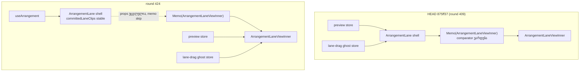

# PERF fix-up: clip drag-ის დროს lane კვლავ ერთხელ რენდერდება (lane shell-ის subscriptions inner-ში)

**თარიღი:** 2026-11-10
**სტატუსი:** Completed (C round 424 PASS)
**შეცვლილი პროექტი:** Store (ერთი component ფაილი, ერთი test ფაილი და ეს doc; ხილული ქცევა და budgets უცვლელია)

## კონტექსტი

C round 423-მა (REGRESSION-2026-11-10 part 1) ერთი Medium იპოვა: **C-R423-01**. interactions perf spec-ის 17 დეტერმინისტული `move-components` assert ჩავარდა. დანარჩენი რეგრესიის row-ები გავიდა.

მიზეზი: round 409-მა `ArrangementLane` გაყო shell-ად, რომელიც per-lane preview და lane-drag ghost store-ებს თავად იწერდა. მის ქვეშ იყო `memo(ArrangementLaneViewInner, areArrangementLaneViewPropsEqual)`. ყოველ drag commit-ზე preview იცვლებოდა, shell ხელახლა რენდერდებოდა და comparator-ი drag-ის დროს ყოველთვის `false`-ს აბრუნებდა. harness ითვლის fiber tag-ებს 0/1/11/14/15, ამიტომ ყოველი რენდერებული lane 3 fiber-ს ითვლიდა: shell, `Memo(ArrangementLaneViewInner)` და inner. Round 404-ში 1 იყო. ასე მიიღო თითო drag-მა **+2 fiber თითო რენდერებულ lane-ზე**.

ბრაუზერის name probe HEAD-ზე (`875ff37`) ამას ადასტურებს: fade drag-ის ყოველ commit-ზე ორი დამატებითი fiber არის `ArrangementLane` და `Memo(ArrangementLaneViewInner)`.

ჩავარდნილი 17 id (`c-round-423.json`, C-R423-01):

| id | r404 | r423 HEAD | sketch | budget |
|---|---|---|---|---|
| interact.drag.fade.playing.move-components-max | 4 | 6 | 4 | 4 |
| interact.drag.fade.playing.move-components-per-move | 3.933 | 5.9 | 3.933 | 4 |
| interact.drag.fade.stopped.move-components-max | 4 | 6 | 4 | 4 |
| interact.drag.fade.stopped.move-components-per-move | 3.933 | 5.9 | 3.933 | 4 |
| interact.drag.trim.playing.move-components-max | 15 | 17 | 15 | 15 |
| interact.drag.trim.playing.move-components-per-move | 14.75 | 16.717 | 14.75 | 15 |
| interact.drag.trim.stopped.move-components-max | 15 | 17 | 15 | 15 |
| interact.drag.trim.stopped.move-components-per-move | 14.75 | 16.717 | 14.75 | 15 |
| interact.drag.video-fade.playing.move-components-max | 3 | 5 | 3 | 3 |
| interact.drag.video-fade.stopped.move-components-max | 3 | 5 | 3 | 3 |
| interact.drag.video-fade.stopped.move-components-per-move | 2.95 | 4.917 | 2.95 | 3 |
| interact.drag.video-trim.playing.move-components-max | 15 | 17 | 15 | 15 |
| interact.drag.video-trim.stopped.move-components-max | 15 | 17 | 15 | 15 |
| interact.drag.video-trim.stopped.move-components-per-move | 12.817 | 14.783 | 12.817 | 13 |
| interact.drag.video.playing.move-components-max | 12 | 14 | 12 | 12 |
| interact.drag.video.stopped.move-components-max | 13 | 15 | 13 | 13 |
| interact.drag.video.stopped.move-components-per-move | 9.883 | 11.85 | 9.883 | 10 |

წყარო: loop-ის `b-round-423/perf-sketch/compare-404-423-sketch.txt` (B-ის sketch run, production build, 3 sample).

`test:perf` gate-ის row არ არის და 405–422 რაუნდებში არ გაშვებულა. Round 409 B-ის sketch-იდან გაიცა leaf-name probe-ით, მაგრამ sketch-ზე interactions spec-ის გარეშე. Retro-ს კანდიდატია RC-R423-PERF-SPEC-ON-STRUCTURE.

## მიდგომა

**Ruling: RESTORE (D-29z1481).** `tech-lead`-მა აღდგენა ურჩია: comparator-ი drag-ის დროს ყოველთვის ვარდება, budgets-ს კი რეზერვი განზრახ არ აქვს. `performance-optimizer`-ს განსხვავებული აზრი ჰქონდა: +2 მიეღოთ, რადგან latency არ შეცვლილა (`b-round-423/latency-404-vs-423.txt`). მისი latency-budget-ის იდეა შენახულია კანდიდატად PERF-CAND-DRAG-LATENCY-BUDGET. **Budgets არ შეცვლილა.**

ცვლილება B-ის განხილული sketch-ია (`b-round-423/sketch-424.patch.txt`, sha256 `942dfdb6…`, verdict approve-with-lows, `b-round-423/sketch-review.md`). A-მ ის ზუსტად გამოიყენა, შემდგომი ჩასწორების გარეშე:

- **Inner (`ArrangementLaneViewInner`)** თავად იწერს preview store-ს (`useStore` + `useShallow`). როცა preview არ არის, იყენებს ახალ prop-ს `committedLaneClips`. ასევე თავად იწერს lane-drag ghosts-ს და ითვლის `laneSources`-სა და `laneGhostTitles`-ს. Ghost title-ები `getArrangement().clips`-ს კითხულობს `useMemo`-ში, რომლის key ghosts-ია (TL-R424-L1, Low).
- **Shell (`ArrangementLane`)** ინარჩუნებს `useArrangement()`-ს და preview/ghost store-ებს აღარ იწერს. გადასცემს `committedLaneClips`-ს (სტაბილურია `useShallow(fn)(arrangement)`-ით), `collection`-ს, `sourcePeaks`-ს, `videoSources`-ს, `sourceDurations`-ს, `pxPerSecond`-სა და `hasArrangementClips`-ს.

ამის შედეგად drag commit inner-ს პირდაპირ აღწევს: shell და Memo wrapper არ რენდერდება, ამიტომ თითო lane კვლავ 1 fiber-ს ითვლის.

განხილული ალტერნატივა იყო budgets-ის +2-ით გაზრდა (performance-optimizer). ის უარყოფილია: ის რეგრესიას დამალავდა და budgets-ის „რეზერვის გარეშე“ პრინციპს დაარღვევდა.

## არქიტექტურა



Drag commit HEAD-ზე: shell → Memo → inner = 3 fiber. Round 424-ზე: მხოლოდ inner = 1 fiber.

## შეცვლილი ფაილები

- `app/components/arrangement/ArrangementLane.tsx`: preview და ghost subscriptions, `laneSources` და `laneGhostTitles` shell-იდან inner-ში გადავიდა. Props: `clips`, `laneSources`, `laneGhosts` და `laneGhostTitles` ჩანაცვლდა `committedLaneClips`-ით, `collection`-ით, `sourcePeaks`-ით და `videoSources`-ით.
- `app/lib/arrangement/__tests__/drag-preview-render.test.tsx`: DP2, DP49 და DP21-ში `rendersOf('ArrangementLane')).toBe(2)` გადავიდა `ArrangementLaneViewInner`-ზე, იგივე მნიშვნელობით. DP29-ში `toBeGreaterThan(0)` გადავიდა inner-ზე. ოთხივე row-ს დაემატა `rendersOf('ArrangementLane')).toBe(0)`. არცერთი assertion არ დაკარგულა; ჩანაცვლება თანაბარი ან უფრო მკაცრია.
- `docs/implementation/2026/quarter-IV/273-perf-fix-lane-shell-subscriptions.md`: ეს doc.

## პრობლემები და გადაწყვეტები

- **პრობლემა:** shell-ის split-მა (round 409) drag-ის დროს comparator-ი უსარგებლო გახადა და lane-ზე fiber-ების რაოდენობა 1-დან 3-მდე გაზარდა.
  **გადაწყვეტა:** subscriptions inner-შია. Shell-ის props drag-ის დროს სტაბილურია, ამიტომ shell და Memo არ რენდერდება.
- **პრობლემა:** `laneSources`-ს peaks, collection და video sources სჭირდება, რომლებიც shell-ში იყო.
  **გადაწყვეტა:** ისინი memo props-ად გადაეცემა. `sourcePeaks` და `videoSources` `useState` მნიშვნელობებია, ამიტომ drag-ის დროს სტაბილურია.
- **პრობლემა:** round 404-ის ყველა მნიშვნელობა არ დაბრუნდა (INFO-B423-LANE-RESTORE-PARTIAL).
  **გადაწყვეტა:** დარჩენილი სხვაობები record-only ან budget-ის ფარგლებშია, ამიტომ მიღებულია ჩანაწერად:
  - zoom: 41 → 45;
  - move/lane max: 40 → 44;
  - group max: 44 → 48;
  - per-move: +0.2…0.5.

  Round 409-ის დაზოგვა შენარჩუნდა: play start/stop 11 → 7.

## ტესტირება

**Name probe** (ბრაუზერი, 1440×900, loop-ის `b-round-423/probe/names-summary.txt`):

```
fade-names-head: commits 59 maxSize 6 meanSize 6 shell 59 memoLane 59 inner 59 errors 0
fade-names-sketch: commits 59 maxSize 4 meanSize 4 shell 0 memoLane 0 inner 59 errors 0
trim-names-head: commits 59 maxSize 17 meanSize 17 shell 59 memoLane 59 inner 59 errors 0
trim-names-sketch: commits 59 maxSize 15 meanSize 15 shell 0 memoLane 0 inner 59 errors 0
```

**Mutants** (loop-ის `b-round-423/mutants/summary.txt`):

```
MU-SHELL-SUBSCRIBES (HEAD ArrangementLane.tsx + sketch tests): drag-preview-render 4 failed / 73 passed (DP2 l.436, DP49 l.610, DP21 l.978, DP29 l.1248 -> ArrangementLane expected 0) -> mutants/mutant-SHELL-SUBSCRIBES-HEAD.log
MU-PERF-HEAD (HEAD source, perf interactions spec): 17 asserted ids red -> c-round-423/perf-results/latest-interactions.json (C round 423 run, rc 1)
SKETCH (perf interactions spec): 95/95 asserted rows pass, the 17 ids at round-404 values -> perf-sketch/latest-interactions.json, perf-sketch/compare-404-423-sketch.txt
```

ზემოთ ბლოკი artifact-ის ზუსტი ასლია. მისი `l.` ნომრები HEAD-ის ძველ assertion-ის ხაზებს უჩვენებს. ცვლილების შემდეგ ახალი `rendersOf('ArrangementLane')).toBe(0)` assertions არის test ფაილის ხაზებზე 437, 612, 981 და 1252.

DP30 (l.1272, ეს row ამ რაუნდში არ შეცვლილა) კვლავ ამოწმებს `rendersOf('ArrangementLane')).toBeGreaterThan(0)`-ს same-lane move-ზე x=80-მდე და ის გადის. ამ ნაბიჯზე shell-ი რენდერდება, DP21-ის ნაბიჯზე კი არა. ეს row B-ის claims-ში ცნობილი ნარჩენია: K10 `lane-gt0 1` sketch-ზე. მიზეზი ამ რაუნდში არ დადგენილა. Name probe-ის fade და trim drag-ებზე shell 0-ია.

**A-ს შემოწმებები** (round 424, loop-ის `a-round-424/`):

- covering set: 12 ფაილი, 291/291 (`drag-preview-render` 77/77);
- `npm run typecheck`: rc 0;
- `npm run lint`: rc 0 (205 warning, 1 info);
- Biome 2 ფაილზე: rc 0, fixes არ გამოყენებულა.

**C-ს შემოწმებები:** perf interactions spec (C-R423-01-ის 17 id), name probe, ghost title, lane/leaf, video და play smoke, auth (C round 424).

## TODO / შემდეგი ნაბიჯები

- **TL-R424-L1 (Low, `deferred_low_polish`):** ghost title-ის memo-ს key `laneGhosts`-ია და render-ის დროს `getArrangement().clips`-ს კითხულობს. მინიმალური ფიქსია `sourceId`-ის დამატება `ClipLaneGhost`-ზე.
- **TL-R424-L2 (Low, `deferred_low_polish`):** `useArrangementPreviewLaneClips` ახლა მხოლოდ ტესტებში გამოიყენება. მის წაშლას Saba-ს თანხმობა სჭირდება.
- **TL-R424-L3 (Low, `deferred_low_polish`):** `selectPreviewLaneClips(state.preview, state.preview, …)` და `(null, committed, …)` ბუნდოვნად იკითხება; lane filter-ი უფრო გასაგები იქნება.
- **PERF-CAND-DRAG-LATENCY-BUDGET:** performance-optimizer-ის კანდიდატი, drag-ის latency budget-ი fiber count-ის გვერდით.
