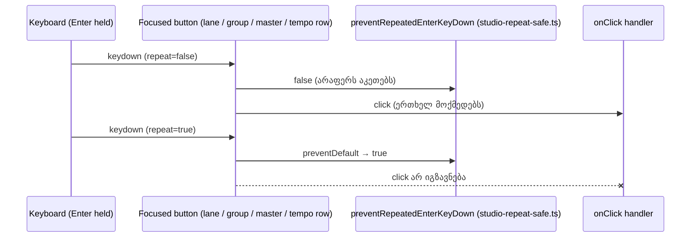

# SYS-2 stage 2a: დაჭერილი Enter ერთხელ მოქმედებს lane-ის, group-ის, master-ის და tempo row-ის ღილაკებზე

**თარიღი:** 2026-11-10
**სტატუსი:** Completed (C round 429 PASS)
**შეცვლილი პროექტი:** Store (ერთი ახალი shared helper, ხუთი component ფაილი, ერთი type ფაილი, ერთი ახალი test ფაილი და ეს doc; ერთჯერადი დაჭერის და mouse click-ის ქცევა უცვლელია)

## კონტექსტი

Chromium focused `<button>`-ზე ყოველ auto-repeat Enter keydown-ზე `click`-ს აგზავნის, თუ ეს keydown `preventDefault`-ით არ შეჩერდა. SYS-2 stage 1-მა (doc 272, round 422) transport-ის ღილაკები და marker flag დაიცვა. HEAD-ზე (`f6c76f4`) დაუცველი დარჩა mixer-ის მხარე.

რეალურ Chromium-ში (`/studio-lab`, B-ის HEAD probe, `tmp/studio-real-loop/b-round-425/probe/head/*.json`) დაჭერილი Enter ყოველ repeat-ზე ხელახლა:

- რთავდა/თიშავდა track Mute-ს და Solo-ს, group Mute-ს და Solo-ს, Master Mute-ს და metronome-ს;
- კეცავდა/შლიდა track fold-ს და group fold-ს;
- ხელახლა ხსნიდა video file chooser-ს.

**ოთხი stage-2a ფაილის სკანირება** (Enter-ზე მორგებული scanner `tmp/studio-real-loop/b-round-425/button-guard-scan-enter.py`): 14 ღილაკი; 11-ს `onKeyDown` საერთოდ არ ჰქონდა, 3-ს ჰქონდა, მაგრამ Enter-ს არ ამუშავებდა (track fold და group fold მხოლოდ განმეორებულ Space-ს იცავდა; group name ღილაკი მხოლოდ F2-ს).

**Scanner-ის შენიშვნა (INFO-B425-SCANNER-SPACE-AS-ENTER):** round 421-ის scanner Space-only group-fold guard-ს Enter guard-ად თვლიდა. ახალი scanner named handler-ებს ხსნის და მოითხოვს `'Enter'`-ს `repeat`-თან ერთად (ან helper-ს). მთელ folder-ზე HEAD-ზე: 62 ღილაკი, 23 ENTER-GUARD, 7 KEYDOWN-NO-ENTER, 32 NONE (`tmp/studio-real-loop/b-round-425/data/scan-all-head.txt`; stage 2b ამ რიცხვებიდან იზომება).

HEAD-ზე `ArrangementTransport.tsx`-ს ჰქონდა private `preventRepeatedEnterKeyDown` (11 ღილაკი) და Export-ზე მისი მეორე inline ასლი. `SoftDisabledButtonProps` იყო `{ 'aria-disabled'?; onMouseDown? }`; transport-ის შვიდ ღილაკზე (Undo, Redo, Split, Delete, Loop, Zoom to range და Zoom back) `onKeyDown` guard `{...softDisabledButtonProps(...)}` spread-მდე დგას, ამიტომ type-ში მომავალი `onKeyDown` guard-ს ჩუმად გადაფარავდა (A-R422-REVIEW-L1).

ამ რაუნდის ID-ები:

| ID | სტატუსი | Row |
|---|---|---|
| A-R422-REVIEW-L1-ONKEYDOWN-SPREAD-ORDER | დახურული | HM15 |
| A-R107-SWEEP-HELD-ENTER-TOOLBAR | ნაწილობრივ (ღია რჩება stage 2b-სთვის) | HM1–HM14 |
| SIG-R422-REPEAT-SAFE-BUTTON-PROPS | გადაწყვეტილი (ruling 1) | HM15 |

## მიდგომა

B-ის rulings (D-29z1489):

1. **ერთი shared helper:** ახალი `app/components/arrangement/studio-repeat-safe.ts` export-ს აკეთებს `preventRepeatedEnterKeyDown(event: KeyboardEvent<HTMLElement>): boolean`-ს. ის `preventDefault()`-ს იძახებს და `true`-ს აბრუნებს მხოლოდ `key === 'Enter' && repeat`-ზე; სხვა შემთხვევაში `false`-ს აბრუნებს და არაფერს აკეთებს. `stopPropagation` არ არის.
2. **Transport:** private ფუნქცია წაიშალა და shared helper შემოვიდა import-ით; Export-ის inline ასლი გახდა `onKeyDown={preventRepeatedEnterKeyDown}`. ქცევა იდენტურია. **Fit დაუცველი რჩება** (TH5 lock).
3. **დამატებული guard-ები** (`onKeyDown={preventRepeatedEnterKeyDown}`, ან არსებული handler-ის პირველი statement `if (preventRepeatedEnterKeyDown(event)) { return; }`):
   - `ArrangementLane.tsx`: track Mute, Solo, active-track name ღილაკი, video import (full და compact), Pan reset, track fold (`handleFoldKeyDown`).
   - `ArrangementGroupHeader.tsx`: group fold (inline handler), group name ღილაკი (`handleNameKeyDown`), group Mute, group Solo.
   - `ArrangementMaster.tsx`: Master Mute, master peak reset.
   - `ArrangementTempoRow.tsx`: metronome toggle.
4. **Group name input:** განმეორებული Enter ან Escape კვლავ prevent და stop-დება, მაგრამ editor-ს აღარ ხურავს; ახალი Enter commit-ს აკეთებს, ახალი Escape — cancel-ს, როგორც დღეს. ეს defensive guard-ია (TL-R425-04): repeat ახლად გახსნილ editor-მდე იშვიათად აღწევს.
5. **Pan reset-იც დაცულია** (TL-R425-02): ჩვეულებრივ მისი click focus-ს Pan slider-ზე გადაიტანს, ამიტომ repeat-ები slider-ზე ხვდება და არაფერს ცვლის; როცა reset უარყოფილია (აქტიური pointer gesture), focus ღილაკზე რჩება და guard ყოველ repeat-ზე უარის ხელახალ announcement-ს აჩერებს.
6. **Type guard** (ხურავს A-R422-REVIEW-L1-ს): `SoftDisabledButtonProps` იღებს `onKeyDown?: never;`-ს. HM15 ამას `expectTypeOf`-ით ამოწმებს (`npm run typecheck`) და runtime-ზე regression pin-ითაც (`'onKeyDown' in softDisabledButtonProps(true | false)` არის false). Runtime ნაწილი HEAD-ზეც მწვანეა, ამიტომ type guard-ის რეალური მტკიცებულება `expectTypeOf` და MU-SPREAD-TYPE-ია (TL-R425-01).
7. **ერთჯერადი დაჭერა უცვლელია.** ახალი Enter, Space, F2, Escape და mouse click (Ctrl/Cmd/Shift-ით ან მის გარეშე) ზუსტად ისე მოქმედებს, როგორც HEAD-ზე. Text, label, title, class და layout არ იცვლება; არაფერი mount/unmount-დება. Screen-budget და product-designer row-ები არ ეხება.
8. **Focus target-ები (L47):** Pan reset-ზე ახალი Enter-ის შემდეგ focus იმავე track-ის Pan slider-ზეა; group name editor-ში ახალი Enter-ის ან Escape-ის შემდეგ focus group name ღილაკზეა. ორივე დღევანდელი ქცევაა (C row 6).
9. **Stage 2b (შემდეგი):** library, video dock, detail panel, grid menu, marker menu და editor Escape, export dialog, shortcut sheet, narrow screen, footer ღილაკები; ასევე ყველა დარჩენილი inline `key === 'Enter' && event.repeat` ასლის helper-ზე გადატანა grep row-ით (TL-R425-06). Marker flag-ის inline guard-იც იქ გადავა.
10. **Doc:** ეს ფაილი (274).

**Ableton:** არ ეხება. ცვლილება მხოლოდ Chromium-ის auto-repeat activation-ს აჩერებს და per-press ქცევას არ ცვლის, ამიტომ Live-ის ქცევა შესადარებელი არ არის. რეფერენსი პროექტის საკუთარი კონვენციაა (rounds 108 და 422). Deviation არ არის.

## არქიტექტურა



## შეცვლილი ფაილები

- `app/components/arrangement/studio-repeat-safe.ts` — ახალი shared helper `preventRepeatedEnterKeyDown`.
- `app/components/arrangement/ArrangementTransport.tsx` — private helper წაიშალა და shared helper შემოვიდა; Export-ის inline ასლი helper-ით შეიცვალა. Fit უცვლელია.
- `app/components/arrangement/ArrangementLane.tsx` — guard track Mute-ზე, Solo-ზე, name ღილაკზე, ორივე video import ღილაკზე, Pan reset-ზე და `handleFoldKeyDown`-ში.
- `app/components/arrangement/ArrangementGroupHeader.tsx` — guard group fold-ზე, `handleNameKeyDown`-ში, group Mute-ზე და Solo-ზე; name input-ში განმეორებული Enter/Escape editor-ს აღარ ხურავს.
- `app/components/arrangement/ArrangementMaster.tsx` — guard Master Mute-ზე და peak reset-ზე.
- `app/components/arrangement/ArrangementTempoRow.tsx` — guard metronome toggle-ზე.
- `app/components/arrangement/studio-soft-disabled.ts` — `SoftDisabledButtonProps`-ს დაემატა `onKeyDown?: never`.
- `app/lib/arrangement/__tests__/mixer-held-enter-ui.test.tsx` — ახალი test ფაილი, row-ები HM1–HM15 (17 test).
- `docs/implementation/2026/quarter-IV/274-sys-held-enter-mixer.md` — ეს doc.

## პრობლემები და გადაწყვეტები

**პრობლემა:** round 421-ის scanner Space-only fold guard-ს Enter guard-ად თვლიდა, ამიტომ დაუცველი ღილაკების რაოდენობა ნაკლებად ჩანდა.
**გადაწყვეტა:** ახალი Enter-specific scanner (`button-guard-scan-enter.py`), რომელიც named handler-ებს ხსნის; stage 2b მისი HEAD output-ით იზომება.

**პრობლემა:** guard-ის ორი ასლი (`ArrangementTransport.tsx`-ის private ფუნქცია და Export-ის inline კოდი) და ახალ ფაილებში მესამე, მეოთხე ასლის რისკი.
**გადაწყვეტა:** ერთი shared helper `studio-repeat-safe.ts`-ში, რომელსაც ყველა stage-2a site იყენებს (SIG-R422-REPEAT-SAFE-BUTTON-PROPS).

**პრობლემა:** `softDisabledButtonProps(...)` spread guard-ის შემდეგ დგას, ამიტომ type-ში მომავალი `onKeyDown` transport-ის შვიდი ღილაკის guard-ს ჩუმად გადაფარავდა.
**გადაწყვეტა:** `onKeyDown?: never` type-ში; HM15 ამას compile-time-ზე ამოწმებს (`expectTypeOf`), runtime assert კი მხოლოდ regression pin-ია. MU-SPREAD-TYPE (`never` ამოღებული) `tsc`-ს აწითლებს.

**პრობლემა:** master peak reset და Zoom to range-ის მსგავსად idempotent-ია, ამიტომ განმეორებული click snapshot-ს ვერ ცვლის.
**გადაწყვეტა:** HM13 repeat keydown-ის `defaultPrevented`-ს ამოწმებს; browser probe-ში MPEAK-ის პირველი Enter-ის „მოქმედება“ არ მოითხოვება (peak-ის გარეშე reset idempotent-ია).

## ტესტირება

ახალი row-ები `app/lib/arrangement/__tests__/mixer-held-enter-ui.test.tsx`-ში. თითო snapshot: arrangement JSON, Undo title, status sequence, active track, track folded/selected attribute-ები, group selected/collapsed attribute-ები, ყველა `aria-pressed`, name input-ის არსებობა და file chooser-ის click count.

| Row | რას ამტკიცებს |
|---|---|
| HM1 | ახალი Enter track Mute-ზე mute-ს რთავს; სამი repeated Enter შეჩერებულია და snapshot-ს არ ცვლის |
| HM2 | იგივე track Solo-სთვის |
| HM3 | ახალი Enter SFX lane-ს ერთხელ კეცავს |
| HM4 | ახალი Ctrl+Enter track name-ზე selection-ს ერთხელ ცვლის და active track-ს აყენებს |
| HM5 | Pan reset ერთხელ ცენტრავს, focus Pan slider-ზე გადადის, slider-ზე repeat-ები არაფერს ცვლის, reset-ზე მისული repeat-ები შეჩერებულია |
| HM6 / HM6b | full და compact video import ღილაკი file chooser-ს ერთხელ ხსნის |
| HM7 | ახალი Enter group-ს ერთხელ კეცავს |
| HM8 / HM9 | group mute ერთხელ; group solo `data-solo` off → on ერთხელ |
| HM10 | ახალი Ctrl+Enter group name-ზე group selection-ს ერთხელ ცვლის |
| HM11 / HM11b | განმეორებული Enter/Escape editor-ს არ ხურავს; ახალი Enter `Bed`-ს commit-ს აკეთებს (focus name ღილაკზე, შემდეგი repeat-ები შეჩერებულია); ახალი Escape cancel-ს აკეთებს |
| HM12 / HM13 | Master mute ერთხელ; peak reset-ის repeat-ები შეჩერებულია |
| HM14 | tempo 120-ით metronome ერთხელ ირთვება |
| HM15 | helper მხოლოდ განმეორებულ Enter-ს აჩერებს (არა ახალ Enter-ს, Space-ს ან F2-ს); `SoftDisabledButtonProps['onKeyDown']` არის `undefined` (typecheck) და runtime-ზე არ არსებობს |

Mutants (`tmp/studio-real-loop/b-round-425/mutants/run.py` → `summary.txt`; base = HEAD, sketch-ის test ფაილი უცვლელია):

```
MU-HEAD-SRC: red HM1,HM2,HM3,HM4,HM5,HM6,HM6b,HM7,HM8,HM9,HM10,HM11,HM11b,HM12,HM13,HM14 (16 failed | 1 passed (17))
MU-LANE-MUTE: red HM1 (1 failed | 16 passed (17))
MU-LANE-SOLO: red HM2 (1 failed | 16 passed (17))
MU-LANE-FOLD: red HM3 (1 failed | 16 passed (17))
MU-LANE-NAME: red HM4 (1 failed | 16 passed (17))
MU-LANE-VIDEO: red HM6 (1 failed | 16 passed (17))
MU-LANE-VIDEO-COMPACT: red HM6b (1 failed | 16 passed (17))
MU-PAN-RESET: red HM5 (1 failed | 16 passed (17))
MU-GROUP-FOLD: red HM7 (1 failed | 16 passed (17))
MU-GROUP-NAME: red HM10,HM11 (2 failed | 15 passed (17))
MU-GROUP-INPUT: red HM11,HM11b (2 failed | 15 passed (17))
MU-GROUP-MUTE: red HM8 (1 failed | 16 passed (17))
MU-GROUP-SOLO: red HM9 (1 failed | 16 passed (17))
MU-MASTER-MUTE: red HM12 (1 failed | 16 passed (17))
MU-MASTER-PEAK: red HM13 (1 failed | 16 passed (17))
MU-METRONOME: red HM14 (1 failed | 16 passed (17))
MU-HELPER: red HM1,HM2,HM3,HM4,HM5,HM6,HM6b,HM7,HM8,HM9,HM10,HM12,HM13,HM14,HM15 (15 failed | 2 passed (17))
MU-SPREAD-TYPE: tsc rc 2, 1 error line(s) in mixer-held-enter-ui.test.tsx
```

Browser, HEAD vs sketch (`tmp/studio-real-loop/b-round-425/probe/compare.txt`; რეალური Chromium, `/studio-lab`, 1440×900 და 1280×720, ერთი Enter + სამი repeated keydown):

| Button | HEAD: held-ზე შეცვლილი | Sketch: პირველი Enter მოქმედებს | Sketch: held-ზე შეცვლილი |
|---|---|---|---|
| LMUTE | `pressed` | true | — |
| LSOLO | `pressed` | true | — |
| LFOLD | `folded`, `pan` | true | — |
| LNAME | — | true | — |
| LVIDEO | `chooser` | true | — |
| PANRESET | — | true | — |
| GFOLD | `pressed`, `folded`, `trackSel`, `groupCollapsed`, `groupNames`, `pan` | true | — |
| GMUTE | `pressed` | true | — |
| GSOLO | `pressed` | true | — |
| GNAME | — | true | — |
| GEDIT | — | true | — |
| MMUTE | `pressed` | true | — |
| MPEAK | — | false (peak-ის გარეშე reset idempotent-ია) | — |
| METRO | `pressed`, `status` | true | — |

ორივე viewport-ზე შედეგი ერთნაირია: `ALL OK (28 cells)`.

A-ს შემოწმებები (round 426; log-ები `tmp/studio-real-loop/a-round-426/`-ში): covering ტესტები — 57 ფაილი, 1015/1015 (`mixer-held-enter-ui` 17/17); `npm run typecheck` rc 0; `npm run lint` rc 0 (205 warning, 1 info — იგივე, რაც B-ის sketch-ზე); Biome რვა code ფაილზე rc 0, fix-ის გარეშე. მეზობელი row-ები, რომლებიც covering set-ში უცვლელად გადის: `transport-centre-ui.test.tsx`-ის TC/HE row-ები და `export-toolbar-hold-enter.test.tsx`-ის TH1–TH5 (Export guarded, Fit არა).

## TODO / შემდეგი ნაბიჯები

- **SYS-2 stage 2b:** library, video dock, detail panel, grid menu, marker menu და editor Escape, export dialog, shortcut sheet, narrow screen და footer ღილაკები; ყველა დარჩენილი inline `key === 'Enter' && event.repeat` ასლის (marker flag-ის ჩათვლით) shared helper-ზე გადატანა grep row-ით (TL-R425-06). ამის შემდეგ A-R107-SWEEP-HELD-ENTER-TOOLBAR იხურება.
