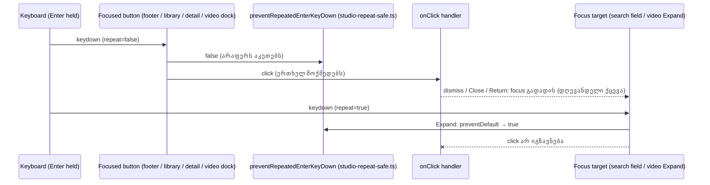

# SYS-2 stage 2b-i: დაჭერილი Enter ერთხელ მოქმედებს footer toggle-ებზე, library tree-ზე, detail toggle-ზე და video dock-ზე

**თარიღი:** 2026-11-10
**სტატუსი:** Completed (C round 429 PASS)
**შეცვლილი პროექტი:** Store (ხუთი component ფაილი, ერთი არსებული და ერთი ახალი test ფაილი და ეს doc; ერთჯერადი დაჭერის და mouse click-ის ქცევა უცვლელია)

## კონტექსტი

Chromium focused `<button>`-ზე ყოველ auto-repeat Enter keydown-ზე `click`-ს აგზავნის, თუ ეს keydown `preventDefault`-ით არ შეჩერდა. SYS-2 stage 1-მა (doc 272, round 422) transport დაიცვა, stage 2-მა (2a, doc 274, round 426) mixer-ის მხარე და shared helper `preventRepeatedEnterKeyDown` (`app/components/arrangement/studio-repeat-safe.ts`) შემოიტანა. HEAD-ზე (`052c76c`) დაუცველი დარჩა footer-ის, library-ის, detail panel-ის და video dock-ის ღილაკები.

რეალურ Chromium-ში (`/studio-lab`, B-ის HEAD probe, `tmp/studio-real-loop/b-round-426/probe/head/*.json`; 18-დან 14 cell-ში მდგომარეობა repeat-ებზე იცვლებოდა) დაჭერილი Enter ყოველ repeat-ზე ხელახლა:

- რთავდა/თიშავდა footer-ის Snap და Envelope toggle-ს;
- კეცავდა/შლიდა library collection-ს;
- კეცავდა/შლიდა detail panel-ს;
- video-ს floating-ზე გადაიყვანდა და ისევ dock-ავდა;
- Close-ის ან Return-ის შემდეგ focus Expand-ზე გადადიოდა, ამიტომ repeat-ები video-ს ხელახლა floating-ზე გადაიყვანდა.

**HEAD-ის რიცხვები** (B-ის claims, `tmp/studio-real-loop/b-round-426/claims-427-planning-output.txt`):

- ხუთ ფაილში 5 inline `event.key === 'Enter' && event.repeat` ასლი: Library 1 (private `preventRepeatedLibraryEnter`-ის შიგნით, რომელიც 3-ჯერ გამოიყენებოდა), LibraryPreview 2, DetailPanel 2. არცერთი ფაილი shared helper-ს import-ით არ იყენებდა.
- Enter scanner (`tmp/studio-real-loop/b-round-425/button-guard-scan-enter.py`) ხუთ ფაილზე: 7 ENTER-GUARD, 3 KEYDOWN-NO-ENTER (detail toggle, video drag handle, library option; option-ის Enter branch delegated handler-შია, რომელსაც scanner ვერ ხედავს), 11 NONE (10 ამ რაუნდის scope-ში და footer-ის Shortcuts ღილაკი, რომელიც shortcut sheet-თან ერთად 2b-ii-ში გადადის).
- მთელ folder-ზე: 37 ENTER-GUARD, 4 KEYDOWN-NO-ENTER, 21 NONE.
- Detail toggle-ის `handleToggleKeyDown` მხოლოდ Space-ს ამუშავებდა (keydown-ზე toggle, Space repeat იგნორირდება); Enter native click-მდე აღწევდა.
- Library option-ები განმეორებულ Enter-ს უკვე აიგნორებდა (`handleOptionKeyDown` მხოლოდ `if (!event.repeat)`-ზე მოქმედებს); search field-ის `handleSearchKeyDown`-ს Enter branch არ აქვს.

ამ რაუნდის ID-ები:

| ID | სტატუსი | Row |
|---|---|---|
| A-R107-SWEEP-HELD-ENTER-TOOLBAR | ნაწილობრივ (ღია რჩება stage 2b-ii-სთვის) | HP1–HP9 |
| TL-R425-09 | premise შესწორებულია (ruling 6) | HM5b (characterization) |

## მიდგომა

B-ის rulings (D-29z1493 … D-29z1496):

1. **დამატებული guard-ები.** თითოეული არის `onKeyDown={preventRepeatedEnterKeyDown}`, ან არსებული handler-ის პირველი statement `if (preventRepeatedEnterKeyDown(event)) { return; }`:
   - `StudioWorkspace.tsx`: Snap toggle და Envelope toggle.
   - `ArrangementLibrary.tsx`: collection fold, All node, collection node, folder node და notice dismiss.
   - `ArrangementDetailPanel.tsx`: detail toggle, `handleToggleKeyDown`-ის პირველ statement-ად, ამიტომ Space დღევანდელივით მუშაობს.
   - `ArrangementVideoDock.tsx`: Expand/Return, floating Close და placeholder Return.
2. **Fold-ები (ქცევა იდენტურია):**
   - private `preventRepeatedLibraryEnter` წაიშალა და მისი 3 გამოყენება shared helper-ს იყენებს;
   - LibraryPreview-ის 2 და DetailPanel-ის 2 inline ასლი გახდა `onKeyDown={preventRepeatedEnterKeyDown}`;
   - LibraryPreview-ის ასლები `{...softDisabledButtonProps(...)}`-მდე რჩება; ამ spread-ს `onKeyDown` ვერ მოაქვს (`onKeyDown?: never`, round 426).
3. **Scope-ის გარეთ (ruling):**
   - video drag handle (KEYDOWN-NO-ENTER, `onClick` არ აქვს): Enter-ს იქ მოქმედება არ აქვს;
   - Transport Fit დაუცველი რჩება (TH5 lock);
   - search field და library option-ები: option-ები განმეორებულ Enter-ს უკვე აიგნორებს, search field-ს Enter-ის მოქმედება არ აქვს.
4. **ერთჯერადი დაჭერა უცვლელია.** ახალი Enter, Space ან mouse click ზუსტად ისე მოქმედებს, როგორც HEAD-ზე. Text, label, title, class და layout არ იცვლება; ახალი არაფერი mount-დება. Screen-budget, product-designer და journey row-ები არ ეხება.
5. **Focus target-ები (L47, L50).** სამი ღილაკი, რომელიც თავის თავს unmount-ს უკეთებს, focus-ს დღევანდელივით mount-ში დარჩენილ ელემენტს გადასცემს:
   - notice dismiss → library search field (`input[type=search]`);
   - floating Close → video Expand ღილაკი;
   - placeholder Return → video Expand ღილაკი (dock-ის effect cleanup იძახებს `expandButtonRef.current?.focus()`-ს).

   შემდეგ repeat-ები ამ ელემენტზე ხვდება. Search field მათ აიგნორებს; Expand მათ მხოლოდ ამ რაუნდის guard-ით აიგნორებს (მის გარეშე ეს HEAD-ის ბაგია). L50 regex ხუთ ფაილში 18 / 20 / 5 / 11 / 17 hit-ს იძლევა და sketch-ის 0 დამატებული და 0 წაშლილი ხაზი ემთხვევა მას: sketch focus call-ს, blur handler-ს, pointer-down handler-ს, list render-ს ან conditional render-ს არ ამატებს, არ აადგილებს და არ შლის. ყველა 71 hit არსებული და scope-ის გარეთაა. დანარჩენი guarded ღილაკები focus-ს ინარჩუნებს (toggle-ები) ან idempotent-ია (tree node-ები).
6. **TL-R425-09: premise შესწორებულია (D-29z1493, D-29z1496).**
   - HM5-ის gesture-active შემთხვევამდე Enter ვერ აღწევს, რადგან StudioWorkspace-ის window keydown handler აქტიური pointer gesture-ის დროს non-typing target-ზე ახალ Enter-ს თავადვე `preventDefault`-ით აჩერებს და gesture refusal status-ს წერს.
   - **HM5b characterization row-ია, HEAD-ზე design-ით მწვანე.** ის რეალურ გზას აფიქსირებს: ახალი Enter შეჩერებულია, pan 0.5-ზე რჩება, focus reset-ზე რჩება, refusal ერთხელ იწერება და 3 repeat-ის შემდეგ მთელი snapshot (`statusSequence`-ის ჩათვლით) უცვლელია. არცერთი mutant არ უნდა გააწითლოს.
   - Low, რომელიც B-მ თავიდან ხელახლა announced refusal-ზე შეიტანა (B-R426-GESTURE-REFUSAL-REPEAT-STATUS), ბაგად არ ჩაითვალა და მოხსნილია. მოძრავი drag-ის ვარიანტი ჰიპოთეზად რჩება: INFO-TL-R426-MOVING-DRAG-REPEAT.
7. **Stage-ების ნუმერაცია (D-29z1494).** SYS-2-ს ახლა 4 stage აქვს:
   - stage 1: round 422, doc 272;
   - stage 2 (2a): round 426, doc 274; მისი l.4 გამოქვეყნდა როგორც "stage 2 of 3" და ასე რჩება;
   - stage 3 (2b-i): ეს რაუნდი, doc 275;
   - stage 4 (2b-ii): transient surface-ები და დამხურავი grep row (0 inline ასლი `studio-repeat-safe.ts`-ის გარეთ). ის doc 274-ის და 275-ის l.4-ს `Completed`-ზე გადაიყვანს (L28). მისი button scan და დამხურავი grep ყველა folder-ს უნდა ფარავდეს, რომელსაც `/studio-lab` არენდერებს, არა მხოლოდ `app/components/arrangement`-ს.
8. **Doc:** ეს ფაილი (275).

**Ableton:** არ ეხება. ცვლილება მხოლოდ Chromium-ის auto-repeat activation-ს აჩერებს და per-press ქცევას არ ცვლის, ამიტომ Live-ის ქცევა შესადარებელი არ არის. რეფერენსი პროექტის საკუთარი კონვენციაა (rounds 108, 422 და 426). Deviation არ არის.

## არქიტექტურა



## შეცვლილი ფაილები

- `app/components/arrangement/StudioWorkspace.tsx` — guard footer-ის Snap და Envelope toggle-ზე.
- `app/components/arrangement/ArrangementLibrary.tsx` — private `preventRepeatedLibraryEnter` წაიშალა, მისი 3 გამოყენება (expand, collapse, clear search) shared helper-ს იყენებს; ახალი guard collection fold-ზე, All, collection და folder node-ზე და notice dismiss-ზე.
- `app/components/arrangement/ArrangementLibraryPreview.tsx` — preview და add ღილაკის inline ასლები shared helper-ით შეიცვალა (spread-მდე).
- `app/components/arrangement/ArrangementDetailPanel.tsx` — clip-gain reset-ის და Apply-ის inline ასლები shared helper-ით შეიცვალა; detail toggle-ის `handleToggleKeyDown`-ს პირველ statement-ად guard დაემატა.
- `app/components/arrangement/ArrangementVideoDock.tsx` — guard Expand/Return-ზე, floating Close-ზე და placeholder Return-ზე.
- `app/lib/arrangement/__tests__/panel-held-enter-ui.test.tsx` — ახალი test ფაილი, row-ები HP1–HP9.
- `app/lib/arrangement/__tests__/mixer-held-enter-ui.test.tsx` — characterization row HM5b და ერთი import.
- `docs/implementation/2026/quarter-IV/275-sys-held-enter-panels.md` — ეს doc.

## პრობლემები და გადაწყვეტები

**პრობლემა:** Close-ის და placeholder Return-ის click video-ს dock-ავს და focus-ს Expand-ზე გადასცემს, ამიტომ Close-ზე დაჭერილი Enter-ის repeat-ები Expand-ზე ხვდებოდა და video-ს ხელახლა floating-ზე გადაიყვანდა.
**გადაწყვეტა:** guard Expand-ზეც; HP8 და HP9 focus-ს Expand-ზე ამოწმებს და შემდეგ repeat-ებს. ამიტომ MU-VIDEO-EXPAND HP7-თან ერთად HP8-ს და HP9-საც აწითლებს.

**პრობლემა:** tree node-ების (All, collection, folder) selection idempotent-ია, ამიტომ განმეორებული click snapshot-ს ვერ ცვლის.
**გადაწყვეტა:** HP4 `aria-current`-ს და repeat keydown-ის `defaultPrevented`-ს ამოწმებს; შეჩერებული repeat თავად არის ის, რასაც row აკვირდება.

**პრობლემა:** TL-R425-09 ვარაუდობდა, რომ gesture-ის დროს უარყოფილ Pan reset-ზე Enter-ის repeat-ები refusal-ს ხელახლა announce-ს უკეთებდა.
**გადაწყვეტა:** HEAD-ზე window handler ახალ Enter-ს click-მდე აჩერებს; HM5b ამ რეალურ გზას characterization-ად აფიქსირებს (ruling 6) და bug-row-ად არ ითვლება.

**პრობლემა:** detail toggle-ს უკვე ჰქონდა Space handler, რომელიც keydown-ზე toggle-ს აკეთებს.
**გადაწყვეტა:** guard `handleToggleKeyDown`-ის პირველი statement-ია; Space-ის branch უცვლელია და HP6 ამოწმებს, რომ Space და Space repeat კვლავ ერთხელ toggle-ს აკეთებს.

## ტესტირება

ახალი row-ები `app/lib/arrangement/__tests__/panel-held-enter-ui.test.tsx`-ში. თითო snapshot: arrangement JSON, Undo title, status sequence, active track, track და group attribute-ები, ყველა `aria-pressed`, library `aria-expanded` და `aria-current`, detail toggle-ის `aria-expanded`, video Expand label, group name input და file chooser-ის count.

| Row | რას ამტკიცებს |
|---|---|
| HP1 | ახალი Enter Snap-ს რთავს/თიშავს; სამი repeated Enter შეჩერებულია და snapshot-ს არ ცვლის |
| HP2 | იგივე Envelope toggle-სთვის |
| HP3 | collection ერთხელ იკეცება; focus fold-ზე რჩება |
| HP4 | folder, collection და All თითოეული ერთხელ ირჩევა (`aria-current`); repeat-ები შეჩერებულია |
| HP5 | განმეორებული Enter შეჩერებულია და notice-ს არ ხურავს; ახალი Enter ერთხელ ხურავს და focus-ს search field-ზე გადაიტანს; იქ repeat-ები არაფერს ცვლის (ეს ბოლო ნაწილი characterization-ია) |
| HP6 | დაჭერილი Enter detail panel-ს ერთხელ კეცავს; Space და Space repeat კვლავ ერთხელ toggle-ს აკეთებს |
| HP7 | Expand video-ს ერთხელ გადაიყვანს floating-ზე |
| HP8 | განმეორებული Enter შეჩერებულია; ახალი Enter ერთხელ dock-ავს, focus Expand-ზე გადადის და იქ repeat-ები video-ს ხელახლა floating-ზე არ გადაიყვანს |
| HP9 | იგივე placeholder Return-ისთვის (focus assert-ის ჩათვლით) |
| HM5b | (`mixer-held-enter-ui.test.tsx`, characterization) pointer gesture-ის დროს workspace ახალ Enter-ს Pan reset-ზე click-მდე აჩერებს: pan 0.5-ზე რჩება, focus reset-ზე რჩება, refusal ერთხელ იწერება და repeat-ების შემდეგ snapshot უცვლელია; HEAD-ზე design-ით მწვანე |

Fold-ებული inline ასლები (Library-ის expand, collapse და clear search; LibraryPreview-ის preview და add; DetailPanel-ის clip-gain reset და Apply) არსებული covering row-ებით რჩება დაფარული: Library-ის expand, collapse და clear search — `library-focus-handoff.test.tsx`-ის LF8; LibraryPreview-ის preview — `library-preview.test.tsx`-ის HT1; LibraryPreview-ის add — `held-enter-add.test.tsx`-ის HA5; DetailPanel-ის clip-gain reset და Apply — `status-announcement-ui.test.tsx`-ის HE4.

Mutants (`tmp/studio-real-loop/b-round-426/mutants/run.py` → `summary.txt`; base = HEAD, sketch-ის test ფაილები უცვლელია):

```
MU-HEAD-SRC: red HP1,HP2,HP3,HP4,HP5,HP6,HP7,HP8,HP9 (9 failed | 18 passed (27))
MU-SNAP: red HP1 (1 failed | 26 passed (27))
MU-ENVELOPE: red HP2 (1 failed | 26 passed (27))
MU-LIB-FOLD: red HP3 (1 failed | 26 passed (27))
MU-LIB-ALL: red HP4 (1 failed | 26 passed (27))
MU-LIB-COLLECTION: red HP4 (1 failed | 26 passed (27))
MU-LIB-FOLDER: red HP4 (1 failed | 26 passed (27))
MU-LIB-DISMISS: red HP5 (1 failed | 26 passed (27))
MU-DETAIL-TOGGLE: red HP6 (1 failed | 26 passed (27))
MU-VIDEO-EXPAND: red HP7,HP8,HP9 (3 failed | 24 passed (27))
MU-VIDEO-CLOSE: red HP8 (1 failed | 26 passed (27))
MU-VIDEO-RETURN: red HP9 (1 failed | 26 passed (27))
```

Browser, HEAD vs sketch (`tmp/studio-real-loop/b-round-426/probe/compare.txt`; რეალური Chromium, `/studio-lab`, 1440×900 და 1280×720, ერთი Enter + სამი repeated keydown, fresh context თითო cell-ზე):

| Button | HEAD: held-ზე შეცვლილი | Sketch: პირველი Enter მოქმედებს | Sketch: held-ზე შეცვლილი | Sketch: focus repeat-ების შემდეგ |
|---|---|---|---|---|
| SNAP | `pressed`, `status` | true | — | `arrangement-snap-toggle` |
| ENV | `pressed`, `status` | true | — | `arrangement-envelope-toggle` |
| LFOLDC | `libExpanded`, `libCurrent` | true | — | collection fold (`… — Unfold`) |
| LFOLDER | — | true | — | `arrangement-library-folder` |
| LDISMISS | — | true | — | `arrangement-library-search` |
| DTOGGLE | `detail` | true | — | `arrangement-detail-toggle` |
| VEXPAND | `videoExpand`, `videoClose`, `videoPlaceholder`, `status` | true | — | `arrangement-video-expand` |
| VCLOSE | `videoExpand`, `videoClose`, `videoPlaceholder`, `status` | true | — | `arrangement-video-expand` |
| VRETURN | `videoExpand`, `videoClose`, `videoPlaceholder`, `status` | true | — | `arrangement-video-expand` |

ორივე viewport-ზე შედეგი ერთნაირია: `ALL OK (18 cells)`; ყოველ cell-ში focus ring ხილულია (`focusVisible` true, `outline` `solid`). Per-press smoke (`smoke-2bi.mjs`) sketch-ზე HEAD-ის ტოლია ორივე viewport-ზე.

A-ს შემოწმებები (round 427; ანგარიში `tmp/studio-real-loop/a-round-427.md`, log-ები `tmp/studio-real-loop/a-round-427/`-ში): covering ტესტები — 68 ფაილი, 1226/1226 (`panel-held-enter-ui` 9/9, `mixer-held-enter-ui` 18/18); `npm run typecheck` rc 0; `npm run lint` rc 0 (205 warning, 1 info — იგივე, რაც B-ის sketch-ზე); Biome შვიდ code/test ფაილზე rc 0, fix-ის გარეშე.

## TODO / შემდეგი ნაბიჯები

- **SYS-2 stage 4 (2b-ii):** transient surface-ები (grid menu, marker menu და editor, export dialog, shortcut sheet და footer-ის Shortcuts ღილაკი, narrow screen) და დამხურავი grep row: 0 inline `key === 'Enter' && event.repeat` ასლი `studio-repeat-safe.ts`-ის გარეთ, ყველა folder-ში, რომელსაც `/studio-lab` არენდერებს. ის doc 274-ის და 275-ის l.4-ს `Completed`-ზე გადაიყვანს. ამის შემდეგ A-R107-SWEEP-HELD-ENTER-TOOLBAR იხურება.
