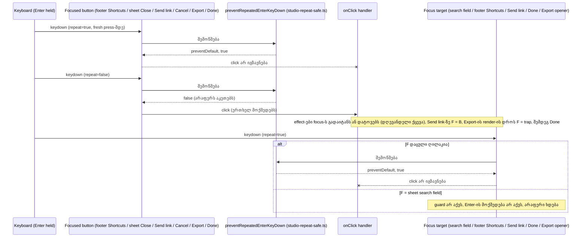

# SYS-2 stage 2b-ii-a: დაჭერილი Enter ერთხელ მოქმედებს shortcut sheet-ზე, export dialog-ზე და narrow screen-ის Send link-ზე

**თარიღი:** 2026-11-10
**სტატუსი:** Completed (C round 429 PASS)
**შეცვლილი პროექტი:** Store (ოთხი component ფაილი, სამი არსებული test ფაილი და ეს doc; ერთჯერადი დაჭერის და mouse click-ის ქცევა უცვლელია)

## კონტექსტი

Chromium focused `<button>`-ზე ყოველ auto-repeat Enter keydown-ზე `click`-ს აგზავნის, თუ ეს keydown `preventDefault`-ით არ შეჩერდა. SYS-2-ის წინა stage-ებმა დაიცვეს transport (doc 272, round 422), mixer-ის მხარე shared helper `preventRepeatedEnterKeyDown`-ით (`app/components/arrangement/studio-repeat-safe.ts`; doc 274, round 426) და footer toggle-ები, library, detail panel და video dock (doc 275, round 427). HEAD-ზე (`ffae71c`) დაუცველი დარჩა transient surface-ების ნაწილი: footer-ის Shortcuts ღილაკი, shortcut sheet-ის Close, narrow screen-ის Send link და export dialog-ის Cancel და Export.

**HEAD-ის დეფექტი რეალურ Chromium-ში** (`/studio-lab`, B-ის HEAD probe, `tmp/studio-real-loop/b-round-427/probe/head/*.json`; 1440×900 და 1280×720, Send link — 800×700):

- **sheet Close:** პირველი Enter sheet-ს ხურავს და focus footer-ის Shortcuts ღილაკზე (opener) ბრუნდება. შემდეგი repeat-ები ამ ღილაკს აჭერს და sheet-ს ხელახლა ხსნის (`sheetOpens` 1 → 2).
- **narrow screen-ის Send link:** ყოველი repeat link-ს ხელახლა აკოპირებს (clipboard write 1 → 4).

**HEAD-ზე დეფექტი არ არის** დანარჩენ cell-ებში (`head held []`):

- footer-ის ღილაკი ცალკე: focus sheet-ის search field-ზე გადადის, რომელსაც Enter-ის მოქმედება არ აქვს;
- export Done, რომელიც HEAD-ზე უკვე inline იყო დაცული;
- Modal-ის close ✕ და Export: focus დაცულ Export opener-ზე ან Done-ზე გადადის;
- grid menu: მისი container keydown click-ს მხოლოდ `if (!event.repeat)`-ზე აკეთებს.

**HEAD-ის რიცხვები** (B-ის claims, `tmp/studio-real-loop/b-round-427/claims-428-planning-output.txt`):

- ამ რაუნდის ოთხ ფაილში 1 inline `event.key === 'Enter' && event.repeat` ასლი იყო (export Done); მთელ `app/**`-ში და `perf/**`-ში (test-ის გარდა) — 7: ExportDialog 1, MarkerRow 5, LibraryMenu 1.
- Shared helper ოთხიდან მხოლოდ StudioWorkspace-ში გამოიყენებოდა.
- Enter scanner (`tmp/studio-real-loop/b-round-425/button-guard-scan-enter.py`) ოთხ ფაილზე: 3 ENTER-GUARD, 5 NONE; მთელ folder-ზე: 48 ENTER-GUARD, 3 KEYDOWN-NO-ENTER, 11 NONE.
- Send link `navigator.share`-ს იძახებს, თუ ის არსებობს, თორემ clipboard-ს.

ამ რაუნდის ID-ები:

| ID | სტატუსი | Row |
|---|---|---|
| A-R107-SWEEP-HELD-ENTER-TOOLBAR | ნაწილობრივ (ღია რჩება stage 5-ისთვის) | HQ1, HQ2, HN1, HX1–HX3 |

## მიდგომა

B-ის rulings (D-29z1500, D-29z1503):

1. **დამატებული guard-ები.** თითოეული არის `onKeyDown={preventRepeatedEnterKeyDown}`:
   - `StudioWorkspace.tsx`: footer-ის Shortcuts ღილაკი;
   - `ArrangementShortcutSheet.tsx`: sheet-ის Close;
   - `StudioNarrowScreen.tsx`: Send link;
   - `ArrangementExportDialog.tsx`: Cancel და Export (primary ღილაკი).
2. **Fold (ქცევა იდენტურია):** export Done-ის inline ასლი გახდა `onKeyDown={preventRepeatedEnterKeyDown}`.
3. **Export და Cancel-ის guard-ები preventive-ია.** HEAD-ზე Chromium-ში მათზე დეფექტი არ განმეორდა:
   - Export render-ის დროს natively disabled ხდება და focus Done-ზე სრულდება;
   - Cancel პირველ Enter-ზე unmount-დება და focus Done-ზე გადადის (CU1).

   ისინი იმიტომ არის დაცული, რომ dialog ერთ წესს მისდევდეს (TL-R427-03).
4. **Scope-ის გარეთ (ruling, მტკიცებულებით):**
   - **Modal ✕** (`app/components/ui/Modal.tsx`, საერთო Store UI): XMODALX cell HEAD-ზე დეფექტს არ აჩვენებს. ✕ პირველ Enter-ზე unmount-დება და focus დაცულ Export opener-ზე ბრუნდება.
   - **CookieConsent:** GA4 id-ის გარეშე არ რენდერდება, Accept/Decline კი მას unmount-ს უკეთებს.
   - **AuthModal და Toast:** ამ რაუნდში არ შემოწმებულა; stage 5-ში დამხურავ scan-თან ერთად განიხილება.
   - **sheet-ის search field:** Enter-ის მოქმედება არ აქვს. HQ1 აფიქსირებს, რომ მისი repeat-ები შეჩერებული არ არის.
   - **grid menu და marker menu:** container click-ს მხოლოდ `if (!event.repeat)`-ზე აკეთებს. ეს delegated ფორმა stage 5-ში განიხილება.
   - **Transport Fit (TH5), video drag handle და library option:** როგორც round 427-ში.
   - **grid menu-ს focus return:** pointer-ით გახსნილ, წინასწარი focus-ის გარეშე menu-ში არჩევისას focus BODY-ზე ბრუნდება — HEAD-ზეც და sketch-ზეც. ეს არსებული ქცევაა, იგივე root cause-ით, რაც C-R301-01-ს აქვს (იქ ჩაწერილია `confirmedBy`-ად, D-29z1504). GMENU cell focus-ს მხოლოდ იწერს და არ ამოწმებს.
5. **ერთჯერადი დაჭერა უცვლელია.** ახალი Enter, Space ან mouse click ზუსტად ისე მოქმედებს, როგორც HEAD-ზე (probe-ის `firstEqualsHead True` ყველა 13 cell-ში). Text, label, title, class და layout არ იცვლება; ახალი არაფერი mount-დება. Screen-budget, product-designer და journey row-ები არ ეხება.
6. **Focus target-ები (L47, L50).** პირველი Enter-ის შემდეგ focus ქვემოთ დასახელებულ ელემენტზე ხვდება და repeat-ებიც იქ მიდის:
   - sheet Close → footer-ის Shortcuts ღილაკი (opener); ის მხოლოდ ამ რაუნდის შემდეგ არის დაცული, მის გარეშე ეს HEAD-ის ბაგია;
   - footer Shortcuts → sheet-ის search field; მისი repeat-ები არ შეჩერდება და არაფერი ხდება;
   - Send link → Send link-ზე რჩება;
   - Cancel → Done (CU1);
   - Done და Modal ✕ → Export opener.

   L50 regex ოთხ granted source ფაილში 19 / 8 / 4 / 17 hit-ს იძლევა (ExportDialog / ShortcutSheet / NarrowScreen / Workspace), და sketch-ის 0 დამატებული ან წაშლილი ხაზი ემთხვევა მას. Sketch focus call-ს, blur handler-ს, pointer-down handler-ს, list render-ს ან conditional render-ს არ ამატებს, არ აადგილებს და არ შლის. ყველა 48 hit არსებული და scope-ის გარეთაა.
7. **Stage-ების ნუმერაცია (D-29z1500).** SYS-2-ს ახლა 5 stage აქვს:
   - stage 1: round 422, doc 272;
   - stage 2 (2a): round 426, doc 274;
   - stage 3 (2b-i): round 427, doc 275;
   - stage 4 (2b-ii-a): ეს რაუნდი, doc 276;
   - stage 5 (2b-ii-b): შემდეგი. ის მოიცავს MarkerRow-ის (5) და LibraryMenu-ის (1) inline ასლებს, delegated ფორმის ruling-ს და დამხურავ grep-ს `app/**`-ზე და `perf/**`-ზე, თითო mutant-ით თითო ასლის ფორმაზე. ის doc 274-ის, 275-ის და 276-ის l.4-ს `Completed`-ზე გადაიყვანს (L28).

   doc 274-ის და 275-ის გამოქვეყნებული l.4 ამ რაუნდში უცვლელია.
8. **Doc:** ეს ფაილი (276).

**Ableton:** არ ეხება. ცვლილება მხოლოდ Chromium-ის auto-repeat activation-ს აჩერებს და per-press ქცევას არ ცვლის, ამიტომ Live-ის ქცევა შესადარებელი არ არის. რეფერენსი პროექტის საკუთარი კონვენციაა (rounds 108, 422, 426 და 427). Deviation არ არის.

## არქიტექტურა



## შეცვლილი ფაილები

- `app/components/arrangement/StudioWorkspace.tsx` — guard footer-ის Shortcuts ღილაკზე.
- `app/components/arrangement/ArrangementShortcutSheet.tsx` — guard sheet-ის Close-ზე და helper-ის import.
- `app/components/arrangement/StudioNarrowScreen.tsx` — guard Send link-ზე და helper-ის import.
- `app/components/arrangement/ArrangementExportDialog.tsx` — guard Cancel-ზე და Export-ზე, Done-ის inline ასლი shared helper-ით შეიცვალა, helper-ის import.
- `app/lib/arrangement/__tests__/shortcut-sheet-ui.test.tsx` — row-ები HQ1, HQ2.
- `app/lib/arrangement/__tests__/studio-narrow-gate-ui.test.tsx` — row HN1.
- `app/lib/arrangement/__tests__/export-cancel-ui.test.tsx` — row-ები HX1–HX3.
- `docs/implementation/2026/quarter-IV/276-sys-held-enter-dialogs.md` — ეს doc.

## პრობლემები და გადაწყვეტები

**პრობლემა:** sheet Close focus-ს footer-ის Shortcuts ღილაკს უბრუნებს, ამიტომ Close-ზე დაჭერილი Enter-ის repeat-ები opener-ზე ხვდებოდა და sheet-ს ხელახლა ხსნიდა.
**გადაწყვეტა:** guard opener-ზეც. HQ2 focus-ს opener-ზე ამოწმებს, შემდეგ repeat-ებს და `aria-expanded` false-ს. ამიტომ MU-SHEET-FOOTER HQ1-თან ერთად HQ2-საც აწითლებს.

**პრობლემა:** Cancel render-ს წყვეტს და focus Done-ზე გადადის; Done-ის repeat-ებს dialog-ის დახურვა შეეძლო.
**გადაწყვეტა:** Done-ის guard უკვე inline არსებობდა და ახლა shared helper-ს იყენებს. HX2 Done-ზე repeat-ების შემდეგ dialog-ს ღიად ამოწმებს, ამიტომ MU-EXPORT-DONE HX2-ს და HX3-ს აწითლებს. HX3 HEAD-ზე design-ით მწვანეა, რადგან Done HEAD-ზე უკვე დაცული იყო (ruling 2).

**პრობლემა:** fresh Enter-ის შემდეგ Export disabled ხდება, ამიტომ მის შემდეგ repeat-ების შემოწმება მხოლოდ jsdom-ის ქცევას ამტკიცებდა (jsdom disabled ღილაკზეც აგზავნის keydown-ს; TL-R427-02, TL-R427-04).
**გადაწყვეტა:** HX1-ის discriminator არის repeat, რომელიც Export-ს fresh press-მდე აღწევს; fresh Enter-ის შემდეგ row მხოლოდ ერთ render-ს და `disabled` true-ს ამოწმებს.

**პრობლემა:** sheet-ის search field-ზე repeat-ის loop ვერ ჩავარდებოდა (TL-R427-01).
**გადაწყვეტა:** HQ1-ში ყოველი repeat ამოწმებს, რომ guard-მა ის არ შეაჩერა (`toBe(true)`), ანუ search field განზრახ დაუცველია; sheet ღია რჩება. ეს characterization-ია: HQ1-ის `value === ''` assert თითქმის ვერ ჩავარდება: Enter input-ში ტექსტს არ წერს (არც jsdom-ში, არც browser-ში), ამიტომ ის მხოლოდ app-ის მიერ search query-ის ცვლილებას დაიჭერდა (A-ს reviewer-ის Low, B-სთვის ჩაწერილი).

## ტესტირება

ახალი row-ები:

| Row | ფაილი | რას ამტკიცებს |
|---|---|---|
| HQ1 | `shortcut-sheet-ui.test.tsx` | footer-ის ღილაკზე განმეორებული Enter შეჩერებულია და არაფერს ხსნის; ახალი Enter sheet-ს ერთხელ ხსნის და focus search field-ზე გადადის; იქ repeat-ები განზრახ არ შეჩერდება და sheet ღია რჩება |
| HQ2 | `shortcut-sheet-ui.test.tsx` | Close-ზე განმეორებული Enter შეჩერებულია; ახალი Enter ერთხელ ხურავს და focus footer-ის ღილაკზე გადადის; იქ repeat-ები შეჩერებულია და sheet-ს ხელახლა არ ხსნის (`aria-expanded` false) |
| HN1 | `studio-narrow-gate-ui.test.tsx` | press-მდე repeat არაფერს აკოპირებს; ახალი Enter ერთხელ აკოპირებს ("Link copied"), 3 repeat შეჩერებულია; 1 `writeText` call; focus Send link-ზე რჩება |
| HX1 | `export-cancel-ui.test.tsx` | (preventive) fresh press-მდე Export-ზე მისული repeat შეჩერებულია და render-ს არ იწყებს; ახალი Enter 1 render-ს იწყებს და ღილაკს disabled-ს ხდის |
| HX2 | `export-cancel-ui.test.tsx` | (preventive) render-ის დროს Cancel-ზე განმეორებული Enter შეჩერებულია და არ წყვეტს; ახალი Enter ერთხელ წყვეტს და focus Done-ზე გადადის; იქ repeat-ები შეჩერებულია და dialog ღია რჩება |
| HX3 | `export-cancel-ui.test.tsx` | (fold characterization) Done-ზე repeat შეჩერებულია და dialog-ს ღიად ტოვებს; ახალი Enter ხურავს; HEAD-ზე design-ით მწვანე |

მეზობელი ქცევა არსებული row-ებით რჩება დაფარული: `?` და Esc sheet-ზე (SS2, SS5); export Cancel ყველა phase-ში (CU1–CU10); narrow screen-ის Space/Delete იზოლაცია (NG6) და share/clipboard გზები (NG7a–NG7d).

Mutants (`tmp/studio-real-loop/b-round-427/mutants/run.py` → `summary.txt`; base = HEAD, sketch-ის test ფაილები უცვლელია):

```
MU-HEAD-SRC: red HN1,HQ1,HQ2,HX1,HX2 (5 failed | 42 passed (47))
MU-SHEET-FOOTER: red HQ1,HQ2 (2 failed | 45 passed (47))
MU-SHEET-CLOSE: red HQ2 (1 failed | 46 passed (47))
MU-NARROW-SEND: red HN1 (1 failed | 46 passed (47))
MU-EXPORT-PRIMARY: red HX1 (1 failed | 46 passed (47))
MU-EXPORT-CANCEL: red HX2 (1 failed | 46 passed (47))
MU-EXPORT-DONE: red HX2,HX3 (2 failed | 45 passed (47))
```

Browser, HEAD vs sketch (`tmp/studio-real-loop/b-round-427/probe/compare.txt`; რეალური Chromium, `/studio-lab`, 1440×900 და 1280×720, NSEND — 800×700; ერთი Enter + სამი repeated keydown, fresh context თითო cell-ზე):

| Cell | HEAD: held-ზე შეცვლილი | Sketch: პირველი Enter მოქმედებს | Sketch: held-ზე შეცვლილი | Sketch: focus repeat-ების შემდეგ |
|---|---|---|---|---|
| SFOOTER | — | true | — | `Search shortcuts` |
| SCLOSE | `c`, `sheet` | true | — | `Keyboard shortcuts (?)` |
| NSEND | `c` | true | — | `Send link` |
| XEXPORT | — | true | — | `Done` (totals: 1 render, 1 download) |
| XDONE | — | true | — | `Export` |
| XMODALX | — | true | — | `Export` |
| GMENU | — | true | — | BODY (მხოლოდ ჩაწერილი, ruling 4) |

ყველა 13 cell-ში `firstEqualsHead True` და შედეგი `ALL OK (13 cells)`. GMENU-ს გარდა ყოველ cell-ში focus ring ხილულია (`focusVisible` true, `outline` `solid`).

A-ს შემოწმებები (round 428; ანგარიში `tmp/studio-real-loop/a-round-428.md`, log-ები `tmp/studio-real-loop/a-round-428/`-ში): covering ტესტები — 59 ფაილი, 996/996; `npm run typecheck` rc 0; `npm run lint` rc 0 (205 warning, 1 info — იგივე, რაც B-ის sketch-ზე); Biome შვიდ code/test ფაილზე rc 0, fix-ის გარეშე.

## TODO / შემდეგი ნაბიჯები

- **SYS-2 stage 5 (2b-ii-b):** MarkerRow-ის (5) და LibraryMenu-ის (1) inline ასლები shared helper-ზე; grid menu-ს და marker menu-ს delegated `if (!event.repeat)` ფორმის ruling; AuthModal-ის, Toast-ის და `/studio-lab`-ის import closure-ის დანარჩენი ნაწილის ruling; დამხურავი grep `app/**`-ზე და `perf/**`-ზე (0 inline ასლი `studio-repeat-safe.ts`-ის გარეთ), თითო mutant-ით თითო ასლის ფორმაზე. ის doc 274-ის, 275-ის და 276-ის l.4-ს `Completed`-ზე გადაიყვანს; ამის შემდეგ A-R107-SWEEP-HELD-ENTER-TOOLBAR იხურება.
