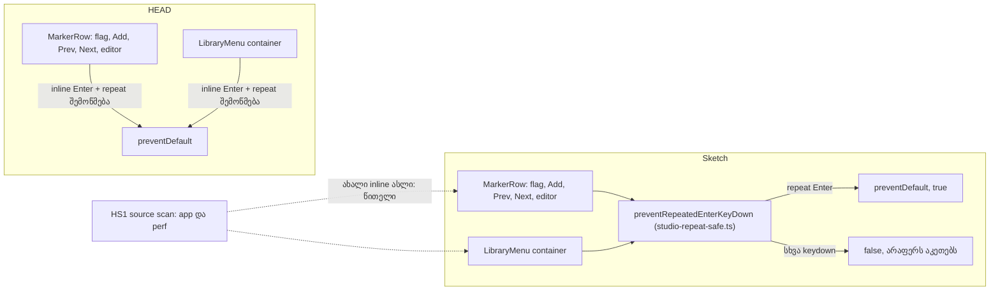

# SYS-2 stage 5 (2b-ii-b): ბოლო inline held-Enter ასლები shared guard-ზე და დამხურავი source scan

**თარიღი:** 2026-11-10
**სტატუსი:** Completed (C round 429 PASS)
**შეცვლილი პროექტი:** Store (ორი component ფაილი, ორი არსებული და ერთი ახალი test ფაილი, doc 274–276-ის l.4 და ეს doc; ერთჯერადი დაჭერის და mouse click-ის ქცევა უცვლელია)

## კონტექსტი

Chromium focused `<button>`-ზე ყოველ auto-repeat Enter keydown-ზე `click`-ს აგზავნის, თუ ეს keydown `preventDefault`-ით არ შეჩერდა. SYS-2-ის წინა stage-ებმა დაიცვეს transport (doc 272, round 422), mixer-ის მხარე shared helper `preventRepeatedEnterKeyDown`-ით (`app/components/arrangement/studio-repeat-safe.ts`; doc 274, round 426), panel-ები (doc 275, round 427) და dialog-ები (doc 276, round 428).

**HEAD-ზე დარჩენილი inline ასლები** (`event.key === 'Enter' && event.repeat`, test-ის გარდა, `app/**` და `perf/**`; B-ის claims K8, `tmp/studio-real-loop/b-round-428/claims-429-planning-output.txt`) — სულ 6:

- `ArrangementMarkerRow.tsx` — 5: marker flag-ის keydown (`handleFlagKeyDown`), Add (+), Prev, Next და name editor;
- `ArrangementLibraryMenu.tsx` — 1: menu container-ის keydown.

Shared helper ამ ორ ფაილში არ გამოიყენებოდა; `app`-ის non-test ფაილებში მისი სახელი 64-ჯერ გვხვდებოდა (K8b; grep-ის რაოდენობა, import-ებისა და definition-ის ჩათვლით).

**HEAD-ზე დეფექტი არ არის.** ექვსივე ასლი უკვე სწორად მუშაობდა: B-ის HEAD probe რეალურ Chromium-ში (`/studio-lab`, 1440×900 და 1280×720) ოთხივე cell-ში `head held []`-ს აჩვენებს. ამიტომ ეს რაუნდი არის **ქცევით იდენტური fold** და **დამხურავი scan**, რომელიც ახალ inline ასლს აღარ უშვებს.

ამ რაუნდის ID-ები:

| ID | სტატუსი | Row |
|---|---|---|
| A-R107-SWEEP-HELD-ENTER-TOOLBAR | დახურულია C round 429 PASS-ზე (ხუთივე stage-ის row-ები ქვემოთ, „ტესტირება“) | HK1–HK4, HS1, HS2 |

## მიდგომა

B-ის rulings (D-29z1508):

1. **Fold, ქცევა იდენტურია თითო დაჭერაზე:**
   - flag keydown: `if (preventRepeatedEnterKeyDown(event)) { return; }`, ისევ პირველი statement;
   - Add, Prev და Next: `onKeyDown={preventRepeatedEnterKeyDown}`;
   - name editor: არსებული Enter/Escape branch-ის შიგნით `if (preventRepeatedEnterKeyDown(event)) { return; }`; განმეორებული Escape ისევ settle-ს აკეთებს, როგორც HEAD-ზე;
   - LibraryMenu container: `preventRepeatedEnterKeyDown(event);` ბოლო statement-ად.

   სხვა არაფერი იცვლება: text, label, title, class, layout და mount უცვლელია. Screen-budget, product-designer და journey row-ები არ ეხება.
2. **Delegated menu ფორმა რჩება.** Menu container-ები (`ArrangementGridMenu.tsx` და `ArrangementMarkerMenu.tsx`) ყველა Enter-ს და Space-ს აჩერებს და მოქმედებს მხოლოდ `if (!event.repeat)`-ზე. ეს სხვა კონტრაქტია (ყველა Enter, არა მხოლოდ repeat), ამიტომ ის helper-ზე არ გადადის; ARCH-CHECKPOINT-SYS-2 მას მოგვიანებით აწონის. K9-ის რიცხვები — GridMenu (2), MarkerMenu (1), DetailPanel (3), Library (2), GroupHeader (3) — `if (!event.repeat)`-ის ყველა ადგილს ითვლის, არა მხოლოდ menu container-ებს: მათში შედის GridMenu-ს window listener, DetailPanel-ის range და Clip Gain input-ების Enter handler-ები და Space handler-ი, Library option-ის context-menu key (ContextMenu, Shift+F10) და Enter handler-ები, GroupHeader-ის F2, Space და სახელის editor-ის handler-ები. ეს ადგილები ამ რაუნდში არ იცვლება.
3. **AuthModal და Toast scope-ის გარეთაა.** `/studio-lab`-ზე ისინი მიუწვდომელია: AuthModal-ს მხოლოდ `RequireAuth`, layout Header, `PurchaseHeader`, `cart` route და `account.reset.$id.$token` route ხსნის; `/studio-lab` `RequireAuth`-ს არ იყენებს და Header `/studio*`-ზე არ რენდერდება; toast-ს მხოლოდ cart, account და purchase კოდი იძახებს, `app/components/arrangement` კი toast-ს არ იყენებს. Modal ✕ და CookieConsent round 428-ის ruling-ებს ინარჩუნებს.
4. **დამხურავი scan (HS1, HS2).** `held-enter-source-scan.test.ts` `app/`-ის და `perf/`-ის ყველა non-test `.ts`/`.tsx` ფაილს კითხულობს და inline held-Enter შემოწმებაზე ჩავარდება. Pattern ემთხვევა: ორივე operand-ის რიგს, `==`-ს და `===`-ს, quote-ს და backtick-ს, რამდენიმე ხაზზე გადატანილ პირობას და optional chaining-ს (`[\w.?]*` character class; HS2-ს `?.`-ის ცალკე შემთხვევა არ აქვს).

   **Scan-ის literal-form საზღვრები (TL-R429-06, B ruling):** scan არ იჭერს ფრჩხილებში ჩასმულ operand-ს, ორს შორის მესამე operand-ს, bracket access-ს (`e['key']`) და `'Enter'`-ის ნაცვლად დასახელებულ constant-ს. დღეს `app/**`-ში და `perf/**`-ში არცერთი არ არსებობს. ARCH-CHECKPOINT-SYS-2 lint rule-ს scan-თან შეადარებს.
5. **Focus target-ები (L47).** პირველი Enter-ის შემდეგ focus ქვემოთ დასახელებულ ელემენტზე ხვდება და repeat-ებიც იქ მიდის (B-ის გაზომვა რეალურ Chromium-ში, HEAD-ზე და sketch-ზე):
   - Add (+) → name editor (`arrangement-marker-name-input`);
   - editor Enter → ახალი flag (`arrangement-marker`);
   - flag → flag-ზე რჩება;
   - library menu-ს link → library option ღილაკი („Middle East“); menu პირველ Enter-ზე იხურება.

   L50 regex MarkerRow-ში 12 და LibraryMenu-ში 3 ხაზს იძლევა; sketch-ის 0 დამატებული ან წაშლილი ხაზი ემთხვევა მას. Sketch focus call-ს, blur handler-ს, pointer-down handler-ს, list render-ს ან conditional render-ს არ ამატებს, არ აადგილებს და არ შლის; editor hunk არსებულ `settleEditor(` call-ს context-ად ინარჩუნებს.
6. **Docs (L28, ბოლო stage):** doc 274-ის, 275-ის და 276-ის l.4 გახდა `**სტატუსი:** Completed (C round 429 PASS)`; ეს doc (277) ახალია; doc 272 უკვე `Completed` იყო.
7. **C PASS-ზე:** SYS-2 სრულდება, A-R107-SWEEP-HELD-ENTER-TOOLBAR იხურება და ARCH-CHECKPOINT-SYS-2 root-ს გადაეცემა.

**Ableton:** არ ეხება. Per-press ქცევა არ იცვლება; ეს refactor-ის და test-ის რაუნდია.

## არქიტექტურა



## შეცვლილი ფაილები

- `app/components/arrangement/ArrangementMarkerRow.tsx` — ხუთი inline ასლი shared helper-ით შეიცვალა, helper-ის import.
- `app/components/arrangement/ArrangementLibraryMenu.tsx` — container-ის inline ასლი shared helper-ით შეიცვალა, helper-ის import.
- `app/lib/arrangement/__tests__/markers-ui.test.tsx` — row-ები HK1 (Add, Prev, Next), HK2, HK3.
- `app/lib/arrangement/__tests__/studio-link-view-in-store-ui.test.tsx` — row HK4.
- `app/lib/arrangement/__tests__/held-enter-source-scan.test.ts` — ახალი ფაილი, row-ები HS1, HS2.
- `docs/implementation/2026/quarter-IV/274-sys-held-enter-mixer.md` — მხოლოდ l.4.
- `docs/implementation/2026/quarter-IV/275-sys-held-enter-panels.md` — მხოლოდ l.4.
- `docs/implementation/2026/quarter-IV/276-sys-held-enter-dialogs.md` — მხოლოდ l.4.
- `docs/implementation/2026/quarter-IV/277-sys-held-enter-closing.md` — ეს doc.

## პრობლემები და გადაწყვეტები

**პრობლემა:** browser-ში Add, Prev, Next და LibraryMenu guard-ის დაკარგვა არ ჩანს: focus პირველ Enter-ზე ტოვებს ამ ელემენტებს, ან menu იხურება. ამიტომ browser probe ეკვივალენტობას ამტკიცებს და არა თავად guard-ს.
**გადაწყვეტა:** თითო guard-ს საკუთარი mutant აქვს (MU-ADD, MU-PREV, MU-NEXT, MU-LIBMENU), რომელიც HK1-ს ან HK4-ს აწითლებს; ეს არის განმასხვავებელი მტკიცებულება.

**პრობლემა:** name editor ყველა Enter-ზე `preventDefault`-ს იძახებს, ამიტომ HK3-ის `defaultPrevented` შემოწმება guard-ს ვერ განასხვავებს (TL-R429-05).
**გადაწყვეტა:** HK3 repeat-ების შემდეგ editor-ს ღიად, marker-ების არარსებობას და undo-ს არარსებობას ამოწმებს; MU-EDITOR სწორედ ამ ხაზებზე წითლდება.

**პრობლემა:** HS1-ის პირველი ვერსია line-based იყო და გადატანილ, შებრუნებულ, `==` და template ფორმებს ვერ იჭერდა (TL-R429-03).
**გადაწყვეტა:** HS1 მთელ ფაილზე regex-ს უშვებს; HS2 pattern-ის დადებით და უარყოფით ფორმებს ამოწმებს, ხოლო ექვსი MU-FORM-* mutant HS1-ს აწითლებს.

**პრობლემა:** HS1 helper-ის ზუსტ source text-ს ამოწმებდა, რაც ზედმეტად მყიფე იყო (TL-R429-04).
**გადაწყვეტა:** HS1 მხოლოდ helper-ის export-ის სახელს ამოწმებს; ქცევას HK1–HK4 აფიქსირებს.

## ტესტირება

ახალი row-ები:

| Row | ფაილი | რას ამტკიცებს |
|---|---|---|
| HK1 (×3) | `markers-ui.test.tsx` | Add, Prev ან Next-ზე განმეორებული Enter შეჩერებულია; ახალი Enter — არა |
| HK2 | `markers-ui.test.tsx` | flag-ზე განმეორებული Enter შეჩერებულია და არაფერს ცვლის (arrangement, menu, focus); ახალი Enter შეჩერებული არ არის |
| HK3 | `markers-ui.test.tsx` | name editor-ში განმეორებული Enter მას არ settle-ავს (editor ღიაა, marker არ არის, undo არ არის); ახალი Enter ერთ marker-ს ქმნის |
| HK4 | `studio-link-view-in-store-ui.test.tsx` | store link-ზე განმეორებული Enter menu-მ შეაჩერა, menu ღია რჩება და focus link-ზეა; ახალი Enter შეჩერებული არ არის |
| HS1 | `held-enter-source-scan.test.ts` | `app/`-ის და `perf/`-ის non-test source-ებში inline held-Enter შემოწმება არ არის, helper-ის export კი არსებობს |
| HS2 | `held-enter-source-scan.test.ts` | scan pattern ექვს დადებით ფორმას ემთხვევა და helper-ის ფორმას, menu-ს ფორმას და `!event.repeat`-ს უგულებელყოფს |

მეზობელი ქცევა არსებული row-ებით რჩება დაფარული: marker editor-ის M, Enter, Escape და blur (MU1, MU2 და `markers-ui`-ის დანარჩენი row-ები); render-ის რაოდენობა (`render-budget` და covering set-ის render-log ფაილები).

Mutants (`tmp/studio-real-loop/b-round-428/mutants/run.py` → `summary.txt`; base = HEAD, sketch-ის test ფაილები უცვლელია):

```
MU-HEAD-SRC: red HS1 (1 failed | 59 passed (60))
MU-ADD: red HK1 (1 failed | 59 passed (60))
MU-PREV: red HK1 (1 failed | 59 passed (60))
MU-NEXT: red HK1 (1 failed | 59 passed (60))
MU-FLAG: red HK2 (1 failed | 59 passed (60))
MU-EDITOR: red HK3 (1 failed | 59 passed (60))
MU-LIBMENU: red HK4 (1 failed | 59 passed (60))
MU-FORM-ARROW: red HS1 (1 failed | 59 passed (60))
MU-FORM-IF-RETURN: red HS1 (1 failed | 59 passed (60))
MU-FORM-NESTED: red HS1 (1 failed | 59 passed (60))
MU-FORM-CONTAINER: red HS1 (1 failed | 59 passed (60))
MU-FORM-PERF-REVERSED: red HS1 (1 failed | 59 passed (60))
MU-FORM-WRAPPED-OPERAND: red HS1 (1 failed | 59 passed (60))
```

Mutant-ები MU-ADD, MU-PREV და MU-NEXT თითოეული HK1-ს საკუთარ ღილაკზე აწითლებს (`arrangement-marker-add`, `arrangement-marker-prev`, `arrangement-marker-next`; `tmp/studio-real-loop/b-round-428/mutants/hk1-params.txt`).

Browser, HEAD vs sketch (`tmp/studio-real-loop/b-round-428/probe/compare.txt`; რეალური Chromium, `/studio-lab`, 1440×900 და 1280×720; ერთი Enter + სამი repeated keydown, fresh context თითო cell-ზე):

| Cell | HEAD: held-ზე შეცვლილი | Sketch: პირველი Enter მოქმედებს | Sketch: held-ზე შეცვლილი | Sketch: focus repeat-ების შემდეგ |
|---|---|---|---|---|
| MADD | — | true | — | `arrangement-marker-name-input` |
| MEDIT | — | true | — | `arrangement-marker` |
| MFLAG | — | true | — | `arrangement-marker` |
| LMENU | — | true | — | library option ღილაკი (BUTTON) |

ყველა 8 cell-ში `firstEqualsHead True`, focus ring ხილულია (`focusVisible` true, `outline` `solid`) და შედეგი `ALL OK (8 cells)`.

**A-R107-SWEEP-HELD-ENTER-TOOLBAR-ის დახურვა, row-ები ხუთივე stage-ზე:**

| Stage | Round | Doc | Row-ები | Test ფაილი |
|---|---|---|---|---|
| 1 | 422 | 272 | HE1–HE5 | `transport-centre-ui.test.tsx` |
| 2 (2a) | 426 | 274 | HM1–HM14 | `mixer-held-enter-ui.test.tsx` |
| 3 (2b-i) | 427 | 275 | HP1–HP9 | `panel-held-enter-ui.test.tsx` |
| 4 (2b-ii-a) | 428 | 276 | HQ1, HQ2; HN1; HX1–HX3 | `shortcut-sheet-ui.test.tsx`; `studio-narrow-gate-ui.test.tsx`; `export-cancel-ui.test.tsx` |
| 5 (2b-ii-b) | 429 | 277 | HK1–HK3; HK4; HS1, HS2 | `markers-ui.test.tsx`; `studio-link-view-in-store-ui.test.tsx`; `held-enter-source-scan.test.ts` |

რამდენიმე ID (მაგ. HE1, HK1, HS1, HP1, HM1) სხვა test ფაილებშიც გვხვდება სხვა მნიშვნელობით; ამ ცხრილის row-ები მხოლოდ დასახელებულ ფაილს ეხება.

A-ს შემოწმებები (round 429; ანგარიში `tmp/studio-real-loop/a-round-429.md`, log-ები `tmp/studio-real-loop/a-round-429/`-ში): covering ტესტები, `npm run typecheck`, `npm run lint` და Biome ხუთ code/test ფაილზე. სრული test suite, build და verify root gate-ის row-ებია.

## TODO / შემდეგი ნაბიჯები

- **ARCH-CHECKPOINT-SYS-2 (root):**
  - per-button opt-in (`onKeyDown={preventRepeatedEnterKeyDown}`) vs საერთო wrapper ან lint rule;
  - scan-ის literal-form საზღვრები (TL-R429-06): ფრჩხილებში ჩასმული operand, მესამე operand შუაში, bracket access და დასახელებული constant — lint rule vs source scan;
  - delegated menu ფორმა (`if (!event.repeat)`) helper-თან შედარებით;
  - SIG-R427-HELD-ENTER-TEST-HELPER: held-Enter test-ების საერთო helper.
- **Scan-ის false positive (A-ს reviewer, Low):** pattern-ის მეორე branch `!event.repeat && event.key === 'Enter'`-საც ემთხვევა (fresh-Enter-only guard), რაც HS1-ს უსაფუძვლოდ გააწითლებს; დღეს ასეთი ფორმა source-ში არ არის. HS2-ს უარყოფითი შემთხვევა და `!`-ის გამორიცხვა სჭირდება — B-ის გადასაწყვეტი.
- **განმეორებული Escape name editor-ში (A-ს reviewer, Low):** ruling 1-ის „repeat Escape ისევ settle-ს აკეთებს“ ცალკე row-ით არ არის დამაგრებული; HK3 მხოლოდ Enter-ს ამოწმებს.
