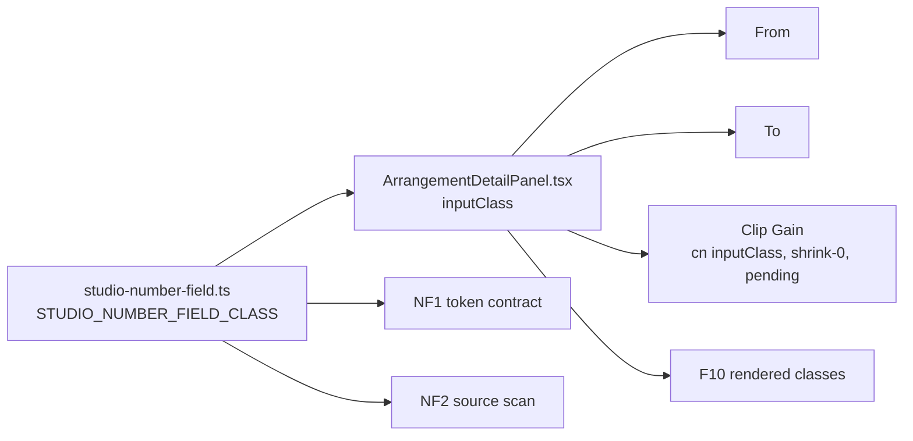

# SABA-B-12 stage 1 (STUDIO-VIS-1): Clip details-ის number field-ებს browser-ის spin button-ები აღარ აქვს

**თარიღი:** 2026-11-10
**სტატუსი:** In Progress (stage 1 of 4; C round 430 PASS)
**შეცვლილი პროექტი:** Store (ერთი component ფაილი, ერთი ახალი class ფაილი, ერთი არსებული და ერთი ახალი test ფაილი, ეს doc; ტექსტი, ზომა, ფერი, keyboard და wheel ქცევა უცვლელია)

## კონტექსტი

საბამ (2026-11-10, Medium) Clip details panel-ის number field-ებზე browser-ის default spin ისრები (▲▼) დაინახა: „უფრო სოლიდური, და ესთეტიური უნდა იყოს". product-designer-ის audit-ის (`docs/technical/studio-real-workspace/studio-visual-audit-2026-11-10.md`) მიხედვით root-ის ცხრილში პირველი stage, STUDIO-VIS-1, **High / Immediate**-ია.

**HEAD-ის ფაქტი** (B-ის probe რეალურ Chromium-ში, `tmp/studio-real-loop/b-round-429/probe/head/`): `app/components/arrangement`-ში test-ის გარეშე სამი `type="number"` input არის, სამივე `ArrangementDetailPanel.tsx`-ში — Clip Gain, From და To. სამივე class-ს ერთი `inputClass` string-იდან იღებს. field-ის მარჯვენა gutter-ზე hover spin button-ებს ხატავს: **182 შეცვლილი px ექვსივე cell-ში** (3 field × 2 viewport), computed `appearance: auto`. click-ით focus-ზე (mouse გატანილი) — 168 px border-ის შიგნით. Rest მდგომარეობაში 0 px, ამიტომ at-rest screenshot-ებმა ეს ვერ დაიჭირა.

SABA-B-12-ის stage-ები (D-29z1512):

1. **ეს რაუნდი:** 3 number field.
2. Export dialog-ის 6 radio და მისი `<progress>`.
3. Shortcut sheet-ის search field-ის native cancel ✕.
4. 2 `<select>` — საბას პასუხი 2-ით გადადებულია REVIEW-RECOMMENDATIONS-ში.

## მიდგომა

B-ის rulings (D-29z1513):

1. **ერთი shared class:** ახალი `app/components/arrangement/studio-number-field.ts` export-ს აკეთებს `STUDIO_NUMBER_FIELD_CLASS`-ს. შიგნით სამი Tailwind token-ია: `[appearance:textfield]` (Firefox; Chromium-ის computed მნიშვნელობაც), `[&::-webkit-inner-spin-button]:appearance-none` და `[&::-webkit-outer-spin-button]:appearance-none` (Chromium, Safari). pattern იგივეა, რაც `studio-fader.ts`-ში.
2. **class ემატება არსებულ `inputClass` template string-ს**, ამიტომ სამივე field იღებს მას ყველა მდგომარეობაში: disabled, enabled და pending (Clip Gain-ზე `cn(inputClass, 'shrink-0', isPending && 'border-warning')`). სხვა არაფერი იცვლება: ტექსტი, label, ზომა, ფერი, border, layout, keyboard, wheel. box რჩება **80×24** px.
3. **custom stepper-ები არ კეთდება.** keyboard stepping (Live 12 manual 42.6), Clip Gain-ის fader და typing + Enter/Esc რჩება. ერთადერთი დანაკარგი mouse-ით click-to-step-ია, და ეს არის მიზანიც.
4. **guard-ის ფარგლები (NF2):** NF2 ამოწმებს, რომ `app/components/arrangement`-ის პირდაპირ შიგნით მყოფი ყოველი non-test `.tsx` ფაილი, რომელსაც number input აქვს, class-ს import-ების გარეთ იყენებს. ფარგლებს გარეთაა (TL-R430-06): `type={variable}`, spread-ები, wrapper-ები და sub-folder-ები. დღეს არცერთი არ არსებობს.
5. **Firefox და Safari:** cloud-ში მხოლოდ Chromium-ია. ეს ნახევარი Tech Lead-ის row-ია **TLM-SABA-B-12-FIREFOX-SAFARI**, deadline RETRO 435 (L46).
6. **Screen budget:** მუდმივი არაფერი ემატება და არ იშლება — row არ ეხება. product-designer consult არ ეხება, რადგან ეს bug fix-ია, რომლის დიზაინის წყარო product-designer-ის საკუთარი audit-ია.
7. **Docs:** ეს doc (278); l.4 L28-ის მიხედვით.

**Ableton Live 12:** value field-ები ისრიანი ღილაკებით (Shift — fine), აკრეფით, Enter-ით და Esc-ით იცვლება (manual 42.6 Adjusting Values — დადასტურებული). Live-ის field-ებზე stepper არ ჩანს — **დასკვნა**, manual stepper-ს არ ახსენებს, UI Live-ში არ გაზომილა. field-ზე drag Live-ში არსებობს; ჩვენთან არ არის — ეს უკვე არსებული gap-ია, საბასთან კითხვად გაგზავნილი (SABA-Q-NUMBER-FIELD-DRAG, `awaiting_user`), ამ რაუნდში არ კეთდება.

## არქიტექტურა



## შეცვლილი ფაილები

- `app/components/arrangement/studio-number-field.ts` — ახალი; `STUDIO_NUMBER_FIELD_CLASS`.
- `app/components/arrangement/ArrangementDetailPanel.tsx` — ერთი import და `inputClass` string-ის ბოლოს class.
- `app/lib/arrangement/__tests__/studio-number-field.test.ts` — ახალი; NF1, NF2.
- `app/lib/arrangement/__tests__/detail-panel-fit.test.tsx` — import-ები და F10.
- `docs/implementation/2026/quarter-IV/278-saba-b-12-number-spinbuttons.md` — ეს doc.

## პრობლემები და გადაწყვეტები

- **პრობლემა:** spin button-ები at-rest screenshot-ზე 0 px-ია, ამიტომ VISUAL-A-მ და RETRO-ს screen review-ებმა ვერ დაიჭირეს. **გადაწყვეტა:** C-ის browser row ზომავს hover-სა და focus-ს ცალ-ცალკე; lesson L61 („native control chrome is a row").
- **პრობლემა:** Clip Gain-ის class `cn(...)`-ით მოდის, From/To — პირდაპირ. **გადაწყვეტა:** class `inputClass`-ში ემატება, ამიტომ ორივე გზა ერთ წყაროს იყენებს; F10 სამივე field-ს disabled და enabled მდგომარეობაში ამოწმებს, pending-ს კი Clip Gain-ზე (From/To-ს pending მდგომარეობა არ აქვს).
- **პრობლემა:** unit test-ს (jsdom) pseudo-element-ის რენდერი ვერ ამოწმებს. **გადაწყვეტა:** NF1/NF2/F10 class-ის კონტრაქტს იცავს; ვიზუალური ნახევარი C-ის Chromium probe-ია.

## ტესტირება

- **ახალი row-ები:** NF1 (token contract), NF2 (ერთადერთი number-input ფაილი Detail panel-ია და ის constant-ს import-ების გარეთ იყენებს), F10 (panel-ს ზუსტად 3 spinbutton აქვს — From, To, Clip Gain — და თითოეულს token-ები აქვს disabled და enabled მდგომარეობაში; pending მდგომარეობა Clip Gain-ზე მოწმდება).
- **Mutant-ები** (B, `tmp/studio-real-loop/b-round-429/mutants/summary.txt`):

```
MU-NF-CLASS rc=1 red=F10,NF2 tests=2 failed | 8 passed (10)
MU-NF-INNER rc=1 red=NF1 tests=1 failed | 9 passed (10)
MU-NF-TEXTFIELD rc=1 red=NF1 tests=1 failed | 9 passed (10)
MU-NF-NEW-FIELD rc=1 red=NF2 tests=1 failed | 9 passed (10)
MU-NF-4TH-FIELD rc=1 red=F10 tests=1 failed | 9 passed (10)
MU-NF-IMPORT-ONLY rc=1 red=F10,NF2 tests=2 failed | 8 passed (10)
```

- **Browser (B-ის probe საბოლოო sketch-ზე, `tmp/studio-real-loop/b-round-429/probe/compare.txt`):**

| Viewport | Field | HEAD hover px | after hover px | HEAD focus px | after focus px | typed commit |
|---|---|---|---|---|---|---|
| 1440×900 | Clip Gain | 182 | 0 | 168 | 0 | 2.0 |
| 1440×900 | From | 182 | 0 | 168 | 0 | 1 |
| 1440×900 | To | 182 | 0 | 168 | 0 | 3 |
| 1280×720 | Clip Gain | 182 | 0 | 168 | 0 | 2.0 |
| 1280×720 | From | 182 | 0 (max 1) | 168 | 0 | 1 |
| 1280×720 | To | 182 | 0 | 168 | 0 | 3 |

  შედეგი: `ALL OK (6 cells)`. A-ის იგივე probe-ის run-ი (`tmp/studio-real-loop/a-round-430/probe-run2.log`) თითო cell-ში ArrowUp-ის step-საც აფიქსირებს (Clip Gain `0.0 → 0.1`, From `0 → 0.001`, To `101.352 → 101.353`), computed `appearance: textfield`-ს და box-ს 80×24.
- **A (round 430):** covering set 32 ფაილი, 660/660, rc 0; `npm run typecheck` rc 0; `npm run lint` rc 0 (205 warning, 1 info, როგორც HEAD-ზე); Biome 4 ფაილზე rc 0. logs: `tmp/studio-real-loop/a-round-430/`.
- **C round 430:** mutant-ები, browser probe ორ viewport-ზე და auth row (C-ის ანგარიში round 430-ის loop folder-ში).

## TODO / შემდეგი ნაბიჯები

- **TL-R430-06 ფარგლები:** NF2 ვერ ხედავს `type={variable}`-ს, spread-ებს, wrapper-ებს და sub-folder-ებს. ასეთი number input-ის დამატებისას guard გასაფართოებელია.
- **Stage 2:** Export dialog-ის 6 radio + `<progress>`.
- **Stage 3:** Shortcut sheet-ის search field-ის native cancel ✕.
- **Stage 4:** 2 `<select>` (REVIEW-RECOMMENDATIONS).
- **TLM-SABA-B-12-FIREFOX-SAFARI:** Firefox-სა და Safari-ში spin button-ების არარსებობის ხელით შემოწმება, deadline RETRO 435.
- **SABA-Q-NUMBER-FIELD-DRAG:** field-ზე drag — საბას პასუხის მოლოდინში.
