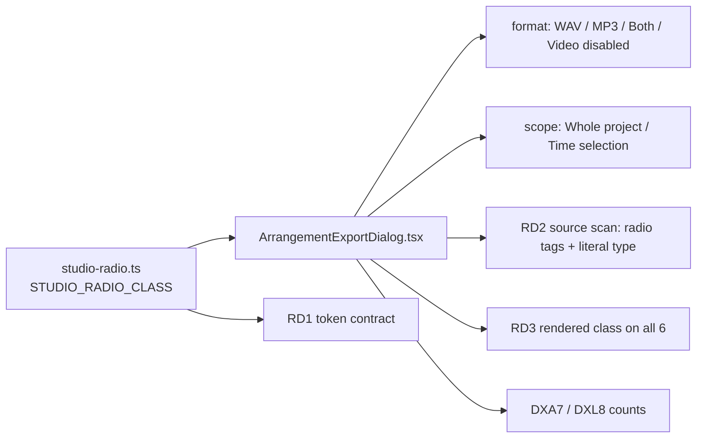

# SABA-B-12 stage 2a (STUDIO-VIS-2): Export dialog-ის radio-ებს თემა ხატავს და არა browser

**თარიღი:** 2026-11-10
**სტატუსი:** In Progress (stage 2a of 4; C round 431 PASS)
**შეცვლილი პროექტი:** Store (ერთი component ფაილი, ერთი ახალი class ფაილი, სამი არსებული და ერთი ახალი test ფაილი, ეს doc; ტექსტი, label-ები, layout, keyboard და export-ის ქცევა უცვლელია)

## კონტექსტი

საბამ (2026-11-10) Studio-ში browser-ის default form control-ები დაიწუნა: „უფრო სოლიდური, და ესთეტიური უნდა იყოს". product-designer-ის audit-ში (`docs/technical/studio-real-workspace/studio-visual-audit-2026-11-10.md`) Export dialog-ის native radio-ები STUDIO-VIS-2-ია (High / Next). Stage 1 (doc 278) Clip details-ის spin button-ებს ეხებოდა; ეს stage 2-ის პირველი ნაწილია.

**HEAD-ის ფაქტები** (`5a30894`, B-ის probe რეალურ Chromium-ში, `tmp/studio-real-loop/b-round-430/probe/head/`):

- `ArrangementExportDialog.tsx`-ს 6 `type="radio"` input აქვს: format — WAV, MP3, Both, Video (disabled, class-ის გარეშე); scope — Whole project და Time selection (range-ის გარეშე disabled; render-ის დროს ორივე scope radio disabled-ია). ხუთს `className="accent-brand"` ჰქონდა. arrangement-ის component-ებში radio მხოლოდ ამ ფაილშია.
- ყოველი radio card `<label>`-შია: არჩეულზე `border-brand bg-brand/10`, სხვაზე `border-outline` (ეს უცვლელია).
- ერთადერთი global focus style: `:focus-visible`-ზე 1.5px brand outline 80%-ით, `outline-offset: var(--focus-offset, 2px)`; `html[data-focus-source="pointer"]`-ის ქვეშ ჩახშობილია.
- Browser-ში ყოველი radio browser-ის 13×13 control-ია (`appearance: auto`), `accent-brand`-ით შეფერილი; Video-ს tint-იც არ ჰქონდა.
- Dialog-ის Tab stop-ები: Close, wav, mp3, both, project, Done, Export WAV. ArrowDown ციკლავს wav → mp3 → both → wav (disabled Video-ს ტოვებს). mouse press `:focus-visible`-ს არ ემთხვევა.

## მიდგომა

B-ის rulings (D-29z1517):

1. **ვარიანტი (b), არა `sr-only`.** თემის მიერ დახატული წრე რეალურ input-ზე (product-designer-ის არჩევანი, 2026-11-10). global focus ring input-ზე რჩება (მეორე ring style და დამალული focusable არ ჩნდება); არჩეულ მდგომარეობას ფორმის განსხვავებაც აქვს (ცარიელი რგოლი vs brass რგოლი მუქი ცენტრით), ამიტომ ის მარტო ფერზე არ არის დამოკიდებული (WCAG 1.4.1/1.4.11); native arrow-key ციკლი და forced-colors რჩება. audit-ის ტექსტი `sr-only`-ისკენ იხრებოდა; trade-off ჩაწერილია.
2. **ერთი საერთო constant** `STUDIO_RADIO_CLASS` ახალ `app/components/arrangement/studio-radio.ts`-ში (`studio-fader.ts`-ის pattern): `size-4 shrink-0 appearance-none rounded-full border border-outline-strong bg-transparent checked:border-4 checked:border-brand checked:bg-brand-foreground enabled:not-checked:hover:border-brand-hover disabled:cursor-not-allowed disabled:opacity-50 forced-colors:appearance-auto`. ექვსივე radio-ზე, Video-ს ჩათვლით. `accent-brand` dialog-იდან ქრება.
3. **Card highlight რჩება** მეორე სიგნალად და დიდ click target-ად. ტექსტი, label, layout, keyboard და export ქცევა არ იცვლება; label box-ები HEAD-ის ±1 px-ში რჩება (გაზომილი 0).
4. **მდგომარეობები:** unchecked — ცარიელი `outline-strong` რგოლი; checked — brass რგოლი, მუქი ცენტრი; disabled — იგივე ფორმა 50% opacity-ით (Video, Time selection range-ის გარეშე, render-ის დროს ორივე scope radio = disabled-checked); hover ცვლის მხოლოდ enabled unchecked რგოლს (`brand-hover`); keyboard focus — global ring 16 px წრის გარშემო; mouse press — ring არ ჩანს; **forced colours** — სისტემის radio (`forced-colors:appearance-auto`).
5. **Motion:** ახალი transition token არ არის (TL-R431-01: unlayered global `input { transition … }` წესი utility-ებს სჯობს; მისი 150 ms ფერის fade ძველია და უცვლელი).
6. **Guard-ის ფარგლები (RD2):** მხოლოდ ზედა დონის `app/components/arrangement/*.tsx`; literal `type="…"`-ის გარეშე ნებისმიერი `<input>` ტესტს აწითლებს, ასე რომ radio `type={variable}`-ის ან მხოლოდ spread-ის უკან ვერ დაიმალება. Spread-ს, რომელიც literal `type`-ის შემდეგ მოდის (`<input type="text" {...rest} />`, მაგ. `ArrangementMixFader.tsx`), RD2 ვერ ხედავს; იქ type-ის გადაფარვას TypeScript იცავს, რადგან props-ის type-დან `type` ამოღებულია. `app/components/recordings/SfxSceneExport.tsx`-ში native radio რჩება: ის `/studio-lab`-ის გარეთაა და STORE-REDESIGN-ის acceptance-ში გადადის (TL-R430-10).
7. **Firefox/Safari:** cloud-ში მხოლოდ Chromium-ია. TLM-SABA-B-12-FIREFOX-SAFARI ახლა radio-ს წრესაც ფარავს (deadline RETRO 435).
8. **Screen budget:** მუდმივი ელემენტი არც ემატება და არც იშლება.
9. **Doc:** ეს doc; doc 278 არ იცვლება.

**Ableton:** Live 12-ის Export Audio/Video dialog choosers-სა და on/off options-ს იყენებს (manual 5.1.3), არა radio-ებს. ჩვენი card radio-ები Saba-ს მიერ დამტკიცებული ძველი განსხვავებაა; ეს stage მხოლოდ წრის დახატვას ცვლის. „Live dialog-ებში OS-ის control-ს არ აჩვენებს" — დასკვნაა, არ არის გაზომილი.

## არქიტექტურა



## შეცვლილი ფაილები

- `app/components/arrangement/studio-radio.ts` — ახალი; `STUDIO_RADIO_CLASS`.
- `app/components/arrangement/ArrangementExportDialog.tsx` — ერთი import, ხუთი `accent-brand` → `STUDIO_RADIO_CLASS`, Video-ზე class დამატებული.
- `app/lib/arrangement/__tests__/studio-radio.test.ts` — ახალი; RD1, RD2.
- `app/lib/arrangement/__tests__/export-dialog-a11y-copy.test.tsx` — import და RD3.
- `app/lib/arrangement/__tests__/affordance-colour-ui.test.tsx` — `RADIO_PATH` და DXA7-ის ცხრილები (`accent-brand` 0, `STUDIO_RADIO_CLASS` 6, `checked:border-brand` 1).
- `app/lib/arrangement/__tests__/label-status-colour-ui.test.tsx` — DXL8-ის რაოდენობები (`accent-brand` 0, `STUDIO_RADIO_CLASS` 6).
- `docs/implementation/2026/quarter-IV/279-saba-b-12-export-radios.md` — ეს doc.

## პრობლემები და გადაწყვეტები

- **პრობლემა:** native radio-ს წრე at-rest screenshot-ზე „ლამაზად" ჩანს და screen review-ები მას row-ად არ ითვლიდნენ. **გადაწყვეტა:** lesson L61 — browser-ის მიერ დახატული ნაწილი (radio dot) row-ია; C ყოველ radio-ს rest, hover, focus და pressed მდგომარეობაში ჭრის ორივე viewport-ზე.
- **პრობლემა:** `appearance: none`-ის შემდეგ Windows High Contrast-ში radio შეიძლება გაქრეს. **გადაწყვეტა:** `forced-colors:appearance-auto` სისტემის radio-ს აბრუნებს; RD1 ამ token-ს იცავს, browser-ში კი `emulateMedia({ forcedColors: 'active' })` ზომავს.
- **პრობლემა:** hover-ი checked რგოლის brass ფერს გადაფარავდა. **გადაწყვეტა:** `enabled:not-checked:hover:` — hover მხოლოდ enabled unchecked რგოლზე მოქმედებს; MU-RD-HOVER-CHECKED mutant-ი RD1-ს აწითლებს.
- **პრობლემა:** source scan-ს radio spread-ით (`{...props}`) ან `type={variable}`-ით გამოეპარებოდა. **გადაწყვეტა:** RD2 ყოველ arrangement `<input>`-ს literal `type`-ს სთხოვს (MU-RD-SPREAD-TYPE). ზღვარი: literal `type`-ის შემდეგ მოსული spread-ი RD2-ს არ აწითლებს (იხ. TODO).
- **პრობლემა:** jsdom-ს computed style-ის (`appearance`, cascade) შემოწმება არ შეუძლია. **გადაწყვეტა:** RD1/RD2/RD3 class-ის კონტრაქტს იცავს; ვიზუალური ნახევარი C-ის Chromium probe-ია.

## ტესტირება

- **ახალი row-ები:** RD1 (`studio-radio.test.ts`: class ზუსტად token-only წრეა, `accent-*` არ აქვს, `forced-colors:appearance-auto` აქვს, hover checked-ს გამორიცხავს), RD2 (`studio-radio.test.ts`: radio მხოლოდ Export dialog-შია, მის 6 radio tag-ს `className={STUDIO_RADIO_CLASS}` აქვს, `<input>` type-ს არ მალავს), RD3 (`export-dialog-a11y-copy.test.tsx`: 6 რენდერებული radio, მათ შორის 2 disabled, ზუსტად საერთო class-ით). DXA7 (`affordance-colour-ui.test.tsx`) და DXL8 (`label-status-colour-ui.test.tsx`) ძველი `accent-brand` = 5-ის ნაცვლად თანაბარ ან უფრო მკაცრ რაოდენობებს ამოწმებს.
- **Mutant-ები** (B, `tmp/studio-real-loop/b-round-430/mutants/summary.txt`):

```
MU-RD-ONE-ACCENT: rc=1 red=DXA7,DXL8,RD2,RD3
MU-RD-VIDEO-BARE: rc=1 red=DXA7,DXL8,RD2,RD3
MU-RD-NO-FORCED: rc=1 red=RD1
MU-RD-NATIVE: rc=1 red=RD1
MU-RD-NEW-RADIO: rc=1 red=RD2
MU-RD-SPREAD-TYPE: rc=1 red=RD2
MU-RD-HOVER-CHECKED: rc=1 red=RD1
```

- **Browser** (B-ის probe საბოლოო sketch-ზე, `tmp/studio-real-loop/b-round-430/probe/compare.txt`: `ALL OK (2 cells, 6 radios each)`; `compare-extra.txt`: `EXTRA ALL OK (2 cells)`). A-მ იგივე probe-ები საკუთარ tree-ზე :5173-ზე გაუშვა (`tmp/studio-real-loop/a-round-431/probe/`) და იგივე შედეგი მიიღო. ორივე viewport-ზე (1440×900, 1280×720):

| მდგომარეობა | HEAD | ამ round-ის შემდეგ |
|---|---|---|
| computed `appearance`, box (6 radio) | `auto`, 13×13 | `none`, 16×16 |
| checked (WAV, Whole project) | browser-ის წრე `accent-brand`-ით | brass რგოლი `rgb(201, 164, 106)` 4 px, მუქი ცენტრი `rgb(14, 13, 12)` |
| unchecked (MP3, Both) | browser-ის წრე | რგოლი `rgb(115, 107, 96)` 1 px |
| hover enabled unchecked | უცვლელი | რგოლი `rgb(217, 184, 127)` (`brand-hover`) |
| hover checked / disabled | უცვლელი | უცვლელი |
| disabled (Video, Time selection) | browser-ის disabled წრე | იგივე ცარიელი რგოლი 50% opacity-ით |
| disabled-checked (Whole project render-ის დროს) | — | opacity `0.5`, brass რგოლი 4 px |
| forced colours | — | ექვსივე `appearance: auto` |
| label box-ები | — | HEAD-ის ±0 px |
| Tab stop-ები | Close, wav, mp3, both, project, Done, Export WAV | იგივე |
| ArrowDown | wav → mp3 → both → wav, mp3 `:focus-visible` | იგივე |
| mouse press | `:focus-visible` არა | იგივე |
| WAV export (dialog → render → ფაილი) | — | ფაილი ჩამოიტვირთა |
| page errors | 0 | 0 |

- **Contrast** (B, computed ფერებიდან, `tmp/studio-real-loop/b-round-430/probe/contrast.txt`): unchecked რგოლი (`outline-strong`) vs surface card 3.5:1; brass რგოლი vs არჩეული card-ის ფონი (brand/10 surface-ზე) 6.74:1; შიდა წერტილი (`brand-foreground`) vs brass რგოლი 8.32:1; hover რგოლი (`brand-hover`) vs surface 9.72:1; focus ring (brand 80%) არჩეულ card-ზე დაახლოებით 4.85:1.
- **A (round 431):** covering set 29 ფაილი, 384/384, rc 0; `npm run typecheck` rc 0; `npm run lint` rc 0 (205 warning, 1 info, როგორც HEAD-ზე); Biome 6 ფაილზე rc 0. logs: `tmp/studio-real-loop/a-round-431/`.
- **C round 431:** mutant-ები, browser probe-ები ორ viewport-ზე, forced colours, disabled-checked, export და auth row (C-ის ანგარიში round 431-ის loop folder-ში).

## TODO / შემდეგი ნაბიჯები

- **SABA-B-12-ის stage-ები:** 1 — დასრულებულია (Clip details-ის spin button-ები, doc 278); 2a — ეს doc (Export dialog-ის 6 radio); 2b — `<progress>`; 3 — search cancel ✕; 4 — `<select>`-ები (deferred).
- **Stage 2b:** Export dialog-ის `<progress>` bar (SABA-B-12-STAGE-2B-PROGRESS); ჯერ determinate და indeterminate მდგომარეობების გამეორებადი hold recipe რეალურ Chromium-ში.
- **Stage 3:** Shortcut sheet-ის search field-ის native cancel ✕.
- **Stage 4:** 2 `<select>` (REVIEW-RECOMMENDATIONS, deferred).
- **RD2-ის ფარგლები:** guard მხოლოდ ზედა დონის `app/components/arrangement/*.tsx`-ს კითხულობს; sub-folder-ები, wrapper component-ები და arrangement-ის გარეთ ფაილები (მაგ. `app/components/recordings/SfxSceneExport.tsx`-ის native radio, STORE-REDESIGN-ის acceptance, TL-R430-10) არ იფარება. ასევე: literal `type`-ის შემდეგ მოსული `{...spread}` (type-ს runtime-ში შეუძლია გადაფაროს), `data-type=`/`aria-…type=` attribute-ებიც ემთხვევა `\btype=` regex-ს, და `type="datetime-local"`-ის მსგავს type-ს `[a-z]+` ვერ კითხულობს. ასეთი radio-ს ან input-ის დამატებისას guard გასაფართოებელია.
- **TLM-SABA-B-12-FIREFOX-SAFARI:** Firefox-სა და Safari-ში radio-ს წრისა და spin button-ების ხელით შემოწმება, deadline RETRO 435.
