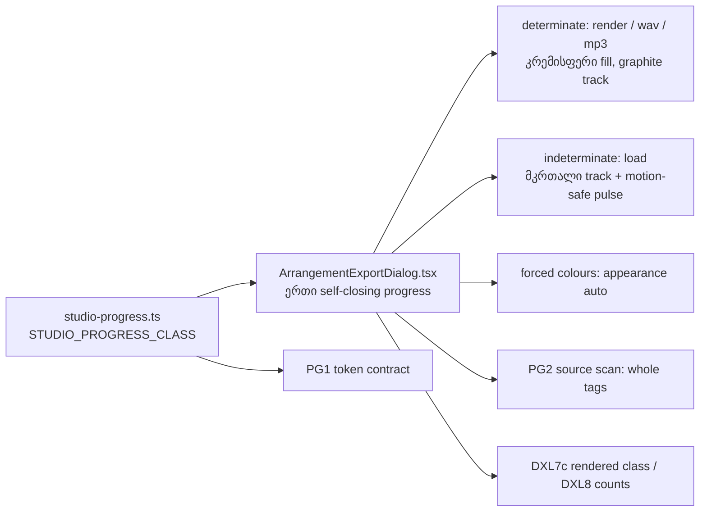

# SABA-B-12 stage 2b: Export dialog-ის progress bar-ს თემა ხატავს და არა browser

**თარიღი:** 2026-11-10
**სტატუსი:** In Progress (stage 2b of 4; C round 432 PASS)
**შეცვლილი პროექტი:** Store (ერთი component ფაილი, ერთი ახალი class ფაილი, ერთი არსებული და ერთი ახალი test ფაილი, ეს doc; ტექსტი, label, `aria-*`, layout და export-ის ქცევა უცვლელია)

## კონტექსტი

Saba-მ (SABA-B-12) მოითხოვა, რომ Studio-ში browser-ის default control-ები აღარ ჩანდეს. Stage 1-მა Clip details-ის spin button-ები დამალა (doc 278), stage 2a-მ Export dialog-ის radio-ები თემით დახატა (doc 279). ეს stage Export dialog-ის ერთადერთ `<progress>`-ს ეხება.

**HEAD-ის ფაქტები** (`1197dcb`, B-ის probe რეალურ Chromium-ში ორივე viewport-ზე, `tmp/studio-real-loop/b-round-431/probe/head-final/`):

- `ArrangementExportDialog.tsx`-ს ერთი `<progress>` აქვს, class `h-2 w-full accent-foreground`. ის მხოლოდ `isRendering && progress` პირობით რენდერდება, `value`-ს `progress.fraction`-იდან იღებს და `aria-valuetext`-ში იმავე ტექსტს ატარებს, რაც label-შია.
- WAV export-ის render-ის დროს bar არის **Chromium-ის default მწვანე fill ნაცრისფერ track-ზე**, კვადრატული ბოლოებით; `accent-foreground` მას საერთოდ არ აღწევს.
- MP3 encoder-ის ჩატვირთვისას (phase `load`, `fraction: null`, `value` attribute-ის გარეშე) bar ბრტყელი ნაცრისფერი browser bar-ია, ანიმაციის გარეშე.
- Phase-ები (`export-progress.ts`): `render`, `wav` და `mp3` determinate-ია; `load` indeterminate. phase-ის ცვლისას value 0-ზე ბრუნდება და label იმავე frame-ში იცვლება.
- `arrangement/` ფოლდერში სხვა `<progress>` არ არის. `app/components/recordings/SfxSceneExport.tsx`-ს საკუთარი bar აქვს `/studio-lab`-ის გარეთ (STORE-REDESIGN-ის acceptance).
- `app.css`-ში global `progress` rule არ არსებობს; token-ები `outline-hover` (#2e2a26) და `foreground` (#ece6da) არსებობს.

## მიდგომა

B-ის rulings (D-29z1524, product-designer-ის consult 2026-11-10):

1. **Native `<progress>` რჩება** და ემატება ერთი საერთო constant: `STUDIO_PROGRESS_CLASS` ახალ `app/components/arrangement/studio-progress.ts`-ში, `studio-radio.ts`-ის pattern-ით, გამოყენება `className={STUDIO_PROGRESS_CLASS}`. უარყოფილია `div role=progressbar`: ის browser-ის უკვე მოცემულ semantics-ს თავიდან აშენებს, `tagName PROGRESS`-ის pin-ებს არღვევს და მეორე pattern-ს ამატებს.
2. **იერი:** `h-2 w-full` box რჩება (ორივე viewport-ზე 494×8 px, როგორც HEAD-ზე); `appearance-none rounded-full overflow-hidden`; track `bg-outline-hover` element-ზე (Firefox) და `::-webkit-progress-bar`-ზე (Chromium); fill `bg-foreground` `::-webkit-progress-value`-სა და `::-moz-progress-bar`-ზე, მომრგვალებული ბოლოებით. Fill **ნეიტრალურია** — DXL7c-ის ფერის როლი რჩება, brass და `accent-*` არ არის. width transition არ არის.
3. **Indeterminate (MP3 encoder-ის ჩატვირთვა):** მთელი track მკრთალდება `indeterminate:bg-foreground/30`-ით (element-ზე, `::-webkit-progress-bar`-ზე და `::-moz-progress-bar`-ზე, TL-R432-02) და ემატება `motion-safe:indeterminate:animate-pulse`. ეს Tailwind-ის ჩაშენებული keyframe-ია, ამიტომ `app.css`-ს ახალი არაფერი ემატება. `prefers-reduced-motion: reduce`-ისას bar იგივე მკრთალი, უძრავი ზოლია.
   - code-reviewer-ის დასკვნა (არ არის გაზომილი): Chromium-ში `bg-foreground/30` სავარაუდოდ ორჯერ იხატება — element-ზე და მის ზემოთ `::-webkit-progress-bar`-ზე. ორი ფენის გამოთვლილი ფერი (~#837f7a) ახლოსაა გაზომილ შუა pixel-თან (~#7f7b76, 4.37:1 surface-თან); ერთი ფენა დაახლოებით 2.5:1-ს მისცემდა. pulse-ის დაბალ წერტილში (opacity 0.5) bar surface-თან დაახლოებით 1.5:1-ია (გამოთვლა); status-ს ხილული label და `aria-valuetext` ატარებს.
   - უარყოფილია (a) ცარიელი track: „0 %"-ად ან „გაჭედილად" იკითხება, ჩატვირთვა კი 120 წამამდე შეიძლება გაგრძელდეს.
   - უარყოფილია (c) მოცურავე სეგმენტი: ახალ `@keyframes`-ს მოითხოვს (Tailwind-first-ის დარღვევა) და ჩვეულებრივ 2 წამზე მოკლე ნაბიჯისთვის ზედმეტი მოძრაობაა.
4. **Forced colours:** `forced-colors:appearance-auto` სისტემის bar-ს აბრუნებს. Chromium-ის *emulated* forced colours-ში HEAD-იც და sketch-იც ორივე მდგომარეობაში სრულად თეთრ bar-ს ხატავს (`tmp/studio-real-loop/b-round-431/probe/forced-determinate.txt`). ეს არსებული ქცევაა, C მას ჩაწერს და არ ამოწმებს. რეალური Windows High Contrast-ის შემოწმება TLM-SABA-B-12-FIREFOX-SAFARI-ს დაემატა.
5. **უცვლელია:** ტექსტი, label, `aria-label`, `aria-valuetext`, render guard, unmount done/cancel/error-ზე, layout და export-ის ქცევა. phase-ებს შორის 0-ზე დაბრუნება რჩება — Live-ის export bar-იც ყოველ pass-ზე reset-დება (manual 5.1.3.4).
6. **Guard (PG2):** ზედა დონის `app/components/arrangement/*.tsx`. ერთადერთი owner Export dialog-ია; `<progress` გახსნების რაოდენობა self-closing tag-ების რაოდენობას უდრის, ყოველ tag-ს constant აქვს და `</progress>` დამხურავი tag არ არსებობს (TL-R432-05). `SfxSceneExport.tsx` ფარგლებს გარეთ რჩება.
7. **Firefox/Safari:** cloud-ში მხოლოდ Chromium-ია. TLM-SABA-B-12-FIREFOX-SAFARI ახლა progress bar-საც ფარავს (deadline RETRO 435); `browserVerified`-ს false-ად არ აქცევს.
8. **Screen budget:** მუდმივად ხილული არაფერი ემატება და არ იშლება — bar მხოლოდ render-ის დროს არსებობს.
9. **Docs:** ეს doc (280); doc 279 არ შეცვლილა.

**Ableton Live 12-ის reference:**

| წერტილი | წყარო | სტატუსი | CZABA |
|---|---|---|---|
| render-ის დროს dialog-ში progress bar ჩნდება | manual **5.1.3.5 Real-Time Rendering**: „Once the waiting period is over, the render starts and a progress bar appears in the dialog." (https://www.ableton.com/en/live-manual/12/managing-files-and-sets/, 2026-11-10) | დადასტურებული (manual-ის ტექსტი) | bar dialog-შია render-ის დროს (არსებული ქცევა); მის იერს ახლა თემა ხატავს |
| რამდენიმე pass-იან render-ზე bar reset-დება | იგივე გვერდი, **5.1.3.4 Video Rendering Options**: „the progress bar in the dialog resets for each individual pass." | დადასტურებული (manual-ის ტექსტი) | უცვლელი და შესაბამისი: bar ყოველ phase-ზე 0-ზე ბრუნდება (render → wav, load → mp3), label იმავე მომენტში იცვლება |
| Live საკუთარ UI-ს ხატავს, არა OS-ის default bar-ს | — | დასკვნა (არ არის გაზომილი) | Export dialog-ში browser-ის დახატული bar აღარ რჩება |

bar-ის ფერზე, სიმაღლესა და indeterminate ანიმაციაზე reference ვერ მოიძებნა: manual 5.1.3 მათ არ აღწერს და ოფიციალური screenshot B-მ ვერ იპოვა. **განსხვავებები:** ნეიტრალური კრემისფერი fill და pulse CZABA-ს საკუთარი იერია (Obsidian თემა, DXL7c-ის ფერის როლი); Live-ს დოკუმენტირებული indeterminate მდგომარეობა არ აქვს — ჩვენთან ის არსებობს, რადგან MP3 encoder პირველ გამოყენებაზე იტვირთება.

## არქიტექტურა



## შეცვლილი ფაილები

- `app/components/arrangement/studio-progress.ts` — ახალი; `STUDIO_PROGRESS_CLASS`.
- `app/components/arrangement/ArrangementExportDialog.tsx` — ერთი import და `h-2 w-full accent-foreground` → `STUDIO_PROGRESS_CLASS`.
- `app/lib/arrangement/__tests__/studio-progress.test.ts` — ახალი; PG1, PG2.
- `app/lib/arrangement/__tests__/label-status-colour-ui.test.tsx` — DXL7c ჩანაცვლებული (რენდერებული bar ზუსტად constant-ის token-ებს ატარებს, `accent-*` არა), DXL8-ის რაოდენობები (`accent-foreground` 0, `className={STUDIO_PROGRESS_CLASS}` 1).
- `docs/implementation/2026/quarter-IV/280-saba-b-12-export-progress.md` — ეს doc.

## პრობლემები და გადაწყვეტები

- **პრობლემა:** `accent-foreground` (CSS `accent-color`) Chromium-ში `<progress>`-ს არ აღწევს, ამიტომ bar მწვანე რჩებოდა, თუმცა DXL7c token-ს ამოწმებდა და მწვანე იყო. **გადაწყვეტა:** `appearance-none` და pseudo-element-ების (`::-webkit-progress-bar`, `::-webkit-progress-value`, `::-moz-progress-bar`) პირდაპირი ფერები; DXL7c ახლა ზუსტ class-ს ამოწმებს, ვიზუალურ ნახევარს კი C-ის Chromium probe ზომავს.
- **პრობლემა:** indeterminate bar ცარიელი track-ით „გაჭედილად" გამოიყურებოდა. **გადაწყვეტა:** მკრთალი სრული track და `motion-safe:` pulse — Tailwind-ის ჩაშენებული keyframe, ახალი CSS-ის გარეშე; reduced motion-ისას უძრავია.
- **პრობლემა:** Firefox-ის indeterminate fill სხვა pseudo-element-ზე ხატავს. **გადაწყვეტა:** `indeterminate:[&::-moz-progress-bar]:bg-foreground/30` (TL-R432-02); MU-PG-MOZ-IND mutant-ი PG1-ს აწითლებს. რეალური Firefox-ის შემოწმება Tech Lead row-ია.
- **პრობლემა:** `appearance: none`-ის შემდეგ High Contrast-ში bar შეიძლება გაქრეს. **გადაწყვეტა:** `forced-colors:appearance-auto`; emulated forced colours-ში ის `appearance: auto`-ს იძლევა. emulated თეთრი bar HEAD-ზეც იგივეა, ამიტომ მხოლოდ ჩაიწერება.
- **პრობლემა:** source scan-ს `<progress>…</progress>` წყვილი self-closing ძებნას გამოეპარებოდა. **გადაწყვეტა:** PG2 გახსნებს self-closing tag-ებს უთანაბრებს და დამხურავ tag-ს კრძალავს (TL-R432-05, MU-PG-CLOSING-PAIR).

## ტესტირება

- **ახალი და შეცვლილი row-ები:** PG1 (`studio-progress.test.ts`: class ზუსტად token-only ნეიტრალური bar-ია, `accent`/`brand` არ აქვს, pulse მხოლოდ `motion-safe:indeterminate:`-ის ქვეშაა, Firefox-ის indeterminate fill და `forced-colors:appearance-auto` აქვს), PG2 (`studio-progress.test.ts`: `<progress>` მხოლოდ Export dialog-შია, ყოველი გახსნა ერთი self-closing tag-ია `className={STUDIO_PROGRESS_CLASS}`-ით, დამხურავი წყვილი არ არის), DXL7c (`label-status-colour-ui.test.tsx`: pending render-ის დროს რენდერებული bar ზუსტად constant-ის token-ებს ატარებს, `accent-brand` და `accent-foreground` არა), DXL8 (იგივე ფაილი: dialog-ის source-ში `accent-foreground` 0, `className={STUDIO_PROGRESS_CLASS}` 1).
- **მეზობელი ქცევა:** PU1 და PU2 (`export-progress-ui.test.tsx`: phase-ები, ჩატვირთვისას `value` attribute არ არის, done/შეცდომაზე bar ქრება) უცვლელად გადის.
- **Mutant-ები** (B, `tmp/studio-real-loop/b-round-431/mutants/summary.txt`):

```
MU-PG-ACCENT: rc=1 red=DXL7c,DXL8,PG2
MU-PG-NO-FORCED: rc=1 red=PG1
MU-PG-NATIVE: rc=1 red=PG1
MU-PG-ALWAYS-PULSE: rc=1 red=PG1
MU-PG-BRASS-FILL: rc=1 red=DXL7c,PG1
MU-PG-MOZ-IND: rc=1 red=PG1
MU-PG-CLOSING-PAIR: rc=1 red=PG2
MU-PG-NEW-BAR: rc=1 red=PG2
```

- **Browser** (B-ის probe საბოლოო sketch-ზე, `tmp/studio-real-loop/b-round-431/probe/compare.txt`: `ALL OK (2 cells, 4 states each)`; HEAD-ზე `compare-head.txt`: `NOT ALL OK`; მეზობლები `compare-neighbours.txt`: `NEIGHBOURS OK (2 cells, 3 load-phase states)`). ორივე viewport-ზე (1440×900, 1280×720):

| მდგომარეობა | HEAD | ამ round-ის შემდეგ |
|---|---|---|
| determinate (WAV render) | `appearance: auto`, მწვანე fill ნაცრისფერ track-ზე (226–406 მწვანე pixel), კვადრატული კუთხე | `appearance: none`, fill `rgb(236,230,218)`, track `rgb(46,42,38)`, 0 მწვანე pixel, მომრგვალებული კუთხე; fill-ის სიგანე value-ის bracket-შია |
| indeterminate (MP3 encoder load) | `appearance: auto`, ბრტყელი ნაცრისფერი, ანიმაცია `none`, opacity მუდმივად 1.0 | `value` attribute არ არის, box 494×8, radius 9999px, ანიმაცია `pulse` (opacity იცვლება), შუა pixel მკრთალი ნეიტრალური |
| reduced motion | — | ანიმაცია `none`, opacity 1, იგივე მკრთალი fill |
| forced colours (emulated) | `appearance: auto`, სრულად თეთრი bar | `appearance: auto`, სრულად თეთრი bar (ჩაიწერება, არ მოწმდება) |
| label, `aria-label`, `aria-valuetext`, box x/y/w/h load phase-ში | — | HEAD-ის ტოლი (±1 px) |
| export (dialog → render → ფაილი) | — | WAV და MP3 ფაილი ჩამოიტვირთა |

- **Contrast** (B, token-ებიდან, `tmp/studio-real-loop/b-round-431/probe/contrast.txt`): fill `foreground` #ece6da vs track `outline-hover` #2e2a26 — 11.45:1; fill vs dialog-ის surface #161412 — 14.78:1; track vs surface — 1.29:1 (track მნიშვნელობას არ ატარებს, product-designer); indeterminate-ის გაზომილი შუა pixel ~#7f7b76 vs surface — 4.37:1.
- **A (round 432):** covering set 30 ფაილი, 386/386, rc 0; `npm run typecheck` rc 0; `npm run lint` rc 0 (205 warning, 1 info, როგორც HEAD-ზე); Biome 4 ფაილზე rc 0. logs: `tmp/studio-real-loop/a-round-432/`.
- **C round 432:** mutant-ები, browser probe ორ viewport-ზე (determinate, indeterminate, reduced motion, forced colours, მეზობლები) და auth row.

## TODO / შემდეგი ნაბიჯები

- **SABA-B-12-ის stage-ები:** 1 — დასრულებულია (Clip details-ის spin button-ები, doc 278); 2a — დასრულებულია (Export dialog-ის 6 radio, doc 279); 2b — ეს doc (`<progress>`); 3 — search cancel ✕; 4 — `<select>`-ები (deferred).
- **Stage 3:** Shortcut sheet-ის search field-ის native cancel ✕.
- **Stage 4:** 2 `<select>` (REVIEW-RECOMMENDATIONS, deferred).
- **TLM-SABA-B-12-FIREFOX-SAFARI** (deadline RETRO 435): Firefox-ში `::-moz-progress-bar`-ის fill და indeterminate მდგომარეობა (ფარავს თუ არა მკრთალი fill მთელ track-ს; Chromium-ის ორფენიანი 4.37:1 იქ შეიძლება ერთ ფენამდე, ~2.5:1-მდე დავიდეს), Safari, და რეალური Windows High Contrast (forced colours) progress bar-ზე, radio-ებსა და spin button-ებზე.
- **`SfxSceneExport.tsx`-ის bar** (`app/components/recordings/`, `/studio-lab`-ის გარეთ): STORE-REDESIGN-ის acceptance (SABA-B-12-RECORDINGS-NUMBER); PG2 მას არ ფარავს.
