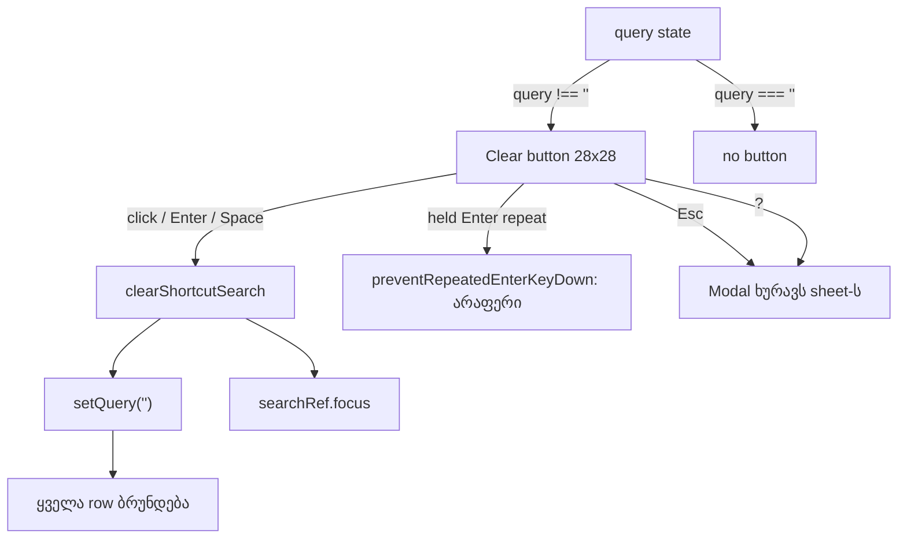

# SABA-B-12 stage 3: Shortcut sheet-ის search საკუთარ Clear ღილაკს ხატავს და არა browser-ის ✕-ს

**თარიღი:** 2026-11-10
**სტატუსი:** In Progress (stage 3 of 4; C round 433 PASS)
**შეცვლილი პროექტი:** Store (ერთი component ფაილი, ერთი strings ხაზი, ერთი არსებული და ერთი ახალი test ფაილი, ეს doc; sheet-ის ტექსტი, ფილტრი, Esc-ის და focus trap-ის ქცევა უცვლელია)

## კონტექსტი

Saba-მ (SABA-B-12) მოითხოვა, რომ Studio-ში browser-ის default control-ები აღარ ჩანდეს. Stage 1-მა Clip details-ის spin button-ები დამალა (doc 278), stage 2a-მ Export dialog-ის radio-ები თემით დახატა (doc 279), stage 2b-მ Export-ის progress bar (doc 280). ეს stage `?` shortcut sheet-ის search ველს ეხება.

**HEAD-ის ფაქტები** (`1a417fb`, B-ის probe რეალურ Chromium-ში ორივე viewport-ზე, `tmp/studio-real-loop/b-round-432/probe/head/`):

- `ArrangementShortcutSheet.tsx`-ს **ერთი** `type="search"` აქვს, class `… bg-background px-3 py-2 text-sm …`, native cancel-ის დამალვის წესის გარეშე.
- search-ში ტექსტის აკრეფისას ველის მარჯვენა ბოლოში **Chromium-ის ლურჯი ✕** ჩნდება: Obsidian & Brass dialog-ში browser-ის დახატული control. ველის მარჯვენა 42 px-ში probe-მა 32 ლურჯი pixel დათვალა (`compare-head.txt`, `head/clear.json`).
- `ArrangementLibrary.tsx`-ის search უკვე მალავს native cancel-ს (`[&::-webkit-search-cancel-button]:hidden`) და საკუთარ "Clear search" ღილაკს ხატავს; input-ს მხოლოდ მაშინ აბრუნებს focus-ს, როცა focus ღილაკზე იყო.
- `app/components/arrangement`-ში ეს ორი ერთადერთი `type="search"` ველია.
- sheet-ის capture handler Escape-ზე `preventDefault`-ს იძახებს, და `Modal.tsx`-ის document handler sheet-ს ხურავს, ამიტომ browser-ის საკუთარი „Esc ასუფთავებს search-ს“ არასოდეს სრულდება.
- focus trap-ის focusable selector ყველა `button:not([disabled])`-ს მოიცავს და ყოველ Tab-ზე თავიდან იკითხება.
- `studioShortcutSheetStrings`-ს `clearSearch` არ ჰქონდა.

## მიდგომა

B-ის rulings (D-29z1530; product-designer-ისა და tech-lead-ის consult, `b-round-432/sketch-review.md`):

1. **native cancel იმალება, ჩვენი ღილაკი იხატება.** Library-ის pattern, 38 px ველისთვის ერთი საფეხურით დიდი: input `pl-3 pr-9` + `[&::-webkit-search-cancel-button]:hidden`; ღილაკი 28×28 (`h-7 w-7`), `text-muted hover:text-foreground`, lucide `X` `size-3.5`, `aria-label` და `title` "Clear search" (ახალი `studioShortcutSheetStrings.clearSearch`). უარყოფილია: მხოლოდ ✕-ის დამალვა (მომხმარებელს დღეს არსებულ ფუნქციას ართმევს), `CircleX` (იგივე იდეის ახალი ვიზუალი) და Library-ის ზუსტი `h-6`/`size-3` (ამ ველში ძალიან პატარაა).
2. **ხილვადობა:** ღილაკი ჩანს, სანამ `query !== ''` (space-ებიც ითვლება, რომ მათი გასუფთავებაც შეიძლებოდეს). ცარიელ ველზე საერთოდ არ რენდერდება, ამიტომ disabled მდგომარეობა არ აქვს.
3. **Click, Enter ან Space** ასუფთავებს query-ს და focus-ს **ყოველთვის search input-ზე აბრუნებს** (L47): ღილაკი unmount-დება და dialog-მა focus body-ზე არ უნდა დააგდოს. ეს შეგნებული განსხვავებაა Library-სგან. Held Enter ერთხელ მოქმედებს (`preventRepeatedEnterKeyDown`). Space-ს unit test-ი არ ფარავს (jsdom Space-ს click-ად არ აქცევს); მას browser probe-ის `afterSpace` ამოწმებს.
4. **Tab-ის რიგი:** Close → search → Clear → Close. ღილაკი ჩვეულებრივი tab stop-ია (`tabIndex` 0); არსებულ trap-ს ცვლილება არ სჭირდება.
5. **Esc უცვლელია:** query-ით Esc search-ში ან Clear-ზე **sheet-ს ხურავს**, მომდევნო გახსნა ცარიელი ველით იწყება. ეს Saba-ს CALM-1 კონტრაქტია (SS2; subline: "Esc closes."). Live-სგან განსხვავდება (იხ. Reference); ეს არსებული CALM-1 გადაწყვეტილებაა და არა ახალი deviation.
6. **`?` Clear-ზე** sheet-ს ხურავს, ისევე როგორც Close-ზე (SS5-ის წესი ღილაკებისთვის). `?` search-ში ტექსტად იწერება.
7. **Focus ring:** არსებული global keyboard focus style (1px brass outline 80 %-ით, offset 2px). ახალი ring ან token არ ემატება.
8. **საერთო search constant ახლა არ კეთდება** (TL-R433-06): Library-სთან მხოლოდ ერთი token არის საერთო; საკითხი ROOT-REQ-ARCH-CHECKPOINT-STUDIO-CONTROLS-ში გადადის. SF2 მხოლოდ `app/components/arrangement`-ის top-level `.tsx` ფაილებს სკანირებს (ეს შეგნებული ფარგლებია და არა finding; scanner ვერ ხედავს `{...props}`-ით გადაცემულ type-ს და tag-ის შიგნით `//` comment-ში apostrophe-ს — დღეს არცერთი არ გვხვდება); დღეს Studio-ს ყველა search ველი იქაა. `app/components/recordings/*` SABA-B-12-RECORDINGS-NUMBER-ის ნაწილია.

### Reference: Ableton Live 12

| Point | Live 12 source (2026-11-10) | Live | CZABA | C checks |
|---|---|---|---|---|
| Clear button search ველში | [Manual 4.2 Search Bar](https://www.ableton.com/en/live-manual/12/working-with-the-browser/) | "You can click the x button in the search bar to clear any search terms." | იგივე: ველში X ასუფთავებს ტექსტს | Row 4 |
| რას აბრუნებს გასუფთავება | 4.2 | Clear შლის search terms-ს (filters რჩება) | ყველა row ბრუნდება (sheet-ს filters არ აქვს) | Row 4 (`afterClick` rows = სრული რაოდენობა) |
| Esc | 4.2, keyboard steps | "Esc to clear the search field and show all items" | Esc sheet-ს **ხურავს** (Saba CALM-1); X ასუფთავებს | Row 4 `esc-closes-with-query` |
| X-ის ვიზუალი | reference ვერ მოიძებნა (მხოლოდ manual-ის ტექსტი) | — | ჩვენი muted X, hover-ზე foreground; ველის ფონზე 7.07:1 | Row 4 crops |

Live-ის search browser-ის search-ია და არა shortcut sheet; Live-ს საძიებო shortcut sheet არ აქვს. Deviations: Esc (CALM-1), ინგლისური label-ები, საერთო focus style.

### Stage-ების სია

| Stage | შინაარსი | სტატუსი |
|---|---|---|
| 1 | Clip details-ის number spin button-ები (doc 278) | done |
| 2a | Export dialog-ის radio-ები (doc 279) | done |
| 2b | Export dialog-ის progress bar (doc 280) | done |
| 3 | Shortcut sheet-ის search Clear (ეს doc) | this round |
| 3b | dialog-ის scrollbar (SABA-B-12-DIALOG-SCROLLBAR) | next |
| 4 | native `<select>`-ები | deferred |

## არქიტექტურა



## შეცვლილი ფაილები

- `app/components/arrangement/ArrangementShortcutSheet.tsx` — search input `relative` wrapper-ში, `pl-3 pr-9` და native cancel-ის დამალვა; ახალი Clear ღილაკი და `clearShortcutSearch`, რომელიც query-ს ასუფთავებს და focus-ს search-ზე აბრუნებს.
- `app/lib/arrangement/strings.ts` — `studioShortcutSheetStrings.clearSearch` ("Clear search").
- `app/lib/arrangement/__tests__/shortcut-sheet-ui.test.tsx` — helper-ები და SC1–SC6.
- `app/lib/arrangement/__tests__/studio-search-field.test.ts` (ახალი) — SF1 (whole-tag scanner-ის self-test) და SF2 (arrangement-ის search ველები და native cancel).
- `docs/implementation/2026/quarter-IV/281-saba-b-12-search-clear.md` — ეს doc.

## პრობლემები და გადაწყვეტები

- **პრობლემა:** ღილაკი click-ის შემდეგ unmount-დება (ცარიელ ველზე არ რენდერდება) და focus dialog-ში body-ზე ვარდება. **გადაწყვეტა:** `clearShortcutSearch` focus-ს ყოველთვის search input-ზე აბრუნებს, მიუხედავად იმისა, სად იყო focus (Library-ის `hadFocus` guard-ის საწინააღმდეგოდ; SC2 და მუტანტი M7).
- **პრობლემა:** Escape-ზე browser-ის „Esc ასუფთავებს search-ს“ Live-ს ემთხვევა, მაგრამ CALM-1 კონტრაქტს ეწინააღმდეგება. **გადაწყვეტა:** Esc-ის ქცევა უცვლელია (sheet იხურება), გასუფთავება მხოლოდ X-ით ხდება (SC5, SS2).
- **პრობლემა:** guard-ს `type="search"`-ის ყველა ჩაწერა უნდა ეპოვა, მათ შორის `type={'search'}`, და tag-ის შიგნით `>` ან `{'}'}` არ უნდა აერიოს. **გადაწყვეტა:** whole-tag scanner, რომლის self-test-ია SF1 (L13); `type={'search'}`-ის გამოტოვებას მუტანტი M8 ამოწმებს.
- **პრობლემა:** ორ ფაილს შორის მხოლოდ ერთი class token არის საერთო. **გადაწყვეტა:** საერთო constant ამ round-ში არ კეთდება (TL-R433-06), საკითხი ARCH checkpoint-ზე გადადის.

## ტესტირება

**Unit (A, round 433):** covering set — 10 ფაილი, 196/196, rc 0; typecheck rc 0; lint rc 0 (205 warning, 1 info, HEAD-ის ტოლი); Biome 4 ფაილზე rc 0. ახალი row-ები: SC1–SC6 shortcut-sheet-ui-ში, SF1 და SF2 studio-search-field-ში. მეზობელი row-ები, რომლებიც covering set-შია: SS2 (Esc ხურავს, focus ბრუნდება), SS5 (`?` Close-ზე და search-ში), SS6 (Tab wrap ცარიელი query-ით), SS9 (უნიკალური სახელები).

**Mutants** (`tmp/studio-real-loop/b-round-432/mutants/summary.txt`, ზუსტი ასლი):

```
M1-head-component red: SC1 SC2 SC3 SC4 SC5 SC6 SF2 | Tests  7 failed | 16 passed
M2-native-cancel-shown red: SF2 | Tests  1 failed | 22 passed
M3-no-refocus red: SC2 SC4 | Tests  2 failed | 21 passed
M4-no-held-enter-guard red: SC4 | Tests  1 failed | 22 passed
M5-trim-hides-spaces red: SC1 | Tests  1 failed | 22 passed
M6-not-in-tab-order red: SC3 | Tests  1 failed | 22 passed
M7-library-hadfocus-guard red: SC2 | Tests  1 failed | 22 passed
M8-type-brace-search-unhidden red: SF2 | Tests  1 failed | 22 passed
sketch-green red: none | Tests  23 passed
```

**Browser** (B-ის probe რეალურ Chromium-ში, `b-round-432/probe/compare.txt` sketch-ზე და `compare-head.txt` HEAD-ზე):

| Check | HEAD 1440×900 | HEAD 1280×720 | Sketch 1440×900 | Sketch 1280×720 |
|---|---|---|---|---|
| page errors | 0 | 0 | 0 | 0 |
| Clear ცარიელ ველზე | 0 | 0 | 0 | 0 |
| Clear "loop"-ის აკრეფის შემდეგ | 0 (FAIL) | 0 (FAIL) | 1 | 1 |
| ფილტრი (rows) | 1 / 51 | 1 / 51 | 1 / 51 | 1 / 51 |
| ლურჯი pixel-ები ველის მარჯვენა 42 px-ში | 32 (FAIL) | 32 (FAIL) | 0 | 0 |
| input box | 670×38 | 670×38 | 670×38 | 670×38 |
| ტექსტის ბოლო ≤ ღილაკის x | — | — | 1018 ≤ 1021 | 938 ≤ 941 |
| ღილაკი ველის შიგნით | — | — | 28×28 at x1021 | 28×28 at x941 |
| hover-ის ფერი | — | — | rgb(163,155,142) → rgb(236,230,218) | იგივე |
| რეალური Tab | — | — | Clear → Close → Clear | იგივე |
| keyboard focus ring | — | — | solid 1px, brass / 0.8, offset 2px | იგივე |
| held Enter / click / Space | — | — | value '', focus "Search shortcuts", 51 row; Space-ზე playing 0 | იგივე |
| Esc query-ით / ხელახალი გახსნა | — | — | sheet იხურება / ცარიელი ველი | იგივე |
| შედეგი | NOT ALL OK | | ALL OK (2 cells) | |

**Contrast** (`b-round-432/probe/contrast.txt`): Clear-ის icon `text-muted` #a39b8e input-ის `bg-background` #0e0d0c-ზე — 7.07:1 (WCAG 1.4.11 ≥ 3:1); hover `text-foreground` #ece6da — > 15:1. Keyboard focus Clear-ზე — არსებული global focus style, ახალი ring არ არის.

- **C round 433:** mutant-ები HEAD + sketch-ზე, იგივე browser probe A-ს tree-ზე ორ viewport-ზე (Clear, ლურჯი pixel-ები, Tab, held Enter, click, Space, Esc) და auth row (C-ის ანგარიში round 433-ის loop folder-ში).

## TODO / შემდეგი ნაბიჯები

- **Stage 3b:** dialog-ის scrollbar (SABA-B-12-DIALOG-SCROLLBAR, D-29z1529): `Modal.tsx`-ის `styled-scrollbar`-ს teal `scrollbar-color` აქვს.
- **TLM-SABA-B-12-FIREFOX-SAFARI (Tech Lead row, არა C-ის):** Safari-სა და Firefox-ში native cancel არ იხატება და ჩვენი Clear ღილაკი ჩანს. Deadline: RETRO 435.
- **ARCH checkpoint (TL-R433-06):** Library-სა და sheet-ის search ველის საერთო constant — ROOT-REQ-ARCH-CHECKPOINT-STUDIO-CONTROLS.
- **Stage 4:** native `<select>`-ები (deferred).
